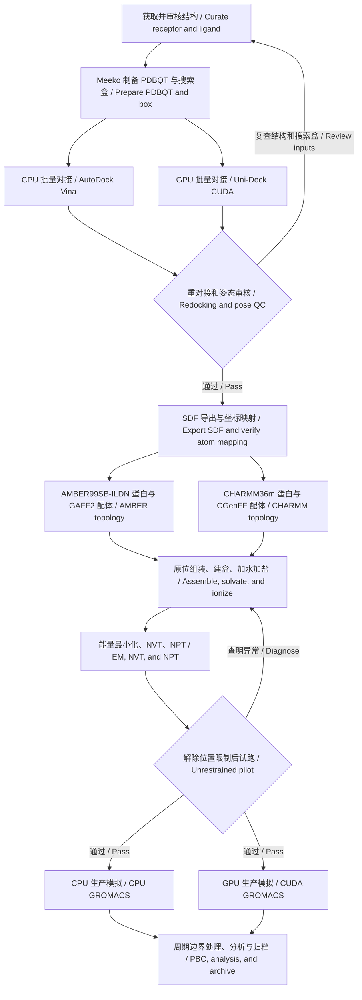
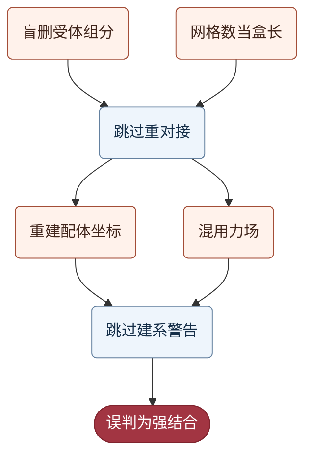
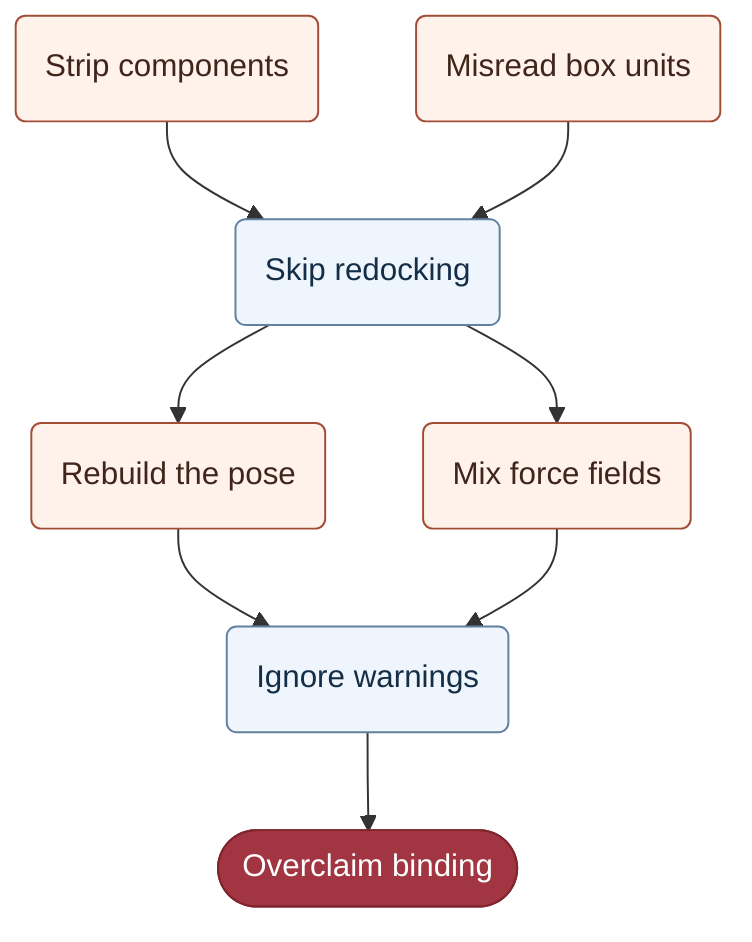
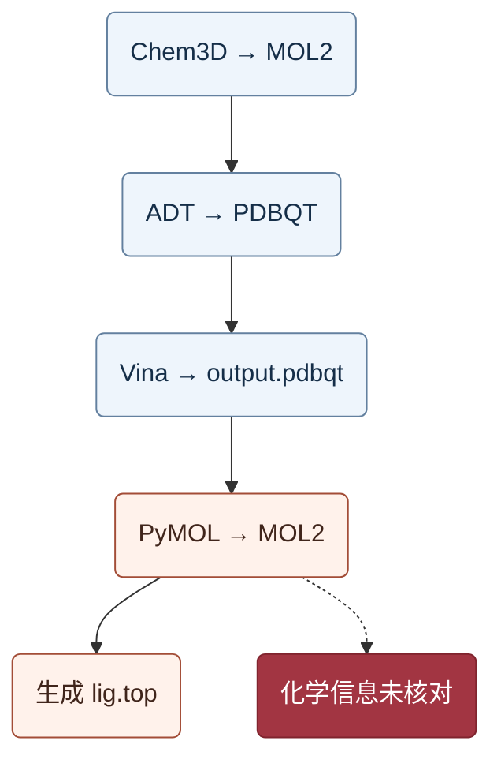
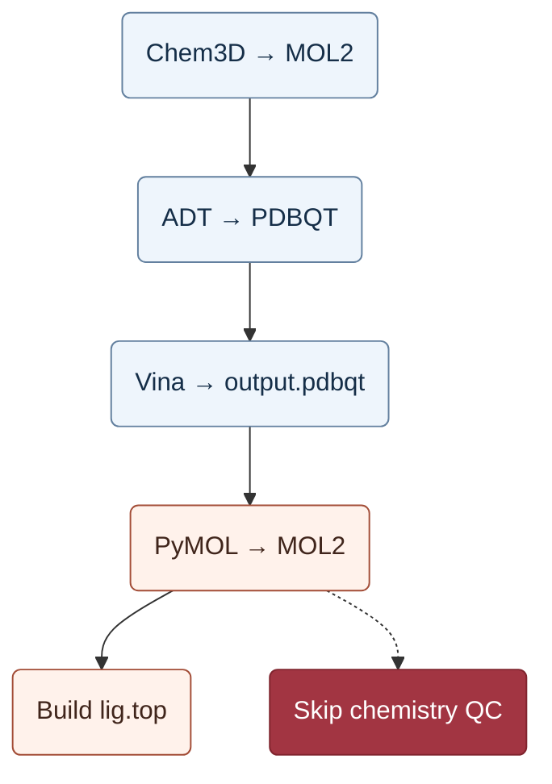

# CPU/GPU 批量分子对接与 GROMACS 分子动力学
**CPU/GPU Batch Molecular Docking and GROMACS Molecular Dynamics**

**中文 / English** · Linux 服务器 / Linux server · Windows + WSL2

用 Meeko 统一准备结构，再用 **AutoDock Vina（CPU）** 或 **Uni-Dock（NVIDIA CUDA）** 批量对接。审核通过的位姿可用 **AMBER99SB-ILDN + GAFF2/AM1-BCC** 或 **CHARMM36m + CGenFF** 建系，在 CPU 或 CUDA 版 GROMACS 中完成显式溶剂模拟。每一步都有输入、命令、输出及质量检查。

Prepare structures with Meeko, then choose **AutoDock Vina (CPU)** or **Uni-Dock (NVIDIA CUDA)** for batch docking. Set up reviewed poses with **AMBER99SB-ILDN + GAFF2/AM1-BCC** or **CHARMM36m + CGenFF** and simulate them in explicit solvent using CPU or CUDA GROMACS. Each step lists inputs, commands, outputs, and checks.

| 步骤 / Step | 阶段 / Stage |
| --- | --- |
| 导读 / Start here | [完整流程图 / Full workflow](#overview) · [网课错误流程图 / Tutorial error flowchart](#tutorial-error-flow) |
| 1–2 | [部署与公开示例 / Setup and public example](#setup) |
| 3–5 | [结构准备、批量对接、姿态导出 / Structure preparation, batch docking, and pose export](#docking) |
| 6–7 | [两套力场、参数化与复合物组装 / Force-field choices, parameterization, and assembly](#topology) |
| 8–10 | [参数、建系、平衡和生产 / Parameters, system setup, equilibration, and production](#simulation) |
| 11–12 | [轨迹分析、故障排查与复现 / Analysis, troubleshooting, and reproducibility](#analysis) |
| 13–14 | [官网、上游仓库、论文 / Official docs, upstream repositories, and papers](#sources) |

适用体系为水溶液中的常规可溶蛋白与**一个非共价结合、有明确化学结构的有机小分子**。膜环境、结合所需的金属或辅因子、非标准残基和共价配体需要针对体系另行建模。对接分数用于筛选候选，轨迹用于分析所选模型在给定条件下的行为。实验结合亲和力与药效需要独立证据。

The baseline covers a soluble protein and **one well-defined, noncovalently bound organic small molecule** in water. Membranes, essential metals or cofactors, nonstandard residues, and covalent ligands require system-specific modeling. Use docking scores to prioritize candidates and trajectories to study the chosen model under the specified conditions. Experimental affinity and activity require independent evidence.

<a name="overview"></a>

## 完整流程图 / Full workflow



对接引擎、MD 力场和 GROMACS 的计算设备可以独立选择。例如可以用 GPU 筛选、CHARMM 组装、CPU 试跑，再将同一套参数用于 GPU 长模拟。  
Choose the docking engine, MD force-field family, and GROMACS compute device independently. For example, screen on a GPU, assemble using CHARMM, run a CPU pilot, then use the same model for a longer GPU run.

## 网课常见误操作 / Common tutorial mistakes

下例用常见教学操作复现问题，供跟练时自查。  
These examples illustrate common operations learners can check while following a tutorial.

<a name="tutorial-error-flow"></a>

### 网课错误流程图 / Tutorial error flowchart

按箭头读一条常见的误操作路径。各步骤的后果、纠正方法，以及如何解读对接分数和 RMSD，见下表和轨迹分析章节。



<details>
<summary>English version</summary>

Follow the arrows through a common sequence of mistakes. See the table and trajectory analysis section for consequences, corrections, and how to interpret docking scores and RMSD.



</details>

| 常见做法 / Common shortcut | 会发生什么 / Consequence | 正确操作 / Fix |
| --- | --- | --- |
| 删除所有非蛋白原子 / Delete everything outside the protein | 可能丢失界定口袋的共晶配体、维持配位的金属或必要辅因子。 / This can remove the co-crystal reference ligand, a coordination metal, or an essential cofactor. | 先另存参考配体，记录各异质成分的保留与去除理由。需要金属或辅因子的体系专项建模。 / Save the reference ligand first and document each component decision. Model essential metals and cofactors explicitly. |
| 把 ADT 盒子的 60 个间隔写成 Vina 的 `size_x = 60` / Copy 60 ADT intervals into Vina as `size_x = 60` | 若间隔为 0.375 Å，实际示例边长为 22.5 Å，输入 60 会显著扩大搜索空间。 / At 0.375 Å per interval, the intended length is 22.5 Å. Entering 60 greatly enlarges the search space. | 转成 Å，再叠加受体和参考配体验证覆盖。 / Convert to Å and inspect coverage on the receptor and reference ligand. |
| 把已对接的 PDBQT 转 MOL2 时重建 3D，再接 MD / Regenerate 3D geometry while converting a docked PDBQT to MOL2 | 恢复的化学图可能错误，配体有可能移出口袋或改变位姿。 / The reconstructed graph can be wrong and the ligand may move or change pose. | Meeko 恢复原始 SDF 化学图，Open Babel 仅做格式转换并保留原位重原子坐标。 / Recover the SDF graph with Meeko, then convert the format while retaining the pose coordinates. |
| CUDA 能识别显卡，就给官方 `vina.exe` 加 GPU 参数 / Treat a working CUDA driver as GPU support in upstream `vina.exe` | 官方 Vina 的普通批处理仍由 CPU 执行。 / Standard upstream Vina batch docking still runs on the CPU. | 选择 Uni-Dock CUDA 或上游明确提供 GPU 后端的程序，并通过日志和设备监控确认。 / Choose Uni-Dock CUDA or an engine with a documented GPU backend and check both its log and device activity. |
| 将 GAFF2 配体直接 include 到 CHARMM36m 蛋白拓扑 / Include a GAFF2 ligand directly in a CHARMM36m topology | 非键合默认项、1–4 规则及参数体系可能冲突。 / Nonbonded defaults, 1–4 rules, and parameter conventions can conflict. | 使用 AMBER + GAFF2 或 CHARMM + CGenFF 的匹配路线。 / Use the matched AMBER + GAFF2 or CHARMM + CGenFF combination. |
| 遇到 grompp warning 直接抬高 `-maxwarn`，或把最低对接分数当作亲和力 / Raise `-maxwarn` after warnings or interpret the lowest docking score as affinity | 可能放行错序拓扑、未知参数或误读筛选结果。 / This can hide topology and parameter problems or overstate a screening result. | 检查展开拓扑、警告原文和重对接结果，用独立实验评价亲和力。 / Review the expanded topology, warning messages, and redocking, and use independent experiments to assess affinity. |

<a name="chem3d-pymol-topology"></a>

### 具体误操作：Chem3D → AutoDockTools → PyMOL → 配体拓扑

先在 Chem3D 优化小分子并导出 `ligand.mol2`，再用 AutoDockTools（ADT）制备 `ligand.pdbqt`。Vina 对接后获得 `output.pdbqt`。网课中的问题出现在下一步：把选中的对接位姿在 PyMOL 中直接另存为 MOL2，随后把它交给 ACPYPE 或其他参数化工具生成 `lig.top`、`lig.itp`。



**风险出在对接到 MD 的交接。** Chem3D 可以用于构象准备，MOL2 也可以作为参数化输入。PDBQT 保存对接坐标、原子类型和部分电荷，缺少用于可靠还原完整键级和形式电荷的信息。非极性氢也常在制备时合并。PyMOL 另存为 MOL2 时，即使重原子位置看起来一致，也需要对照原始配体检查键级、芳香性、质子化状态和净电荷。参数化完成只说明工具处理了该输入，化学状态仍需单独核对。MD 的部分电荷应按所选力场方案生成。

**可靠的交接方法。** 保留与对接输入同一化学状态的原始 SDF 或 MOL2。用 Meeko 制备配体时保留 `REMARK SMILES` 和 `REMARK SMILES IDX`，从所选对接位姿恢复 SDF，再逐原子核对重原子坐标、键级、手性和净电荷。确需 MOL2 时只转换格式，保留已核对的位姿，最后用所选的 AMBER 或 CHARMM 路线参数化。旧版 ADT 的输出若缺少 Meeko 映射，可用原始结构做可靠的原子映射。无法确认映射时，用 Meeko 重新制备并对接。

<details>
<summary>English version: Chem3D → ADT → PyMOL → ligand topology</summary>

The tutorial route optimizes the ligand in Chem3D, exports MOL2, and prepares PDBQT with AutoDockTools (ADT). Vina then writes `output.pdbqt`. The shortcut is to save the chosen pose directly as MOL2 in PyMOL and use it for `lig.top` or `lig.itp` without checking the chemistry.



Chem3D can prepare conformers, and MOL2 can be valid input for parameterization. PDBQT stores docking coordinates, atom types, and partial charges, with insufficient information to reliably restore all bond orders and formal charges. Nonpolar hydrogens are also commonly merged during preparation. Even when the heavy-atom position looks unchanged, verify bond orders, aromaticity, protonation, and net charge against the original ligand. Generate MD partial charges using the chosen force-field protocol.

Keep the original SDF or MOL2 for the same chemical state. With the Meeko SMILES and atom-mapping remarks, recover the selected pose as SDF and verify heavy-atom coordinates, bond orders, stereochemistry, and net charge. If MOL2 is needed, convert the format while preserving the pose before parameterization. For legacy ADT output, establish an unambiguous mapping to the original ligand. If the mapping cannot be verified, prepare the ligand with Meeko and dock again.

</details>

依据 / References · [Vina: Exporting results to SDF](https://autodock-vina.readthedocs.io/en/latest/docking_basic.html#exporting-results-to-sdf) · [Meeko: Exporting docking results](https://meeko.readthedocs.io/en/develop/export_usage.html) · [PyMOL: Save](https://pymolwiki.org/index.php/Save) · [ACPYPE: Ligand parameterization](https://acpype.readthedocs.io/en/latest/)

例如，一个来自 Meeko 对接任务的 PDBQT 应先恢复为 SDF，再取经核对的记录转 MOL2。以下在步骤 05 的目录运行，`1` 是核对过的记录号示例。  
For example, restore SDF chemistry before converting a selected Meeko docking record to MOL2. Run this in the step 05 directory. Replace record `1` with the verified record number.

```bash
mk_export.py selected_run.pdbqt -s docked_poses.sdf
obabel docked_poses.sdf -f 1 -l 1 -O lig_pose.sdf
obabel lig_pose.sdf -O lig_pose.mol2
```

上游依据 / Upstream references · [Vina box and pose export](https://autodock-vina.readthedocs.io/en/latest/docking_basic.html) · [GROMACS force fields](https://manual.gromacs.org/2026.3/user-guide/force-fields.html) · [grompp warnings and expanded topology](https://manual.gromacs.org/current/onlinehelp/gmx-grompp.html)

<a name="setup"></a>

## 01. 部署 / Install the tools

### Linux 服务器 / Linux server

从 [Miniforge 官方发布页](https://github.com/conda-forge/miniforge/releases) 选择与系统和架构匹配的安装包，并按发布页提供的信息校验。下文使用 Bash，默认在项目根目录操作，遇到报错时先检查该步。软件示例使用 Vina 1.2.7、Uni-Dock 1.2.0 和 GROMACS 2026.3 的命令语法。已安装 Miniforge 时直接创建环境。

Choose an installer for your operating system and architecture from the [Miniforge releases](https://github.com/conda-forge/miniforge/releases) and verify it against the release information. The instructions use Bash and assume the project root unless stated otherwise. Resolve errors before continuing. The command examples use Vina 1.2.7, Uni-Dock 1.2.0, and GROMACS 2026.3 syntax. If Miniforge is already installed, go straight to environment creation.

Linux x86-64 安装示例如下，其他架构请替换安装包名。 / Example for Linux x86-64. Use the installer for your architecture.

```bash
bash Miniforge3-Linux-x86_64.sh -b -p "$HOME/miniforge3"
source "$HOME/miniforge3/etc/profile.d/conda.sh"
```

```bash
conda create -n docktools --override-channels -c conda-forge python=3.11 vina=1.2.7 meeko rdkit gemmi openbabel
conda create -n ligandtools --override-channels -c conda-forge ambertools acpype openbabel
conda create -n gmx-cpu --override-channels -c conda-forge gromacs=2026.3

conda activate docktools
vina --version
mk_prepare_receptor.py --help
mk_prepare_ligand.py --help
mk_export.py --help

conda activate ligandtools
command -v antechamber parmchk2 tleap sqm acpype obabel
acpype -h

conda activate gmx-cpu
gmx --version
```

如需枚举配体的质子化与互变异构状态，在 `docktools` 环境安装 Molscrub，运行 `scrub.py --help` 和 `python -m pip check` 核对依赖。遇到平台或版本求解问题，按各项目安装文档选择兼容版本并记录。  
For ligand protonation and tautomer enumeration, install Molscrub in `docktools`; run `scrub.py --help` and `python -m pip check`. If the solver cannot resolve a build for your platform, consult the project installation instructions and record the compatible versions you select. [Molscrub installation](https://github.com/forlilab/molscrub) · [Vina releases](https://github.com/forlilab/AutoDock-Vina/releases) · [conda-forge GROMACS](https://anaconda.org/conda-forge/gromacs)

```bash
conda activate docktools
python -m pip install molscrub
python -m pip check
scrub.py --help
```

### NVIDIA CUDA 对接环境 / NVIDIA CUDA docking environment

在 Linux GPU 节点执行下面命令。Windows 用户先完成本节末尾的 WSL2 设置，再从 WSL Bash 执行同样命令。示例使用 conda-forge 的 Linux x86-64 Uni-Dock 1.2.0 包。先确认驱动能运行实际选用的 CUDA runtime。预编译包会安装所需的运行时依赖，`nvcc` 用于源码编译。  
Run these commands on a Linux GPU node. On Windows, complete the WSL2 setup below, then run the same commands in WSL Bash. The example uses the conda-forge Linux x86-64 package for Uni-Dock 1.2.0. Check that the driver supports the selected CUDA runtime. The prebuilt package installs runtime dependencies, while `nvcc` is used for source builds. [Uni-Dock release notes](https://github.com/dptech-corp/Uni-Dock/releases) · [conda-forge builds](https://anaconda.org/conda-forge/unidock/files) · [NVIDIA CUDA compatibility](https://docs.nvidia.com/deploy/cuda-compatibility/latest/minor-version-compatibility.html)

```bash
nvidia-smi
conda create -n dockgpu --override-channels -c conda-forge 'unidock=1.2.0'
conda activate dockgpu
command -v unidock
unidock --help
conda list --show-channel-urls unidock
```

`nvidia-smi` 标题中的 CUDA Version 表示驱动支持的 CUDA 版本，Toolkit 安装可另用 `nvcc --version` 核实。若解算或运行报 CUDA 兼容错误，请查看实际包的 CUDA 构建号和 GPU 节点驱动，选择两者兼容的版本。命令帮助可验证软件安装，步骤 02 的对接运行用于验证 GPU。  
The CUDA Version in the `nvidia-smi` header describes driver support. Check a local Toolkit separately with `nvcc --version`. If environment resolution or execution reports a CUDA compatibility error, compare the actual package build with the node driver and choose compatible versions. Use the help command to check the installation and the docking run in step 02 to verify GPU execution. [NVIDIA nvidia-smi documentation](https://docs.nvidia.com/deploy/nvidia-smi/)

### GROMACS CUDA 构建 / GROMACS CUDA build

在允许使用 GPU 的计算节点检查 `nvidia-smi`。如需自行编译，选择 GROMACS 安装手册支持的 CUDA Toolkit、C/C++ 编译器和 CMake。使用上游源码压缩包解压后的目录执行以下命令。已有集群软件模块时，可直接加载并核对版本及 GPU 后端。  
Check `nvidia-smi` on a GPU-enabled compute node. For a source build, use a CUDA Toolkit, compiler, and CMake supported by the GROMACS installation guide. Run the following commands from the extracted upstream source tree. If your cluster already provides a module, load it and verify its version and GPU backend. [GROMACS website](https://www.gromacs.org/) · [2026.3 build guide](https://manual.gromacs.org/2026.3/install-guide/index.html) · [GPU performance guide](https://manual.gromacs.org/documentation/current/user-guide/mdrun-performance.html)

```bash
nvidia-smi
nvcc --version
cmake --version
cmake -S . -B build-cuda -DGMX_GPU=CUDA -DGMX_BUILD_OWN_FFTW=ON \
  -DREGRESSIONTEST_DOWNLOAD=ON -DCMAKE_INSTALL_PREFIX="$HOME/opt/gromacs-2026.3-cuda"
cmake --build build-cuda --parallel 4
cmake --build build-cuda --target check
cmake --install build-cuda

source "$HOME/opt/gromacs-2026.3-cuda/bin/GMXRC"
gmx --version
```

切换到 MD 阶段时，选择一个 GROMACS 环境并用 `command -v gmx` 确认。集群上在调度器分配的计算节点运行，线程数以作业配额为准。  
When transitioning to MD, choose one GROMACS installation and confirm it with `command -v gmx`. Use a scheduler allocation on shared clusters and match thread counts to the allocation. [Slurm documentation](https://slurm.schedmd.com/documentation.html)

### Windows + WSL2

从 PowerShell 检查 WSL。若尚未安装，可执行第二个代码块并按提示重启。此后在 Ubuntu 的 WSL Bash 中执行 Linux 步骤，项目与轨迹存放在 Linux 文件系统，例如 `~/docking-md-workshop`。  
Check WSL from PowerShell. If it is missing, run the second block and restart if prompted. Run the Linux workflow from Ubuntu under WSL, and keep the project and trajectory files on the Linux filesystem, for example `~/docking-md-workshop`. [Microsoft WSL installation](https://learn.microsoft.com/windows/wsl/install) · [WSL filesystems](https://learn.microsoft.com/windows/wsl/filesystems)

```powershell
wsl --status
wsl -l -v
```

```powershell
wsl --install -d Ubuntu
```

在 **Windows 宿主机**安装支持 WSL 的 NVIDIA 驱动，并在 WSL Bash 运行 `nvidia-smi`。通过后可按上面的命令装 Uni-Dock CUDA，或选择 CPU 路线。需要源码编译时按 NVIDIA 指引安装 WSL Toolkit，选用不捆绑 Linux 显卡驱动的包。原生 Windows 版 Vina 1.2.7 可走步骤 04A，CUDA 对接走步骤 04B。  
Install the WSL-capable NVIDIA driver on the **Windows host** and check `nvidia-smi` from WSL Bash. Then install Uni-Dock CUDA as shown above or choose the CPU route. For a source build, follow NVIDIA's WSL instructions and select a Toolkit package without a bundled Linux display driver. Native Windows Vina 1.2.7 is covered in step 04A and CUDA docking in step 04B. [NVIDIA CUDA on WSL](https://docs.nvidia.com/cuda/wsl-user-guide/index.html) · [Vina batch syntax on Windows](https://autodock-vina.readthedocs.io/en/latest/docking_in_batch.html)

## 02. 用同一公开案例验收 CPU 和 GPU / Validate CPU and GPU on the same example

先用 Scripps 官方示例复跑 c-Abl 与伊马替尼（PDB **1IEP**）。从官方示例目录下载 `1iep_receptorH.pdb` 和 `1iep_ligand.sdf` 到一个新目录，在该目录运行以下命令。此处的盒坐标只适用于该示例坐标系。  
Start with the Scripps example of imatinib docked to c-Abl (PDB **1IEP**). Download `1iep_receptorH.pdb` and `1iep_ligand.sdf` from the upstream example into a fresh directory and run the commands there. The box coordinates apply specifically to the example's coordinate frame. [Official walkthrough](https://autodock-vina.readthedocs.io/en/latest/docking_basic.html) · [Upstream example files](https://github.com/forlilab/AutoDock-Vina/tree/develop/example/basic_docking) · [RCSB 1IEP](https://www.rcsb.org/structure/1IEP)

```bash
conda activate docktools
mk_prepare_receptor.py --read_pdb 1iep_receptorH.pdb -o 1iep_receptor -p -v \
  --box_size 20 20 20 --box_center 15.190 53.903 16.917
mk_prepare_ligand.py -i 1iep_ligand.sdf -o 1iep_ligand.pdbqt
```

**CPU：AutoDock Vina / CPU: AutoDock Vina**

```bash
vina --receptor 1iep_receptor.pdbqt --ligand 1iep_ligand.pdbqt \
  --config 1iep_receptor.box.txt --scoring vina --cpu 4 --seed 202601 \
  --exhaustiveness 32 --out 1iep_docked.pdbqt
mk_export.py 1iep_docked.pdbqt -s 1iep_docked.sdf
```

**GPU：Uni-Dock CUDA / GPU: Uni-Dock CUDA**

```bash
conda activate dockgpu
mkdir 1iep_gpu
unidock --receptor 1iep_receptor.pdbqt --gpu_batch 1iep_ligand.pdbqt \
  --config 1iep_receptor.box.txt --scoring vina --search_mode balance \
  --num_modes 20 --seed 202601 --dir 1iep_gpu > 1iep_gpu/unidock.log 2>&1
tail -25 1iep_gpu/unidock.log
find 1iep_gpu -maxdepth 1 -type f -name '*.pdbqt' -print
```

用步骤 05 的检查和导出方式处理 GPU 输出。对接命令成功退出后，用位姿文件、日志和 GPU 观测共同核对。  
Use the checks and export procedure in step 05 for the GPU output. After a successful exit, verify the pose file, run log, and GPU activity.

**验收 / Check.** 确认 PDBQT 有 Vina 分数和姿态，SDF 可以读取。分别用公开参考结果检查 CPU 和 GPU 的位姿与关键接触。正式做共晶重对接时，先把参考与对接结构置于同一受体坐标系，比较带对称校正的重原子 RMSD，保持配体在各自原位。约 2 Å 是常用参考值。可另用 BioExcel 的公开案例练习 MD 复合物建系。  
Confirm that the PDBQT contains scores and poses and that the SDF opens. Compare the CPU and GPU poses and key contacts separately with the upstream example. For quantitative redocking, use a shared receptor frame and calculate symmetry-corrected ligand heavy-atom RMSD with the poses kept in place. About 2 Å is a common reference. For a separate MD setup example, use the public BioExcel protein–ligand tutorial. [Scripps expected results](https://autodock-vina.readthedocs.io/en/latest/docking_basic.html#expected-results) · [BioExcel complex setup](https://github.com/bioexcel/biobb_wf_protein-complex_md_setup)

<a name="docking"></a>

## 03. 准备自己的结构 / Prepare your own receptor and ligands

```bash
mkdir -p "$HOME/docking-md-workshop"
cd "$HOME/docking-md-workshop"
mkdir -p input ligands/pdbqt dock qc md
```

| 输入 / Input | 准备要求 / Preparation |
| --- | --- |
| `input/protein.pdb` | 准备供 MD 使用的蛋白，确认生物学装配、链、替代构象、缺失残基和重原子、二硫键、端基以及 His 状态。保留原始结构、PDB ID 和取舍依据。 / Prepare the protein for MD. Review the biological assembly, chains, alternate conformations, missing residues and heavy atoms, disulfides, termini, and histidine states. Retain the original structure, PDB ID and curation rationale. |
| `input/receptorH.pdb` | 使用同一受体坐标系和已审查的质子化假设，提供适合 Meeko 的受体。逐个审查水、离子和辅因子对口袋的作用。 / Provide a Meeko-compatible receptor in the same coordinate frame using reviewed protonation assumptions. Evaluate each water, ion, or cofactor for its role in the pocket. |
| `input/ligand_raw.sdf` | 获取有明确键级、手性和身份的小分子记录。记录 CID 或其他来源、pH 假设和每个候选的整数净电荷。 / Obtain a molecule record with defined bond orders, stereochemistry, and identity. Record the CID or other source, pH assumption, and integer net charge of each candidate. |
| `dock/box.txt` | 根据共晶配体或其他口袋证据确定搜索盒，目视确认它覆盖预期区域。中心和三个边长均以 Å 计。每个受体或不同口袋应保留自己的配置。 / Define and visually check the search box using the co-crystal ligand or other pocket evidence. Use Å for the center coordinates and all three edge lengths. Keep a separate configuration for each receptor or pocket. |

来源与命令参考 / Structure databases and setup docs · [RCSB PDB](https://www.rcsb.org/) · [PubChem](https://pubchem.ncbi.nlm.nih.gov/) · [Meeko receptor options](https://meeko.readthedocs.io/en/develop/rec_cli_options.html) · [Molscrub CLI](https://molscrub.readthedocs.io/en/latest/cli.html)

下例从 Molscrub 输出中选第 1 条作为候选。按实际审核结果替换记录号。若已有确认过的带显式氢、单记录 3D SDF，可直接将其保存为 `ligands/state001.sdf`。为不同化学状态使用独立 ID。  
The example extracts record 1 from a Molscrub output. Use the record number established during review. If an approved single-record 3D SDF already includes explicit hydrogens, save it directly as `ligands/state001.sdf`. Assign a distinct ID to each chemical state.

```bash
conda activate docktools
scrub.py input/ligand_raw.sdf -o ligands/candidates.sdf --ph 7.4
obabel ligands/candidates.sdf -ocan
obabel ligands/candidates.sdf -f 1 -l 1 -O ligands/state001.sdf

mk_prepare_receptor.py --read_pdb input/receptorH.pdb -o dock/receptor -p
mk_prepare_ligand.py -i ligands/state001.sdf -o ligands/pdbqt/state001.pdbqt
sha256sum input/* > qc/input_sha256.txt
```

将下列六项保存为 `dock/box.txt`，把示例值替换为自己测定的中心与尺寸。旧 AutoGrid 参数中的网格间隔数乘间距才得到 Å。对于无已知口袋的结构，可另建探索性搜索盒并检查采样收敛和口袋证据。  
Save the six fields to `dock/box.txt` and replace the example numbers with measured coordinates and dimensions. Convert legacy AutoGrid interval counts to Å by multiplying by grid spacing. For structures without a known site, use a separate exploratory box and evaluate sampling and pocket evidence.

```ini
center_x = 15.190
center_y = 53.903
center_z = 16.917
size_x = 20.0
size_y = 20.0
size_z = 20.0
```

**验收 / Check.** 核对 SDF 记录、显式氢、手性、键级和净电荷。配体 PDBQT 应保留 Meeko 写入的化学映射信息。受体文件、参考配体和搜索盒应在同一坐标系中。  
Confirm the SDF record count, explicit hydrogens, stereochemistry, bond orders, and net charge. The ligand PDBQT should retain Meeko's chemical mapping metadata. Verify that the receptor, reference ligand, and box share the same coordinate frame. [Meeko documentation](https://meeko.readthedocs.io/) · [Open Babel CLI](https://openbabel.org/docs/Command-line_tools/babel.html)

## 04. CPU 与 GPU 批量对接 / Batch docking on CPU and GPU

两条路线共用步骤 03 的受体 PDBQT、配体 PDBQT 和搜索盒。为每个筛选条件保留独立目录。可逐个调用 Meeko 生成配体 PDBQT，或用 `--multimol_outdir` 处理已审核的多记录 SDF。保留候选 ID 与原始 SDF 的对应表，并检查重名和漏项。  
Both routes use the receptor PDBQT, ligand PDBQT files, and search box from step 03. Give each screening run a separate output directory. Prepare ligands individually or use Meeko's `--multimol_outdir` for a reviewed multi-record SDF. Keep a manifest linking ligand IDs to original SDF records, and check for duplicates and missing files. [Meeko ligand CLI](https://meeko.readthedocs.io/en/develop/lig_cli_options.html)

### A. CPU · AutoDock Vina

先跑一个已审核配体，核对日志和位姿后再开始批量筛选。  
Run one reviewed ligand first and inspect its log and poses before launching the batch.

```bash
conda activate docktools
mkdir dock/cpu_single_202601
vina --receptor dock/receptor.pdbqt --ligand ligands/pdbqt/state001.pdbqt \
  --config dock/box.txt --scoring vina --cpu 4 --exhaustiveness 32 \
  --num_modes 20 --seed 202601 --out dock/cpu_single_202601/state001_out.pdbqt \
  > dock/cpu_single_202601/vina.log 2>&1
tail -20 dock/cpu_single_202601/vina.log
grep -E '^MODEL|^REMARK VINA RESULT' dock/cpu_single_202601/state001_out.pdbqt
```

```bash
mkdir dock/cpu_batch_202601
time vina --receptor dock/receptor.pdbqt --batch ligands/pdbqt/*.pdbqt \
  --config dock/box.txt --scoring vina --cpu 4 --exhaustiveness 32 \
  --num_modes 20 --seed 202601 --dir dock/cpu_batch_202601 \
  > dock/cpu_batch_202601/vina.log 2>&1
find ligands/pdbqt -maxdepth 1 -type f -name '*.pdbqt' | wc -l
find dock/cpu_batch_202601 -maxdepth 1 -type f -name '*.pdbqt' | wc -l
```

`--batch` 针对同一受体逐个处理配体，`--cpu 4` 控制一次 Vina 进程的线程数。拆分大库后可在 CPU 配额内并行运行多个独立批次。多个受体分别使用各自的搜索盒。  
`--batch` processes ligands sequentially against one receptor. `--cpu 4` sets the thread count for a Vina process. Split large libraries into separate jobs to parallelize within your CPU allocation. Use a separately defined box for each receptor. [Vina native batch mode](https://autodock-vina.readthedocs.io/en/latest/docking_in_batch.html)

如果选用原生 Windows CPU 版，在项目根目录用 PowerShell 执行。以下示例假定把官方可执行文件命名为 `vina.exe` 并放在当前目录。  
For native Windows CPU docking, run this example in PowerShell from the project root. It assumes that the upstream executable has been named `vina.exe` and placed in the current directory. [Official Windows batch instructions](https://autodock-vina.readthedocs.io/en/latest/docking_in_batch.html)

```powershell
$Ligands = @(Get-ChildItem '.\ligands\pdbqt' -Filter '*.pdbqt' -File |
    Sort-Object Name | Select-Object -ExpandProperty FullName)
if ($Ligands.Count -eq 0) { throw 'No ligand PDBQT files found' }
New-Item -ItemType Directory -Path '.\dock\cpu_batch_win_202601'
& .\vina.exe --receptor .\dock\receptor.pdbqt --batch $Ligands --config .\dock\box.txt `
    --scoring vina --cpu 4 --exhaustiveness 32 --num_modes 20 --seed 202601 `
    --dir .\dock\cpu_batch_win_202601 > .\dock\cpu_batch_win_202601\vina.log 2>&1
if ($LASTEXITCODE -ne 0) { throw 'See the Vina log' }
```

### B. NVIDIA GPU · Uni-Dock CUDA

在 Linux 或 WSL2 的项目根目录执行。首次用 `--gpu_batch` 测一个配体。独立终端运行 `nvidia-smi -l 1` 可观察稍长测试的 GPU 使用情况。  
Run from the project root in Linux or WSL2. Start with one ligand using `--gpu_batch`. For a longer test, observe GPU activity with `nvidia-smi -l 1` in a second terminal. [Uni-Dock CLI](https://github.com/dptech-corp/Uni-Dock/tree/main/unidock)

```bash
conda activate dockgpu
mkdir dock/gpu_single_202601
unidock --receptor dock/receptor.pdbqt --gpu_batch ligands/pdbqt/state001.pdbqt \
  --config dock/box.txt --scoring vina --search_mode balance \
  --num_modes 20 --seed 202601 --dir dock/gpu_single_202601 \
  > dock/gpu_single_202601/unidock.log 2>&1
tail -25 dock/gpu_single_202601/unidock.log
find dock/gpu_single_202601 -maxdepth 1 -type f -name '*.pdbqt' -print
```

批量任务用 `--ligand_index` 读取清单。以下清单每行一个相对路径，使用无空格且唯一的配体文件名。首轮用几十个代表性配体检查资源和输出。若用约 4 GB 显存的 RTX 4060 Laptop，可先取 32 个配体测一批，按实际显存与耗时调整。  
Batch runs use `--ligand_index` with a manifest. The example uses one relative path per line and unique ligand filenames without spaces. Test a few dozen representative compounds first. On an RTX 4060 Laptop with around 4 GB of VRAM, 32 ligands are a practical starting batch to measure, with the size adjusted according to memory use and runtime.

```bash
mkdir dock/gpu_batch_202601
find ligands/pdbqt -maxdepth 1 -type f -name '*.pdbqt' | LC_ALL=C sort \
  > dock/gpu_batch_202601/ligands.txt
test -s dock/gpu_batch_202601/ligands.txt
```

确认清单非空后运行。显存不足时用 `split -l 32 dock/gpu_batch_202601/ligands.txt dock/gpu_chunk_` 拆分清单。每次更换清单路径、日志和输出目录。  
Run after confirming the manifest is nonempty. If VRAM is limited, split it with `split -l 32 dock/gpu_batch_202601/ligands.txt dock/gpu_chunk_`. Give every run its own manifest path, log, and output directory.

```bash
time unidock --receptor dock/receptor.pdbqt \
  --ligand_index dock/gpu_batch_202601/ligands.txt \
  --config dock/box.txt --scoring vina --search_mode balance \
  --num_modes 20 --seed 202601 --dir dock/gpu_batch_202601 \
  > dock/gpu_batch_202601/unidock.log 2>&1
wc -l dock/gpu_batch_202601/ligands.txt
find dock/gpu_batch_202601 -maxdepth 1 -type f -name '*.pdbqt' | wc -l
tail -25 dock/gpu_batch_202601/unidock.log
```

`fast`、`balance`、`detail` 调整 Uni-Dock 的搜索力度。复筛可换种子或提高搜索力度，并使用新的输出目录。每个文件需有有效姿态和评分记录。按候选 ID 对照清单与输出，查日志中的 CUDA 或解析错误，单独记录未完成项。  
`fast`, `balance`, and `detail` control Uni-Dock's search effort. For follow-up docking, change the seed or search effort and use a new output directory. Verify that files contain poses and scores. Reconcile outputs against manifest IDs, inspect logs for CUDA or parsing errors, and record incomplete jobs. [Uni-Dock modes and batch manifest](https://github.com/dptech-corp/Uni-Dock/blob/main/unidock/README.md)

### 两条路线怎么比较 / How to compare both routes

用相同输入、口袋和配体清单，记录引擎版本、评分函数、搜索参数、种子、CPU 线程或 GPU 型号、实耗时、成功配体数和峰值显存。用成功配体数除以墙钟时间计算吞吐。分别检查已知配体的重对接位姿、关键接触、候选排名和重复种子一致性。CPU 与 CUDA 引擎各自的搜索策略和参数定义有差异，原始分数保留在各自结果表中。  
Use the same inputs, pocket, and ligand manifest. Record engine versions, scoring functions, search settings, seeds, CPU threads or GPU model, wall time, completed ligand counts, and peak VRAM. Compute throughput as completed ligands per wall-clock time. Check native-pose recovery, key contacts, candidate rankings, and seed repeatability for each engine. Search strategies and parameter definitions differ between the CPU and CUDA engines, so retain the raw scores in their respective result tables.

**其他 GPU 实现 / Other GPU engines.** Vina-GPU 2.1 可在上游支持的 Windows 或 Linux 环境使用 OpenCL，仓库提供自带示例，批量输入输出选项为 `--ligand_directory` 与 `--output_directory`。NVIDIA 环境的构建说明会用到 CUDA Toolkit 路径，其搜索内核用 OpenCL 执行。Scripps 的 AutoDock-GPU 支持 CUDA/OpenCL，使用 AutoDock4 路线和相应的亲和力图。  
Vina-GPU 2.1 provides OpenCL docking on the upstream-supported Windows or Linux setups. Its repository includes a sample and documents `--ligand_directory` and `--output_directory` for batch runs. Its NVIDIA build instructions reference CUDA Toolkit paths, while its search kernels use OpenCL. Scripps AutoDock-GPU supports CUDA/OpenCL and uses the AutoDock4 protocol with affinity maps. [Vina-GPU 2.1](https://github.com/DeltaGroupNJUPT/Vina-GPU-2.1) · [Scripps AutoDock-GPU](https://github.com/forlilab/AutoDock-GPU)

## 05. 恢复姿态与化学结构 / Recover the selected pose and chemistry

保留原始 SDF 和所选运行的输出。每套力场、姿态和独立重复各用一个目录。以下示例选 AMBER + CPU 位姿。如选择 CHARMM，把 `ff_family=amber` 改为 `ff_family=charmm`。使用 GPU 位姿时，从步骤 04B 输出目录查找该配体的 PDBQT，把 `pose_file` 改成查到的实际路径。  
Keep the source SDF and the selected run's output. Use separate directories for each force field, pose, and replicate. This example selects AMBER and the CPU pose. Set `ff_family=charmm` for CHARMM. To use a GPU pose, find its PDBQT in step 04B's output directory and set `pose_file` to that path.

```bash
conda activate docktools
ff_family=amber
pose_file=dock/cpu_single_202601/state001_out.pdbqt
run_dir="md/${ff_family}_state001_pose01_rep01"

test -s "$pose_file" &&
  mkdir "$run_dir" &&
  cp input/protein.pdb "$run_dir/protein.pdb" &&
  cp ligands/state001.sdf "$run_dir/state_original.sdf" &&
  cp "$pose_file" "$run_dir/selected_run.pdbqt" &&
  cd "$run_dir"

grep -m 1 '^REMARK SMILES ' selected_run.pdbqt
grep -m 1 '^REMARK SMILES IDX ' selected_run.pdbqt
```

Meeko 映射检查通过后再导出。若输出缺少映射，保留原始结果并回到制备和对接阶段核查引擎输出。若使用官方 Vina 重新生成候选姿态，记录为新的 CPU 位姿，再按其自身证据选入 MD。  
Export after the Meeko mapping checks pass. If the output lacks mapping metadata, retain it and revisit preparation and docking to inspect the engine output. If you regenerate a candidate with upstream Vina, record it as a new CPU pose and assess it on its own evidence before MD.

```bash
mk_export.py selected_run.pdbqt -s docked_poses.sdf
grep -E '^MODEL|^REMARK VINA RESULT' selected_run.pdbqt
obabel docked_poses.sdf -ocan
```

**GPU 备选交接：直接输出 SDF / GPU alternative: direct SDF output.** 如果某个 Uni-Dock PDBQT 文件缺少 Meeko 化学映射，可用 Uni-Dock Tools 从原 SDF 准备 GPU 输入，然后以同一个受体和盒重新对接，取得有化学图的 SDF。将它记为一个新的 GPU 对接任务。在步骤 05 的重复目录中开始，下面第一条命令会返回项目根目录。保留上面的 `run_dir` 变量。  
If a Uni-Dock PDBQT output lacks Meeko metadata, use Uni-Dock Tools to prepare GPU input from the original SDF and redock against the same receptor and box to produce SDF poses with a molecular graph. Record this as a new GPU docking job. Start from the step 05 replicate directory. The first command returns to the project root. Keep the `run_dir` variable set above. [Uni-Dock Tools instructions](https://github.com/dptech-corp/Uni-Dock/blob/main/unidock_tools/README.md)

```bash
cd ../..
conda install -n dockgpu --override-channels -c conda-forge python=3.11 pip
conda activate dockgpu
python -m pip install 'git+https://github.com/dptech-corp/Uni-Dock.git@1.2.0#subdirectory=unidock_tools'
mkdir -p dock/gpu_sdfprep_202601 dock/gpu_sdf_202601
unidocktools ligandprep -l ligands/state001.sdf -sd dock/gpu_sdfprep_202601
find dock/gpu_sdfprep_202601 -maxdepth 1 -type f -name '*.sdf' -print
```

确认输出是所选的单一化学状态，再运行下面命令。检查输出只有一个配体的 SDF 文件（其内可以有多个位姿），再复制到当前重复目录。  
Verify that the prepared output contains the chosen chemical state before running the next commands. Confirm there is one ligand output file, which may contain multiple poses, before copying it into the replicate directory.

```bash
unidock --receptor dock/receptor.pdbqt --gpu_batch dock/gpu_sdfprep_202601/*.sdf \
  --config dock/box.txt --scoring vina --search_mode balance --keep_nonpolar_H \
  --num_modes 20 --seed 202601 --dir dock/gpu_sdf_202601 \
  > dock/gpu_sdf_202601/unidock.log 2>&1
find dock/gpu_sdf_202601 -maxdepth 1 -type f -name '*_out.sdf' -print
```

```bash
cp dock/gpu_sdf_202601/*_out.sdf "$run_dir/docked_poses.sdf"
cd "$run_dir"
conda activate docktools
obabel docked_poses.sdf -ocan
```

核对 SDF 记录、位姿来源和评分后再提取。使用 PDBQT 转出的 SDF 时，核对 SDF 记录与 PDBQT MODEL 的对应关系。下面以第 1 条为示例。  
Check the SDF record, pose provenance, and score before extraction. If the SDF was converted from PDBQT, check its correspondence with the PDBQT MODEL. This example uses record 1.

```bash
obabel docked_poses.sdf -f 1 -l 1 -O lig_pose.sdf
obabel state_original.sdf -ocan
obabel lig_pose.sdf -ocan
```

**验收 / Check.** PDBQT 路线用 Meeko 原始映射恢复键级与化学身份。直接 SDF 路线对照原始 SDF 核对分子图。用 SMILES 初筛并复核手性、净电荷和分子图，再逐原子比对重原子坐标。叠加时保留绝对坐标，并保留原始对接几何。缺少映射时从原始 SDF 重新准备 Meeko 输入并对接。  
Use Meeko's original mapping to recover bond orders and identity on the PDBQT route. For direct SDF output, compare the molecular graph with the input SDF. Screen with canonical SMILES, verify stereochemistry, net charge, and connectivity, and then compare mapped heavy-atom coordinates. Overlay structures in their original absolute coordinates to preserve the docked geometry. If mapping metadata is missing, prepare Meeko input again from the original SDF and rerun docking. [Meeko export in the Vina tutorial](https://autodock-vina.readthedocs.io/en/latest/docking_basic.html#exporting-results-to-sdf)

<a name="topology"></a>

## 06. 选择力场并参数化配体 / Choose force fields and parameterize the ligand

| 路线 / Route | 蛋白力场 / Protein force field | 小分子力场与电荷 / Ligand force field and charges | 水和非键合参数 / Water and nonbonded settings |
| --- | --- | --- | --- |
| A · AMBER | AMBER99SB-ILDN | GAFF2，AM1-BCC，经 AmberTools / ACPYPE / GAFF2 and AM1-BCC via AmberTools and ACPYPE | AMBER 端口的 TIP3P 与匹配离子，PME，示例 1.0 nm 截断 / TIP3P and ions from the AMBER port, PME, example 1.0 nm cutoff |
| B · CHARMM | MacKerell Lab GROMACS 端口的 CHARMM36m / CHARMM36m in the MacKerell Lab GROMACS port | 版本匹配的 CGenFF 类型、电荷和键合参数 / Version-matched CGenFF types, charges, and bonded parameters | CHARMM TIP3P 与匹配离子，PME，普通截断端口用 1.0–1.2 nm 的 LJ 力切换 / CHARMM TIP3P and matching ions, PME, LJ force switch over 1.0–1.2 nm for the cutoff port |

常规可溶蛋白和结构明确的有机配体可采用 A。实验室已有 CHARMM 体系、需与既有 CHARMM 模型对照，或采用 CHARMM36m 的理由明确且可获得质量合格的配体参数时，可用 B。两套力场比较时固定化学状态和起始位姿，各自使用匹配的水、离子和非键合参数，并独立平衡。  
Route A is suitable for the standard soluble protein and well-defined organic ligand covered here. Choose B when matching an existing CHARMM protocol or when CHARMM36m is justified and suitable ligand parameters are available. To compare force fields, start from the same chemical state and pose, use the matching water, ions, and nonbonded settings for each, and equilibrate each system independently. [Amber manuals](https://ambermd.org/Manuals.php) · [GROMACS force-field notes](https://manual.gromacs.org/2026.3/user-guide/force-fields.html) · [MacKerell force-field ports](https://mackerell.umaryland.edu/charmm_ff.shtml)

### 路线 A · GAFF2 + AM1-BCC 配体 / Route A · GAFF2 + AM1-BCC ligand

Open Babel 在这里仅做格式转换，保持已有 3D 几何。示例的 `-n 0` 适用于已确认的中性配体。根据配体实际整数净电荷改为 `-n -1`、`-n 1` 等。  
Use Open Babel for format conversion while preserving the existing 3D geometry. The example's `-n 0` assumes a verified neutral ligand. Set `-n -1`, `-n 1`, or another integer according to the selected chemical state's net charge. [AmberTools](https://ambermd.org/AmberTools.php) · [ACPYPE quick start](https://acpype.readthedocs.io/en/latest/)

```bash
conda activate ligandtools
obabel lig_pose.sdf -O lig_pose.mol2
acpype -i lig_pose.mol2 -b LIG -a gaff2 -c bcc -n 0

ls -lh LIG.acpype
cp LIG.acpype/LIG_GMX.gro ligand.gro
cp LIG.acpype/LIG_GMX.itp ligand.itp
```

输出名以实际 ACPYPE 版本生成的文件为准。查阅 Antechamber、SQM、parmchk2 日志，审核原子类型和关键参数。在 `[ atoms ]` 中核对部分电荷之和、原子顺序、名称和质量，并按映射比较 `ligand.gro` 与对接 SDF 的重原子坐标。SDF 通常用 Å，GRO 用 nm，且写出精度不同。坐标不符或映射不清时暂停建系。  
Use the actual ACPYPE output names for your version. Review the Antechamber, SQM, and parmchk2 logs, atom types, and key parameters. Check the partial-charge sum, atom ordering, names, and masses in `[ atoms ]`. Compare mapped heavy-atom coordinates between `ligand.gro` and the pose SDF. SDF usually uses Å and GRO uses nm, with different output precision. Resolve coordinate or mapping discrepancies before system assembly.

### 路线 B · CGenFF 配体 / Route B · CGenFF ligand

1. 在当前 CHARMM 重复目录准备单个配体的 MOL2，保留明确的键级、手性、净电荷、显式氢和对接重原子位置。对照原 SDF 检查转换结果。  
   In the CHARMM replicate directory, prepare a single-ligand MOL2 with the reviewed bond orders, stereochemistry, net charge, explicit hydrogens, and docked heavy-atom coordinates. Compare it with the source SDF.

```bash
conda activate docktools
obabel lig_pose.sdf -O lig_pose.mol2 --title LIG
obabel lig_pose.sdf -ocan
obabel lig_pose.mol2 -ocan
```

2. 向 [CGenFF 官方服务](https://cgenff.silcsbio.com/) 提交该 MOL2，保存包含配体拓扑和附加参数的 CHARMM stream 文件为 `lig_pose.str`。记录 CGenFF 参数**版本**、`RESI` 名称、整数电荷与罚分。下例的 `LIG` 以 `RESI` 行的实际名称为准。高罚分提示类比参数需要复核，SilcsBio 指南中通常建议对大于 50 的条目进一步优化。  
   Submit the MOL2 to the [CGenFF service](https://cgenff.silcsbio.com/) and save the CHARMM stream containing the ligand topology and additional parameters as `lig_pose.str`. Record the **CGenFF parameter version**, `RESI` name, integer charge, and penalties. Replace `LIG` in the example with the actual `RESI` name. High penalties flag analogies for review. The SilcsBio guide typically recommends further optimization for values above 50. [CGenFF stream format and penalties](https://docs.silcsbio.com/2026/cgenff/usage.html)

```bash
grep -iE 'cgenff version|force field|^[[:space:]]*RESI[[:space:]]|penalty' lig_pose.str | head -30
```

3. 从 MacKerell 实验室获取与 stream **版本匹配**的 GROMACS 移植包。这里举例选择 2026 年 2 月、CGenFF 5.0 的普通截断版本，下面的力场目录名使用同一个版本。如果 stream 来自 CGenFF 4.6，则按官网下载对应 4.6 包并在后续命令统一替换目录名。  
   Download the GROMACS port that matches the stream **parameter version** from the MacKerell lab. This example uses the February 2026 cutoff port with CGenFF 5.0. Keep the same directory name throughout the workflow. For a CGenFF 4.6 stream, download the matching 4.6 port and update the commands to use that directory. [MacKerell lab force-field downloads](https://mackerell.umaryland.edu/charmm_ff.shtml)

```bash
curl --fail --location \
  'https://mackerell.umaryland.edu/download.php?filename=CHARMM_ff_params_files%2Fcharmm36-feb2026_cgenff-5.0.ff.tgz' \
  -o charmm36-feb2026_cgenff-5.0.ff.tgz
tar -tzf charmm36-feb2026_cgenff-5.0.ff.tgz | head -20
tar -xzf charmm36-feb2026_cgenff-5.0.ff.tgz
test -f charmm36-feb2026_cgenff-5.0.ff/forcefield.itp
sha256sum charmm36-feb2026_cgenff-5.0.ff.tgz
```

4. 安装 Lemkul Lab 转换工具，首次装一次。保存工具提交号及所用力场压缩包的哈希。下面调用实验室提供的转换工具。  
   Install the Lemkul Lab converter once. Record its commit and the force-field archive hash. The commands call the lab's upstream converter. [Lemkul Lab converter](https://github.com/Lemkul-Lab/cgenff_charmm2gmx)

```bash
conda create -n cgenff-tools --override-channels -c conda-forge python=3.13 networkx numpy
mkdir -p "$HOME/tools"
git clone https://github.com/Lemkul-Lab/cgenff_charmm2gmx.git "$HOME/tools/cgenff_charmm2gmx"
git -C "$HOME/tools/cgenff_charmm2gmx" rev-parse HEAD > cgenff_converter_commit.txt
conda activate cgenff-tools
python "$HOME/tools/cgenff_charmm2gmx/cgenff_charmm2gmx.py" \
  LIG lig_pose.mol2 lig_pose.str charmm36-feb2026_cgenff-5.0.ff
ls -lh lig.itp lig.prm lig_ini.pdb
```

5. 用任一 GROMACS 构建把配体坐标转为 GRO，并核查 `lig.itp` 的原子顺序、电荷和配体质量。使用转换器生成的 `lig.prm` 保存全局参数。核对 `lig_ini.pdb` 和 `ligand.gro` 的原位坐标。转换器生成的单配体 TOP 可用于审查，其 `[ defaults ]`、`[ system ]` 和 `[ molecules ]` 由最终系统 TOP 统一管理。  
   Use either GROMACS build to convert the ligand coordinates to GRO, then check atom order, charges, and masses in `lig.itp`. Keep `lig.prm` as the global parameter include. Check the original coordinates in `lig_ini.pdb` and `ligand.gro`. The converter's standalone TOP is useful for review. The final system TOP owns `[ defaults ]`, `[ system ]`, and `[ molecules ]`.

```bash
conda activate gmx-cpu
gmx editconf -f lig_ini.pdb -o ligand.gro
cp lig.itp ligand.itp
head -n 2 ligand.gro
```

**两条路线的配体检查 / Ligand checks for both routes.** 将 `[ atoms ]` 的部分电荷求和，与已确认的整数净电荷比较。对照原始坐标与参数输出，确认重原子映射、Å 到 nm 的单位转换，以及 GRO 行与拓扑顺序。若参数化软件增加了虚拟粒子，核对其拓扑定义与坐标顺序。  
Sum the partial charges in `[ atoms ]` and compare with the confirmed integer net charge. Check the heavy-atom mapping, Å-to-nm conversion, and ordering between GRO rows and topology. If parameterization adds virtual sites, review their definitions and coordinate ordering.

```bash
awk '/^[[:space:]]*\[[[:space:]]*atoms[[:space:]]*\]/{in_atoms=1;next}
     /^[[:space:]]*\[/{in_atoms=0}
     in_atoms && $1 ~ /^[0-9]+$/ {total+=$7; atoms++}
     END{if (!atoms) exit 1; printf "Atoms: %d; charge sum: %.6f\n", atoms,total}' ligand.itp
```

## 07. 蛋白拓扑、位置限制与原位组装 / Assemble the protein–ligand system

在某一力场的重复目录中准备蛋白拓扑。按计划启用一个 GROMACS 构建。CHARMM 预处理和 AMBER 预处理均可使用 CPU 或 CUDA 构建提供的同一套命令。  
Prepare the protein topology in the selected force-field replicate directory. Activate either GROMACS build. The preprocessing commands for both force-field families are available in the CPU and CUDA builds.

**CPU 版 / CPU build**

```bash
conda activate gmx-cpu
gmx --version
```

**CUDA 版 / CUDA build**

```bash
source "$HOME/opt/gromacs-2026.3-cuda/bin/GMXRC"
gmx --version
```

**路线 A / Route A**

```bash
gmx pdb2gmx -f protein.pdb -o protein.gro -p topol.top -i posre.itp \
  -ff amber99sb-ildn -water tip3p -ignh
cp topol.top topol_protein.top
```

**路线 B / Route B**

```bash
gmx pdb2gmx -f protein.pdb -o protein.gro -p topol.top -i posre.itp \
  -ff charmm36-feb2026_cgenff-5.0 -water tip3p -ignh
cp topol.top topol_protein.top
```

两条路线均应核对末端、His、二硫键、链连接和 TIP3P 实际 include。需要显式指定 His 时检查当前力场与 `pdb2gmx -h`。AMBER 特殊端基按该力场的命名规则处理。  
In both routes, check termini, histidines, disulfides, chain connectivity, and the actual TIP3P include. Consult your chosen force field and `pdb2gmx -h` for explicit histidine choices. Use AMBER naming conventions for its special terminals. [pdb2gmx reference](https://manual.gromacs.org/current/onlinehelp/gmx-pdb2gmx.html)

`pdb2gmx -ignh` 会按所选残基状态重建氢。检查生成的所有蛋白链拓扑及位置限制文件，并核对蛋白重原子的绝对位置。若有缺失重原子，应在结构准备阶段处理。  
`pdb2gmx -ignh` rebuilds hydrogens according to the chosen residue states. Review the generated chain topologies and restraint files and verify the protein's absolute heavy-atom coordinates. Resolve missing heavy atoms during structure preparation.

**路线 A 的拓扑编辑 / Topology editing for route A.** 从 `ligand.itp` 把 `[ atomtypes ]` 及必要的全局类型定义移到 `ligand_atomtypes.itp`。核对 ACPYPE 和蛋白力场的 `[ defaults ]`、组合规则及 1–4 缩放；系统只保留一套全局默认定义。如有同名类型或参数冲突，先解决再继续。蛋白拓扑和水、离子 include 保留原样，以下是插入位置示意。若配体全局类型均已正确定义，省略相应 include。  
Move `[ atomtypes ]` and any required global type definitions from `ligand.itp` into `ligand_atomtypes.itp`. Check the ACPYPE and protein-force-field `[ defaults ]`, combination rules, and 1–4 scaling. Keep one global defaults block and resolve conflicting type definitions. Preserve the generated protein, water, and ion entries. The snippet shows insertion points. Omit the ligand atom-types include if every ligand type is already correctly defined.

```ini
#include "amber99sb-ildn.ff/forcefield.itp"
#include "ligand_atomtypes.itp"
; Existing protein molecule definitions and protein restraint includes
#include "ligand.itp"
; Existing water and ion includes

[ system ]
Protein-ligand complex

[ molecules ]
; Existing protein molecule names and counts, in their original order
LIG  1
```

**路线 B 的拓扑编辑 / Topology editing for route B.** 将转换器生成的 `lig.prm` 放在 CHARMM 力场主 include 之后、首个 `[ moleculetype ]` 之前。保留蛋白链、水、离子及位置限制相关 include。按以下位置插入内容。  
Place the converter's `lig.prm` after the CHARMM force-field include and before the first `[ moleculetype ]`. Preserve the generated protein, water, ion, and restraint includes. Use these insertion points.

```ini
#include "charmm36-feb2026_cgenff-5.0.ff/forcefield.itp"
#include "lig.prm"
; Existing protein molecule definitions and protein restraint includes
#include "ligand.itp"
; Existing CHARMM TIP3P and ion includes

[ system ]
Protein-ligand complex

[ molecules ]
; Existing protein molecule names and counts, in their original order
LIG  1
```

两条路线的 `[ molecules ]` 都按“蛋白分子、配体分子、水、离子”与实际坐标对应。  
For both routes, ensure that the order in `[ molecules ]` matches the protein, ligand, solvent, and ions in the coordinates. [GROMACS topology formats](https://manual.gromacs.org/2026.3/reference-manual/topologies/topology-file-formats.html)

`LIG` 一行使用 `ligand.itp` 里 `[ moleculetype ]` 的**实际名称**。在 `ligand.gro` 上生成配体局部索引和重原子位置限制。GRO 的质量选择可能依赖名称推断，逐原子与 ITP 的质量列核对后，在 `gmx genrestr` 提示中选 `Ligand_heavy_local`。  
Use the **actual name** from `[ moleculetype ]` in `ligand.itp` in place of `LIG`. Generate the ligand-local index and heavy-atom restraints from `ligand.gro`. A GRO-based mass selection can rely on atom-name inference. Check it against the ITP masses before selecting `Ligand_heavy_local` at the `gmx genrestr` prompt.

```bash
gmx select -s ligand.gro -select '"Ligand_heavy_local" mass > 2.5' -on ligand_heavy_local.ndx
gmx genrestr -f ligand.gro -n ligand_heavy_local.ndx -o posre_ligand.itp -fc 1000 1000 1000
```

在 `ligand.itp` 的配体分子定义末尾加入以下条件块。若已存在配体限制块，检查后使用唯一一套文件。配体限制编号为配体分子内部的编号。  
Add this conditional block at the end of the ligand's molecule definition in `ligand.itp`. If ACPYPE already added a ligand restraint block, review it and use a single restraint definition. The restraint indices are local to the ligand molecule.

```ini
#ifdef POSRES_LIG
#include "posre_ligand.itp"
#endif
```

下列命令按“蛋白所有原子 → 配体所有原子”保留原始坐标行。先确认两份文件各为单帧 GRO，第二行为原子数，文件总行数为原子数加 3。把合并结果与 `[ molecules ]` 顺序逐项对应。  
The commands preserve the original coordinate rows in protein-first, ligand-second order. Confirm that each file is a single-frame GRO, line 2 gives its atom count, and the file contains exactly that count plus three lines. Check the merged order against `[ molecules ]`.

```bash
head -n 2 protein.gro ligand.gro
wc -l protein.gro ligand.gro

protein_atoms=$(sed -n '2p' protein.gro | tr -d '[:space:]')
ligand_atoms=$(sed -n '2p' ligand.gro | tr -d '[:space:]')
solute_atoms=$((protein_atoms + ligand_atoms))

printf 'Protein-ligand complex\n%5d\n' "$solute_atoms" > complex_raw.gro
sed -n "3,$((protein_atoms + 2))p" protein.gro >> complex_raw.gro
sed -n "3,$((ligand_atoms + 2))p" ligand.gro >> complex_raw.gro
tail -n 1 protein.gro >> complex_raw.gro
wc -l complex_raw.gro
```

**验收 / Check.** 合并后叠加检查配体仍在选定口袋。核对坐标顺序、原子数、电荷与拓扑一致。盒子在下一阶段对整个复合物一起移动。  
Overlay the merged structure to verify that the ligand is still in the selected pocket. Confirm consistency between coordinates and topology for atom order, count, and charge. The box-building step will move the complex as a unit.

<a name="simulation"></a>

## 08. 编写 GROMACS 参数文件 / Prepare the GROMACS parameter files

以下示例为 300 K、1 bar、0.15 M NaCl、PME 和 2 fs 时间步长的教学起点。先按给出的 AMBER 基线保存各文件，使用 CHARMM 时再按本节末尾更新非键合参数。按研究目的选择模拟长度和重复数，并记录所有改动。  
The teaching example uses 300 K, 1 bar, 0.15 M NaCl, PME, and a 2 fs integration step. Save the AMBER baseline under the stated file names first. For CHARMM, apply the nonbonded settings at the end of this section. Choose production length and replicate count for your research question and record any changes. [Versioned MDP options](https://manual.gromacs.org/2026.3/user-guide/mdp-options.html)

### `ions.mdp` · 加离子预处理 / Ion-placement preprocessing

此文件仅生成 `genion` 所需的 TPR。  
Use this file to generate the TPR input for `genion`.

```ini
integrator      = steep
nsteps          = 500
emtol           = 1000
emstep          = 0.01
cutoff-scheme   = Verlet
coulombtype     = Cut-off
rcoulomb        = 1.0
vdwtype         = Cut-off
rvdw            = 1.0
pbc             = xyz
constraints     = none
```

### `em.mdp` · 能量最小化 / Energy minimization

```ini
integrator      = steep
nsteps          = 50000
emtol           = 1000
emstep          = 0.01
cutoff-scheme   = Verlet
coulombtype     = PME
rcoulomb        = 1.0
vdwtype         = Cut-off
rvdw            = 1.0
DispCorr        = EnerPres
pbc             = xyz
constraints     = none
nstenergy       = 100
nstlog          = 100
```

### `nvt.mdp` · 控温平衡 / Temperature equilibration

```ini
define                  = -DPOSRES -DPOSRES_LIG
integrator              = md
dt                      = 0.002
nsteps                  = 50000
continuation            = no
constraints             = h-bonds
constraint-algorithm    = lincs
cutoff-scheme           = Verlet
nstlist                 = 20
coulombtype             = PME
rcoulomb                = 1.0
vdwtype                 = Cut-off
rvdw                    = 1.0
DispCorr                = EnerPres
pme-order               = 4
fourierspacing          = 0.12
pbc                     = xyz
tcoupl                  = V-rescale
tc-grps                 = Complex Water_and_ions
tau-t                   = 1.0 1.0
ref-t                   = 300 300
pcoupl                  = no
gen-vel                 = yes
gen-temp                = 300
gen-seed                = 202601
nstxout                 = 0
nstvout                 = 0
nstfout                 = 0
nstenergy               = 500
nstlog                  = 500
nstxout-compressed      = 500
```

### `npt.mdp` · 恒压平衡 / Pressure equilibration

复制 `nvt.mdp`，替换同名键并加入新的压力设置。删除 `gen-temp` 和 `gen-seed`，保留 `define`。  
Copy `nvt.mdp`, replace the existing keys below, and add the new pressure-coupling keys. Remove `gen-temp` and `gen-seed`. Keep `define`.

```bash
cp nvt.mdp npt.mdp
```

```ini
nsteps                  = 500000
continuation            = yes
gen-vel                 = no
pcoupl                  = C-rescale
pcoupltype              = isotropic
tau-p                   = 5.0
ref-p                   = 1.0
compressibility         = 4.5e-5
refcoord-scaling        = com
```

### `smoke.mdp`、`pilot.mdp`、`md.mdp` · 试跑和生产 / Pilot and production

复制三份 `npt.mdp`，每份都删除 `define` 和 `refcoord-scaling`，使生产阶段解除位置限制。仍约束含氢共价键的键长（`constraints = h-bonds`）。按表修改已有键，每个键在文件中只出现一次。  
Make three copies of `npt.mdp`. Remove `define` and `refcoord-scaling` from each to release position restraints while retaining constraints on bonds involving hydrogen (`constraints = h-bonds`). Replace the existing keys as shown, keeping each key unique within its file.

```bash
cp npt.mdp smoke.mdp
cp npt.mdp pilot.mdp
cp npt.mdp md.mdp
```

| 文件 / File | `nsteps` | 时长 / Duration | `nstenergy`, `nstlog`, `nstxout-compressed` |
| --- | ---: | ---: | ---: |
| `nvt.mdp` | 50,000 | 100 ps | 500 |
| `npt.mdp` | 500,000 | 1 ns | 500 |
| `smoke.mdp` | 10,000 | 20 ps | 500 |
| `pilot.mdp` | 500,000 | 1 ns | 500 |
| `md.mdp` | 50,000,000 | 100 ns | 5,000 |

MDP 中的整数直接写成 `50000000`，表中逗号仅用于阅读。100 ns 是命令示例。输出步长 5,000 对应 10 ps 间隔，按拟分析的时间尺度调整。  
Enter plain integers such as `50000000` in MDP files. The 100 ns duration is an example. An output stride of 5,000 gives 10 ps between frames; adapt it to the timescale of your analysis.

### CHARMM36m + CGenFF 的 MDP 设置 / MDP settings for CHARMM36m + CGenFF

若选择路线 B 的普通截断力场包，从上面的教学模板新建该路线自己的七个 MDP。将下面的键应用到 `ions.mdp`、`em.mdp`、`nvt.mdp`、`npt.mdp`、`smoke.mdp`、`pilot.mdp` 和 `md.mdp`。逐键替换已有值并添加缺失键。各阶段原有积分器、温压耦合、步数及位置限制设置分别保留。`ions.mdp` 只生成加离子 TPR，保留 `coulombtype = Cut-off`。其余六个文件保留 `coulombtype = PME`。  
For route B's cutoff port, create separate copies of all seven MDP files. Apply the following keys to `ions.mdp`, `em.mdp`, `nvt.mdp`, `npt.mdp`, `smoke.mdp`, `pilot.mdp`, and `md.mdp`. Replace matching keys and add missing ones. Keep each stage's integrator, coupling, step count, and restraint settings. Keep `coulombtype = Cut-off` in `ions.mdp` for ion-placement TPR preparation. Retain `coulombtype = PME` in the six run stages. [GROMACS recommended CHARMM settings](https://manual.gromacs.org/2026.3/user-guide/force-fields.html)

```ini
rcoulomb       = 1.2
vdwtype        = Cut-off
vdw-modifier   = Force-switch
rvdw-switch    = 1.0
rvdw           = 1.2
DispCorr       = no
```

按当前力场目录与 MDP 核对。LJ-PME 移植包须使用其自身设置。  
Cross-check the MDP against the chosen port. An LJ-PME port requires its own settings. [MacKerell port notes](https://mackerell.umaryland.edu/charmm_ff.shtml)

## 09. 加水、加盐、最小化和平衡 / Solvate, add ions, minimize, and equilibrate

### 建盒、溶剂化和离子 / Box, solvent, and ions

按所选路线先执行一个建盒命令。以下示例使用 AMBER 1.2 nm 或 CHARMM 1.4 nm 的初始溶质到盒边距。按实际盒形、截断和溶质尺寸验证周期映像间距。  
Run one box command for your chosen route. The examples use initial solute-to-box margins of 1.2 nm for AMBER and 1.4 nm for CHARMM. Check periodic-image spacing for your box shape, cutoff, and solute.

```bash
# AMBER
gmx editconf -f complex_raw.gro -o boxed.gro -c -d 1.2 -bt dodecahedron
```

```bash
# CHARMM
gmx editconf -f complex_raw.gro -o boxed.gro -c -d 1.4 -bt dodecahedron
```

核对所选力场 `ions.itp` 的分子名。下例使用 `NA`、`CL`，应与实际拓扑一致。  
Check molecule names in the selected force field's `ions.itp`. The example uses `NA` and `CL`; confirm that they match your actual topology.

```bash
cp topol.top topol_before_solvation.top
gmx solvate -cp boxed.gro -cs spc216.gro -o solv.gro -p topol.top

gmx grompp -f ions.mdp -c solv.gro -p topol.top -o ions.tpr \
  -pp ions_processed.top -po ions_out.mdp -maxwarn 0

cp topol.top topol_before_ions.top
gmx genion -s ions.tpr -o solv_ions.gro -p topol.top \
  -pname NA -nname CL -neutral -conc 0.15 -seed 202601
```

在 `genion` 提示中选择连续的纯水组 **SOL**，使用终端给出的实际组号。核对拓扑中水和离子数、总电荷、盒间距。额外的中和离子会影响最终离子强度。这里借用 `spc216.gro` 作为三点水坐标模板，实际水模型由拓扑定义。路线 A 使用 AMBER TIP3P，路线 B 使用保留氢原子 LJ 项的 CHARMM TIP3P。  
At the prompt, select the contiguous water-only group **SOL** using the number shown. Check the topology's water and ion counts, total charge, and box clearance. Additional neutralizing ions affect the final ionic strength. Here `spc216.gro` supplies three-site water coordinates, while the topology defines the actual water model. Use AMBER TIP3P for A and CHARMM TIP3P with hydrogen LJ terms for B. [GROMACS grompp](https://manual.gromacs.org/current/onlinehelp/gmx-grompp.html) · [GROMACS MD tutorial](https://tutorials.gromacs.org/docs/md-intro-tutorial.html)

### 最速下降能量最小化 / Steepest-descent minimization

```bash
gmx grompp -f em.mdp -c solv_ions.gro -p topol.top -o em.tpr \
  -pp em_processed.top -po em_out.mdp -maxwarn 0
gmx mdrun -v -deffnm em -nb cpu
gmx energy -f em.edr -o potential.xvg
```

在 `gmx energy` 选择 **Potential**，输入 `0` 结束。查看 `em.log` 的结束原因、最大力和能量变化。示例目标为最大力小于 1,000 kJ mol⁻¹ nm⁻¹。失败时先检查位阻、原子顺序、分子拓扑和参数。  
Select **Potential** and enter `0` to finish. Inspect the termination reason, maximum force, and energy in `em.log`. The example target is a maximum force below 1,000 kJ mol⁻¹ nm⁻¹. If minimization fails, investigate clashes, atom ordering, molecular topology, and parameters.

### 建立命名分组 / Build named index groups

以下原子分组依赖步骤 07 的蛋白 → 配体顺序，水和离子位于其后。用当前 `em.tpr` 生成索引并核对各组数量。若系统的默认 Backbone 或 C-alpha 分组不同，用 `gmx make_ndx -f em.gro` 查看并按实际组名调整。  
These selections assume protein atoms first, ligand atoms next, and solvent and ions last. Generate the index from `em.tpr` and verify group counts. If the default Backbone or C-alpha name differs, inspect groups with `gmx make_ndx -f em.gro` and adjust the selections.

```bash
protein_atoms=$(sed -n '2p' protein.gro | tr -d '[:space:]')
ligand_atoms=$(sed -n '2p' ligand.gro | tr -d '[:space:]')
solute_atoms=$((protein_atoms + ligand_atoms))
ligand_start=$((protein_atoms + 1))

gmx select -s em.tpr -on index.ndx -select \
  "\"System\" all;
   \"Protein\" atomnr 1 to $protein_atoms;
   \"Ligand\" atomnr $ligand_start to $solute_atoms;
   \"Complex\" atomnr 1 to $solute_atoms;
   \"Water_and_ions\" atomnr > $solute_atoms;
   \"Backbone\" group \"Backbone\";
   \"C_alpha\" group \"C-alpha\";
   \"Protein_heavy\" (atomnr 1 to $protein_atoms) and mass > 2.5;
   \"Ligand_heavy\" (atomnr $ligand_start to $solute_atoms) and mass > 2.5"
gmx make_ndx -f em.gro -n index.ndx -o index_review.ndx
```

用 `q` 退出索引检查。确认 `Complex` 和 `Water_and_ions` 互斥并覆盖全部原子。检查 `Ligand` 数量与配体 GRO 一致，并确保 `Backbone` 与 `C_alpha` 来自蛋白。后续使用原始 `index.ndx`。  
Exit the index viewer with `q`. Confirm that `Complex` and `Water_and_ions` are disjoint and cover the system, that `Ligand` matches the ligand GRO atom count, and that `Backbone` and `C_alpha` contain protein atoms. Use the original `index.ndx` below.

### NVT → NPT

在当前 Bash 会话中，为步骤 09 的平衡及步骤 10 的模拟选择下面**一个**设备配置。此处以单节点、四 OpenMP 线程为示例。CUDA 示例使用单卡的 thread-MPI 构建。使用集群外部 MPI 构建时，按站点文档选择启动器和进程配置。在新终端续跑前重新设置数组。  
Choose **one** device configuration in the current Bash session for equilibration and step 10. These examples use one node and four OpenMP threads. The CUDA example uses a single GPU with a thread-MPI build. Use the site-specific launcher and rank settings for an external MPI build. Set the array again before resuming in a new shell. [GROMACS runtime performance](https://manual.gromacs.org/documentation/current/user-guide/mdrun-performance.html)

```bash
# CPU
md_backend=(-ntomp 4 -nb cpu -pme cpu)
```

```bash
# NVIDIA GPU, thread-MPI
md_backend=(-ntmpi 1 -ntomp 4 -nb gpu -pme auto)
```

CUDA 路线查看 `nvt.log` 和 `pilot.log` 确认设备及卸载任务。短程非键合强制 GPU，PME 由 GROMACS 自动选择。  
For CUDA, check `nvt.log` and `pilot.log` for device and task assignment. These flags request GPU short-range nonbonded calculations and leave PME placement to GROMACS.

```bash
gmx grompp -f nvt.mdp -c em.gro -r em.gro -p topol.top -n index.ndx \
  -o nvt.tpr -pp nvt_processed.top -po nvt_out.mdp -maxwarn 0
gmx mdrun -v -deffnm nvt "${md_backend[@]}"
gmx energy -f nvt.edr -o temperature.xvg
```

选择 **Temperature**，观察目标温度附近的波动与漂移，再进入 NPT。  
Select **Temperature** and inspect fluctuation and drift around the target before proceeding to NPT.

```bash
gmx grompp -f npt.mdp -c nvt.gro -t nvt.cpt -r em.gro -p topol.top -n index.ndx \
  -o npt.tpr -pp npt_processed.top -po npt_out.mdp -maxwarn 0
gmx mdrun -v -deffnm npt "${md_backend[@]}"
gmx energy -f npt.edr -o density.xvg
gmx energy -f npt.edr -o volume.xvg
gmx energy -f npt.edr -o pressure.xvg
```

分别按文件选择 **Density**、**Volume** 和 **Pressure**。确认温度、密度和体积没有持续漂移，检查压力时间平均与合理波动。瞬时压力可有较大波动。检查日志与结构后，再进入无位置限制试跑。  
Select **Density**, **Volume**, and **Pressure** for their respective files. Check temperature, density, and volume for sustained drift, and inspect the pressure average and fluctuations. Instantaneous pressure can fluctuate widely. Review the logs and structure before moving to the unrestrained pilot.

## 10. 短试跑、生产与续跑 / Test, run production, and resume

短试跑开始前，检查展开拓扑中 `[ position_restraints ]`。若返回匹配，先查明来源。检查是否出现 LINCS、SETTLE 或非有限能量等异常。之后跑 1 ns pilot 并检查实际吞吐、显存占用及剩余运行时间。  
Before the short test, search the expanded topology for `[ position_restraints ]` and investigate any matches. Check for LINCS or SETTLE warnings and nonfinite energy. Then run the 1 ns pilot and inspect measured throughput, memory use, and estimated runtime.

```bash
gmx grompp -f smoke.mdp -c npt.gro -t npt.cpt -p topol.top -n index.ndx \
  -o smoke.tpr -pp smoke_processed.top -po smoke_out.mdp -maxwarn 0
grep -n 'position_restraints' smoke_processed.top
```

```bash
gmx mdrun -v -deffnm smoke "${md_backend[@]}"
```

```bash
gmx grompp -f pilot.mdp -c smoke.gro -t smoke.cpt -p topol.top -n index.ndx \
  -o pilot.tpr -pp pilot_processed.top -po pilot_out.mdp -maxwarn 0
gmx mdrun -v -deffnm pilot "${md_backend[@]}"
gmx check -f pilot.xtc
grep -A2 'Performance:' pilot.log
```

通过试跑后生成生产 TPR。核对 `md_out.mdp` 的步长、步数和输出频率，检查展开拓扑并记录各阶段初始结构来源。软件运行稳定与采样是否充足需要分别评估。  
After the pilot passes, compile the production TPR. Check the step size, step count, and output frequency in `md_out.mdp`, inspect the expanded topology, and record each phase's starting structure. Assess numerical stability and sampling adequacy separately.

```bash
gmx grompp -f md.mdp -c pilot.gro -t pilot.cpt -p topol.top -n index.ndx \
  -o md.tpr -pp md_processed.top -po md_out.mdp -maxwarn 0
grep -n 'position_restraints' md_processed.top
grep -E '^(dt|nsteps|nstxout-compressed)' md_out.mdp
```

```bash
gmx mdrun -v -deffnm md "${md_backend[@]}" -cpt 15
```

同一生产任务中断后，保留原始输出，确认 `md.cpt` 存在且配套 `md.tpr`、日志和轨迹，再使用检查点续跑。若修改了运行设备或显式 GPU 参数，记录实际续跑配置。需增加模拟时长时，使用 `gmx convert-tpr -extend`（单位 ps）和同一检查点。  
For an interruption, preserve the original outputs and verify that `md.cpt` exists and belongs to the matching `md.tpr`, log, and trajectory before resuming. Record any device or explicit GPU flag changes. To extend the simulated time, use `gmx convert-tpr -extend` in ps with the same checkpoint. [GROMACS long simulations](https://manual.gromacs.org/current/user-guide/managing-simulations.html)

```bash
ls -lh md.cpt md.tpr md.log md.xtc
gmx mdrun -v -deffnm md -cpi md.cpt -append "${md_backend[@]}" -cpt 15
```

独立重复在不同目录使用不同的 NVT `gen-seed`，例如 202601、202602、202603，分别完成 NVT、NPT 和后续模拟。根据研究问题决定是否使用不同起始姿态或对照。  
Use separate directories and different NVT `gen-seed` values, such as 202601, 202602, and 202603, for independent replicates. Carry each replicate through NVT, NPT, and subsequent simulation. Choose starting poses and controls to suit the scientific question. [MD reliability and reproducibility checklist](https://www.nature.com/articles/s42003-023-04653-0)

<a name="analysis"></a>

## 11. 轨迹处理与结果解释 / Process and interpret trajectories

### 周期边界处理 / Periodic boundary processing

```bash
gmx trjconv -s md.tpr -f md.xtc -n index.ndx -o whole.xtc -pbc whole
gmx trjconv -s md.tpr -f whole.xtc -n index.ndx -o centered.xtc -pbc mol -center -ur compact
gmx check -f centered.xtc
```

第一条输出组选 **System**。第二条中心组选 **Protein**，输出组选 **System**。抽查最初、中间和最后几帧，确认受体、配体和多链装配的周期映像合理。对跨盒的多链装配按实际结构另行处理；分析解离时保留物理位移。  
In the first command, select **System** for output. In the second, center on **Protein** and output **System**. Inspect frames from the beginning, middle, and end to confirm that receptor, ligand, and multichain assembly images are sensible. Handle assemblies spanning the box as needed and preserve physical displacement when studying dissociation.

### RMSD、RMSF、Rg、SASA 和口袋接触 / Structural and contact metrics

```bash
gmx rms -s md.tpr -f centered.xtc -n index.ndx -o rmsd_protein.xvg -tu ns
gmx rms -s md.tpr -f centered.xtc -n index.ndx -o rmsd_ligand.xvg -tu ns -nomw
gmx rmsf -s md.tpr -f centered.xtc -n index.ndx -res -o rmsf.xvg
gmx gyrate -s md.tpr -f centered.xtc -n index.ndx -sel 'group "Protein"' -o rg.xvg
gmx sasa -s md.tpr -f centered.xtc -n index.ndx \
  -surface 'group "Complex"' -output 'group "Protein"; group "Ligand"' -o sasa.xvg
gmx mindist -s md.tpr -f centered.xtc -n index.ndx -od mindist.xvg -on contacts.xvg -d 0.35
gmx hbond -s md.tpr -f centered.xtc -n index.ndx \
  -r 'group "Protein"' -t 'group "Ligand"' -num hbond.xvg
```

| 指标 / Metric | 分组、参考或判读 / Selection, reference, or interpretation |
| --- | --- |
| 蛋白 RMSD / Protein RMSD | 拟合与计算均选 `Backbone`。 / Choose `Backbone` for fit and calculation. |
| 配体 RMSD / Ligand RMSD | 对 `Backbone` 拟合，对 `Ligand_heavy` 计算。这里用生产 TPR 的初始坐标为参考，范围与共晶重对接 RMSD 不同。 / Fit to `Backbone` and calculate on `Ligand_heavy`. This uses the production TPR coordinates as reference. Compare redocking to the crystal pose separately. |
| RMSF | 选择 `C_alpha`，追踪残基及链编号。 / Select `C_alpha` and preserve residue and chain identifiers. |
| Rg、SASA | Rg 描述整个蛋白紧致程度；SASA 在复合物表面计算蛋白和配体各自暴露面积。 / Rg describes whole-protein compactness, while SASA measures protein and ligand exposure in the complex. |
| 最短距离及接触 / Minimum distance and contacts | 依次选择 `Protein_heavy`、`Ligand_heavy`，记录 0.35 nm 示例阈值。 / Select `Protein_heavy` followed by `Ligand_heavy` and document the example cutoff, 0.35 nm. |
| 氢键 / Hydrogen bonds | 示例用新版 `gmx hbond`。用 `gmx hbond -h` 检查本机语法，报告距离和角度定义。 / The command uses the newer `gmx hbond` interface. Check local syntax with `gmx hbond -h` and report distance and angle definitions. |

结合蛋白对齐后的配体 RMSD、最短距离、关键残基接触与代表构象，判断候选姿态是否发生移动、翻转或解离。逐个分析独立重复，保留采样窗口与剔除依据。XVG 可用 Grace 查看，或转换为表格后绘图。  
Use protein-aligned ligand RMSD, minimum distance, key-residue contacts, and representative structures together to assess movement, flips, and dissociation. Analyze replicates separately and document analysis windows and exclusions. Plot XVG data in Grace or import it into a spreadsheet. [GROMACS manual](https://manual.gromacs.org/2026.3/) · [New hydrogen-bond tool](https://manual.gromacs.org/current/onlinehelp/gmx-hbond.html)

```bash
grep -v '^[#@]' rmsd_ligand.xvg > rmsd_ligand_columns.txt
gmx trjconv -s md.tpr -f centered.xtc -n index.ndx -o complex_movie.xtc -dt 100
gmx trjconv -s md.tpr -f centered.xtc -n index.ndx -o complex_movie.pdb -dump 0
```

两个导出命令都选 **Complex**。如果动画轨迹首帧时间并非 0 ps，先用 `gmx check -f complex_movie.xtc` 查出实际时间，再替换 `-dump 0` 中的数值。配套结构和动画轨迹应使用相同原子顺序。开展 MM/PBSA 或 MM/GBSA 时，另行记录模型、参数、取帧窗口、间隔和不确定性，并将结果作为模型依赖的端点估算解释。  
Select **Complex** for both exports. If the movie starts at a time other than 0 ps, find its first-frame time with `gmx check -f complex_movie.xtc` and use that value for `-dump`. Ensure that the movie and matching structure use the same atom order. If you run MM/PBSA or MM/GBSA, document the model, parameters, frame window and spacing, and uncertainty. Interpret the result as a model-dependent endpoint estimate. [gmx_MMPBSA documentation](https://valdes-tresanco-ms.github.io/gmx_MMPBSA/)

<a name="pymol-image-export"></a>

### 使用开源 PyMOL 导出无水印图片 / Export figures with open-source PyMOL

查看对接位姿或制作结构图时，可使用 Schrödinger 维护的开源 PyMOL。标准开源构建用 `png` 导出时默认不会在图片上加软件水印。材料与方法中可记录实际版本号、安装来源和出图命令。  
Use the open-source PyMOL build maintained by Schrödinger to inspect poses or prepare structure figures. Its standard `png` export adds no software watermark by default. Record the installed version, package source, and export command in the methods. [Schrödinger 开源仓库 / Open-source repository](https://github.com/schrodinger/pymol-open-source) · [Oxford Protein Informatics Group](https://www.blopig.com/blog/2023/10/tips-tricks-with-pymol/)

从 conda-forge 安装并启动开源构建。  
Install and launch the open-source build from conda-forge. [Package page](https://anaconda.org/conda-forge/pymol-open-source)

```bash
conda create -n pymol-oss --override-channels -c conda-forge pymol-open-source
conda activate pymol-oss
pymol
```

以下命令在 PyMOL 命令行执行，以本节导出的复合物 PDB 为例生成白底 PNG。  
Run these commands at the PyMOL prompt to render the exported complex PDB as a white-background PNG. [PyMOL `png` command](https://pymolwiki.org/index.php/Png)

```text
load complex_movie.pdb, complex
bg_color white
set ray_opaque_background, on
png complex.png, width=2400, height=1800, dpi=300, ray=1
```

引用格式 / Suggested citation · The PyMOL Molecular Graphics System, Version X.Y, Schrödinger, LLC. 将 X.Y 替换成实际安装版本。 / Replace X.Y with your installed version. [PyMOL citation guidance](https://pymol.org/support.html)

## 12. 常见故障与复现材料 / Troubleshooting and reproducibility

| 现象 / Symptom | 核查与处理 / Check and action |
| --- | --- |
| Meeko 无法匹配受体 / Meeko fails to match residues | 检查替代构象、缺失重原子、残基化学状态及所需辅因子。 / Inspect alternate locations, missing heavy atoms, residue chemistry, and required cofactors. |
| 批量对接缺少输出 / Missing batch results | 对照配体 ID、输出名和日志；核查失败记录，并以独立目录重试。 / Match ligand IDs, output names, and logs. Inspect failures and retry in a separate directory. |
| Uni-Dock 启动失败或 GPU 内存不足 / Uni-Dock fails to launch or runs out of GPU memory | 检查 `nvidia-smi`、CUDA 包构建号与日志。用单个配体验证，显存不足时缩小批次。 / Check GPU visibility, the CUDA package build, and the log. Verify with one ligand and reduce batch size if VRAM is exhausted. |
| CGenFF 版本或罚分异常 / CGenFF version mismatch or high penalties | 比对 stream 与力场版本，审核类比参数，必要时优化后再建系。 / Compare stream and force-field versions. Review the analogies and refine parameters before setup if needed. |
| 配体在建系后偏离口袋 / Ligand displaced during setup | 逐阶段比对绝对坐标、分子映射、Å↔nm 和实际原子顺序。 / Compare absolute coordinates, atom mappings, Å↔nm conversion, and order at each handoff. |
| `Invalid order for directive atomtypes` | 检查全局类型定义是否位于所有 `[ moleculetype ]` 之前。 / Put global type definitions before every `[ moleculetype ]`. |
| 坐标数与拓扑数不一致 / Coordinate and topology counts differ | 核对 GRO 原子数、`[ molecules ]` 顺序及加水、加离子后的数量。 / Check GRO counts, `[ molecules ]` order, and solvent/ion counts. |
| LINCS / SETTLE 或能量异常 / Constraint warnings or abnormal energies | 停在该阶段，检查重叠、参数、最小化最大力及平衡状态。 / Stop at that stage and review overlaps, parameters, maximum force, and equilibration. |
| GPU 或检查点报错 / GPU or checkpoint error | GPU 检查节点分配、驱动、构建和日志。续跑检查匹配的 TPR、CPT 和已完整保存的原始输出。 / For GPU errors, check allocation, driver, build, and logs. For restart errors, check the matching TPR, CPT, and original outputs. |

复现时保存原始结构来源与 SHA-256、环境锁文件、受体和配体状态、搜索盒、种子、所有对接结果、姿态选取和原子映射记录、力场与电荷模型、MDP、展开拓扑、TPR/CPT/EDR/XTC、GROMACS 日志、分析分组和选取区间。在项目根目录记录软件环境，CUDA 源码构建另存 `gmx --version` 与编译配置。  
Archive structure provenance and SHA-256 hashes, environment locks, receptor and ligand states, the search box, seeds, docking outputs, pose and atom-mapping records, the force field and charge model, MDPs, expanded topologies, TPR/CPT/EDR/XTC files, logs, analysis selections, and time windows. Record environments from the project root. For source builds, also retain `gmx --version` and the build configuration.

```bash
conda list -n docktools --explicit > qc/docktools-explicit.txt
conda list -n ligandtools --explicit > qc/ligandtools-explicit.txt
conda list -n gmx-cpu --explicit > qc/gmx-cpu-explicit.txt
```

若运行了 GPU 对接或安装了 CGenFF 工具，可额外导出对应环境。CGenFF 路线同时保存 stream、罚分、转换器提交号和力场包哈希。  
Export the additional environment used for GPU docking or CGenFF conversion. For CGenFF, retain the stream, penalties, converter commit, and force-field archive hash.

```bash
conda list -n dockgpu --explicit > qc/dockgpu-explicit.txt
conda list -n cgenff-tools --explicit > qc/cgenff-tools-explicit.txt
```

如果安装了可选的 pip 包，另存 pip 版本列表。 / If you installed optional pip packages, also record their versions.

```bash
conda run -n docktools python -m pip freeze > qc/docktools-pip.txt
```

<a name="sources"></a>

## 13. 官网、手册与上游 GitHub / Official documentation and upstream GitHub

| 用途 / Role | 官网、手册或平台 / Website, manual, or service | 上游 GitHub / Upstream GitHub |
| --- | --- | --- |
| CPU 分子对接 / CPU docking | [Scripps AutoDock Suite](https://ccsb.scripps.edu/autodocksuite/) · [Vina manual](https://autodock-vina.readthedocs.io/en/latest/) · [Batch tutorial](https://autodock-vina.readthedocs.io/en/latest/docking_in_batch.html) | [forlilab/AutoDock-Vina](https://github.com/forlilab/AutoDock-Vina) |
| NVIDIA CUDA 批量对接 / NVIDIA CUDA batch docking | [Uni-Dock usage](https://github.com/dptech-corp/Uni-Dock/tree/main/unidock) · [conda-forge builds](https://anaconda.org/conda-forge/unidock/files) · [NVIDIA CUDA on WSL](https://docs.nvidia.com/cuda/wsl-user-guide/index.html) | [dptech-corp/Uni-Dock](https://github.com/dptech-corp/Uni-Dock) |
| 其他 GPU 对接 / Other GPU docking | [Vina-GPU 2.1 instructions](https://github.com/DeltaGroupNJUPT/Vina-GPU-2.1#readme) · [Scripps docking resources](https://rscd3.scripps.edu/) | [DeltaGroupNJUPT/Vina-GPU-2.1](https://github.com/DeltaGroupNJUPT/Vina-GPU-2.1) · [forlilab/AutoDock-GPU](https://github.com/forlilab/AutoDock-GPU) |
| PDBQT 制备、SDF 导出 / PDBQT preparation and SDF export | [Meeko documentation](https://meeko.readthedocs.io/) | [forlilab/Meeko](https://github.com/forlilab/Meeko) |
| 配体状态和构象 / Ligand states and conformers | [Molscrub CLI](https://molscrub.readthedocs.io/en/latest/cli.html) | [forlilab/molscrub](https://github.com/forlilab/molscrub) |
| 化学结构与映射 / Chemical structures and mapping | [RDKit docs](https://www.rdkit.org/docs/) · [Open Babel docs](https://openbabel.org/docs/) | [rdkit/rdkit](https://github.com/rdkit/rdkit) · [openbabel/openbabel](https://github.com/openbabel/openbabel) |
| 小分子参数 / Ligand parameters | [AmberTools website](https://ambermd.org/AmberTools.php) · [Amber manuals](https://ambermd.org/Manuals.php) · [ACPYPE documentation](https://acpype.readthedocs.io/en/latest/) | [alanwilter/acpype](https://github.com/alanwilter/acpype) |
| CHARMM36m 与 CGenFF / CHARMM36m and CGenFF | [MacKerell Lab](https://mackerell.umaryland.edu/charmm_ff.shtml) · [CGenFF service](https://cgenff.silcsbio.com/) · [CGenFF manual](https://docs.silcsbio.com/2026/cgenff/usage.html) | [Lemkul-Lab/cgenff_charmm2gmx](https://github.com/Lemkul-Lab/cgenff_charmm2gmx) · [Lemkul-Lab/toppar_c36_releases](https://github.com/Lemkul-Lab/toppar_c36_releases) |
| 分子动力学 / Molecular dynamics | [GROMACS official site](https://www.gromacs.org/) · [2026.3 manual](https://manual.gromacs.org/2026.3/) · [Primary source repository on GitLab](https://gitlab.com/gromacs/gromacs) | [gromacs/gromacs, public backup](https://github.com/gromacs/gromacs) |
| 独立的机构教程 / Independent institutional tutorial | [BioExcel GROMACS Protein–Ligand Complex MD Setup](https://mmb.irbbarcelona.org/biobb/workflows/tutorials/biobb_wf_protein-complex_md_setup) | [bioexcel/biobb_wf_protein-complex_md_setup](https://github.com/bioexcel/biobb_wf_protein-complex_md_setup) |
| 可视化 / Visualization | [Open-source PyMOL project](https://github.com/schrodinger/pymol-open-source) | [schrodinger/pymol-open-source](https://github.com/schrodinger/pymol-open-source) |
| 可选端点能量估算 / Optional endpoint estimates | [gmx_MMPBSA manual](https://valdes-tresanco-ms.github.io/gmx_MMPBSA/) | [Valdes-Tresanco-MS/gmx_MMPBSA](https://github.com/Valdes-Tresanco-MS/gmx_MMPBSA) |

## 14. 参考论文 / References

1. Trott O, Olson AJ. *AutoDock Vina: Improving the speed and accuracy of docking with a new scoring function, efficient optimization, and multithreading*. J Comput Chem. 2010. [DOI](https://doi.org/10.1002/jcc.21334)
2. Eberhardt J, Santos-Martins D, Tillack AF, Forli S. *AutoDock Vina 1.2.0: New docking methods, expanded force field, and Python bindings*. J Chem Inf Model. 2021. [DOI](https://doi.org/10.1021/acs.jcim.1c00203)
3. Forli S, Huey R, Pique ME, et al. *Computational protein–ligand docking and virtual drug screening with the AutoDock suite*. Nat Protoc. 2016. [DOI](https://doi.org/10.1038/nprot.2016.051)
4. Santos-Martins D, He Y, Eberhardt J, et al. *Meeko: Molecule parametrization and software interoperability for docking and beyond*. J Chem Inf Model. 2025. [DOI](https://doi.org/10.1021/acs.jcim.5c02271)
5. Lindorff-Larsen K, Piana S, Palmo K, et al. *Improved side-chain torsion potentials for the Amber ff99SB protein force field*. Proteins. 2010. [DOI](https://doi.org/10.1002/prot.22711)
6. Wang J, Wolf RM, Caldwell JW, Kollman PA, Case DA. *Development and testing of a general Amber force field*. J Comput Chem. 2004. GAFF 基础论文，GAFF2 实现见所用版本的 Amber 手册。 / Foundational GAFF paper. See the Amber manual for the GAFF2 version used. [DOI](https://doi.org/10.1002/jcc.20035)
7. Jakalian A, Jack DB, Bayly CI. *Fast, efficient generation of high-quality atomic charges. AM1-BCC model: II. Parameterization and validation*. J Comput Chem. 2002. [DOI](https://doi.org/10.1002/jcc.10128)
8. Sousa da Silva AW, Vranken WF. *ACPYPE — AnteChamber PYthon Parser interfacE*. BMC Res Notes. 2012. [DOI](https://doi.org/10.1186/1756-0500-5-367)
9. Abraham MJ, Murtola T, Schulz R, et al. *GROMACS: High performance molecular simulations through multi-level parallelism from laptops to supercomputers*. SoftwareX. 2015. [DOI](https://doi.org/10.1016/j.softx.2015.06.001)
10. *Reliability and reproducibility checklist for molecular dynamics simulations*. Commun Biol. 2023. [DOI](https://doi.org/10.1038/s42003-023-04653-0)
11. Valdés-Tresanco MS, Valdés-Tresanco ME, Valiente PA, Moreno E. *gmx_MMPBSA: A new tool to perform end-state free energy calculations with GROMACS*. J Chem Theory Comput. 2021. [DOI](https://doi.org/10.1021/acs.jctc.1c00645)

12. Yu Y, Cai C, Wang J, Bo Z, Zhu Z, Zheng H. *Uni-Dock: GPU-accelerated docking enables ultralarge virtual screening*. J Chem Theory Comput. 2023. [DOI](https://doi.org/10.1021/acs.jctc.2c01145)
13. Tang S, Ding J, Zhu X, et al. *Vina-GPU 2.1: Towards further optimizing docking speed and precision of AutoDock Vina and its derivatives*. IEEE/ACM Trans Comput Biol Bioinform. [DOI](https://doi.org/10.1109/TCBB.2024.3467127)
14. Santos-Martins D, Solis-Vasquez L, Tillack AF, et al. *Accelerating AutoDock4 with GPUs and gradient-based local search*. J Chem Theory Comput. 2021. [DOI](https://doi.org/10.1021/acs.jctc.0c01006)
15. Huang J, Rauscher S, Nawrocki G, et al. *CHARMM36m: An improved force field for folded and intrinsically disordered proteins*. Nat Methods. 2017. [DOI](https://doi.org/10.1038/nmeth.4067)
16. Vanommeslaeghe K, Hatcher E, Acharya C, et al. *CHARMM general force field: A force field for drug-like molecules compatible with the CHARMM all-atom additive biological force fields*. J Comput Chem. 2010. [DOI](https://doi.org/10.1002/jcc.21367)

**验证范围 / Verification scope.** 命令依据上游手册与公开案例编写。已静态核查命令和文件衔接。CUDA 批量对接及两套力场的正式 MD 仍需在目标环境记录实跑结果。  
The commands were assembled from upstream documentation and public examples. The commands and file handoffs were checked statically. CUDA batch docking and production MD for both force-field routes still need recorded runs on the target hardware.
