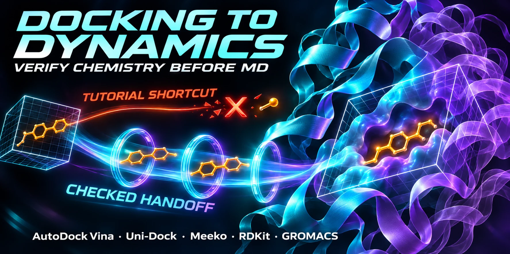
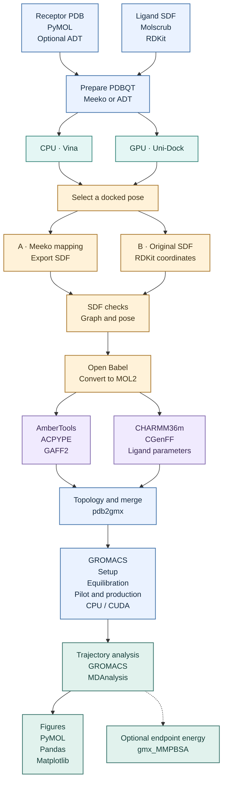

# Protein–Ligand Docking and Molecular Dynamics with GROMACS

**English** · [简体中文](README.zh-CN.md)

**A reproducible workflow for protein–ligand docking and molecular dynamics**

CPU / NVIDIA CUDA · Linux / Windows + WSL2

This guide documents a reproducible workflow for academic research and training. Starting from a receptor PDB and a ligand SDF, it covers batch docking, pose and topology validation, explicit-solvent molecular dynamics (MD), trajectory analysis, and publication figures. Each stage identifies the commands and records needed to reproduce the work.

**Scope.** The baseline protocol is designed for a soluble protein and one noncovalently bound organic small molecule in water. Membrane proteins, covalent ligands, essential metals or cofactors, and nonstandard residues require system-specific protocols.

<a name="contact"></a>

## Contact and collaboration

Email is welcome for technical discussions on molecular docking, GROMACS simulations, workflow reproducibility, and research collaboration.

- [lucifer.qsq@gmail.com](mailto:lucifer.qsq@gmail.com)
- [3069326069@qq.com](mailto:3069326069@qq.com)



**Cover guide**

- **Tutorial shortcut.** Converting PDBQT alone to MOL2 for ligand topology generation requires inferring missing chemical information, including bond orders.<sup>[1](#ref-1)</sup> [Workflow comparison](docs/TROUBLESHOOTING.md#chem3d-pymol-topology)
- **Checked handoff.** Dock with AutoDock Vina or Uni-Dock. Recover the selected pose using Meeko metadata or by transferring its coordinates with RDKit and a verified atom mapping to the original SDF. Verify bond orders, stereochemistry, formal charge, and heavy-atom coordinates before parameterization and GROMACS simulation. [Docked-pose transfer](#pose-handoff) · [Validation guide](docs/DOCKING_VALIDATION.md)

<a name="start-here"></a>

## Start here

- **First run.** Set up the environment and use the **1IEP c-Abl–imatinib** co-crystal as the reference redocking case. Select AutoDock Vina (CPU) or Uni-Dock (CUDA) for your hardware. [Environment setup](#setup) · [Reference redocking](#benchmark)
- **Docking output available.** Export an SDF from Meeko-mapped output. For a legacy ADT run, use the original SDF and a verified atom map to recover the docked coordinates. [Docked-pose transfer](#pose-handoff)
- **Trajectory available.** Start with trajectory processing and analysis, then follow the figure workflow for molecular views, quantitative plots, and panel assembly. [Trajectory processing and analysis](#analysis) · [Publication figures](#publication-figures)

- **Local PDB and SDF available.** Start with local input files and review the receptor structure and ligand microstate. [Local inputs](#local-inputs)
- **Complex system or failed run.** Use the troubleshooting guide to identify the first affected stage or a system-specific preparation route. [Troubleshooting guide](docs/TROUBLESHOOTING.md#troubleshooting-contents)
- **Unknown binding pocket or a pose to validate.** Follow the multi-stage docking guide to check receptor preparation, box coverage, local poses, and interaction assignments. [Validation guide](docs/DOCKING_VALIDATION.md)

**Upstream documentation**  
[AutoDock Vina Documentation](https://autodock-vina.readthedocs.io/en/latest/) · [Uni-Dock Documentation](https://github.com/dptech-corp/Uni-Dock/tree/main/unidock) · [Meeko Documentation](https://meeko.readthedocs.io/) · [GROMACS Official Site](https://www.gromacs.org/) · [GROMACS 2026.3 Manual](https://manual.gromacs.org/2026.3/) · [PyMOL Open-Source Repository](https://github.com/schrodinger/pymol-open-source)

<a name="contents"></a>

## Contents

- [Contact and collaboration](#contact)
- **Overview**
  - [Workflow overview](#overview) · [Tools and file handoffs](#toolchain)
- **01–05 · Docking and pose recovery**
  - [01. Environment setup](#setup) · [02. Reference redocking](#benchmark)
  - [03. Structure preparation](#docking) · [Local inputs](#local-inputs) · [04. Batch docking](#batch-docking)
  - [05. Pose transfer](#pose-handoff) · [Legacy ADT recovery](#legacy-adt-handoff)
  - [Multi-stage docking and validation](docs/DOCKING_VALIDATION.md)
- **06–10 · Parameterization, system setup, and simulation**
  - [06. Force fields and ligand parameters](#topology) · [07. Protein topology and assembly](#complex-assembly)
  - [08. Run parameters](#simulation) · [09. Setup and equilibration](#equilibration)
  - [10. Validation, production, and restart](#production) · [Server handoff](#server-handoff)
- **11–12 · Analysis, figures, and reproducibility**
  - [11. Trajectory analysis](#analysis) · [Endpoint energy estimates](#endpoint-energy)
  - [Publication figures](#publication-figures) · [Agent-assisted workflow](#agent-workflow) · [12. Reproducibility records](#reproducibility)
- **Troubleshooting guide**
  - [Complex systems](docs/TROUBLESHOOTING.md#complex-systems) · [Error index](docs/TROUBLESHOOTING.md#triage)
  - [Tutorial pitfalls](docs/TROUBLESHOOTING.md#tutorial-error-flow) · [Workflow comparison](docs/TROUBLESHOOTING.md#chem3d-pymol-topology)
- **13–16 · Sources, citation, and acknowledgments**
  - [Evidence for method choices](#method-evidence) · [13. Tools and upstream sources](#sources)
  - [14. References and software citation](#references) · [15. Disclaimer](#disclaimer) · [16. Acknowledgments](#acknowledgments)

<a name="overview"></a>

## Workflow overview

The receptor structure and ligand microstate are prepared separately. Choose the docking engine, molecular dynamics force field, and compute backend independently. Use the co-crystal benchmark to verify the docking installation and protocol. [Reference redocking](#benchmark)



[Compare with the tutorial shortcut](docs/TROUBLESHOOTING.md#chem3d-pymol-topology)


<a name="toolchain"></a>

### Tools and file handoffs

| Step | Tools and roles | Files or checks |
| --- | --- | --- |
| [01–02 Setup and validation](#setup) | Miniforge/Conda manages environments. Use Linux on servers and WSL2 or native Vina on Windows. NVIDIA drivers and CUDA support the GPU tools. | 1IEP co-crystal redocking, logs, and heavy-atom RMSD. |
| [03 Receptor preparation](#docking) | Use RCSB PDB for source structures and open-source PyMOL to inspect chains, pockets, and the co-crystal ligand. Meeko prepares the docking receptor. AutoDockTools can assist with legacy inputs or GPF inspection. | Reviewed protein PDB, receptor PDBQT, box. |
| [03 Ligand preparation](#docking) | PubChem or another documented source provides the SDF. Molscrub generates protonation states, tautomers, and 3D candidates. RDKit checks graph, stereochemistry, and net charge. Meeko writes mapped PDBQT. | Source and selected-state SDFs, ligand PDBQT. |
| [04 Docking and follow-up](#docking) | AutoDock Vina uses CPU threads and Uni-Dock uses NVIDIA CUDA. Review poses and pocket contacts in a structure viewer. | Poses, logs, candidate IDs, box, and seeds. |
| [05 Pose recovery and QC](#pose-handoff) | A exports SDF from Meeko mappings. B maps a legacy ADT pose onto the original SDF with RDKit. Both require chemistry and coordinate checks before Open Babel converts to MOL2. | Selected pose SDF, MOL2, atom mapping, and absolute coordinate check. |
| [06–07 Force fields and assembly](#topology) | GROMACS `pdb2gmx` parameterizes the protein. For AMBER ligands, use AmberTools (`antechamber`, `sqm`, `parmchk2`, and `tleap`) and ACPYPE. The CHARMM ligand uses CGenFF and the Lemkul Lab converter. | AMBER99SB-ILDN + GAFF2/AM1-BCC or CHARMM36m + CGenFF, with matching coordinate and topology atom order. |
| [08–10 Setup and production](#simulation) | GROMACS handles boxing, solvation, ions, EM, NVT, NPT, unrestrained tests, production, and restarts. | MDP, TPR, CPT, EDR, XTC, and logs. |
| [11–12 Analysis and figures](#analysis) | GROMACS and MDAnalysis analyze trajectories. gmx_MMPBSA can estimate endpoint energies. Open-source PyMOL renders structures, pandas / Matplotlib / seaborn prepare plots, and Inkscape or optional GIMP / Photoshop assembles panels. | XVG, CSV, representative structures, structure PNGs, vector plots, and editable figures. |

<a name="setup"></a>

## 01. Environment setup and installation

### Linux server

Use the Miniforge installer for your operating system and architecture, and verify it against the published release information. Command blocks assume Bash and the project root unless specified. The examples use the syntax of Vina 1.2.7, Uni-Dock 1.2.0, and GROMACS 2026.3. If Miniforge is already available, proceed to environment creation. [Miniforge Releases](https://github.com/conda-forge/miniforge/releases)

Example for Linux x86-64. Use the installer for your architecture.

```bash
bash Miniforge3-Linux-x86_64.sh -b -p "$HOME/miniforge3"
source "$HOME/miniforge3/etc/profile.d/conda.sh"
```

```bash
conda create -n docktools --override-channels -c conda-forge python=3.11 vina=1.2.7 meeko rdkit gemmi openbabel
conda create -n ligandtools --override-channels -c conda-forge ambertools acpype openbabel
conda create -n gmx-cpu --override-channels -c conda-forge gromacs=2026.3

conda activate docktools
vina --version
mk_prepare_receptor.py --help
mk_prepare_ligand.py --help
mk_export.py --help

conda activate ligandtools
command -v antechamber parmchk2 tleap sqm acpype obabel
acpype -h

conda activate gmx-cpu
gmx --version
```

Install Molscrub in `docktools` to enumerate protomers and tautomers. Run `scrub.py --help` to confirm the command-line interface and `python -m pip check` to verify dependencies. If dependency resolution fails, consult upstream installation instructions and document compatible versions. [Molscrub installation](https://github.com/forlilab/molscrub) · [Vina releases](https://github.com/forlilab/AutoDock-Vina/releases) · [conda-forge GROMACS](https://anaconda.org/conda-forge/gromacs)

```bash
conda activate docktools
python -m pip install molscrub
python -m pip check
scrub.py --help
```

### NVIDIA CUDA docking environment

Run these commands on a Linux GPU node or in WSL2 after completing the Windows setup below. The example uses the conda-forge Linux x86-64 build of Uni-Dock 1.2.0. Verify that the NVIDIA driver supports the package's CUDA runtime. The package installs its runtime dependencies. Source builds use the `nvcc` compiler. [Uni-Dock release notes](https://github.com/dptech-corp/Uni-Dock/releases) · [conda-forge builds](https://anaconda.org/conda-forge/unidock/files) · [NVIDIA CUDA compatibility](https://docs.nvidia.com/deploy/cuda-compatibility/latest/minor-version-compatibility.html)

```bash
nvidia-smi
conda create -n dockgpu --override-channels -c conda-forge 'unidock=1.2.0'
conda activate dockgpu
command -v unidock
unidock --help
conda list --show-channel-urls unidock
```

The CUDA version reported by `nvidia-smi` indicates driver support. Use `nvcc --version` to query a locally installed toolkit. If installation or execution fails because of CUDA compatibility, match the package build to the node's NVIDIA driver. Verify installation with the help command and verify GPU execution with the reference docking case in step 02. [NVIDIA nvidia-smi documentation](https://docs.nvidia.com/deploy/nvidia-smi/)

### GROMACS CUDA build

Verify GPU visibility with `nvidia-smi`. For a source build, select CUDA Toolkit, compiler, and CMake versions supported by the GROMACS installation guide, then run the commands from the extracted source tree. If a cluster module is available, load it and verify its GROMACS version and GPU backend. [GROMACS website](https://www.gromacs.org/) · [2026.3 build guide](https://manual.gromacs.org/2026.3/install-guide/index.html) · [GPU performance guide](https://manual.gromacs.org/documentation/current/user-guide/mdrun-performance.html)

```bash
nvidia-smi
nvcc --version
cmake --version
cmake -S . -B build-cuda -DGMX_GPU=CUDA -DGMX_BUILD_OWN_FFTW=ON \
  -DREGRESSIONTEST_DOWNLOAD=ON -DCMAKE_INSTALL_PREFIX="$HOME/opt/gromacs-2026.3-cuda"
cmake --build build-cuda --parallel 4
cmake --build build-cuda --target check
cmake --install build-cuda

source "$HOME/opt/gromacs-2026.3-cuda/bin/GMXRC"
gmx --version
```

Before starting MD, verify which GROMACS executable is on `PATH` with `command -v gmx`. Run shared-cluster jobs inside a scheduler allocation and match the thread count to the allocated resources. [Slurm documentation](https://slurm.schedmd.com/documentation.html)

### Windows + WSL2

Check the WSL configuration in PowerShell. If WSL is absent, install it with the second command block and restart if prompted. Run the Linux commands in Ubuntu under WSL. Store the simulation project and trajectory files on the Linux filesystem, for example in `~/docking-md-workshop`. [Microsoft WSL installation](https://learn.microsoft.com/windows/wsl/install) · [WSL filesystems](https://learn.microsoft.com/windows/wsl/filesystems)

```powershell
wsl --status
wsl -l -v
```

```powershell
wsl --install -d Ubuntu
```

Install the WSL-capable NVIDIA driver on the **Windows host** and check `nvidia-smi` from WSL Bash. Then install Uni-Dock CUDA as shown above or choose the CPU route. For a source build, follow NVIDIA's WSL instructions and select a Toolkit package without a bundled Linux display driver. Native Windows Vina 1.2.7 is covered in step 04A and CUDA docking in step 04B. [NVIDIA CUDA on WSL](https://docs.nvidia.com/cuda/wsl-user-guide/index.html) · [Vina batch syntax on Windows](https://autodock-vina.readthedocs.io/en/latest/docking_in_batch.html)

<a name="benchmark"></a>

## 02. Reference redocking benchmark

Use the Scripps c-Abl–imatinib example (PDB **1IEP**) as a reference redocking benchmark. Download `1iep_receptorH.pdb` and `1iep_ligand.sdf` from the upstream example into a new directory and run the commands there. The search box is defined in the example receptor's coordinate frame.<sup>[2](#ref-2),[3](#ref-3),[4](#ref-4)</sup> [Official walkthrough](https://autodock-vina.readthedocs.io/en/latest/docking_basic.html) · [Upstream example files](https://github.com/forlilab/AutoDock-Vina/tree/develop/example/basic_docking) · [RCSB 1IEP](https://www.rcsb.org/structure/1IEP)

**Structure provenance and validation.** Record the structure DOI and reference ligand instance. Report the atom correspondence and symmetry treatment used for redocking RMSD.<sup>[5](#ref-5)</sup> [1IEP structure DOI](https://doi.org/10.2210/pdb1IEP/pdb) · [DockRMSD methodology](https://doi.org/10.1186/s13321-019-0362-7)

```bash
conda activate docktools
mk_prepare_receptor.py --read_pdb 1iep_receptorH.pdb -o 1iep_receptor -p -v \
  --box_size 20 20 20 --box_center 15.190 53.903 16.917
mk_prepare_ligand.py -i 1iep_ligand.sdf -o 1iep_ligand.pdbqt
```

**CPU: AutoDock Vina**

```bash
vina --receptor 1iep_receptor.pdbqt --ligand 1iep_ligand.pdbqt \
  --config 1iep_receptor.box.txt --scoring vina --cpu 4 --seed 202601 \
  --exhaustiveness 32 --out 1iep_docked.pdbqt
mk_export.py 1iep_docked.pdbqt -s 1iep_docked.sdf
```

**GPU: Uni-Dock CUDA**

```bash
conda activate dockgpu
mkdir 1iep_gpu
unidock --receptor 1iep_receptor.pdbqt --gpu_batch 1iep_ligand.pdbqt \
  --config 1iep_receptor.box.txt --scoring vina --search_mode balance \
  --num_modes 20 --seed 202601 --dir 1iep_gpu > 1iep_gpu/unidock.log 2>&1
tail -25 1iep_gpu/unidock.log
find 1iep_gpu -maxdepth 1 -type f -name '*.pdbqt' -print
```

For the GPU run, apply the pose export and verification procedure in step 05. Confirm successful completion using the pose file, run log, and observed GPU activity.

**Check.** Confirm that the PDBQT contains pose and score records and that the recovered SDF is readable. Evaluate each engine's pose recovery and key contacts against the co-crystal reference. Calculate symmetry-aware ligand heavy-atom root-mean-square deviation (RMSD) in a common receptor frame without independently fitting the ligands. Approximately 2 Å is a conventional reference for pose recovery. A separate BioExcel tutorial covers MD complex setup. [Scripps expected results](https://autodock-vina.readthedocs.io/en/latest/docking_basic.html#expected-results) · [BioExcel complex setup](https://github.com/bioexcel/biobb_wf_protein-complex_md_setup)

**Quantitative redocking.** In the RCSB 1IEP entry, download the STI instance coordinates as SDF for the matching chain and save them as `1iep_crystal_ligand.sdf`. Verify the ligand conformer and common receptor frame in a structure viewer. After confirming chemical identity, use Open Babel `obrms` to calculate per-pose heavy-atom RMSD in Å. It searches equivalent correspondences by heavy-atom connectivity. Leave `-m` unset to preserve each pose in the receptor frame.<sup>[6](#ref-6)</sup> [RCSB 1IEP](https://www.rcsb.org/structure/1IEP) · [Open Babel obrms](https://github.com/openbabel/openbabel/blob/master/tools/obrms.cpp)

```bash
conda activate docktools
obabel 1iep_crystal_ligand.sdf -ocan
obabel 1iep_docked.sdf -ocan
obrms 1iep_crystal_ligand.sdf 1iep_docked.sdf | tee 1iep_cpu_redocking_rmsd.txt
```

Export the GPU poses to `1iep_gpu_docked.sdf` using step 05. Compare the top-ranked pose and other leading poses by RMSD and key contacts. Record separately whether the search recovered the reference pose and whether the scoring function ranked it first.

If a reference-like pose is sampled but ranked poorly, report its rank and redocking RMSD and review pocket contacts and ligand microstate. [Redocking troubleshooting](docs/TROUBLESHOOTING.md#docking-errors)

```bash
obabel 1iep_gpu_docked.sdf -ocan
obrms 1iep_crystal_ligand.sdf 1iep_gpu_docked.sdf | tee 1iep_gpu_redocking_rmsd.txt
```

[Back to contents](#contents)

<a name="docking"></a>

## 03. Receptor and ligand preparation

Use these commands for a new Linux project. If you already staged inputs, run only the last line from the corresponding project directory. [Local inputs](#local-inputs)

```bash
mkdir -p "$HOME/docking-md-workshop"
cd "$HOME/docking-md-workshop"
mkdir -p input ligands/pdbqt dock qc md
```

<a name="local-inputs"></a>

### Start from local PDB and SDF files

Open PowerShell in a new project directory and set the absolute paths to the source PDB and SDF files. The example stages the two selected files under the tutorial's standard names. Use PowerShell for staging and WSL or Linux for Bash instructions. On Linux, copy the selected files directly to `input/` under the same names. [Microsoft WSL filesystem guidance](https://learn.microsoft.com/en-us/windows/wsl/filesystems)

<details>
<summary>PowerShell staging example</summary>

```powershell
$Protein = 'C:\path\to\protein.pdb'
$Ligand  = 'C:\path\to\ligand.sdf'

if (!(Test-Path -LiteralPath $Protein -PathType Leaf) -or
    !(Test-Path -LiteralPath $Ligand -PathType Leaf)) {
    throw 'Check the two input file paths.'
}

$InputDir = Join-Path (Get-Location).Path 'input'
$ProteinCopy = Join-Path $InputDir 'protein_raw.pdb'
$LigandCopy = Join-Path $InputDir 'ligand_raw.sdf'
if ((Test-Path -LiteralPath $ProteinCopy) -or (Test-Path -LiteralPath $LigandCopy)) {
    throw 'The input directory already has a staged file. Use a fresh project directory.'
}

New-Item -ItemType Directory -Force -Path $InputDir -ErrorAction Stop | Out-Null
Copy-Item -LiteralPath $Protein -Destination $ProteinCopy -ErrorAction Stop
Copy-Item -LiteralPath $Ligand -Destination $LigandCopy -ErrorAction Stop
wsl pwd
```

Use `wsl pwd` to identify the WSL path corresponding to the current directory and verify the two copies there. Recheck paths if you move the project to the Linux filesystem.

</details>

| Source input | Requirements for the next step |
| --- | --- |
| `input/protein_raw.pdb` | Review assembly, chains, pocket, nonstandard components, and missing regions. Prepare `protein.pdb` for MD and `receptorH.pdb` for docking. |
| `input/ligand_raw.sdf` (2D SDF) | Verify bond orders, stereochemistry, and microstate, then generate a 3D conformer with explicit hydrogens for Meeko. |
| `input/ligand_raw.sdf` (3D SDF) | Review coordinates, explicit hydrogens, chemistry, and record number. A validated single record can be used directly for ligand preparation. |

[Ligand input requirements](https://meeko.readthedocs.io/en/develop/lig_prep_basic.html) · [Complex structure review](docs/TROUBLESHOOTING.md#complex-systems)

| Input | Preparation |
| --- | --- |
| `input/protein.pdb` | Prepare the protein for MD. Review the biological assembly, chains, alternate conformations, missing residues and heavy atoms, disulfides, termini, and histidine states. Retain the original structure, PDB ID and curation rationale. |
| `input/receptorH.pdb` | Provide a Meeko-compatible receptor in the same coordinate frame using reviewed protonation assumptions. Evaluate each water, ion, or cofactor for its role in the pocket. |
| `input/ligand_raw.sdf` | Obtain a molecule record with defined bond orders, stereochemistry, and identity. Record the CID or other source, pH assumption, and integer net charge of each candidate. |
| `dock/box.txt` | Define and visually check the search box using the co-crystal ligand or other pocket evidence. Use Å for the center coordinates and all three edge lengths. Keep a separate configuration for each receptor or pocket. |

Structure databases and setup docs · [RCSB PDB](https://www.rcsb.org/) · [PubChem](https://pubchem.ncbi.nlm.nih.gov/) · [Meeko receptor options](https://meeko.readthedocs.io/en/develop/rec_cli_options.html) · [Molscrub CLI](https://molscrub.readthedocs.io/en/latest/cli.html)

**Receptor files for docking and MD.** Review chain identity, alternate locations, missing atoms or residues, and any essential solvent molecules or cofactors in the source structure. Open-source PyMOL can be used to curate `input/protein.pdb`. Review the hydrogen and protonation model in `input/receptorH.pdb` before generating receptor PDBQT with Meeko. AutoDockTools can assist with legacy preparation and AutoGrid parameter files (GPF). Use the prepared protein PDB for MD topology generation with `pdb2gmx`. [Meeko receptor preparation](https://meeko.readthedocs.io/en/develop/rec_cli_options.html) · [Scripps AutoDock Suite](https://ccsb.scripps.edu/autodocksuite/)

The example selects record 1 from the Molscrub output. Substitute the record number established during chemical review. You may supply a vetted single-record 3D SDF with explicit hydrogens as `ligands/state001.sdf`. Assign a distinct identifier to each ligand microstate.

```bash
conda activate docktools
scrub.py input/ligand_raw.sdf -o ligands/candidates.sdf --ph 7.4
obabel ligands/candidates.sdf -ocan
obabel ligands/candidates.sdf -f 1 -l 1 -O ligands/state001.sdf
```

**Review the candidate with RDKit.** From the `docktools` environment, load the selected SDF in Python and verify stereochemistry, integer net charge, explicit hydrogen count, and the 3D conformer flag. Resolve any parsing or chemical-identity discrepancy before calling Meeko. [RDKit Python guide](https://www.rdkit.org/docs/GettingStartedInPython.html)

```bash
python
```

```python
from rdkit import Chem

candidate = Chem.SDMolSupplier("ligands/state001.sdf", removeHs=False)[0]
Chem.MolToSmiles(Chem.RemoveHs(candidate), isomericSmiles=True)
Chem.GetFormalCharge(candidate)
sum(atom.GetAtomicNum() == 1 for atom in candidate.GetAtoms())
candidate.GetConformer().Is3D()
exit()
```

```bash
mk_prepare_receptor.py --read_pdb input/receptorH.pdb -o dock/receptor -p
mk_prepare_ligand.py -i ligands/state001.sdf -o ligands/pdbqt/state001.pdbqt
sha256sum input/* > qc/input_sha256.txt
```

Write the six fields to `dock/box.txt` and substitute the actual center and edge lengths. Convert legacy AutoGrid interval counts to Å using the grid spacing. If the binding site is unknown, use a separate exploratory box and evaluate sampling and pocket plausibility.

```ini
center_x = 15.190
center_y = 53.903
center_z = 16.917
size_x = 20.0
size_y = 20.0
size_z = 20.0
```

**Check.** Verify the SDF record count, explicit hydrogens, stereochemistry, bond orders, and net charge. Check that the ligand PDBQT retains the Meeko mapping metadata and that the receptor, reference ligand, and search box use the same coordinate frame. [Meeko documentation](https://meeko.readthedocs.io/) · [Open Babel CLI](https://openbabel.org/docs/Command-line_tools/babel.html)

**Structure and chemistry references.** Use wwPDB validation reports to review deposited experimental structures and the Chemical Component Dictionary to check ligand identifiers. [wwPDB validation reports](https://www.wwpdb.org/validation/validation-reports) · [Chemical Component Dictionary](https://www.wwpdb.org/data/ccd)

**Focused screening, blind docking, and follow-up.** Use a focused box when structural evidence identifies the binding site. Validate the protocol by redocking when a co-crystal pose is available. For exploratory docking, use a separate file such as `dock/box_blind.txt` and record the coverage, seeds, and search settings. Inspect pose clusters for structurally plausible pockets, then use separate focused boxes and output directories for follow-up. In a legacy GPF, `npts 60 60 60` with `spacing 0.375` defines three 22.5 Å edges. Resolve `gridcenter auto` to verified coordinates before writing the Vina configuration. [Vina FAQ](https://autodock-vina.readthedocs.io/en/latest/faq.html)

<a name="batch-docking"></a>

## 04. Batch docking on CPU and CUDA

The CPU and CUDA workflows use the same receptor PDBQT, ligand PDBQT files, and search box from step 03. Use a separate output directory for each screen. Prepare ligands individually or pass a reviewed multi-record SDF to Meeko with `--multimol_outdir`. Track the mapping between ligand IDs and source SDF records, including duplicate IDs and failed preparations.<sup>[7](#ref-7)</sup> [Meeko ligand CLI](https://meeko.readthedocs.io/en/develop/lig_cli_options.html)

### A. CPU · AutoDock Vina

Run a single curated ligand and inspect its output and log before launching the batch.

```bash
conda activate docktools
mkdir dock/cpu_single_202601
vina --receptor dock/receptor.pdbqt --ligand ligands/pdbqt/state001.pdbqt \
  --config dock/box.txt --scoring vina --cpu 4 --exhaustiveness 32 \
  --num_modes 20 --seed 202601 --out dock/cpu_single_202601/state001_out.pdbqt \
  > dock/cpu_single_202601/vina.log 2>&1
tail -20 dock/cpu_single_202601/vina.log
grep -E '^MODEL|^REMARK VINA RESULT' dock/cpu_single_202601/state001_out.pdbqt
```

```bash
mkdir dock/cpu_batch_202601
time vina --receptor dock/receptor.pdbqt --batch ligands/pdbqt/*.pdbqt \
  --config dock/box.txt --scoring vina --cpu 4 --exhaustiveness 32 \
  --num_modes 20 --seed 202601 --dir dock/cpu_batch_202601 \
  > dock/cpu_batch_202601/vina.log 2>&1
find ligands/pdbqt -maxdepth 1 -type f -name '*.pdbqt' | wc -l
find dock/cpu_batch_202601 -maxdepth 1 -type f -name '*.pdbqt' | wc -l
```

`--batch` processes ligands sequentially against one receptor. `--cpu 4` sets the thread count for a Vina process. Split large libraries into separate jobs to parallelize within your CPU allocation. Use a separately defined box for each receptor. [Vina native batch mode](https://autodock-vina.readthedocs.io/en/latest/docking_in_batch.html)

#### Native Windows Vina and WSL2 handoff

For WSL preparation followed by native Windows Vina, copy the docking files to your Windows profile. Replace `YOUR_WINDOWS_USER` and run these commands from the WSL project root. Keep the original SDF and the MD-ready protein PDB in the WSL project. Use the Windows drive for the handoff. [Microsoft WSL filesystems](https://learn.microsoft.com/windows/wsl/filesystems)

```bash
win_user='YOUR_WINDOWS_USER'
win_job="/mnt/c/Users/$win_user/MD_exchange/target01"
mkdir -p "/mnt/c/Users/$win_user/MD_exchange"
mkdir "$win_job" &&
  mkdir -p "$win_job/dock" "$win_job/ligands/pdbqt" &&
  cp dock/receptor.pdbqt dock/box.txt "$win_job/dock/" &&
  cp ligands/pdbqt/*.pdbqt "$win_job/ligands/pdbqt/"
```

Enter the exchange directory in Windows PowerShell. The example expects the upstream executable there as `vina.exe`. Set `$Vina` to its full path if it is installed elsewhere. [Official Windows batch instructions](https://autodock-vina.readthedocs.io/en/latest/docking_in_batch.html)

```powershell
Set-Location (Join-Path $env:USERPROFILE 'MD_exchange\target01')
$Vina = '.\vina.exe'
& $Vina --version
$Ligands = @(Get-ChildItem '.\ligands\pdbqt' -Filter '*.pdbqt' -File |
    Sort-Object Name | Select-Object -ExpandProperty FullName)
if ($Ligands.Count -eq 0) { throw 'No ligand PDBQT files found' }
New-Item -ItemType Directory -Path '.\dock\cpu_batch_win_202601' -ErrorAction Stop
& $Vina --receptor .\dock\receptor.pdbqt --batch $Ligands --config .\dock\box.txt `
    --scoring vina --cpu 4 --exhaustiveness 32 --num_modes 20 --seed 202601 `
    --dir .\dock\cpu_batch_win_202601 > .\dock\cpu_batch_win_202601\vina.log 2>&1
if ($LASTEXITCODE -ne 0) { throw 'See the Vina log' }
(Get-ChildItem '.\dock\cpu_batch_win_202601' -Filter '*.pdbqt' -File).Count
```

Return to the same WSL Bash session and project root. Copy the entire batch output and inspect the log and poses. In a new terminal, set `win_job` again first. In step 05, set `pose_file` to the candidate file you copied back. Run subsequent setup and trajectory work on the WSL filesystem.

```bash
test -d "$win_job/dock/cpu_batch_win_202601" &&
  test ! -e dock/cpu_batch_win_202601 &&
  cp -a "$win_job/dock/cpu_batch_win_202601" dock/
find dock/cpu_batch_win_202601 -maxdepth 1 -type f -name '*.pdbqt' -print
tail -20 dock/cpu_batch_win_202601/vina.log
```

### B. NVIDIA GPU · Uni-Dock CUDA

Run from the Linux or WSL2 project root. Verify a single ligand with `--gpu_batch` first. During a longer run, monitor GPU activity with `nvidia-smi -l 1` in a second terminal. [Uni-Dock CLI](https://github.com/dptech-corp/Uni-Dock/tree/main/unidock)

```bash
conda activate dockgpu
mkdir dock/gpu_single_202601
unidock --receptor dock/receptor.pdbqt --gpu_batch ligands/pdbqt/state001.pdbqt \
  --config dock/box.txt --scoring vina --search_mode balance \
  --num_modes 20 --seed 202601 --dir dock/gpu_single_202601 \
  > dock/gpu_single_202601/unidock.log 2>&1
tail -25 dock/gpu_single_202601/unidock.log
find dock/gpu_single_202601 -maxdepth 1 -type f -name '*.pdbqt' -print
```

Pass a manifest to `--ligand_index` with one relative path per line and unique filenames without spaces. Measure device memory use, throughput, and output completeness on a representative subset before scaling.

```bash
mkdir dock/gpu_batch_202601
find ligands/pdbqt -maxdepth 1 -type f -name '*.pdbqt' | LC_ALL=C sort \
  > dock/gpu_batch_202601/ligands.txt
test -s dock/gpu_batch_202601/ligands.txt
```

Run after confirming the manifest is nonempty. If VRAM is limited, split it with `split -l 32 dock/gpu_batch_202601/ligands.txt dock/gpu_chunk_`. Give every run its own manifest path, log, and output directory.

```bash
time unidock --receptor dock/receptor.pdbqt \
  --ligand_index dock/gpu_batch_202601/ligands.txt \
  --config dock/box.txt --scoring vina --search_mode balance \
  --num_modes 20 --seed 202601 --dir dock/gpu_batch_202601 \
  > dock/gpu_batch_202601/unidock.log 2>&1
wc -l dock/gpu_batch_202601/ligands.txt
find dock/gpu_batch_202601 -maxdepth 1 -type f -name '*.pdbqt' | wc -l
tail -25 dock/gpu_batch_202601/unidock.log
```

`fast`, `balance`, and `detail` control Uni-Dock's search effort. For follow-up docking, change the seed or search effort and use a new output directory. Verify that files contain poses and scores. Reconcile outputs against manifest IDs, inspect logs for CUDA or parsing errors, and record incomplete jobs. [Uni-Dock modes and batch manifest](https://github.com/dptech-corp/Uni-Dock/blob/main/unidock/README.md)

### Benchmarking the docking engines

Use identical receptor, search box, and ligand inputs. Document engine versions, scoring functions, search settings, seeds, device, thread count, elapsed wall time, successful ligand count, and peak VRAM where applicable. Report throughput as successful ligands per unit of wall time. Compare native-pose recovery, key contacts, ranking, and repeatability across seeds. Retain separate score tables for the two engines.<sup>[8](#ref-8)</sup>

**Other GPU engines.** Vina-GPU 2.1 provides OpenCL docking on the upstream-supported Windows or Linux setups. Its repository includes a sample and documents `--ligand_directory` and `--output_directory` for batch runs. Its NVIDIA build instructions reference CUDA Toolkit paths, while its search kernels use OpenCL. Scripps AutoDock-GPU supports CUDA/OpenCL and uses the AutoDock4 protocol with affinity maps.<sup>[9](#ref-9),[10](#ref-10)</sup> [Vina-GPU 2.1](https://github.com/DeltaGroupNJUPT/Vina-GPU-2.1) · [Scripps AutoDock-GPU](https://github.com/forlilab/AutoDock-GPU)

### Follow-up docking and pose selection

Redock shortlisted candidates with the same microstate, receptor frame, and focused search box. For the CPU example, repeat step 04A with seeds `202602` and `202603` and distinct logs and output directories. For Uni-Dock, set `--seed` for each repeat in `balance` mode, then assess increased sampling with `detail`. Group poses using a documented heavy-atom criterion and inspect pocket placement, steric clashes, and reference contacts. Record the selected pose and any failed runs.

| Record | Fields |
| --- | --- |
| Inputs | Receptor chain, box config, ligand source, SDF record ID, net charge |
| Docking | Engine, version, search effort, seed, output plus MODEL or SDF record, score |
| Selection | Redocking reference, pose group, key contacts, rejection reasons, selected pose |

<a name="pose-handoff"></a>

## 05. Docked-pose transfer to molecular dynamics

Both workflows produce `lig_pose.sdf`. The source SDF defines the molecular graph, formal charge, protonation state, and stereochemistry. The selected docking pose supplies the heavy-atom coordinates in the original receptor frame. Choose the recovery method from the available metadata and source structure. Docking hardware is an independent choice.

**Pose-transfer references.** See the Meeko paper for PDBQT interoperability and the Open Babel manual for subsequent format conversion.<sup>[1](#ref-1),[6](#ref-6)</sup> [Meeko paper](https://doi.org/10.1021/acs.jcim.5c02271) · [Open Babel CLI](https://openbabel.org/docs/Command-line_tools/babel.html) · [Open Babel paper](https://doi.org/10.1186/1758-2946-3-33)

| Route | When to use it | How to recover |
| --- | --- | --- |
| **A · Meeko-preserved mapping** | New jobs, or outputs retaining Meeko's SMILES and atom indices. | Prepare and check the state, dock mapped PDBQT, export SDF with `mk_export.py`, then verify with RDKit. |
| **[B · Legacy ADT with SDF template](#legacy-adt-handoff)** | A legacy ADT pose and the original SDF for the same chemical state are available. | Select the PDBQT MODEL, verify the atom map, then use RDKit to transfer coordinates, add hydrogens, check the pose and write SDF. |

Archive the original ligand SDF and docking output in separate work directories for each force field, pose, and replicate. The example uses `ff_family=amber` and a pose from the CPU run. Set `ff_family=charmm` for CHARMM, or set `pose_file` to the selected PDBQT from step 04B for a CUDA-generated pose.

```bash
conda activate docktools
ff_family=amber
pose_file=dock/cpu_single_202601/state001_out.pdbqt
run_dir="md/${ff_family}_state001_pose01_rep01"

test -s "$pose_file" &&
  mkdir "$run_dir" &&
  cp input/protein.pdb "$run_dir/protein.pdb" &&
  cp ligands/state001.sdf "$run_dir/state_original.sdf" &&
  cp "$pose_file" "$run_dir/selected_run.pdbqt" &&
cd "$run_dir"
```

### A. Pose recovery from Meeko metadata

Archive the original SDF and Meeko-prepared ligand PDBQT. In the docking output, verify `REMARK SMILES` and `REMARK SMILES IDX`, and check `REMARK H PARENT` where present. [Meeko export documentation](https://meeko.readthedocs.io/en/develop/export_usage.html)

```bash
awk '/^REMARK SMILES / && $3 != "IDX" {print; found=1; exit}
     END {if (!found) exit 1}' selected_run.pdbqt
grep -m 1 '^REMARK SMILES IDX ' selected_run.pdbqt
grep -m 1 '^REMARK H PARENT ' selected_run.pdbqt || true
```

Export once the mapping checks pass. For legacy ADT output without Meeko metadata, follow route B. For any new docking run, record its engine, search settings, and pose-selection rationale separately.

```bash
mk_export.py selected_run.pdbqt -s docked_poses.sdf
grep -E '^MODEL|^REMARK VINA RESULT' selected_run.pdbqt
obabel docked_poses.sdf -ocan
```

**Optional native SDF from Uni-Dock.** If a Uni-Dock PDBQT output lacks Meeko metadata, use Uni-Dock Tools to prepare GPU input from the original SDF and redock against the same receptor and box to produce SDF poses with a molecular graph. This optional fallback produces poses from a new docking job. Start from the step 05 replicate directory. The first command returns to the project root. Keep the `run_dir` variable set above. [Uni-Dock Tools instructions](https://github.com/dptech-corp/Uni-Dock/blob/main/unidock_tools/README.md)

```bash
cd ../..
conda install -n dockgpu --override-channels -c conda-forge python=3.11 pip
conda activate dockgpu
python -m pip install 'git+https://github.com/dptech-corp/Uni-Dock.git@1.2.0#subdirectory=unidock_tools'
mkdir -p dock/gpu_sdfprep_202601 dock/gpu_sdf_202601
unidocktools ligandprep -l ligands/state001.sdf -sd dock/gpu_sdfprep_202601
find dock/gpu_sdfprep_202601 -maxdepth 1 -type f -name '*.sdf' -print
```

Check that the prepared ligand has the intended microstate. Before copying the results, verify that there is one SDF file for this ligand. A single file may contain multiple pose records.

```bash
unidock --receptor dock/receptor.pdbqt --gpu_batch dock/gpu_sdfprep_202601/*.sdf \
  --config dock/box.txt --scoring vina --search_mode balance --keep_nonpolar_H \
  --num_modes 20 --seed 202601 --dir dock/gpu_sdf_202601 \
  > dock/gpu_sdf_202601/unidock.log 2>&1
find dock/gpu_sdf_202601 -maxdepth 1 -type f -name '*_out.sdf' -print
```

```bash
cp dock/gpu_sdf_202601/*_out.sdf "$run_dir/docked_poses.sdf"
cd "$run_dir"
conda activate docktools
obabel docked_poses.sdf -ocan
```

Before extracting a pose, verify its provenance and score. If it came from a PDBQT export, confirm the correspondence between its SDF record and PDBQT `MODEL`. The example selects record 1.

```bash
obabel docked_poses.sdf -f 1 -l 1 -O lig_pose.sdf
obabel state_original.sdf -ocan
obabel lig_pose.sdf -ocan
```

<a name="legacy-adt-handoff"></a>

### B. Template-based recovery of legacy ADT poses

Save the original SDF for the same microstate as `state_original.sdf` and the legacy Vina output as `selected_run.pdbqt`. Establish a one-to-one atom map from the preparation records, original ADT input, and atom identities. Verify heavy-atom elements, connectivity, and identifiers together. If the original chemical template, atom mapping, or stereochemistry remains uncertain, prepare a new input and redock with route A.

This example uses MODEL 1. Change it to the verified model. The columns are PDBQT serial, coordinates (Å), and AutoDock atom type. For an AutoDock4 `.dlg`, extract the selected pose first. If a single pose has no MODEL record, confirm its contents and extract that structure explicitly.

```bash
grep -E '^MODEL|^REMARK VINA RESULT' selected_run.pdbqt
model=1
awk -v model="$model" '
  $1 == "MODEL" { selected = ($2 == model); next }
  $1 == "ENDMDL" { selected = 0; next }
  selected && /^(ATOM  |HETATM)/ && $NF !~ /^(H|HD|HS)$/ {
    printf "%d\t%.3f\t%.3f\t%.3f\t%s\n",
      substr($0, 7, 5), substr($0, 31, 8), substr($0, 39, 8), substr($0, 47, 8), $NF
  }
' selected_run.pdbqt > pose_heavy.tsv
test -s pose_heavy.tsv && cat pose_heavy.tsv
```

Save the verified mapping as `atom_map.tsv` with two columns and no header. Column 1 is the **one-based** heavy-atom index after RDKit removes ordinary hydrogens from the source SDF. Column 2 is the atom serial in the selected PDBQT MODEL. Use these commands to inspect the template indices and elements.

```bash
conda activate docktools
python - <<'RDKIT'
from rdkit import Chem

template, = Chem.SDMolSupplier("state_original.sdf", removeHs=True)
for atom in template.GetAtoms():
    print(atom.GetIdx() + 1, atom.GetSymbol())
RDKIT
```

Run the following commands after reviewing the atom map. For the organic ligands covered here, RDKit retains the template's molecular graph, inserts the docked heavy-atom coordinates, and adds hydrogens. Resolve any disagreement between the template and stereochemistry assigned from the recovered 3D coordinates before continuing. [RDKit stereochemistry API](https://www.rdkit.org/docs/source/rdkit.Chem.rdmolops.html#rdkit.Chem.rdmolops.AssignStereochemistryFrom3D)

```bash
python - <<'RDKIT'
from math import dist
from pathlib import Path
from rdkit import Chem

template, = Chem.SDMolSupplier("state_original.sdf", removeHs=True)
assert template is not None and all(a.GetAtomicNum() > 1 for a in template.GetAtoms())
mapped_rows = [line.split() for line in Path("atom_map.tsv").read_text().splitlines() if line.strip()]
pose_rows = [line.split() for line in Path("pose_heavy.tsv").read_text().splitlines() if line.strip()]
mapping = {int(idx) - 1: int(serial) for idx, serial in mapped_rows}
coords = {int(serial): (float(x), float(y), float(z)) for serial, x, y, z, _ in pose_rows}
assert len(mapped_rows) == len(mapping) == template.GetNumAtoms()
assert len(pose_rows) == len(coords) == len(mapping)
assert set(mapping) == set(range(template.GetNumAtoms()))
assert len(set(mapping.values())) == len(mapping) and set(mapping.values()) == set(coords)

pose = Chem.Mol(template)
conf = pose.GetConformer()
assert conf.Is3D()
for idx, serial in mapping.items():
    conf.SetAtomPosition(idx, coords[serial])

pose = Chem.AddHs(pose, addCoords=True)
perceived = Chem.Mol(pose)
Chem.AssignStereochemistryFrom3D(perceived, replaceExistingTags=True)
assert Chem.MolToSmiles(Chem.RemoveHs(perceived)) == Chem.MolToSmiles(template)
assert Chem.GetFormalCharge(pose) == Chem.GetFormalCharge(template)

with Chem.SDWriter("lig_pose.sdf") as writer:
    writer.write(pose)
saved, = Chem.SDMolSupplier("lig_pose.sdf", removeHs=False)
saved_conf = saved.GetConformer()
errors = []
for idx, serial in mapping.items():
    p = saved_conf.GetAtomPosition(idx)
    errors.append(dist((p.x, p.y, p.z), coords[serial]))
assert max(errors) <= 0.02, max(errors)
print(f"Maximum mapped heavy-atom position difference: {max(errors):.4f} Å")
RDKIT
```

`0.02 Å` is the file-transfer tolerance used here. Archive the source SDF, ADT input, model number, and atom map. Use `lig_pose.sdf` after the checks pass.

### Pose and chemical-identity validation

In `docktools`, load the source and recovered SDF records in Python. Compare their canonical isomeric SMILES and formal charges. RDKit removes ordinary explicit hydrogens in memory for this comparison. The SDF used for parameterization retains explicit hydrogens and in-place coordinates. Resolve parsing or identity discrepancies before proceeding.

```bash
python
```

```python
from rdkit import Chem

source = Chem.SDMolSupplier("state_original.sdf")[0]
pose = Chem.SDMolSupplier("lig_pose.sdf")[0]
Chem.MolToSmiles(source, isomericSmiles=True) == Chem.MolToSmiles(pose, isomericSmiles=True)
Chem.GetFormalCharge(source) == Chem.GetFormalCharge(pose)
exit()
```

**Check.** Check the recovered molecular graph, bond orders, stereochemistry, and integer net charge against the source SDF. Compare mapped heavy-atom coordinates in the original receptor frame for the selected `MODEL`. Regenerate candidates with route A if the pose or chemical identity cannot be established. Proceed to ligand parameterization in step 06 once these checks pass. [Meeko export in the Vina tutorial](https://autodock-vina.readthedocs.io/en/latest/docking_basic.html#exporting-results-to-sdf)

[Back to contents](#contents)

<a name="topology"></a>

## 06. Force-field selection and ligand parameterization

| Route | Protein force field | Ligand force field and charges | Water and nonbonded settings |
| --- | --- | --- | --- |
| A · AMBER | AMBER99SB-ILDN | GAFF2 and AM1-BCC via AmberTools and ACPYPE | TIP3P and ions from the AMBER port, PME, example 1.0 nm cutoff |
| B · CHARMM | CHARMM36m in the MacKerell Lab GROMACS port | Version-matched CGenFF types, charges, and bonded parameters | CHARMM TIP3P and matching ions, PME, LJ force switch over 1.0–1.2 nm for the cutoff port |

Route A provides the baseline for the soluble protein–ligand systems covered here. Select route B when a CHARMM36m protocol is justified and suitable CGenFF parameters are available. To compare the force-field families, start from the same ligand microstate and pose, apply each family's solvent, ion, and nonbonded settings, and equilibrate each system independently. [Amber manuals](https://ambermd.org/Manuals.php) · [GROMACS force-field notes](https://manual.gromacs.org/2026.3/user-guide/force-fields.html) · [MacKerell force-field ports](https://mackerell.umaryland.edu/charmm_ff.shtml)

### Route A · GAFF2 + AM1-BCC ligand

Use Open Babel for format conversion while preserving the existing 3D geometry. The example's `-n 0` assumes a verified neutral ligand. Set `-n -1`, `-n 1`, or another integer according to the selected chemical state's net charge. [AmberTools](https://ambermd.org/AmberTools.php) · [ACPYPE quick start](https://acpype.readthedocs.io/en/latest/)

```bash
conda activate ligandtools
obabel lig_pose.sdf -O lig_pose.mol2
obabel lig_pose.mol2 -O lig_pose_roundtrip.sdf
obabel lig_pose.sdf -ocan
obabel lig_pose_roundtrip.sdf -ocan
obrms lig_pose.sdf lig_pose_roundtrip.sdf
```

Compare molecular connectivity, net charge, and stereochemistry across the SDF round trip. Check that heavy-atom RMSD in the original coordinate frame is within the precision of the file format. Here, use `obrms` for geometry only. Use ACPYPE after the chemistry and geometry checks pass.

```bash
acpype -i lig_pose.mol2 -b LIG -a gaff2 -c bcc -n 0

ls -lh LIG.acpype
cp LIG.acpype/LIG_GMX.gro ligand.gro
cp LIG.acpype/LIG_GMX.itp ligand.itp
```

ACPYPE invokes AmberTools for parameterization. `antechamber` assigns GAFF2 atom types, `sqm` participates in AM1-BCC charge calculation, `parmchk2` identifies and supplies missing parameter terms, and `tleap` builds the Amber topology. ACPYPE exports GROMACS-compatible coordinates and topology.<sup>[11](#ref-11),[12](#ref-12),[13](#ref-13),[14](#ref-14)</sup> [Amber manuals](https://ambermd.org/Manuals.php) · [ACPYPE source](https://github.com/alanwilter/acpype)

Use the filenames produced by your ACPYPE version. Inspect the Antechamber, SQM, and parmchk2 logs, then review atom types and parameter terms. Verify the partial-charge sum, atom order, names, and masses in `[ atoms ]`. Compare the mapped heavy atoms in `ligand.gro` and the docking SDF after accounting for Å-to-nm conversion and file precision. Resolve discrepancies before assembly.

### Route B · CGenFF ligand

**Choose one compatible parameter set.** Treat route B as a separate replicate directory. Use the CHARMM36m protein definitions from the selected GROMACS port, the CGenFF stream for the verified ligand microstate, and the CHARMM-modified TIP3P water and ion parameters from that port. Keep the source SDF, original docking output, MOL2 submitted to CGenFF, and the returned stream. For the cutoff port, use the cutoff-specific MDP settings in step 08. Follow the release-specific protocol for a CHARMM36 LJ-PME port. [MacKerell Lab CHARMM force-field releases](https://mackerell.umaryland.edu/charmm_ff.shtml)

1. In the CHARMM replicate directory, prepare a single-ligand MOL2 with the reviewed bond orders, stereochemistry, net charge, explicit hydrogens, and docked heavy-atom coordinates. Compare it with the source SDF.<sup>[15](#ref-15),[16](#ref-16)</sup>

```bash
conda activate docktools
obabel lig_pose.sdf -O lig_pose.mol2 --title LIG
obabel lig_pose.sdf -ocan
obabel lig_pose.mol2 -ocan
```

2. Submit the MOL2 to the [CGenFF Service](https://cgenff.silcsbio.com/) and save the CHARMM stream containing the ligand topology and additional parameters as `lig_pose.str`. Record the **CGenFF parameter version**, `RESI` name, integer charge, and penalties. Replace `LIG` in the example with the actual `RESI` name. High penalties flag analogies for review. The SilcsBio guide typically recommends further optimization for values above 50. [CGenFF stream format and penalties](https://docs.silcsbio.com/2026/cgenff/usage.html)

```bash
grep -iE 'cgenff version|force field|^[[:space:]]*RESI[[:space:]]|penalty' lig_pose.str | head -30
```

3. Download the GROMACS port that matches the stream **parameter version** from the MacKerell lab. This example uses the February 2026 cutoff port with CGenFF 5.0. Keep the same directory name throughout the workflow. For a CGenFF 4.6 stream, download the matching 4.6 port and update the commands to use that directory. [MacKerell lab force-field downloads](https://mackerell.umaryland.edu/charmm_ff.shtml)

```bash
curl --fail --location \
  'https://mackerell.umaryland.edu/download.php?filename=CHARMM_ff_params_files%2Fcharmm36-feb2026_cgenff-5.0.ff.tgz' \
  -o charmm36-feb2026_cgenff-5.0.ff.tgz
tar -tzf charmm36-feb2026_cgenff-5.0.ff.tgz | head -20
tar -xzf charmm36-feb2026_cgenff-5.0.ff.tgz
test -f charmm36-feb2026_cgenff-5.0.ff/forcefield.itp
sha256sum charmm36-feb2026_cgenff-5.0.ff.tgz
```

4. Install the Lemkul Lab converter once. Record its commit and the force-field archive hash. The commands call the lab's upstream converter. [Lemkul Lab converter](https://github.com/Lemkul-Lab/cgenff_charmm2gmx)

```bash
conda create -n cgenff-tools --override-channels -c conda-forge python=3.13 networkx numpy
mkdir -p "$HOME/tools"
git clone https://github.com/Lemkul-Lab/cgenff_charmm2gmx.git "$HOME/tools/cgenff_charmm2gmx"
git -C "$HOME/tools/cgenff_charmm2gmx" rev-parse HEAD > cgenff_converter_commit.txt
conda activate cgenff-tools
python "$HOME/tools/cgenff_charmm2gmx/cgenff_charmm2gmx.py" \
  LIG lig_pose.mol2 lig_pose.str charmm36-feb2026_cgenff-5.0.ff
ls -lh lig.itp lig.prm lig_ini.pdb
```

5. Use either GROMACS build to convert the ligand coordinates to GRO, then check atom order, charges, and masses in `lig.itp`. Keep `lig.prm` as the global parameter include. Check the original coordinates in `lig_ini.pdb` and `ligand.gro`. The converter's standalone TOP is useful for review. The final system TOP owns `[ defaults ]`, `[ system ]`, and `[ molecules ]`.

```bash
conda activate gmx-cpu
gmx editconf -f lig_ini.pdb -o ligand.gro
cp lig.itp ligand.itp
head -n 2 ligand.gro
```

#### Route B acceptance before complex assembly

Record the converter commit, GROMACS force-field archive hash, CGenFF parameter version, ligand `RESI` identifier, verified integer charge, and the disposition of high-penalty terms. Use the same MOL2 for submission and conversion. If the MOL2 is edited, compare its atom names and order with the stream before running the converter. CGenFF penalties indicate uncertainty in analogy-based assignments. Evaluate the affected terms and follow the CGenFF optimization guidance when warranted. [CGenFF Usage and Penalties](https://docs.silcsbio.com/2026/cgenff/usage.html)

| Check | Acceptance criterion |
| --- | --- |
| Chemistry and coordinates | Compare the submitted MOL2 with the verified SDF for bond orders, stereochemistry, and formal charge. Use the reviewed atom mapping to check heavy-atom coordinates in `lig_ini.pdb` and `ligand.gro` without alignment. Account for Å and nm and for coordinate precision. |
| Local topology | Verify that the atom names and order in `ligand.gro` match the `[ atoms ]` records in `ligand.itp`. Confirm that the total of the assigned partial charges agrees with the verified integer ligand charge. Review any virtual-site mapping separately. |
| System topology | Include `lig.prm` after the CHARMM force-field include and before the first `[ moleculetype ]`. Include `ligand.itp` and record the exact ligand molecule type in `[ molecules ]`. Review the expanded topology from `grompp -pp` before equilibration. [Complex assembly](#complex-assembly) |
| Simulation settings | Archive the water and ion includes selected by the port. For the cutoff example, verify the 1.0–1.2 nm LJ force-switch settings in the processed MDP. [Run parameters](#simulation) |

The check below verifies the atom order and charge sum for the single-ligand GRO and ITP. Replace `0` with the independently verified integer charge if the ligand is charged. The charge tolerance shown is an example for this file check.

```bash
python - 0 <<'PYTHON'
from math import fsum, isfinite
from pathlib import Path
import re
import sys

expected_charge = int(sys.argv[1])
gro = Path("ligand.gro").read_text().splitlines()
count = int(gro[1].strip())
if count < 1 or len(gro) != count + 3:
    raise SystemExit("Expected a nonempty single-frame ligand GRO file.")
observed_names = [line[10:15].strip() for line in gro[2 : 2 + count]]

section = None
atom_names = []
charges = []
for line in Path("ligand.itp").read_text().splitlines():
    row = line.partition(";")[0].strip()
    heading = re.fullmatch(r"\[\s*(\w+)\s*\]", row)
    if heading:
        section = heading[1].lower()
        continue
    if section != "atoms" or not row:
        continue
    if row.startswith("#"):
        raise SystemExit("Inspect the preprocessed topology for conditional atom rows.")
    fields = row.split()
    if len(fields) < 7 or int(fields[0]) != len(atom_names) + 1:
        raise SystemExit("Check [ atoms ] numbering and record fields.")
    atom_names.append(fields[4])
    charges.append(float(fields[6]))

if not charges or not all(map(isfinite, charges)):
    raise SystemExit("Missing or nonfinite partial charges.")
if observed_names != atom_names:
    raise SystemExit("GRO and ITP atom count, names, or order differ.")
charge_sum = fsum(charges)
if abs(charge_sum - expected_charge) > 0.01:
    raise SystemExit(f"Charge sum {charge_sum:.6f} differs from {expected_charge:+d}.")
print(f"Matched {count} atoms; total partial charge {charge_sum:.6f} e.")
PYTHON
```

**Ligand checks for both routes.** Sum the partial charges in `[ atoms ]` and compare the result with the verified integer net charge. Check the heavy-atom mapping, coordinate units, and atom order between the GRO file and topology. If virtual sites are present, verify their definitions and positions in the coordinate ordering.

```bash
awk '/^[[:space:]]*\[[[:space:]]*atoms[[:space:]]*\]/{in_atoms=1;next}
     /^[[:space:]]*\[/{in_atoms=0}
     in_atoms && $1 ~ /^[0-9]+$/ {total+=$7; atoms++}
     END{if (!atoms) exit 1; printf "Atoms: %d; charge sum: %.6f\n", atoms,total}' ligand.itp
```

<a name="complex-assembly"></a>

## 07. Protein topology, position restraints, and complex assembly

Prepare the protein topology in the selected force-field replicate directory. Activate either GROMACS build. The preprocessing commands for both force-field families are available in the CPU and CUDA builds.<sup>[17](#ref-17)</sup>

**CPU build**

```bash
conda activate gmx-cpu
gmx --version
```

**CUDA build**

```bash
source "$HOME/opt/gromacs-2026.3-cuda/bin/GMXRC"
gmx --version
```

**Route A**

```bash
gmx pdb2gmx -f protein.pdb -o protein.gro -p topol.top -i posre.itp \
  -ff amber99sb-ildn -water tip3p -ignh
cp topol.top topol_protein.top
```

**Route B**

```bash
gmx pdb2gmx -f protein.pdb -o protein.gro -p topol.top -i posre.itp \
  -ff charmm36-feb2026_cgenff-5.0 -water tip3p -ignh
cp topol.top topol_protein.top
```

Verify termini, histidine protonation states, disulfide bonds, chain connectivity, and the TIP3P include selected by the force field. Consult the force-field documentation and `pdb2gmx -h` to select explicit histidine states. Follow the AMBER naming convention for nonstandard termini. [pdb2gmx reference](https://manual.gromacs.org/current/onlinehelp/gmx-pdb2gmx.html)

`pdb2gmx -ignh` rebuilds hydrogens according to the chosen residue states. Review the generated chain topologies and restraint files and verify the protein's absolute heavy-atom coordinates. Resolve missing heavy atoms during structure preparation.

**Topology editing for route A.** Move `[ atomtypes ]` and any other required global type definitions from `ligand.itp` to `ligand_atomtypes.itp`. Verify that the ligand and protein force fields agree on `[ defaults ]`, combination rules, and 1–4 scaling. Resolve naming conflicts and keep a single global defaults block. Preserve the generated protein, solvent, and ion entries. The snippet shows where to insert the ligand includes.

```ini
#include "amber99sb-ildn.ff/forcefield.itp"
#include "ligand_atomtypes.itp"
; Existing protein molecule definitions and protein restraint includes
#include "ligand.itp"
; Existing water and ion includes

[ system ]
Protein-ligand complex

[ molecules ]
; Existing protein molecule names and counts, in their original order
LIG  1
```

**Topology editing for route B.** Place the converter's `lig.prm` after the CHARMM force-field include and before the first `[ moleculetype ]`. Preserve the generated protein, water, ion, and restraint includes. Use these insertion points.

```ini
#include "charmm36-feb2026_cgenff-5.0.ff/forcefield.itp"
#include "lig.prm"
; Existing protein molecule definitions and protein restraint includes
#include "ligand.itp"
; Existing CHARMM TIP3P and ion includes

[ system ]
Protein-ligand complex

[ molecules ]
; Existing protein molecule names and counts, in their original order
LIG  1
```

For both routes, ensure that the order in `[ molecules ]` matches the protein, ligand, solvent, and ions in the coordinates. [GROMACS topology formats](https://manual.gromacs.org/2026.3/reference-manual/topologies/topology-file-formats.html)

Use the name in `[ moleculetype ]` from `ligand.itp` in place of `LIG`. Generate a ligand-local index and heavy-atom restraints from `ligand.gro`. A mass selection from GRO coordinates can rely on atom names. Compare the selected atoms against their ITP masses before choosing `Ligand_heavy_local` in `gmx genrestr`.

```bash
gmx select -s ligand.gro -select '"Ligand_heavy_local" mass > 2.5' -on ligand_heavy_local.ndx
gmx genrestr -f ligand.gro -n ligand_heavy_local.ndx -o posre_ligand.itp -fc 1000 1000 1000
```

Add this conditional block at the end of the ligand's molecule definition in `ligand.itp`. If ACPYPE already added a ligand restraint block, review it and use a single restraint definition. The restraint indices are local to the ligand molecule.

```ini
#ifdef POSRES_LIG
#include "posre_ligand.itp"
#endif
```

The commands preserve the original coordinate rows in protein-first, ligand-second order. Use single-frame GRO files. Line 2 gives the atom count, and the total line count is the atom count plus three. Check the merged order against `[ molecules ]`.

```bash
head -n 2 protein.gro ligand.gro
wc -l protein.gro ligand.gro

protein_atoms=$(sed -n '2p' protein.gro | tr -d '[:space:]')
ligand_atoms=$(sed -n '2p' ligand.gro | tr -d '[:space:]')
solute_atoms=$((protein_atoms + ligand_atoms))

printf 'Protein-ligand complex\n%5d\n' "$solute_atoms" > complex_raw.gro
sed -n "3,$((protein_atoms + 2))p" protein.gro >> complex_raw.gro
sed -n "3,$((ligand_atoms + 2))p" ligand.gro >> complex_raw.gro
tail -n 1 protein.gro >> complex_raw.gro
wc -l complex_raw.gro
```

**Check.** Overlay the assembled complex with the original binding pose. Check atom order, atom counts, and net charge against the topology. The box setup translates the assembled complex as a whole.

<a name="simulation"></a>

## 08. GROMACS run parameters (MDP)

The example uses 300 K, 1 bar, 0.15 M added NaCl, particle mesh Ewald (PME), and a 2 fs integration step. Save the AMBER baseline in the files below. For CHARMM, apply the nonbonded settings at the end of the section. Select and document the production duration and number of independent replicates for your research question. [Versioned MDP options](https://manual.gromacs.org/2026.3/user-guide/mdp-options.html)

**Temperature and pressure coupling.** The V-rescale thermostat and C-rescale barostat are described in separate methods papers. Use the MDP reference corresponding to your GROMACS version.<sup>[18](#ref-18),[19](#ref-19)</sup> [V-rescale](https://doi.org/10.1063/1.2408420) · [C-rescale](https://doi.org/10.1063/5.0020514) · [GROMACS MDP reference](https://manual.gromacs.org/2026.3/user-guide/mdp-options.html)

### `ions.mdp` · Ion-placement preprocessing

Use this file to generate the TPR input for `genion`.

```ini
integrator      = steep
nsteps          = 500
emtol           = 1000
emstep          = 0.01
cutoff-scheme   = Verlet
coulombtype     = Cut-off
rcoulomb        = 1.0
vdwtype         = Cut-off
rvdw            = 1.0
pbc             = xyz
constraints     = none
```

### `em.mdp` · Energy minimization

```ini
integrator      = steep
nsteps          = 50000
emtol           = 1000
emstep          = 0.01
cutoff-scheme   = Verlet
coulombtype     = PME
rcoulomb        = 1.0
vdwtype         = Cut-off
rvdw            = 1.0
DispCorr        = EnerPres
pbc             = xyz
constraints     = none
nstenergy       = 100
nstlog          = 100
```

### `nvt.mdp` · Temperature equilibration

```ini
define                  = -DPOSRES -DPOSRES_LIG
integrator              = md
dt                      = 0.002
nsteps                  = 50000
continuation            = no
constraints             = h-bonds
constraint-algorithm    = lincs
cutoff-scheme           = Verlet
nstlist                 = 20
coulombtype             = PME
rcoulomb                = 1.0
vdwtype                 = Cut-off
rvdw                    = 1.0
DispCorr                = EnerPres
pme-order               = 4
fourierspacing          = 0.12
pbc                     = xyz
tcoupl                  = V-rescale
tc-grps                 = Complex Water_and_ions
tau-t                   = 1.0 1.0
ref-t                   = 300 300
pcoupl                  = no
gen-vel                 = yes
gen-temp                = 300
gen-seed                = 202601
nstxout                 = 0
nstvout                 = 0
nstfout                 = 0
nstenergy               = 500
nstlog                  = 500
nstxout-compressed      = 500
```

### `npt.mdp` · Pressure equilibration

Copy `nvt.mdp`, replace the existing keys below, and add the new pressure-coupling keys. Remove `gen-temp` and `gen-seed`. Keep `define`.

```bash
cp nvt.mdp npt.mdp
```

```ini
nsteps                  = 500000
continuation            = yes
gen-vel                 = no
pcoupl                  = C-rescale
pcoupltype              = isotropic
tau-p                   = 5.0
ref-p                   = 1.0
compressibility         = 4.5e-5
refcoord-scaling        = com
```

### `smoke.mdp`, `pilot.mdp`, and `md.mdp` · Smoke tests, pilots, and production

Use `npt.mdp` as a template for `md.mdp` and for the optional `smoke.mdp` and `pilot.mdp` inputs. Remove `define` and `refcoord-scaling` for these unrestrained stages. Retain constraints on bonds involving hydrogen (`constraints = h-bonds`). Apply the stage-specific settings below and keep one entry per key.

```bash
cp npt.mdp md.mdp

# Optional smoke test and pilot
cp npt.mdp smoke.mdp
cp npt.mdp pilot.mdp
```

| File | `nsteps` | Duration | `nstenergy`, `nstlog`, `nstxout-compressed` |
| --- | ---: | ---: | ---: |
| `nvt.mdp` | 50,000 | 100 ps | 500 |
| `npt.mdp` | 500,000 | 1 ns | 500 |
| `smoke.mdp` | 10,000 | 20 ps | 500 |
| `pilot.mdp` | 500,000 | 1 ns | 500 |
| `md.mdp` | 50,000,000 | 100 ns | 5,000 |

Enter integer values without group separators, for example `50000000`. The 100 ns production duration is illustrative. At a 2 fs integration step, saving every 5,000 steps gives 10 ps between frames. Select an output interval appropriate for the analysis.

**Coordinate-output interval.** The coordinate-output interval is `dt × nstxout-compressed`. With a 2 fs step, values of `5000` and `15000` give intervals of 10 and 30 ps. Choose the interval based on the analysis timescale, storage budget, and measured trajectory size. Energy, log, and coordinate output frequencies can be set independently.

The analysis examples use an XTC containing the full system. To follow them, set `compressed-x-grps = System` in the production MDP and verify that the group includes every atom. For a solute-only trajectory, export a matching structure or topology with identical atom order and adapt the analysis commands. [GROMACS output control](https://manual.gromacs.org/documentation/current/user-guide/mdp-options.html)

### MDP settings for CHARMM36m + CGenFF

For route B's cutoff port, create separate copies of all seven MDP files. Apply the following keys to `ions.mdp`, `em.mdp`, `nvt.mdp`, `npt.mdp`, `smoke.mdp`, `pilot.mdp`, and `md.mdp`. Replace matching keys and add missing ones. Keep each stage's integrator, coupling, step count, and restraint settings. Keep `coulombtype = Cut-off` in `ions.mdp` for ion-placement TPR preparation. Retain `coulombtype = PME` in the six run stages. [GROMACS recommended CHARMM settings](https://manual.gromacs.org/2026.3/user-guide/force-fields.html)

```ini
rcoulomb       = 1.2
vdwtype        = Cut-off
vdw-modifier   = Force-switch
rvdw-switch    = 1.0
rvdw           = 1.2
DispCorr       = no
```

Cross-check the MDP against the chosen port. An LJ-PME port requires its own settings. [MacKerell port notes](https://mackerell.umaryland.edu/charmm_ff.shtml)

<a name="equilibration"></a>

## 09. System setup, energy minimization, and equilibration

### Box, solvent, and ions

Use the box command for your force-field route. The examples set an initial solute-to-box boundary distance of 1.2 nm for AMBER and 1.4 nm for CHARMM. Verify solute–image separation for the chosen periodic box and cutoff.

```bash
# AMBER
gmx editconf -f complex_raw.gro -o boxed.gro -c -d 1.2 -bt dodecahedron
```

```bash
# CHARMM
gmx editconf -f complex_raw.gro -o boxed.gro -c -d 1.4 -bt dodecahedron
```

Check molecule names in the selected force field's `ions.itp`. The example uses `NA` and `CL`; confirm that they match your actual topology.

```bash
cp topol.top topol_before_solvation.top
gmx solvate -cp boxed.gro -cs spc216.gro -o solv.gro -p topol.top

gmx grompp -f ions.mdp -c solv.gro -p topol.top -o ions.tpr \
  -pp ions_processed.top -po ions_out.mdp -maxwarn 0

cp topol.top topol_before_ions.top
gmx genion -s ions.tpr -o solv_ions.gro -p topol.top \
  -pname NA -nname CL -neutral -conc 0.15 -seed 202601
```

At the `genion` prompt, select the contiguous water-only group **SOL**. Verify the solvent and ion counts, total charge, and periodic clearance. Additional counterions used for neutralization affect the final ionic strength. The `spc216.gro` file supplies coordinates for a three-site solvent. The topology defines the water model. Use AMBER TIP3P for route A and CHARMM TIP3P with hydrogen Lennard–Jones terms for route B. [GROMACS grompp](https://manual.gromacs.org/current/onlinehelp/gmx-grompp.html) · [GROMACS MD tutorial](https://tutorials.gromacs.org/docs/md-intro-tutorial.html)

### Steepest-descent minimization

```bash
gmx grompp -f em.mdp -c solv_ions.gro -p topol.top -o em.tpr \
  -pp em_processed.top -po em_out.mdp -maxwarn 0
gmx mdrun -v -deffnm em -nb cpu
gmx energy -f em.edr -o potential.xvg
```

In `gmx energy`, select **Potential**, then type `0` to end the selection. Review minimization termination, energy, and maximum force in `em.log`. The example force criterion is 1,000 kJ mol⁻¹ nm⁻¹. For failed minimizations, diagnose steric clashes, atom order, bonded topology, and parameter assignments.

### Build named index groups

These selections follow the atom order set in step 07: protein first, ligand next, then solvent and ions. Generate the index from `em.tpr` and verify group counts. If the default Backbone or C-alpha name differs, inspect groups with `gmx make_ndx -f em.gro` and adjust the selections.

```bash
protein_atoms=$(sed -n '2p' protein.gro | tr -d '[:space:]')
ligand_atoms=$(sed -n '2p' ligand.gro | tr -d '[:space:]')
solute_atoms=$((protein_atoms + ligand_atoms))
ligand_start=$((protein_atoms + 1))

gmx select -s em.tpr -on index.ndx -select \
  "\"System\" all;
   \"Protein\" atomnr 1 to $protein_atoms;
   \"Ligand\" atomnr $ligand_start to $solute_atoms;
   \"Complex\" atomnr 1 to $solute_atoms;
   \"Water_and_ions\" atomnr > $solute_atoms;
   \"Backbone\" group \"Backbone\";
   \"C_alpha\" group \"C-alpha\";
   \"Protein_heavy\" (atomnr 1 to $protein_atoms) and mass > 2.5;
   \"Ligand_heavy\" (atomnr $ligand_start to $solute_atoms) and mass > 2.5"
gmx make_ndx -f em.gro -n index.ndx -o index_review.ndx
```

Exit the index viewer with `q`. Confirm that `Complex` and `Water_and_ions` are disjoint and cover the system, that `Ligand` matches the ligand GRO atom count, and that `Backbone` and `C_alpha` contain protein atoms. Use the original `index.ndx` below.

### NVT → NPT

Select one compute configuration in the current Bash session for equilibration in step 09 and production in step 10. The examples use four OpenMP threads on one node. The CUDA example uses one GPU with a thread-MPI build. Use the site-specific launcher and rank layout for an external-MPI build. Reinitialize the Bash array when restarting from a new shell. [GROMACS runtime performance](https://manual.gromacs.org/documentation/current/user-guide/mdrun-performance.html)

```bash
# CPU
md_backend=(-ntomp 4 -nb cpu -pme cpu)
```

```bash
# NVIDIA GPU, thread-MPI
md_backend=(-ntmpi 1 -ntomp 4 -nb gpu -pme auto)
```

For CUDA, check `nvt.log` and `pilot.log` for device and task assignment. These flags request GPU short-range nonbonded calculations and leave PME placement to GROMACS.

```bash
gmx grompp -f nvt.mdp -c em.gro -r em.gro -p topol.top -n index.ndx \
  -o nvt.tpr -pp nvt_processed.top -po nvt_out.mdp -maxwarn 0
gmx mdrun -v -deffnm nvt "${md_backend[@]}"
gmx energy -f nvt.edr -o temperature.xvg
```

Select **Temperature**. Inspect fluctuations and sustained drift around the set point before proceeding to NPT equilibration.

```bash
gmx grompp -f npt.mdp -c nvt.gro -t nvt.cpt -r em.gro -p topol.top -n index.ndx \
  -o npt.tpr -pp npt_processed.top -po npt_out.mdp -maxwarn 0
gmx mdrun -v -deffnm npt "${md_backend[@]}"
gmx energy -f npt.edr -o density.xvg
gmx energy -f npt.edr -o volume.xvg
gmx energy -f npt.edr -o pressure.xvg
```

Select **Density**, **Volume**, and **Pressure** for the corresponding outputs. Examine temperature, density, and volume for sustained drift. Assess pressure using its time average and fluctuations. Review the logs and structure before the unrestrained short test and pilot.

<a name="production"></a>

## 10. Pilot runs, production, and checkpoint restart

The optional 20 ps smoke test and 1 ns pilot assess numerical stability after releasing position restraints and provide a performance estimate. If equivalent validation is already available, use the validated endpoint for production preparation. Inspect the processed topology for active `[ position_restraints ]` and review LINCS or SETTLE warnings and nonfinite energies. [Simulation troubleshooting](docs/TROUBLESHOOTING.md#simulation-errors)

```bash
gmx grompp -f smoke.mdp -c npt.gro -t npt.cpt -p topol.top -n index.ndx \
  -o smoke.tpr -pp smoke_processed.top -po smoke_out.mdp -maxwarn 0
grep -n 'position_restraints' smoke_processed.top
```

```bash
gmx mdrun -v -deffnm smoke "${md_backend[@]}"
```

```bash
gmx grompp -f pilot.mdp -c smoke.gro -t smoke.cpt -p topol.top -n index.ndx \
  -o pilot.tpr -pp pilot_processed.top -po pilot_out.mdp -maxwarn 0
gmx mdrun -v -deffnm pilot "${md_backend[@]}"
gmx check -f pilot.xtc
grep -A2 'Performance:' pilot.log
```

Compile the production TPR from the selected validated endpoint. The example uses `pilot`. Set it to `npt` for a protocol that starts from an accepted NPT endpoint, and keep the GRO and checkpoint from the same stage. Check the processed MDP, expanded topology, and compiled TPR, and document the choice of starting state.

```bash
START=pilot
gmx grompp -f md.mdp -c "$START.gro" -t "$START.cpt" -p topol.top -n index.ndx \
  -o md.tpr -pp md_processed.top -po md_out.mdp -maxwarn 0
grep -n 'position_restraints' md_processed.top
grep -Ei '^[[:space:]]*(dt|nsteps|nstxout-compressed|compressed-x-grps)[[:space:]]*=' md_out.mdp
```

<a name="server-handoff"></a>

### Server handoff and production verification

**Before submission.** Archive `md.tpr`, the processed MDP, starting GRO and CPT, `index.ndx`, the top-level topology, and all includes and force-field dependencies. Include software versions, starting-state provenance, and equilibration records. Verify the package on the target server against its checksum manifest, and reconcile the compiled TPR with the processed MDP and topology.

Run the read-only checks in the job directory on the target. If the bundle includes `SHA256SUMS`, verify it first.

```bash
(
  set -e
  if [ -f SHA256SUMS ]; then
    sha256sum -c SHA256SUMS
  fi
  gmx --version
  gmx dump -s md.tpr > md_tpr_dump.txt
  grep -Ei '^[[:space:]]*(dt|nsteps|init-step|nstxout-compressed|continuation)[[:space:]]*=' md_tpr_dump.txt
)
```

| Check | What to verify |
| --- | --- |
| Run length and output | Verify `nsteps × dt`, coordinate-output interval, atom group, and expected starting step. |
| System and restraints | Compare atom counts, index groups, coupling settings, active position restraints, and intended bond constraints. |
| Starting state | Verify starting GRO/CPT provenance, transferred checksums, velocity handling, and TPR readability on the target. |

Track **validated input, running, and completed production** as separate states. Confirm completion from the job log, actual steps, and trajectory. Use the command below when submitting production. If the TPR cannot be read or a restart cannot append, consult the troubleshooting guide first.<sup>[20](#ref-20)</sup> [gmx dump](https://manual.gromacs.org/documentation/current/onlinehelp/gmx-dump.html) · [GROMACS checkpoints and restart](https://manual.gromacs.org/documentation/current/user-guide/managing-simulations.html) · [Server and restart troubleshooting](docs/TROUBLESHOOTING.md#server-errors)

```bash
gmx mdrun -v -deffnm md "${md_backend[@]}" -cpt 15
```

Before restarting an interrupted run, preserve its output files and verify that `md.cpt` matches the production input, log, and trajectory. Record any device or offload changes. Extend `md.tpr` with `gmx convert-tpr -extend` in picoseconds and resume from the matching checkpoint. [GROMACS long simulations](https://manual.gromacs.org/current/user-guide/managing-simulations.html)

```bash
ls -lh md.cpt md.tpr md.log md.xtc
gmx mdrun -v -deffnm md -cpi md.cpt -append "${md_backend[@]}" -cpt 15
```

### Extend a production run

After reaching the planned endpoint, run these commands from the same replicate directory to add 10 ns. `-extend` uses ps. Keep the original `md.tpr` and continue from the new TPR with the same `-deffnm md` and latest `md.cpt`. If outputs were renamed, are missing, or fail checksum verification, restore the matching files or use `-noappend` for separate parts as documented. If an extended run is interrupted, pass the extended TPR explicitly when resuming. [GROMACS run management](https://manual.gromacs.org/2026.3/user-guide/managing-simulations.html)

```bash
gmx convert-tpr -s md.tpr -extend 10000 -o md_extended.tpr
gmx mdrun -v -s md_extended.tpr -deffnm md -cpi md.cpt -append \
  "${md_backend[@]}" -cpt 15
gmx check -f md.xtc
tail -25 md.log
```

Check the end step and time against the log and trajectory before analysis. For another extension, start from the latest TPR used and retain the input and log for each extension.

### Independent replicates

Run independent replicates in separate directories with distinct NVT `gen-seed` values, for example 202601, 202602, and 202603. Equilibrate and simulate each replicate independently. Select starting poses and controls based on the study design. [MD reliability and reproducibility checklist](https://www.nature.com/articles/s42003-023-04653-0)

[Back to contents](#contents)

<a name="analysis"></a>

## 11. Trajectory processing and analysis

### Periodic boundary condition correction

```bash
gmx trjconv -s md.tpr -f md.xtc -n index.ndx -o whole.xtc -pbc whole
gmx trjconv -s md.tpr -f whole.xtc -n index.ndx -o centered.xtc -pbc mol -center -ur compact
gmx check -f centered.xtc
```

For the first command, choose **System** as output. For the second, center on **Protein** and write **System**. Inspect early, middle, and late frames to verify the relative periodic images of the receptor, ligand, and any multichain assembly. Preserve physical displacement when analyzing dissociation.

**Official usage.** Consult the versioned `trjconv` reference and inspect the trajectory when combining `-pbc`, `-center`, or `-fit`. [GROMACS trjconv](https://manual.gromacs.org/2026.3/onlinehelp/gmx-trjconv.html)

### Structural and contact metrics

```bash
gmx rms -s md.tpr -f centered.xtc -n index.ndx -o rmsd_protein.xvg -tu ns
gmx rms -s md.tpr -f centered.xtc -n index.ndx -o rmsd_ligand.xvg -tu ns -nomw
gmx rmsf -s md.tpr -f centered.xtc -n index.ndx -res -o rmsf.xvg
gmx gyrate -s md.tpr -f centered.xtc -n index.ndx -sel 'group "Protein"' -o rg.xvg
gmx sasa -s md.tpr -f centered.xtc -n index.ndx \
  -surface 'group "Complex"' -output 'group "Protein"; group "Ligand"' -o sasa.xvg
gmx mindist -s md.tpr -f centered.xtc -n index.ndx -od mindist.xvg -on contacts.xvg -d 0.35
gmx hbond -s md.tpr -f centered.xtc -n index.ndx \
  -r 'group "Protein"' -t 'group "Ligand"' -num hbond.xvg
```

| Metric | Selection, reference, or interpretation |
| --- | --- |
| Protein RMSD | Choose `Backbone` for fit and calculation. |
| Ligand RMSD | Fit to `Backbone` and calculate on `Ligand_heavy`. This uses the production TPR coordinates as reference. Compare redocking to the crystal pose separately. |
| RMSF | Select `C_alpha` and preserve residue and chain identifiers. |
| Rg and SASA | Rg describes whole-protein compactness, while SASA measures protein and ligand exposure in the complex. |
| Minimum distance and contacts | Select `Protein_heavy` followed by `Ligand_heavy` and document the example cutoff, 0.35 nm. |
| Hydrogen bonds | The command uses the newer `gmx hbond` interface. Check local syntax with `gmx hbond -h` and report distance and angle definitions. |

**GROMACS 2023.2 commands.** In this release, `gyrate` and `hbond` use interactive group selection. Select `Protein` for the first command, then `Protein` and `Ligand` in the second. Use the same version and hydrogen-bond definition across replicates. The files must also be readable by the analysis build. [2023.2 gyrate](https://manual.gromacs.org/documentation/2023.2/onlinehelp/gmx-gyrate.html) · [2023.2 hbond](https://manual.gromacs.org/documentation/2023.2/onlinehelp/gmx-hbond.html)

```bash
gmx gyrate -s md.tpr -f centered.xtc -n index.ndx -o rg.xvg
gmx hbond -s md.tpr -f centered.xtc -n index.ndx -num hbond.xvg
```

Interpret ligand RMSD after protein alignment together with minimum distance, residue contacts, and representative conformations. These measurements help distinguish displacement, reorientation, and dissociation. Analyze independent replicates separately and report analysis windows and exclusions. [GROMACS manual](https://manual.gromacs.org/2026.3/) · [New hydrogen-bond tool](https://manual.gromacs.org/current/onlinehelp/gmx-hbond.html)

```bash
grep -v '^[#@]' rmsd_ligand.xvg > rmsd_ligand_columns.txt
gmx trjconv -s md.tpr -f centered.xtc -n index.ndx -o complex_movie.xtc -dt 100
gmx trjconv -s md.tpr -f centered.xtc -n index.ndx -o complex_movie.pdb -dump 0
```

Select **Complex** for both exports. Verify the first trajectory time with `gmx check -f complex_movie.xtc` and replace `-dump 0` if the first time differs from 0 ps. The reference PDB and trajectory must use the same atom order.

Within the analysis window, select a representative frame using a stated criterion such as contact persistence, ligand displacement, or conformational clustering. Check available timestamps with `gmx check -f centered.xtc`, substitute the selected time for the illustrative 50,000 ps, and choose **Complex**. Report the criterion and actual frame time.

```bash
gmx trjconv -s md.tpr -f centered.xtc -n index.ndx -o representative.pdb -dump 50000
```

<a name="publication-figures"></a>

### Publication figures and panel assembly

| Stage | Tool and task | Archive |
| --- | --- | --- |
| Structural panels | Prefer open-source PyMOL for protein, ligand, pocket, and representative structures. | Input PDB, frame or docking MODEL, PyMOL commands and session, original PNG. |
| Quantitative panels | Calculate metrics with GROMACS or MDAnalysis, organize data with pandas, and plot with Matplotlib or seaborn. | Raw XVG, plotting CSV, commands, and PDF/SVG. |
| Panel assembly | Prefer Inkscape for vector layout. GIMP or Adobe Photoshop can assemble raster panels and align type and panel labels. | Original panels, editable figure, and journal export. |

<a name="pymol-image-export"></a>

#### A. Structures and pockets in open-source PyMOL

Use the Schrödinger-maintained `pymol-open-source` build. Its standard `png` export adds no software watermark by default. Record the version and installation source, and follow PyMOL's citation guidance. [Source](https://github.com/schrodinger/pymol-open-source) · [conda-forge](https://anaconda.org/conda-forge/pymol-open-source) · [Oxford Protein Informatics Group](https://www.blopig.com/blog/2023/10/tips-tricks-with-pymol/) · [Citation](https://pymol.org/support.html)

```bash
conda create -n pymol-oss --override-channels -c conda-forge pymol-open-source
conda activate pymol-oss
pymol
```

At the PyMOL prompt, load `representative.pdb`. For a docking panel, load the verified complex corresponding to the selected `MODEL`. Replace `LIG` with the residue name in your structure and verify the ligand selection with `count_atoms`. [PyMOL selection syntax](https://pymolwiki.org/index.php/Selection_Algebra)

```text
load representative.pdb, complex
select ligand, complex and resn LIG
count_atoms ligand
select pocket, byres ((complex and polymer.protein) within 4.0 of ligand)
```

Export both the complete complex and a binding-site close-up. Report the structure source, docking model or trajectory time, chain and residue identifiers, frame-selection rule, and display cutoff. The illustrative 4.0 Å cutoff defines the displayed pocket. Calculate quantitative contacts from the reported trajectory, atom selections, and analysis cutoff. Follow the target journal's image-resolution and printable-size requirements. [PyMOL PNG export](https://pymolwiki.org/index.php/Png)

```text
hide everything, complex
show cartoon, complex and polymer.protein
color marine, complex and polymer.protein
show sticks, ligand and not hydro
color orange, ligand
bg_color white
set ray_opaque_background, on
zoom complex, 2
png complex_overview.png, width=2400, height=1800, dpi=300, ray=1

show sticks, pocket and not hydro
zoom ligand, 6
png pocket_closeup.png, width=2400, height=1800, dpi=300, ray=1
save pocket_view.pse
```

Suggested citation · The PyMOL Molecular Graphics System, Version X.Y, Schrödinger, LLC. Replace X.Y with the installed version. [PyMOL Citation Guidance](https://pymol.org/support.html)

#### B. Trajectory checks and quantitative plots in Python

Calculate the metrics first and archive the original XVG output. Use MDAnalysis for trajectory inspection and custom atom selections, pandas for replicate-level tables, and Matplotlib or seaborn for plots and vector export. The example plots ligand heavy-atom RMSD after alignment to the protein.<sup>[21](#ref-21),[22](#ref-22),[23](#ref-23),[24](#ref-24),[25](#ref-25)</sup> [MDAnalysis Universe](https://userguide.mdanalysis.org/stable/universe.html) · [pandas read_csv](https://pandas.pydata.org/docs/reference/api/pandas.read_csv.html) · [Matplotlib savefig](https://matplotlib.org/stable/api/_as_gen/matplotlib.pyplot.savefig.html) · [seaborn lineplot](https://seaborn.pydata.org/generated/seaborn.lineplot.html)

<details>
<summary>Show commands</summary>

Run from the corresponding replicate directory and use the `rmsd_ligand_columns.txt` produced in step 11. Add the actual input path for each independent replicate to `repeat_files`. Use consistent alignment, units, and time conventions. If reporting a summary or uncertainty interval, define the statistical unit, replicate count, and interval in the figure legend.

```bash
conda create -n md-analysis --override-channels -c conda-forge \
  mdanalysis pandas matplotlib 'seaborn>=0.12'
conda activate md-analysis
```

The optional trajectory check uses the matching `Complex` files exported in step 11.

```bash
python - <<'PY'
import MDAnalysis as mda

u = mda.Universe("complex_movie.pdb", "complex_movie.xtc")
print("Atoms:", u.atoms.n_atoms, "Frames:", len(u.trajectory))
PY
```

Save the plotted data and two vector formats. The axes are in ns and nm, as produced by the step 11 RMSD command.

```bash
python - <<'PY'
import matplotlib.pyplot as plt
import pandas as pd
import seaborn as sns

repeat_files = {
    "rep01": "rmsd_ligand_columns.txt",
}
curves = []
for replicate, path in repeat_files.items():
    trace = pd.read_csv(path, sep=r"\s+", header=None, names=["time_ns", "rmsd_nm"])
    curves.append(trace.assign(replicate=replicate))
rmsd = pd.concat(curves, ignore_index=True)
rmsd.to_csv("rmsd_plot_data.csv", index=False)

sns.set_theme(style="ticks", palette="colorblind")
fig, ax = plt.subplots(figsize=(4.5, 3), layout="constrained")
sns.lineplot(data=rmsd, x="time_ns", y="rmsd_nm", hue="replicate",
             estimator=None, errorbar=None, ax=ax)
ax.set(xlabel="Time (ns)", ylabel="Ligand heavy-atom RMSD (nm)")
fig.savefig("rmsd_ligand.pdf")
fig.savefig("rmsd_ligand.svg")
plt.close(fig)
PY
```

</details>

<a name="figure-layout"></a>

#### C. Panel assembly in Inkscape, GIMP, or Photoshop

1. Import the original structure PNGs and Python plot SVG/PDF. Use **Inkscape** for vector curves and text, and retain the editable SVG. [Inkscape](https://inkscape.org/) · [Upstream source](https://gitlab.com/inkscape/inkscape)
2. For raster layouts, use open-source **GIMP** or optional **Adobe Photoshop**. In Photoshop, use **File → Place Embedded** to place source panels as Smart Objects, keep panel labels on separate layers, and save the PSD. In GIMP, retain the editable XCF. [GIMP](https://www.gimp.org/) · [Adobe Photoshop](https://www.adobe.com/products/photoshop.html) · [Adobe Smart Objects](https://helpx.adobe.com/photoshop/desktop/create-manage-layers/smart-objects/create-embedded-smart-objects.html)
3. Match the journal's requirements for type, panel labels, legends, and export dimensions. Preserve the underlying data, structures, axis scales, originals, and cropping records. Update plots, units, or structural views in the source tool, then rebuild the figure. [Nature figure integrity](https://research-figure-guide.nature.com/figures/image-integrity/) · [PLOS figure guidelines](https://journals.plos.org/plosone/s/figures)

<a name="agent-workflow"></a>

#### D. Optional agent-assisted editing and panel assembly

Prefer an open-source toolchain. Generate the source panels from structures and data with open-source PyMOL and Python, then assemble them in Inkscape or GIMP. An agent can run reviewed commands, arrange existing panels, and document changes. [Agent Skills specification](https://agentskills.io/specification) · [OpenAI Skills documentation](https://developers.openai.com/plugins/concepts/skills)

| Task | Suggested tools and use |
| --- | --- |
| Academic copyediting | Use the community `nature-skills` package’s `nature-polishing` skill to harmonize scientific wording and tense. Supply the draft, glossary, and verified references. Request tracked changes and review numerical values, qualifiers, claim strength, and DOIs. [nature-polishing](https://github.com/Yuan1z0825/nature-skills/blob/main/skills/nature-polishing/README_EN.md) |
| Data-driven figures | Use `nature-figure` to plan panel layout and legends. Generate plots from archived CSV/XVG and molecular views from archived structures and PyMOL commands. Give the agent the panel IDs, placement, and source files for assembly. [nature-figure](https://github.com/Yuan1z0825/nature-skills/blob/main/skills/nature-figure/README_EN.md) |
| Verify final outputs | Use Superpowers' `verification-before-completion` skill to check panel completeness, numerical values, units, label collisions, and whether export files reopen. [Superpowers verification](https://github.com/obra/superpowers/blob/main/skills/verification-before-completion/SKILL.md) |
| Batch layout in an existing Photoshop installation | Adobe Photoshop is licensed software. The third-party MIT-licensed `drmedia/photoshop-mcp` bridge can place source panels, organize layers, and export files using a compatible Photoshop installation. Verify the process on a working copy. [Photoshop MCP](https://github.com/drmedia/photoshop-mcp) · [Adobe Photoshop](https://www.adobe.com/products/photoshop.html) |

`nature-skills` and Superpowers are community projects. Follow the target journal's policies on generative AI, copyediting, and disclosure. Base submitted figures on traceable data, structures, and rendering records. The authors are responsible for reviewing the final manuscript and figures. [Nature editorial policy on AI](https://www.nature.com/nature-portfolio/editorial-policies/ai) · [Nature figure integrity guide](https://research-figure-guide.nature.com/figures/image-integrity/)

<a name="endpoint-energy"></a>

### Optional MM/GBSA and MM/PBSA

<details>
<summary>Show commands</summary>

The example inputs are for a completed AMBER replicate. For CHARMM, use the corresponding upstream example to verify topology conversion, radii, and compatibility with the selected PB or GB model. Install `gmx_MMPBSA` in a separate environment and verify the installation using an upstream example. Check versions and verify TPR readability from the MD replicate directory.<sup>[26](#ref-26)</sup> [Installation](https://github.com/Valdes-Tresanco-MS/gmx_MMPBSA/blob/master/docs/installation.md) · [CHARMM examples](https://github.com/Valdes-Tresanco-MS/gmx_MMPBSA/blob/master/examples/README.md)

```bash
gmx --version
gmx_MMPBSA --help
gmx check -f centered.xtc
gmx trjconv -s md.tpr -f centered.xtc -n index.ndx \
  -b 80000 -e 100000 -dt 100 -o energy_window.xtc
gmx check -f energy_window.xtc
gmx make_ndx -f em.gro -n index.ndx -o index_energy_review.ndx
```

Select the analysis window and sampling interval for the study. The example uses 80–100 ns with a 100 ps stride. Select `System` during trajectory extraction to retain atom order. Record the actual `Protein` and `Ligand` group IDs in `index.ndx`, then exit with `q`. Verify that `md_processed.top` corresponds to `md.tpr`.

Save the following inputs as `energy_gbsa/gbsa.in` and `energy_pbsa/pbsa.in`. Select the method or methods you need and report the salt concentration, implicit-solvent model, dielectric settings, and radii. These examples omit conformational entropy. [Input namelists](https://github.com/Valdes-Tresanco-MS/gmx_MMPBSA/blob/master/docs/input_file.md) · [Command-line flags](https://github.com/Valdes-Tresanco-MS/gmx_MMPBSA/blob/master/docs/gmx_MMPBSA_command-line.md)

```bash
mkdir -p energy_gbsa energy_pbsa
```

```ini
&general
  startframe=1,
  interval=1,
/
&gb
  igb=5,
  saltcon=0.15,
/
```

```ini
&general
  startframe=1,
  interval=1,
/
&pb
  istrng=0.15,
/
```

In the same Bash session, enter the two group IDs you verified. Run the analyses you need, with outputs in their respective directories.

```bash
read -r -p 'Protein group number: ' protein_group
read -r -p 'Ligand group number: ' ligand_group
```

```bash
(
  cd energy_gbsa &&
  gmx_MMPBSA -O -nogui -i gbsa.in -cs ../md.tpr -ct ../energy_window.xtc \
    -ci ../index.ndx -cg "$protein_group" "$ligand_group" \
    -cp ../md_processed.top -o FINAL_RESULTS_GBSA.dat
)
```

```bash
(
  cd energy_pbsa &&
  gmx_MMPBSA -O -nogui -i pbsa.in -cs ../md.tpr -ct ../energy_window.xtc \
    -ci ../index.ndx -cg "$protein_group" "$ligand_group" \
    -cp ../md_processed.top -o FINAL_RESULTS_PBSA.dat
)
```

Check topology conversion, component assignments, and frame counts in the output logs. Report endpoint estimates and uncertainty across independent replicates. Interpret MM/GBSA and MM/PBSA estimates in the context of the model and sampling window. Establish experimental affinity independently.

</details>

[Back to contents](#contents)

<a name="reproducibility"></a>

## 12. Reproducibility records and troubleshooting

<a name="tutorial-error-flow"></a>
<a name="chem3d-pymol-topology"></a>

Find system-specific preparation, common errors, and the tutorial comparison in the separate guide. Start from the [error index](docs/TROUBLESHOOTING.md#triage) to locate the first affected stage.

- [Complex receptors and membrane systems](docs/TROUBLESHOOTING.md#complex-systems)
- [Docking and pose recovery](docs/TROUBLESHOOTING.md#docking-errors) · [Topology and force fields](docs/TROUBLESHOOTING.md#topology-errors)
- [Equilibration and trajectories](docs/TROUBLESHOOTING.md#simulation-errors) · [GPU, server portability, and restart](docs/TROUBLESHOOTING.md#server-errors)
- [Tutorial pitfalls](docs/TROUBLESHOOTING.md#tutorial-error-flow) · [Workflow comparison](docs/TROUBLESHOOTING.md#chem3d-pymol-topology)

Archive input structure provenance and SHA-256 hashes, environment locks, ligand microstates, receptor preparation, docking boxes and seeds, pose selections and atom maps, force-field and charge assignments, MDPs, processed topologies, TPR/CPT/EDR/XTC outputs, logs, analysis selections, and time windows. Retain `gmx --version` and the configuration for CUDA source builds.

```bash
conda list -n docktools --explicit > qc/docktools-explicit.txt
conda list -n ligandtools --explicit > qc/ligandtools-explicit.txt
conda list -n gmx-cpu --explicit > qc/gmx-cpu-explicit.txt
```

Export the additional environment used for GPU docking or CGenFF conversion. For CGenFF, retain the stream, penalties, converter commit, and force-field archive hash.

```bash
conda list -n dockgpu --explicit > qc/dockgpu-explicit.txt
conda list -n cgenff-tools --explicit > qc/cgenff-tools-explicit.txt
```

If you installed optional pip packages, also record their versions.

```bash
conda run -n docktools python -m pip freeze > qc/docktools-pip.txt
```

### Methods and figure provenance

For each final panel, record its system, replicate, source files, plotting tool version and settings, and cropping or layer edits. Include the MODEL or frame time for structures, and selections, reference, alignment, analysis window, and summary method for quantitative plots. Retain XVG/CSV, PDB, original renderings, and editable SVG, PSD, or XCF files. Share materials according to the journal's and data providers' requirements. [MD reproducibility checklist](https://doi.org/10.1038/s42003-023-04653-0) · [Nature figure integrity](https://research-figure-guide.nature.com/figures/image-integrity/)

[Back to contents](#contents)

<a name="method-evidence"></a>

## Evidence for the workflow

| Method | Papers and official instructions |
| --- | --- |
| CPU and CUDA batch docking | The Vina papers describe its scoring and search, while the Uni-Dock paper describes its GPU screening implementation. Validate the engines separately against the same co-crystal reference. [Vina 1.2 paper](https://doi.org/10.1021/acs.jcim.1c00203) · [Uni-Dock paper](https://doi.org/10.1021/acs.jctc.2c01145) · [Vina batch manual](https://autodock-vina.readthedocs.io/en/latest/docking_in_batch.html) · [Docking validation review](https://doi.org/10.1007/s10822-026-00849-8) |
| Chemical state and pose recovery | The Molscrub manual covers state generation, the Meeko paper and export docs explain mapped recovery, and the RDKit guide covers independent chemical-graph checks. [Molscrub CLI](https://molscrub.readthedocs.io/en/latest/cli.html) · [Meeko paper](https://doi.org/10.1021/acs.jcim.5c02271) · [Meeko export](https://meeko.readthedocs.io/en/develop/export_usage.html) · [RDKit guide](https://www.rdkit.org/docs/GettingStartedInPython.html) |
| AMBER99SB-ILDN + GAFF2 / AM1-BCC | Cite the protein force field, ligand force field, and charge model separately. Use the selected AmberTools manual for the GAFF2 implementation. [AMBER99SB-ILDN](https://doi.org/10.1002/prot.22711) · [GAFF paper](https://doi.org/10.1002/jcc.20035) · [AM1-BCC](https://doi.org/10.1002/jcc.10128) · [ACPYPE](https://doi.org/10.1186/1756-0500-5-367) · [Amber manuals](https://ambermd.org/Manuals.php) |
| CHARMM36m + CGenFF | CHARMM36m and CGenFF cover the protein and organic ligand, respectively. Use upstream docs to select the matching port and stream version and assess penalties. [CHARMM36m](https://doi.org/10.1038/nmeth.4067) · [CGenFF](https://doi.org/10.1002/jcc.21367) · [MacKerell force-field releases](https://mackerell.umaryland.edu/charmm_ff.shtml) · [CGenFF usage](https://docs.silcsbio.com/2026/cgenff/usage.html) |
| MD checks and optional endpoint energies | The GROMACS manual documents setup and restart commands. The reproducibility checklist guides sampling and replicate reporting. The gmx_MMPBSA paper describes the endpoint calculation. [GROMACS manual](https://manual.gromacs.org/2026.3/) · [Managing simulations](https://manual.gromacs.org/2026.3/user-guide/managing-simulations.html) · [MD reproducibility checklist](https://doi.org/10.1038/s42003-023-04653-0) · [gmx_MMPBSA paper](https://doi.org/10.1021/acs.jctc.1c00645) |

<a name="sources"></a>

## 13. Tools, official documentation, and upstream repositories

Cite the versions and modules you used. The directory links official sites, manuals, and upstream source where available, and identifies the roles of optional tools, data sources, and licensed software.

| Tool and role | Official site or documentation | Upstream source |
| --- | --- | --- |
| RCSB PDB and PubChem · Source structures and ligand data | [RCSB PDB](https://www.rcsb.org/) · [PubChem](https://pubchem.ncbi.nlm.nih.gov/) | Data services |
| Miniforge / conda-forge · Environments and dependencies | [conda-forge](https://conda-forge.org/) | [conda-forge/miniforge](https://github.com/conda-forge/miniforge) |
| NVIDIA CUDA · GPU backend | [NVIDIA CUDA documentation](https://docs.nvidia.com/cuda/) · [CUDA on WSL](https://docs.nvidia.com/cuda/wsl-user-guide/index.html) | NVIDIA Toolkit |
| Linux environment on Windows | [Microsoft WSL](https://learn.microsoft.com/windows/wsl/) | [microsoft/WSL](https://github.com/microsoft/WSL) |
| CPU docking | [Scripps AutoDock Suite](https://ccsb.scripps.edu/autodocksuite/) · [Vina manual](https://autodock-vina.readthedocs.io/en/latest/) · [Batch tutorial](https://autodock-vina.readthedocs.io/en/latest/docking_in_batch.html) | [forlilab/AutoDock-Vina](https://github.com/forlilab/AutoDock-Vina) |
| NVIDIA CUDA batch docking | [Uni-Dock usage](https://github.com/dptech-corp/Uni-Dock/tree/main/unidock) · [conda-forge builds](https://anaconda.org/conda-forge/unidock/files) · [NVIDIA CUDA on WSL](https://docs.nvidia.com/cuda/wsl-user-guide/index.html) | [dptech-corp/Uni-Dock](https://github.com/dptech-corp/Uni-Dock) |
| Other GPU docking | [Vina-GPU 2.1 instructions](https://github.com/DeltaGroupNJUPT/Vina-GPU-2.1#readme) · [Scripps docking resources](https://rscd3.scripps.edu/) | [DeltaGroupNJUPT/Vina-GPU-2.1](https://github.com/DeltaGroupNJUPT/Vina-GPU-2.1) · [forlilab/AutoDock-GPU](https://github.com/forlilab/AutoDock-GPU) |
| Meeko · PDBQT preparation and SDF recovery | [Meeko documentation](https://meeko.readthedocs.io/) · [Exporting docking results](https://meeko.readthedocs.io/en/develop/export_usage.html) | [forlilab/Meeko](https://github.com/forlilab/Meeko) |
| AutoDockTools / AutoGrid · Legacy receptor and grid reference | [Scripps AutoDock Suite](https://ccsb.scripps.edu/autodocksuite/) · [MGLTools](https://sannerlab.github.io/software/mgltools/) | [ccsb-scripps/AutoGrid](https://github.com/ccsb-scripps/AutoGrid) |
| Ligand states and conformers | [Molscrub CLI](https://molscrub.readthedocs.io/en/latest/cli.html) | [forlilab/molscrub](https://github.com/forlilab/molscrub) |
| Chemical structures and mapping | [RDKit docs](https://www.rdkit.org/docs/) · [Open Babel docs](https://openbabel.org/docs/) | [rdkit/rdkit](https://github.com/rdkit/rdkit) · [openbabel/openbabel](https://github.com/openbabel/openbabel) |
| Ligand parameters | [AmberTools website](https://ambermd.org/AmberTools.php) · [Amber manuals](https://ambermd.org/Manuals.php) · [ACPYPE documentation](https://acpype.readthedocs.io/en/latest/) | [alanwilter/acpype](https://github.com/alanwilter/acpype) |
| CHARMM36m and CGenFF | [MacKerell Lab](https://mackerell.umaryland.edu/charmm_ff.shtml) · [CGenFF Service](https://cgenff.silcsbio.com/) · [CGenFF manual](https://docs.silcsbio.com/2026/cgenff/usage.html) | [Lemkul-Lab/cgenff_charmm2gmx](https://github.com/Lemkul-Lab/cgenff_charmm2gmx) · [Lemkul-Lab/toppar_c36_releases](https://github.com/Lemkul-Lab/toppar_c36_releases) |
| Molecular dynamics | [GROMACS official site](https://www.gromacs.org/) · [2026.3 manual](https://manual.gromacs.org/2026.3/) · [Primary source repository on GitLab](https://gitlab.com/gromacs/gromacs) | [gromacs/gromacs, public backup](https://github.com/gromacs/gromacs) |
| Independent institutional tutorial | [BioExcel GROMACS Protein–Ligand Complex MD Setup](https://mmb.irbbarcelona.org/biobb/workflows/tutorials/biobb_wf_protein-complex_md_setup) | [bioexcel/biobb_wf_protein-complex_md_setup](https://github.com/bioexcel/biobb_wf_protein-complex_md_setup) |
| AlphaFold DB and wwPDB · Structure provenance and validation | [AlphaFold DB confidence](https://alphafold.ebi.ac.uk/faq) · [wwPDB validation](https://www.wwpdb.org/validation/validation-reports) | Data and validation resources |
| Lipid21, GLYCAM, and PACKMOL-Memgen · Optional membrane and glycan modeling | [Amber manuals](https://ambermd.org/Manuals.php) · [Lipid21](https://doi.org/10.1021/acs.jctc.1c01217) · [GLYCAM](https://glycam.org/) · [PACKMOL-Memgen method](https://doi.org/10.1021/acs.jcim.9b00269) | Archive the implementation and version used |
| MDAnalysis · Custom trajectory analysis | [MDAnalysis](https://www.mdanalysis.org/) · [User guide](https://userguide.mdanalysis.org/stable/) | [MDAnalysis/mdanalysis](https://github.com/MDAnalysis/mdanalysis) |
| gmx_MMPBSA · Optional endpoint estimates | [gmx_MMPBSA documentation](https://valdes-tresanco-ms.github.io/gmx_MMPBSA/) | [Valdes-Tresanco-MS/gmx_MMPBSA](https://github.com/Valdes-Tresanco-MS/gmx_MMPBSA) |
| Molecular rendering | [Official site](https://pymol.org/) · [Citation](https://pymol.org/support.html) · [conda-forge](https://anaconda.org/conda-forge/pymol-open-source) | [schrodinger/pymol-open-source](https://github.com/schrodinger/pymol-open-source) |
| pandas · Data organization | [pandas docs](https://pandas.pydata.org/docs/) | [pandas-dev/pandas](https://github.com/pandas-dev/pandas) |
| Matplotlib and seaborn · Scientific plotting | [Matplotlib](https://matplotlib.org/) · [seaborn](https://seaborn.pydata.org/) | [matplotlib/matplotlib](https://github.com/matplotlib/matplotlib) · [mwaskom/seaborn](https://github.com/mwaskom/seaborn) |
| Inkscape and GIMP · Open-source panel assembly | [Inkscape](https://inkscape.org/) · [GIMP](https://www.gimp.org/) | [Inkscape on GitLab](https://gitlab.com/inkscape/inkscape) · [GIMP source](https://developer.gimp.org/core/setup/git/) |
| Adobe Photoshop · Optional raster layout | [Adobe Photoshop](https://www.adobe.com/products/photoshop.html) · [Smart Objects](https://helpx.adobe.com/photoshop/desktop/create-manage-layers/smart-objects/create-embedded-smart-objects.html) | Adobe-licensed software |
| Optional UXP layout automation | [Adobe Photoshop UXP](https://developer.adobe.com/photoshop/uxp/2022/) | [drmedia/photoshop-mcp](https://github.com/drmedia/photoshop-mcp) |
| Agent Skills, nature-skills, and Superpowers · Optional editing and figure workflow | [Agent Skills specification](https://agentskills.io/specification) · [Nature editorial policy on AI](https://www.nature.com/nature-portfolio/editorial-policies/ai) | [Yuan1z0825/nature-skills](https://github.com/Yuan1z0825/nature-skills) · [obra/superpowers](https://github.com/obra/superpowers) |

<a name="references"></a>

## 14. References and software citation

### How to cite software, data, and this guide

In the Methods, identify the actual software versions, force fields, charge model, structure accessions or DOIs, and the Git commit of the guide used. Cite the papers, data records, and algorithms that contributed to the study.

| Resource | Citation and reporting |
| --- | --- |
| Structures and chemical data | Record the PDB accession, chain, ligand instance, PubChem CID or ligand source. For the 1IEP example, cite the structure DOI. [1IEP data DOI](https://doi.org/10.2210/pdb1IEP/pdb) · [wwPDB CCD](https://www.wwpdb.org/data/ccd) · [PubChem](https://pubchem.ncbi.nlm.nih.gov/) |
| Docking and chemistry | Cite the selected docking engine and document the Molscrub, Meeko, RDKit, and Open Babel versions and methods used. [Vina citations](https://github.com/forlilab/AutoDock-Vina#citations) · [Uni-Dock paper](https://doi.org/10.1021/acs.jctc.2c01145) · [Molscrub source](https://github.com/forlilab/molscrub) · [RDKit citation](https://rdkit.org/docs/Overview.html#citing-the-rdkit) · [Meeko paper](https://doi.org/10.1021/acs.jcim.5c02271) · [Open Babel paper](https://doi.org/10.1186/1758-2946-3-33) |
| Force fields and MD | Cite the protein and ligand force fields, charge model, GROMACS, the coupling algorithms used, and the parameterization tools. Include force-field versions. [Amber manuals](https://ambermd.org/Manuals.php) · [CHARMM force fields](https://mackerell.umaryland.edu/charmm_ff.shtml) · [ACPYPE paper](https://doi.org/10.1186/1756-0500-5-367) · [GROMACS paper](https://doi.org/10.1016/j.softx.2015.06.001) |
| Trajectories, energies, and figures | Follow each project's guidance for any MDAnalysis modules, gmx_MMPBSA calculations, PyMOL builds, pandas releases, Matplotlib, or seaborn used. Record figure assembly software and versions. [MDAnalysis citations](https://github.com/MDAnalysis/mdanalysis#citation) · [gmx_MMPBSA paper](https://doi.org/10.1021/acs.jctc.1c00645) · [PyMOL citation](https://pymol.org/support.html) · [pandas citations](https://pandas.pydata.org/about/citing.html) · [Matplotlib citations](https://matplotlib.org/stable/project/citing.html) · [seaborn paper](https://doi.org/10.21105/joss.03021) |
| Optional agent assistance | Record the tools, models, versions, tasks, and human review as required by the journal. [Nature editorial policy on AI](https://www.nature.com/nature-portfolio/editorial-policies/ai) · [Agent-assisted workflow](#agent-workflow) |

For specialized systems, cite the lipid, carbohydrate, membrane-building, and topology-conversion methods actually used.<sup>[27](#ref-27),[28](#ref-28),[29](#ref-29)</sup> [Lipid21](https://doi.org/10.1021/acs.jctc.1c01217) · [GLYCAM06](https://doi.org/10.1002/jcc.20820) · [PACKMOL-Memgen](https://doi.org/10.1021/acs.jcim.9b00269) · [GROMACS topology formats](https://manual.gromacs.org/documentation/current/reference-manual/topologies/topology-file-formats.html)

### Bibliography

1. <a name="ref-1"></a> Santos-Martins D, He Y, Eberhardt J, et al. *Meeko: Molecule parametrization and software interoperability for docking and beyond*. J Chem Inf Model. 2025. [DOI](https://doi.org/10.1021/acs.jcim.5c02271)
2. <a name="ref-2"></a> Trott O, Olson AJ. *AutoDock Vina: Improving the speed and accuracy of docking with a new scoring function, efficient optimization, and multithreading*. J Comput Chem. 2010. [DOI](https://doi.org/10.1002/jcc.21334)
3. <a name="ref-3"></a> Eberhardt J, Santos-Martins D, Tillack AF, Forli S. *AutoDock Vina 1.2.0: New docking methods, expanded force field, and Python bindings*. J Chem Inf Model. 2021. [DOI](https://doi.org/10.1021/acs.jcim.1c00203)
4. <a name="ref-4"></a> Forli S, Huey R, Pique ME, et al. *Computational protein–ligand docking and virtual drug screening with the AutoDock suite*. Nat Protoc. 2016. [DOI](https://doi.org/10.1038/nprot.2016.051)
5. <a name="ref-5"></a> Bell EW, Zhang Y. *DockRMSD: An open-source tool for atom mapping and RMSD calculation of symmetric molecules through graph isomorphism*. J Cheminform. 2019. [DOI](https://doi.org/10.1186/s13321-019-0362-7)
6. <a name="ref-6"></a> O'Boyle NM, Banck M, James CA, Morley C, Vandermeersch T, Hutchison GR. *Open Babel: An open chemical toolbox*. J Cheminform. 2011. [DOI](https://doi.org/10.1186/1758-2946-3-33)
7. <a name="ref-7"></a> Yu Y, Cai C, Wang J, Bo Z, Zhu Z, Zheng H. *Uni-Dock: GPU-accelerated docking enables ultralarge virtual screening*. J Chem Theory Comput. 2023. [DOI](https://doi.org/10.1021/acs.jctc.2c01145)
8. <a name="ref-8"></a> Kittelson KS, Martins ACF, Santos RP, et al. *Reproducibility, validation, and failure modes across classical and AI-driven molecular docking*. J Comput Aided Mol Des. 2026. [DOI](https://doi.org/10.1007/s10822-026-00849-8)
9. <a name="ref-9"></a> Tang S, Ding J, Zhu X, et al. *Vina-GPU 2.1: Towards further optimizing docking speed and precision of AutoDock Vina and its derivatives*. IEEE/ACM Trans Comput Biol Bioinform. [DOI](https://doi.org/10.1109/TCBB.2024.3467127)
10. <a name="ref-10"></a> Santos-Martins D, Solis-Vasquez L, Tillack AF, et al. *Accelerating AutoDock4 with GPUs and gradient-based local search*. J Chem Theory Comput. 2021. [DOI](https://doi.org/10.1021/acs.jctc.0c01006)
11. <a name="ref-11"></a> Lindorff-Larsen K, Piana S, Palmo K, et al. *Improved side-chain torsion potentials for the Amber ff99SB protein force field*. Proteins. 2010. [DOI](https://doi.org/10.1002/prot.22711)
12. <a name="ref-12"></a> Wang J, Wolf RM, Caldwell JW, Kollman PA, Case DA. *Development and testing of a general Amber force field*. J Comput Chem. 2004. [DOI](https://doi.org/10.1002/jcc.20035)
13. <a name="ref-13"></a> Jakalian A, Jack DB, Bayly CI. *Fast, efficient generation of high-quality atomic charges. AM1-BCC model: II. Parameterization and validation*. J Comput Chem. 2002. [DOI](https://doi.org/10.1002/jcc.10128)
14. <a name="ref-14"></a> Sousa da Silva AW, Vranken WF. *ACPYPE — AnteChamber PYthon Parser interfacE*. BMC Res Notes. 2012. [DOI](https://doi.org/10.1186/1756-0500-5-367)
15. <a name="ref-15"></a> Huang J, Rauscher S, Nawrocki G, et al. *CHARMM36m: An improved force field for folded and intrinsically disordered proteins*. Nat Methods. 2017. [DOI](https://doi.org/10.1038/nmeth.4067)
16. <a name="ref-16"></a> Vanommeslaeghe K, Hatcher E, Acharya C, et al. *CHARMM general force field: A force field for drug-like molecules compatible with the CHARMM all-atom additive biological force fields*. J Comput Chem. 2010. [DOI](https://doi.org/10.1002/jcc.21367)
17. <a name="ref-17"></a> Abraham MJ, Murtola T, Schulz R, et al. *GROMACS: High performance molecular simulations through multi-level parallelism from laptops to supercomputers*. SoftwareX. 2015. [DOI](https://doi.org/10.1016/j.softx.2015.06.001)
18. <a name="ref-18"></a> Bussi G, Donadio D, Parrinello M. *Canonical sampling through velocity rescaling*. J Chem Phys. 2007. [DOI](https://doi.org/10.1063/1.2408420)
19. <a name="ref-19"></a> Bernetti M, Bussi G. *Pressure control using stochastic cell rescaling*. J Chem Phys. 2020. [DOI](https://doi.org/10.1063/5.0020514)
20. <a name="ref-20"></a> *Reliability and reproducibility checklist for molecular dynamics simulations*. Commun Biol. 2023. [DOI](https://doi.org/10.1038/s42003-023-04653-0)
21. <a name="ref-21"></a> Michaud-Agrawal N, Denning EJ, Woolf TB, Beckstein O. *MDAnalysis: A toolkit for the analysis of molecular dynamics simulations*. J Comput Chem. 2011. [DOI](https://doi.org/10.1002/jcc.21787)
22. <a name="ref-22"></a> Gowers RJ, Linke M, Barnoud J, et al. *MDAnalysis: A Python package for the rapid analysis of molecular dynamics simulations*. Proc Python Sci Conf. 2016. [DOI](https://doi.org/10.25080/Majora-629e541a-00e)
23. <a name="ref-23"></a> McKinney W. *Data structures for statistical computing in Python*. Proc Python Sci Conf. 2010. [DOI](https://doi.org/10.25080/Majora-92bf1922-00a)
24. <a name="ref-24"></a> Hunter JD. *Matplotlib: A 2D graphics environment*. Comput Sci Eng. 2007. [DOI](https://doi.org/10.1109/MCSE.2007.55)
25. <a name="ref-25"></a> Waskom ML. *seaborn: Statistical data visualization*. J Open Source Softw. 2021. [DOI](https://doi.org/10.21105/joss.03021)
26. <a name="ref-26"></a> Valdés-Tresanco MS, Valdés-Tresanco ME, Valiente PA, Moreno E. *gmx_MMPBSA: A new tool to perform end-state free energy calculations with GROMACS*. J Chem Theory Comput. 2021. [DOI](https://doi.org/10.1021/acs.jctc.1c00645)
27. <a name="ref-27"></a> Dickson CJ, Walker RC, Gould IR. *Lipid21: Complex lipid membrane simulations with AMBER*. J Chem Theory Comput. 2022. [DOI](https://doi.org/10.1021/acs.jctc.1c01217)
28. <a name="ref-28"></a> Kirschner KN, Yongye AB, Tschampel SM, et al. *GLYCAM06: A generalizable biomolecular force field. Carbohydrates*. J Comput Chem. 2008. [DOI](https://doi.org/10.1002/jcc.20820)
29. <a name="ref-29"></a> Schott-Verdugo S, Gohlke H. *PACKMOL-Memgen: A simple-to-use, generalized workflow for membrane-protein–lipid-bilayer system building*. J Chem Inf Model. 2019. [DOI](https://doi.org/10.1021/acs.jcim.9b00269)

### Feedback

Corrections and reproducible issue reports are welcome. Include the relevant section, software versions, platform, and a minimal example. If the guide helps your research or teaching, consider starring the repository. [GitHub Issues](https://github.com/LuciferBioLab/docking-gromacs-tutorial/issues)

[Back to contents](#contents)

<a name="disclaimer"></a>

## 15. Disclaimer

This independent repository is a reference for academic research and training. Check the example parameters, cutoffs, structures, figures, and commands against your research question, system, and computing environment. Docking scores, trajectory stability, and endpoint energies are model outputs. Experimental affinity, mechanism, and clinical conclusions require independent evidence. Third-party software, force fields, databases, and examples are governed by their own licenses, service terms, and citation policies. Listing a tool credits its contribution and implies no endorsement by its developers or institution.

**Verification scope.** The example commands and file transfers were checked against upstream documentation and public examples. Record target-hardware verification for CUDA batch docking and production MD under each force-field protocol. The third-party Agent and MCP integrations are documented options.

<a name="acknowledgments"></a>

## 16. Acknowledgments

We thank the authors, maintainers, and contributors of AutoDock Vina, Uni-Dock, Molscrub, Meeko, RDKit, Open Babel, ACPYPE, and GROMACS. Their code, documentation, and examples make the workflow easier to inspect and reproduce. We also thank the AmberTools, CHARMM/CGenFF, Lemkul Lab, GLYCAM, and PACKMOL-Memgen teams for force fields, parameterization, conversion, and system-building resources.

We thank the open-source PyMOL, MDAnalysis, gmx_MMPBSA, pandas, Matplotlib, seaborn, Inkscape, and GIMP communities for their analysis and figure tools, conda-forge for packaging, and RCSB PDB, PubChem, and BioExcel for public data and examples. We also thank the maintainers of nature-skills, Superpowers, and drmedia/photoshop-mcp for sharing optional editing and layout tools. Cite the software, data, and methods used in your study. [Tools and upstream repositories](#sources)
