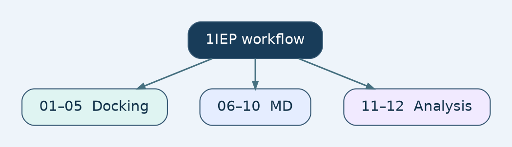

# Molecular Docking and GROMACS

**English** · [简体中文](README.zh-CN.md)

Languages synchronized 2026-11-28. [Verified workflow commit](https://github.com/LuciferBioLab/docking-gromacs-tutorial/commit/d139618900e79f0dc186d3bb64fbe5be4cc25914).

A reproducible workflow for soluble protein–ligand docking and molecular dynamics. Use dedicated modeling for membrane systems, covalent ligands, essential metals or cofactors, and nonstandard residues. The public 1IEP example uses a defined **+1** ligand microstate.

| Intended use | Requires a specialized protocol |
| --- | --- |
| Graduate students and researchers using Bash to reproduce soluble protein–ligand docking, MD, or figures | Membrane assemblies, covalently bound ligands, essential metals or cofactors, and nonstandard residues with unverified parameters |

[FAQ](docs/FAQ.md) · [Version matrix](docs/QUICKSTART.md#version-matrix) · [Validation boundary](docs/QUICKSTART.md#validation-boundary)

**Verification:** 2026-11-28 public 1IEP Linux x86-64 CPU run. The documentation and executable commands correspond to the same source commit.

## Contact

- [Issues](https://github.com/LuciferBioLab/docking-gromacs-tutorial/issues/new/choose)
- [lucifer.qsq@gmail.com](mailto:lucifer.qsq@gmail.com)
- [3069326069@qq.com](mailto:3069326069@qq.com)

**Checked pose handoff.** Preserve the source ligand chemistry. Recover the docking coordinates with Meeko metadata or an explicit RDKit atom map. [Two handoff routes](docs/DOCKING.md#pose-handoff) · [Chem3D/PyMOL comparison](docs/TROUBLESHOOTING.md#chem3d-pymol-topology).

## Start here

1. **Dock only:** complete steps 01–05 using the checksummed 1IEP files. [Quickstart](docs/QUICKSTART.md#dock).
2. **Run MD:** use a reviewed docking pose or a complete prepared system. [System setup](docs/SYSTEM_SETUP.md#topology) · [Quickstart](docs/QUICKSTART.md#quickstart-md).
3. **Make figures:** start with a matching trajectory, topology and index. [Analysis](docs/ANALYSIS.md#analysis).

## Contents

- [Quickstart](docs/QUICKSTART.md)
- [File map and run checklist](docs/WORKFLOW.md)
- [01–02 Environment and redocking](docs/ENVIRONMENT.md)
- [03–05 Preparation and docking](docs/DOCKING.md)
- [06–08 Force fields and setup](docs/SYSTEM_SETUP.md)
- [09–10 Equilibration and production](docs/SIMULATION.md)
- [11–12 Analysis and records](docs/ANALYSIS.md)
- [Glossary and command flags](docs/GLOSSARY.md)
- [Research extensions and validation](docs/RESEARCH.md)
- [Docking validation](docs/DOCKING_VALIDATION.md)
- [Troubleshooting and tutorial corrections](docs/TROUBLESHOOTING.md)
- [References and citation](docs/REFERENCES.md)

1. [Environment](docs/ENVIRONMENT.md#setup)
2. [Reference redocking](docs/ENVIRONMENT.md#benchmark)
3. [Structure preparation](docs/DOCKING.md#docking)
4. [Batch docking](docs/DOCKING.md#batch-docking)
5. [Pose transfer](docs/DOCKING.md#pose-handoff)
6. [Force fields](docs/SYSTEM_SETUP.md#topology)
7. [Complex assembly](docs/SYSTEM_SETUP.md#complex-assembly)
8. [Run parameters](docs/SYSTEM_SETUP.md#simulation)
9. [Equilibration](docs/SIMULATION.md#equilibration)
10. [Production](docs/SIMULATION.md#production)
11. [Analysis](docs/ANALYSIS.md#analysis)
12. [Reproducibility records](docs/ANALYSIS.md#reproducibility)

[License](LICENSE) · [CITATION.cff](CITATION.cff) · [Changelog](CHANGELOG.md) · [Contributing](CONTRIBUTING.md)

Section links from older releases

- [acknowledgments](docs/REFERENCES.md#acknowledgments)

- [agent workflow](docs/ANALYSIS.md#agent-workflow)

- [analysis](docs/ANALYSIS.md#analysis)

- [batch docking](docs/DOCKING.md#batch-docking)

- [benchmark](docs/ENVIRONMENT.md#benchmark)

- [chem3d pymol topology](docs/TROUBLESHOOTING.md#chem3d-pymol-topology)

- [complex assembly](docs/SYSTEM_SETUP.md#complex-assembly)

- [complex systems](docs/TROUBLESHOOTING.md#complex-systems)

- [conformer preparation](docs/DOCKING_VALIDATION.md#conformer-preparation)

- [disclaimer](docs/REFERENCES.md#disclaimer)

- [docking](docs/DOCKING.md#docking)

- [docking errors](docs/TROUBLESHOOTING.md#docking-errors)

- [endpoint energy](docs/ANALYSIS.md#endpoint-energy)

- [equilibration](docs/SIMULATION.md#equilibration)

- [figure layout](docs/ANALYSIS.md#figure-layout)

- [interaction review](docs/DOCKING_VALIDATION.md#interaction-review)

- [legacy adt handoff](docs/DOCKING.md#legacy-adt-handoff)

- [local inputs](docs/DOCKING.md#local-inputs)

- [method evidence](docs/REFERENCES.md#method-evidence)

- [pose handoff](docs/DOCKING.md#pose-handoff)

- [pose validation](docs/DOCKING_VALIDATION.md#pose-validation)

- [production](docs/SIMULATION.md#production)

- [publication figures](docs/ANALYSIS.md#publication-figures)

- [pymol image export](docs/ANALYSIS.md#pymol-image-export)

- [receptor repair](docs/DOCKING_VALIDATION.md#receptor-repair)

- [references](docs/REFERENCES.md#references)

- [reproducibility](docs/ANALYSIS.md#reproducibility)

- [server errors](docs/TROUBLESHOOTING.md#server-errors)

- [server handoff](docs/SIMULATION.md#server-handoff)

- [setup](docs/ENVIRONMENT.md#setup)

- [simulation](docs/SYSTEM_SETUP.md#simulation)

- [simulation errors](docs/TROUBLESHOOTING.md#simulation-errors)

- [sources](docs/REFERENCES.md#sources)

- [tiled search](docs/DOCKING_VALIDATION.md#tiled-search)

- [toolchain](docs/WORKFLOW.md#toolchain)

- [topology](docs/SYSTEM_SETUP.md#topology)

- [topology errors](docs/TROUBLESHOOTING.md#topology-errors)

- [triage](docs/TROUBLESHOOTING.md#triage)

- [troubleshooting contents](docs/TROUBLESHOOTING.md#troubleshooting-contents)

- [tutorial error flow](docs/TROUBLESHOOTING.md#tutorial-error-flow)

- [validation references](docs/DOCKING_VALIDATION.md#validation-references)

- [validation triage](docs/DOCKING_VALIDATION.md#validation-triage)

- [tutorial-error-flow](docs/TROUBLESHOOTING.md#tutorial-error-flow)

- [chem3d-pymol-topology](docs/TROUBLESHOOTING.md#chem3d-pymol-topology)

