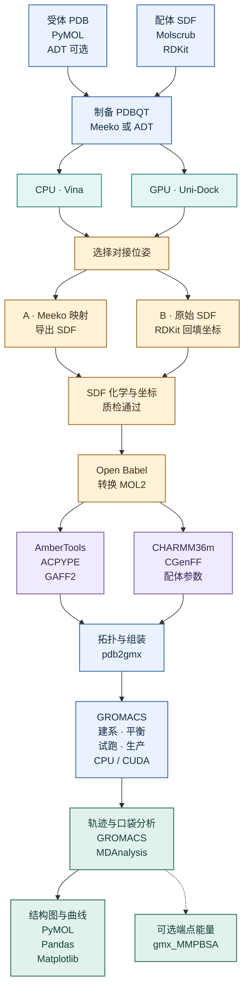
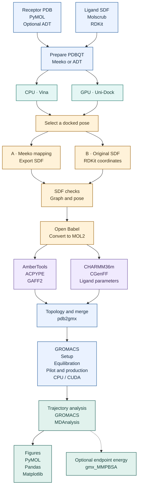

# 蛋白质–小分子对接与 GROMACS 分子动力学

**A reproducible workflow for protein–ligand docking and molecular dynamics**

**中文 / English** · CPU / NVIDIA CUDA · Linux / Windows + WSL2

本教程面向学术研究和科研教学。流程从受体 PDB 和配体 SDF 开始，覆盖批量对接、位姿与拓扑核对、显式溶剂分子动力学、轨迹分析和论文出图。每个阶段给出操作步骤和需要归档的材料，便于他人复核与复现。

This guide documents a reproducible workflow for academic research and training. Starting from a receptor PDB and a ligand SDF, it covers batch docking, pose and topology validation, explicit-solvent molecular dynamics (MD), trajectory analysis, and publication figures. Each stage identifies the commands and records needed to reproduce the work.

**适用范围 / Scope.** 默认体系为水溶液中的可溶蛋白与单个非共价结合、化学状态明确的有机小分子。膜蛋白、共价配体、必需金属或辅因子、非标准残基需要专项建模。  
The baseline protocol is designed for a soluble protein and one noncovalently bound organic small molecule in water. Membrane proteins, covalent ligands, essential metals or cofactors, and nonstandard residues require system-specific protocols.

<a name="contact"></a>

## 联系与合作 / Contact and collaboration

欢迎就分子对接、GROMACS 分子动力学、工作流复现与科研项目合作来信交流。  
Email is welcome for technical discussions on molecular docking, GROMACS simulations, workflow reproducibility, and research collaboration.

- [lucifer.qsq@gmail.com](mailto:lucifer.qsq@gmail.com)
- [3069326069@qq.com](mailto:3069326069@qq.com)

<a name="start-here"></a>

## 从这里开始 / Start here

- **首次使用 / First run.** 先[安装环境](#setup)，再用有共晶结构的 **1IEP（c-Abl–imatinib）** 完成[重对接验收](#benchmark)。按设备选择 AutoDock Vina（CPU）或 Uni-Dock（CUDA）。  
  Set up the environment and use the **1IEP c-Abl–imatinib** co-crystal as the reference redocking case. Select AutoDock Vina (CPU) or Uni-Dock (CUDA) for your hardware.
- **已有对接结果 / Docking output available.** 跳到[位姿交接](#pose-handoff)。带 Meeko 映射的结果用 Meeko 导出 SDF。已有旧 ADT 结果时，用原始 SDF 和经核实的原子映射恢复对接坐标。  
  Go to pose transfer. Export SDF from Meeko-mapped output, or use the original SDF and a verified atom map to recover coordinates from a legacy ADT run.
- **已有轨迹 / Trajectory available.** 从[轨迹处理与分析](#analysis)开始，然后按[论文出图章节](#publication-figures)整理结构图、曲线和图版。  
  Start with trajectory processing and analysis, then follow the figure workflow for molecular views, quantitative plots, and panel assembly.

- **已有 PDB 和 SDF / Local PDB and SDF available.** 从[本地输入](#local-inputs)开始，先审核蛋白结构和配体的化学状态。  
  Start with local input files and review the receptor structure and ligand microstate.
- **复杂体系或有报错 / Complex system or an error.** 对照[复杂体系与排错指南](docs/TROUBLESHOOTING.md#troubleshooting-contents)判断该从哪一步检查。  
  Use the troubleshooting guide to identify the first affected stage or a system-specific preparation route.
- **未知口袋或需复核对接结果 / Unknown pocket or docking validation.** 阅读[多阶段对接验证指南](docs/DOCKING_VALIDATION.md)，按受体修复、网格覆盖、局部位姿和相互作用复核逐步验收。  
  Follow the multi-stage docking guide to check receptor preparation, box coverage, local poses, and interaction assignments.

**官方速查 / Upstream documentation**  
[AutoDock Vina 手册](https://autodock-vina.readthedocs.io/en/latest/) · [Uni-Dock 文档](https://github.com/dptech-corp/Uni-Dock/tree/main/unidock) · [Meeko 手册](https://meeko.readthedocs.io/) · [GROMACS 官网](https://www.gromacs.org/) · [GROMACS 2026.3 手册](https://manual.gromacs.org/2026.3/) · [开源 PyMOL](https://github.com/schrodinger/pymol-open-source)

<a name="contents"></a>

## 目录 / Contents

- [联系与合作 / Contact and collaboration](#contact)
- **概览 / Overview**
  - [完整流程图 / Workflow overview](#overview) · [工具与文件交接 / Tools and file handoffs](#toolchain)
- **01–05 · 对接与位姿恢复 / Docking and pose recovery**
  - [01. 部署 / Environment setup](#setup) · [02. 共晶重对接 / Reference redocking](#benchmark)
  - [03. 受体与配体制备 / Structure preparation](#docking) · [本地 PDB/SDF 输入 / Local inputs](#local-inputs) · [04. CPU/CUDA 批量对接 / Batch docking](#batch-docking)
  - [05. 对接位姿交接 / Pose transfer](#pose-handoff) · [旧 ADT 结果恢复 / Legacy ADT recovery](#legacy-adt-handoff)
  - [多阶段对接与验证 / Multi-stage docking and validation](docs/DOCKING_VALIDATION.md)
- **06–10 · 参数化、建系与模拟 / Parameterization, system setup, and simulation**
  - [06. 两套力场与配体参数 / Force fields and ligand parameters](#topology) · [07. 蛋白拓扑与组装 / Protein topology and assembly](#complex-assembly)
  - [08. MDP 参数 / Run parameters](#simulation) · [09. 建系、最小化与平衡 / Setup and equilibration](#equilibration)
  - [10. 验收、生产与续跑 / Validation, production, and restart](#production) · [服务器交接 / Server handoff](#server-handoff)
- **11–12 · 结果、出图与复现 / Analysis, figures, and reproducibility**
  - [11. 轨迹分析 / Trajectory analysis](#analysis) · [MM/GBSA 与 MM/PBSA / Endpoint energy estimates](#endpoint-energy)
  - [论文出图与组图 / Publication figures](#publication-figures) · [Agent 与 Skills](#agent-workflow) · [12. 复现记录 / Reproducibility records](#reproducibility)
- **排错专页 / Troubleshooting guide**
  - [复杂受体与膜体系 / Complex systems](docs/TROUBLESHOOTING.md#complex-systems) · [常见报错 / Error index](docs/TROUBLESHOOTING.md#triage)
  - [网课错误流程图 / Tutorial pitfalls](docs/TROUBLESHOOTING.md#tutorial-error-flow) · [Chem3D–ADT–PyMOL 对照 / Workflow comparison](docs/TROUBLESHOOTING.md#chem3d-pymol-topology)
- **13–16 · 来源、引用与致谢 / Sources, citation, and acknowledgments**
  - [方法选择依据 / Evidence for method choices](#method-evidence) · [13. 工具、官网与源码 / Tools and upstream sources](#sources)
  - [14. 论文与工具引用 / References and software citation](#references) · [15. 免责声明 / Disclaimer](#disclaimer) · [16. 致谢 / Acknowledgments](#acknowledgments)

<a name="overview"></a>

## 完整流程图 / Workflow overview

从两条输入开始。受体按所选链和结构状态准备，配体按所选化学状态准备。对接引擎、MD 力场和 GROMACS 设备可以独立选择。首次使用先做[共晶重对接验收 / co-crystal redocking](#setup)。  
The receptor structure and ligand microstate are prepared separately. Choose the docking engine, molecular dynamics force field, and compute backend independently. Use the co-crystal benchmark to verify the docking installation and protocol.



[查看两条路线的对比图 / Compare with the tutorial shortcut](docs/TROUBLESHOOTING.md#chem3d-pymol-topology)

<details>
<summary>Full workflow in English</summary>



</details>

<a name="toolchain"></a>

### 工具与文件交接 / Tools and file handoffs

| 步骤 / Step | 工具与职责 / Tools and roles | 关键文件或检查 / Files or checks |
| --- | --- | --- |
| [01–02 部署与验收 / Setup and validation](#setup) | Miniforge/Conda 管理环境。Linux 为服务器方案，Windows 可用 WSL2 或原生 Vina。NVIDIA 驱动及 CUDA 支持 GPU 工具。 / Miniforge/Conda manages environments. Use Linux on servers and WSL2 or native Vina on Windows. NVIDIA drivers and CUDA support the GPU tools. | 1IEP 共晶重对接、日志、重原子 RMSD。 / 1IEP co-crystal redocking, logs, and heavy-atom RMSD. |
| [03 受体准备 / Receptor preparation](#docking) | RCSB PDB 提供源结构。开源 PyMOL 审查链、口袋和共晶配体。Meeko 制备对接受体，AutoDockTools 可辅助处理旧项目或查看 GPF。 / Use RCSB PDB for source structures and open-source PyMOL to inspect chains, pockets, and the co-crystal ligand. Meeko prepares the docking receptor. AutoDockTools can assist with legacy inputs or GPF inspection. | 审核后的蛋白 PDB、受体 PDBQT、搜索盒。 / Reviewed protein PDB, receptor PDBQT, box. |
| [03 配体准备 / Ligand preparation](#docking) | PubChem 等提供原始 SDF。Molscrub 生成质子化、互变异构和 3D 候选。RDKit 核对化学图、手性和净电荷，Meeko 输出带映射的 PDBQT。 / PubChem or another documented source provides the SDF. Molscrub generates protonation states, tautomers, and 3D candidates. RDKit checks graph, stereochemistry, and net charge. Meeko writes mapped PDBQT. | 原始 SDF、选定状态 SDF、配体 PDBQT。 / Source and selected-state SDFs, ligand PDBQT. |
| [04 对接与复筛 / Docking and follow-up](#docking) | AutoDock Vina 用 CPU 多线程，Uni-Dock 用 NVIDIA CUDA。用结构查看器检查位姿和口袋接触。 / AutoDock Vina uses CPU threads and Uni-Dock uses NVIDIA CUDA. Review poses and pocket contacts in a structure viewer. | 对接位姿、日志、候选 ID、搜索盒和种子。 / Poses, logs, candidate IDs, box, and seeds. |
| [05 恢复与质检 / Pose recovery and QC](#pose-handoff) | A 用 Meeko 映射导出 SDF。B 用原始 SDF 和经审核的原子映射，由 RDKit 恢复旧 ADT 位姿。两条路线都通过化学与坐标检查，再用 Open Babel 转 MOL2。 / A exports SDF from Meeko mappings. B maps a legacy ADT pose onto the original SDF with RDKit. Both require chemistry and coordinate checks before Open Babel converts to MOL2. | 入选位姿的 SDF、MOL2、原子映射及绝对坐标核对。 / Selected pose SDF, MOL2, atom mapping, and absolute coordinate check. |
| [06–07 两套力场与组装 / Force fields and assembly](#topology) | 蛋白由 GROMACS `pdb2gmx` 参数化。AMBER 配体采用 AmberTools（`antechamber`、`sqm`、`parmchk2`、`tleap`）与 ACPYPE；CHARMM 配体采用 CGenFF 与 Lemkul Lab 转换器。 / GROMACS `pdb2gmx` parameterizes the protein. The AMBER ligand uses AmberTools and ACPYPE. The CHARMM ligand uses CGenFF and the Lemkul Lab converter. | AMBER99SB-ILDN + GAFF2/AM1-BCC 或 CHARMM36m + CGenFF，坐标和拓扑原子顺序一致。 / Compatible protein and ligand parameters and matching atom order. |
| [08–10 建系与生产 / Setup and production](#simulation) | GROMACS 完成建盒、加水加盐、EM、NVT、NPT、解除位置限制后试跑、生产和检查点续跑。 / GROMACS handles boxing, solvation, ions, EM, NVT, NPT, unrestrained tests, production, and restarts. | MDP、TPR、CPT、EDR、XTC 与日志。 / MDP, TPR, CPT, EDR, XTC, and logs. |
| [11–12 分析与出图 / Analysis and figures](#analysis) | GROMACS / MDAnalysis 处理轨迹，gmx_MMPBSA 可做端点能量估算。开源 PyMOL 出结构图，pandas / Matplotlib / seaborn 出曲线与统计图，Inkscape 或可选的 GIMP / Photoshop 组图。 / GROMACS and MDAnalysis analyze trajectories. gmx_MMPBSA can estimate endpoint energies. Open-source PyMOL renders structures, pandas / Matplotlib / seaborn prepare plots, and Inkscape or optional GIMP / Photoshop assembles panels. | XVG、CSV、代表结构、结构图 PNG、矢量曲线图和可编辑图版。 / XVG, CSV, representative structures, structure PNGs, vector plots, and editable figures. |

<a name="setup"></a>

## 01. 环境与安装 / Environment setup and installation

### Linux 服务器 / Linux server

从 [Miniforge 官方发布页](https://github.com/conda-forge/miniforge/releases) 选择与系统和架构匹配的安装包，并按发布页提供的信息校验。下文使用 Bash，默认在项目根目录操作，遇到报错时先检查该步。软件示例使用 Vina 1.2.7、Uni-Dock 1.2.0 和 GROMACS 2026.3 的命令语法。已安装 Miniforge 时直接创建环境。

Use the Miniforge installer for your operating system and architecture, and verify it against the published release information. Command blocks assume Bash and the project root unless specified. The examples use the syntax of Vina 1.2.7, Uni-Dock 1.2.0, and GROMACS 2026.3. If Miniforge is already available, proceed to environment creation. [Miniforge releases](https://github.com/conda-forge/miniforge/releases)

Linux x86-64 安装示例如下，其他架构请替换安装包名。 / Example for Linux x86-64. Use the installer for your architecture.

```bash
bash Miniforge3-Linux-x86_64.sh -b -p "$HOME/miniforge3"
source "$HOME/miniforge3/etc/profile.d/conda.sh"
```

```bash
conda create -n docktools --override-channels -c conda-forge python=3.11 vina=1.2.7 meeko rdkit gemmi openbabel
conda create -n ligandtools --override-channels -c conda-forge ambertools acpype openbabel
conda create -n gmx-cpu --override-channels -c conda-forge gromacs=2026.3

conda activate docktools
vina --version
mk_prepare_receptor.py --help
mk_prepare_ligand.py --help
mk_export.py --help

conda activate ligandtools
command -v antechamber parmchk2 tleap sqm acpype obabel
acpype -h

conda activate gmx-cpu
gmx --version
```

如需枚举配体的质子化与互变异构状态，在 `docktools` 环境安装 Molscrub，运行 `scrub.py --help` 和 `python -m pip check` 核对依赖。遇到平台或版本求解问题，按各项目安装文档选择兼容版本并记录。  
Install Molscrub in `docktools` to enumerate protomers and tautomers. Run `scrub.py --help` to confirm the command-line interface and `python -m pip check` to verify dependencies. If dependency resolution fails, consult upstream installation instructions and document compatible versions. [Molscrub installation](https://github.com/forlilab/molscrub) · [Vina releases](https://github.com/forlilab/AutoDock-Vina/releases) · [conda-forge GROMACS](https://anaconda.org/conda-forge/gromacs)

```bash
conda activate docktools
python -m pip install molscrub
python -m pip check
scrub.py --help
```

### NVIDIA CUDA 对接环境 / NVIDIA CUDA docking environment

在 Linux GPU 节点执行下面命令。Windows 用户先完成本节末尾的 WSL2 设置，再从 WSL Bash 执行同样命令。示例使用 conda-forge 的 Linux x86-64 Uni-Dock 1.2.0 包。先确认驱动能运行实际选用的 CUDA runtime。预编译包会安装所需的运行时依赖，`nvcc` 用于源码编译。  
Run these commands on a Linux GPU node or in WSL2 after completing the Windows setup below. The example uses the conda-forge Linux x86-64 build of Uni-Dock 1.2.0. Verify that the NVIDIA driver supports the package's CUDA runtime. The package installs its runtime dependencies. Source builds use the `nvcc` compiler. [Uni-Dock release notes](https://github.com/dptech-corp/Uni-Dock/releases) · [conda-forge builds](https://anaconda.org/conda-forge/unidock/files) · [NVIDIA CUDA compatibility](https://docs.nvidia.com/deploy/cuda-compatibility/latest/minor-version-compatibility.html)

```bash
nvidia-smi
conda create -n dockgpu --override-channels -c conda-forge 'unidock=1.2.0'
conda activate dockgpu
command -v unidock
unidock --help
conda list --show-channel-urls unidock
```

`nvidia-smi` 标题中的 CUDA Version 表示驱动支持的 CUDA 版本，Toolkit 安装可另用 `nvcc --version` 核实。若解算或运行报 CUDA 兼容错误，请查看实际包的 CUDA 构建号和 GPU 节点驱动，选择两者兼容的版本。命令帮助可验证软件安装，步骤 02 的对接运行用于验证 GPU。  
The CUDA version reported by `nvidia-smi` indicates driver support. Use `nvcc --version` to query a locally installed toolkit. If installation or execution fails because of CUDA compatibility, match the package build to the node's NVIDIA driver. Verify installation with the help command and verify GPU execution with the reference docking case in step 02. [NVIDIA nvidia-smi documentation](https://docs.nvidia.com/deploy/nvidia-smi/)

### GROMACS CUDA 构建 / GROMACS CUDA build

在允许使用 GPU 的计算节点检查 `nvidia-smi`。如需自行编译，选择 GROMACS 安装手册支持的 CUDA Toolkit、C/C++ 编译器和 CMake。使用上游源码压缩包解压后的目录执行以下命令。已有集群软件模块时，可直接加载并核对版本及 GPU 后端。  
Verify GPU visibility with `nvidia-smi`. For a source build, select CUDA Toolkit, compiler, and CMake versions supported by the GROMACS installation guide, then run the commands from the extracted source tree. If a cluster module is available, load it and verify its GROMACS version and GPU backend. [GROMACS website](https://www.gromacs.org/) · [2026.3 build guide](https://manual.gromacs.org/2026.3/install-guide/index.html) · [GPU performance guide](https://manual.gromacs.org/documentation/current/user-guide/mdrun-performance.html)

```bash
nvidia-smi
nvcc --version
cmake --version
cmake -S . -B build-cuda -DGMX_GPU=CUDA -DGMX_BUILD_OWN_FFTW=ON \
  -DREGRESSIONTEST_DOWNLOAD=ON -DCMAKE_INSTALL_PREFIX="$HOME/opt/gromacs-2026.3-cuda"
cmake --build build-cuda --parallel 4
cmake --build build-cuda --target check
cmake --install build-cuda

source "$HOME/opt/gromacs-2026.3-cuda/bin/GMXRC"
gmx --version
```

切换到 MD 阶段时，选择一个 GROMACS 环境并用 `command -v gmx` 确认。集群上在调度器分配的计算节点运行，线程数以作业配额为准。  
Before starting MD, verify which GROMACS executable is on `PATH` with `command -v gmx`. Run shared-cluster jobs inside a scheduler allocation and match the thread count to the allocated resources. [Slurm documentation](https://slurm.schedmd.com/documentation.html)

### Windows + WSL2

从 PowerShell 检查 WSL。若尚未安装，可执行第二个代码块并按提示重启。此后在 Ubuntu 的 WSL Bash 中执行 Linux 步骤，项目与轨迹存放在 Linux 文件系统，例如 `~/docking-md-workshop`。  
Check the WSL configuration in PowerShell. If WSL is absent, install it with the second command block and restart if prompted. Run the Linux commands in Ubuntu under WSL. Store the simulation project and trajectory files on the Linux filesystem, for example in `~/docking-md-workshop`. [Microsoft WSL installation](https://learn.microsoft.com/windows/wsl/install) · [WSL filesystems](https://learn.microsoft.com/windows/wsl/filesystems)

```powershell
wsl --status
wsl -l -v
```

```powershell
wsl --install -d Ubuntu
```

在 **Windows 宿主机**安装支持 WSL 的 NVIDIA 驱动，并在 WSL Bash 运行 `nvidia-smi`。通过后可按上面的命令装 Uni-Dock CUDA，或选择 CPU 路线。需要源码编译时按 NVIDIA 指引安装 WSL Toolkit，选用不捆绑 Linux 显卡驱动的包。原生 Windows 版 Vina 1.2.7 可走步骤 04A，CUDA 对接走步骤 04B。  
Install the WSL-capable NVIDIA driver on the **Windows host** and check `nvidia-smi` from WSL Bash. Then install Uni-Dock CUDA as shown above or choose the CPU route. For a source build, follow NVIDIA's WSL instructions and select a Toolkit package without a bundled Linux display driver. Native Windows Vina 1.2.7 is covered in step 04A and CUDA docking in step 04B. [NVIDIA CUDA on WSL](https://docs.nvidia.com/cuda/wsl-user-guide/index.html) · [Vina batch syntax on Windows](https://autodock-vina.readthedocs.io/en/latest/docking_in_batch.html)

<a name="benchmark"></a>

## 02. 参考案例重对接 / Reference redocking benchmark

先用 Scripps 官方示例复跑 c-Abl 与伊马替尼（PDB **1IEP**）。从官方示例目录下载 `1iep_receptorH.pdb` 和 `1iep_ligand.sdf` 到一个新目录，在该目录运行以下命令。此处的盒坐标只适用于该示例坐标系。  
Use the Scripps c-Abl–imatinib example (PDB **1IEP**) as a reference redocking benchmark. Download `1iep_receptorH.pdb` and `1iep_ligand.sdf` from the upstream example into a new directory and run the commands there. The search box is defined in the example receptor's coordinate frame. [Official walkthrough](https://autodock-vina.readthedocs.io/en/latest/docking_basic.html) · [Upstream example files](https://github.com/forlilab/AutoDock-Vina/tree/develop/example/basic_docking) · [RCSB 1IEP](https://www.rcsb.org/structure/1IEP)

**结构来源与验证依据 / Structure provenance and validation.** 记录 1IEP 的结构 DOI 和参考配体实例。报告重对接 RMSD 时，注明原子匹配与对称性处理方法。  
Record the structure DOI and reference ligand instance. Report the atom correspondence and symmetry treatment used for redocking RMSD. [1IEP structure DOI](https://doi.org/10.2210/pdb1IEP/pdb) · [DockRMSD methodology](https://doi.org/10.1186/s13321-019-0362-7)

```bash
conda activate docktools
mk_prepare_receptor.py --read_pdb 1iep_receptorH.pdb -o 1iep_receptor -p -v \
  --box_size 20 20 20 --box_center 15.190 53.903 16.917
mk_prepare_ligand.py -i 1iep_ligand.sdf -o 1iep_ligand.pdbqt
```

**CPU：AutoDock Vina / CPU: AutoDock Vina**

```bash
vina --receptor 1iep_receptor.pdbqt --ligand 1iep_ligand.pdbqt \
  --config 1iep_receptor.box.txt --scoring vina --cpu 4 --seed 202601 \
  --exhaustiveness 32 --out 1iep_docked.pdbqt
mk_export.py 1iep_docked.pdbqt -s 1iep_docked.sdf
```

**GPU：Uni-Dock CUDA / GPU: Uni-Dock CUDA**

```bash
conda activate dockgpu
mkdir 1iep_gpu
unidock --receptor 1iep_receptor.pdbqt --gpu_batch 1iep_ligand.pdbqt \
  --config 1iep_receptor.box.txt --scoring vina --search_mode balance \
  --num_modes 20 --seed 202601 --dir 1iep_gpu > 1iep_gpu/unidock.log 2>&1
tail -25 1iep_gpu/unidock.log
find 1iep_gpu -maxdepth 1 -type f -name '*.pdbqt' -print
```

用步骤 05 的检查和导出方式处理 GPU 输出。对接命令成功退出后，用位姿文件、日志和 GPU 观测共同核对。  
For the GPU run, apply the pose export and verification procedure in step 05. Confirm successful completion using the pose file, run log, and observed GPU activity.

**验收 / Check.** 确认 PDBQT 有 Vina 分数和姿态，SDF 可以读取。分别用公开参考结果检查 CPU 和 GPU 的位姿与关键接触。正式做共晶重对接时，先把参考与对接结构置于同一受体坐标系，比较带对称校正的重原子 RMSD，保持配体在各自原位。约 2 Å 是常用参考值。可另用 BioExcel 的公开案例练习 MD 复合物建系。  
Confirm that the PDBQT contains pose and score records and that the recovered SDF is readable. Evaluate each engine's pose recovery and key contacts against the co-crystal reference. Calculate symmetry-aware ligand heavy-atom root-mean-square deviation (RMSD) in a common receptor frame without independently fitting the ligands. Approximately 2 Å is a conventional reference for pose recovery. A separate BioExcel tutorial covers MD complex setup. [Scripps expected results](https://autodock-vina.readthedocs.io/en/latest/docking_basic.html#expected-results) · [BioExcel complex setup](https://github.com/bioexcel/biobb_wf_protein-complex_md_setup)

**定量重对接 / Quantitative redocking.** 在 RCSB 1IEP 的 **Small Molecules → STI → Instance Coordinates** 下载对应链的 SDF，保存为 `1iep_crystal_ligand.sdf`。在结构查看器里确认其链/构象对应受体，并把两者置于同一受体坐标系。先核对化学身份，再用 Open Babel 的 `obrms` 对每个对接姿态计算重原子 RMSD（Å）。`obrms` 按重原子连接匹配并考虑等价映射，`-m` 会对配体再拟合，此处省略该选项。  
In the RCSB 1IEP entry, download the STI instance coordinates as SDF for the matching chain and save them as `1iep_crystal_ligand.sdf`. Verify the ligand conformer and common receptor frame in a structure viewer. After confirming chemical identity, use Open Babel `obrms` to calculate per-pose heavy-atom RMSD in Å. It searches equivalent correspondences by heavy-atom connectivity. Leave `-m` unset to preserve each pose in the receptor frame. [RCSB 1IEP](https://www.rcsb.org/structure/1IEP) · [Open Babel obrms](https://github.com/openbabel/openbabel/blob/master/tools/obrms.cpp)

```bash
conda activate docktools
obabel 1iep_crystal_ligand.sdf -ocan
obabel 1iep_docked.sdf -ocan
obrms 1iep_crystal_ligand.sdf 1iep_docked.sdf | tee 1iep_cpu_redocking_rmsd.txt
```

GPU 同样比较。把按步骤 05 恢复的 1IEP GPU 多位姿 SDF 保存为 `1iep_gpu_docked.sdf`，然后执行下列命令。记录排名第一的位姿与前若干位姿的排名、RMSD 与关键接触，便于区分采样到参考姿态与评分将其排在首位。  
Export the GPU poses to `1iep_gpu_docked.sdf` using step 05. Compare the top-ranked pose and other leading poses by RMSD and key contacts. Record separately whether the search recovered the reference pose and whether the scoring function ranked it first.

若最佳匹配位姿已采样到但排位偏低，分别记录该位姿的排名和重对接 RMSD，并复核口袋接触与配体状态。[重对接排错](docs/TROUBLESHOOTING.md#docking-errors)  
If a reference-like pose is sampled but ranked poorly, report its rank and redocking RMSD and review pocket contacts and ligand microstate. [Redocking troubleshooting](docs/TROUBLESHOOTING.md#docking-errors)

```bash
obabel 1iep_gpu_docked.sdf -ocan
obrms 1iep_crystal_ligand.sdf 1iep_gpu_docked.sdf | tee 1iep_gpu_redocking_rmsd.txt
```

[返回目录 / Back to contents](#contents)

<a name="docking"></a>

## 03. 受体与配体制备 / Receptor and ligand preparation

新建 Linux 工作目录时使用下面的命令。若已按[本地输入章节](#local-inputs)建立项目，只在对应的项目目录执行最后一行。  
Use these commands for a new Linux project. If you already staged inputs, run only the last line from the corresponding project directory.

```bash
mkdir -p "$HOME/docking-md-workshop"
cd "$HOME/docking-md-workshop"
mkdir -p input ligands/pdbqt dock qc md
```

<a name="local-inputs"></a>

### 从现有文件开始 / Start from local PDB and SDF files

在新的项目工作目录中打开 PowerShell，分别填写原始 PDB 和 SDF 的绝对路径。下例只复制指定文件，副本使用本教程的统一文件名。PowerShell 用于导入，后续标为 Bash 的命令在 WSL 或 Linux 中执行。已在 Linux 中工作时，直接把指定文件复制到项目的 `input/`，使用相同文件名。  
Open PowerShell in a new project directory and set the absolute paths to the source PDB and SDF files. The example stages the two selected files under the tutorial's standard names. Use PowerShell for staging and WSL or Linux for Bash instructions. On Linux, copy the selected files directly to `input/` under the same names. [Microsoft WSL filesystem guidance](https://learn.microsoft.com/en-us/windows/wsl/filesystems)

<details>
<summary>PowerShell 导入示例 / PowerShell staging example</summary>

```powershell
$Protein = 'C:\path\to\protein.pdb'
$Ligand  = 'C:\path\to\ligand.sdf'

if (!(Test-Path -LiteralPath $Protein -PathType Leaf) -or
    !(Test-Path -LiteralPath $Ligand -PathType Leaf)) {
    throw 'Check the two input file paths.'
}

$InputDir = Join-Path (Get-Location).Path 'input'
$ProteinCopy = Join-Path $InputDir 'protein_raw.pdb'
$LigandCopy = Join-Path $InputDir 'ligand_raw.sdf'
if ((Test-Path -LiteralPath $ProteinCopy) -or (Test-Path -LiteralPath $LigandCopy)) {
    throw 'The input directory already has a staged file. Use a fresh project directory.'
}

New-Item -ItemType Directory -Force -Path $InputDir -ErrorAction Stop | Out-Null
Copy-Item -LiteralPath $Protein -Destination $ProteinCopy -ErrorAction Stop
Copy-Item -LiteralPath $Ligand -Destination $LigandCopy -ErrorAction Stop
wsl pwd
```

`wsl pwd` 用来确认 WSL 中当前目录对应的路径。在该目录核对两个副本。若后续将项目移到 Linux 文件系统，重新核对工作目录和输入路径。  
Use `wsl pwd` to identify the WSL path corresponding to the current directory and verify the two copies there. Recheck paths if you move the project to the Linux filesystem.

</details>

| 原始输入 / Source input | 进入下一步的条件 / Requirements for the next step |
| --- | --- |
| `input/protein_raw.pdb` | 核对组装、链、口袋、非标准成分及缺失区域。之后分别准备 MD 用的 `protein.pdb` 和对接用的 `receptorH.pdb`。 / Review assembly, chains, pocket, nonstandard components, and missing regions. Prepare the MD and docking receptor files separately. |
| `input/ligand_raw.sdf`，2D / 2D SDF | 先确定键级、手性和微观状态，再生成 3D 构象及显式氢，供 Meeko 制备。 / Verify bond orders, stereochemistry, and microstate, then generate a 3D conformer with explicit hydrogens for Meeko. |
| `input/ligand_raw.sdf`，3D / 3D SDF | 审核坐标、显式氢、化学状态和记录号。合格的单条记录可直接用于配体制备。 / Review coordinates, explicit hydrogens, chemistry, and record number. A validated single record can be used directly for ligand preparation. |

[Meeko 配体输入要求 / Ligand input requirements](https://meeko.readthedocs.io/en/develop/lig_prep_basic.html) · [复杂结构审核 / Complex structure review](docs/TROUBLESHOOTING.md#complex-systems)

| 输入 / Input | 准备要求 / Preparation |
| --- | --- |
| `input/protein.pdb` | 准备供 MD 使用的蛋白，确认生物学装配、链、替代构象、缺失残基和重原子、二硫键、端基以及 His 状态。保留原始结构、PDB ID 和取舍依据。 / Prepare the protein for MD. Review the biological assembly, chains, alternate conformations, missing residues and heavy atoms, disulfides, termini, and histidine states. Retain the original structure, PDB ID and curation rationale. |
| `input/receptorH.pdb` | 使用同一受体坐标系和已审查的质子化假设，提供适合 Meeko 的受体。逐个审查水、离子和辅因子对口袋的作用。 / Provide a Meeko-compatible receptor in the same coordinate frame using reviewed protonation assumptions. Evaluate each water, ion, or cofactor for its role in the pocket. |
| `input/ligand_raw.sdf` | 获取有明确键级、手性和身份的小分子记录。记录 CID 或其他来源、pH 假设和每个候选的整数净电荷。 / Obtain a molecule record with defined bond orders, stereochemistry, and identity. Record the CID or other source, pH assumption, and integer net charge of each candidate. |
| `dock/box.txt` | 根据共晶配体或其他口袋证据确定搜索盒，目视确认它覆盖预期区域。中心和三个边长均以 Å 计。每个受体或不同口袋应保留自己的配置。 / Define and visually check the search box using the co-crystal ligand or other pocket evidence. Use Å for the center coordinates and all three edge lengths. Keep a separate configuration for each receptor or pocket. |

来源与命令参考 / Structure databases and setup docs · [RCSB PDB](https://www.rcsb.org/) · [PubChem](https://pubchem.ncbi.nlm.nih.gov/) · [Meeko receptor options](https://meeko.readthedocs.io/en/develop/rec_cli_options.html) · [Molscrub CLI](https://molscrub.readthedocs.io/en/latest/cli.html)

**受体分两份处理 / Receptor files for docking and MD.** 从同一份源结构确定链、altloc、缺失部分、口袋水和所需辅助成分。可用开源 PyMOL 查看和选择链，保存经审核的 `input/protein.pdb`。为 `input/receptorH.pdb` 确定氢与质子化状态后，用 Meeko 制备受体 PDBQT。已有 AutoDockTools 的读者可用它辅助加氢、查看旧 GPF 或准备对接受体，但应逐项复核化学状态和盒范围。MD 仍从经审核的蛋白 PDB 用 `pdb2gmx` 生成拓扑。  
Review chain identity, alternate locations, missing atoms or residues, and any essential solvent molecules or cofactors in the source structure. Open-source PyMOL can be used to curate `input/protein.pdb`. Review the hydrogen and protonation model in `input/receptorH.pdb` before generating receptor PDBQT with Meeko. AutoDockTools can assist with legacy preparation and AutoGrid parameter files (GPF). Use the prepared protein PDB for MD topology generation with `pdb2gmx`. [Meeko receptor preparation](https://meeko.readthedocs.io/en/develop/rec_cli_options.html) · [Scripps AutoDock Suite](https://ccsb.scripps.edu/autodocksuite/)

下例从 Molscrub 输出中选第 1 条作为候选。按实际审核结果替换记录号。若已有确认过的带显式氢、单记录 3D SDF，可直接将其保存为 `ligands/state001.sdf`。为不同化学状态使用独立 ID。  
The example selects record 1 from the Molscrub output. Substitute the record number established during chemical review. You may supply a vetted single-record 3D SDF with explicit hydrogens as `ligands/state001.sdf`. Assign a distinct identifier to each ligand microstate.

```bash
conda activate docktools
scrub.py input/ligand_raw.sdf -o ligands/candidates.sdf --ph 7.4
obabel ligands/candidates.sdf -ocan
obabel ligands/candidates.sdf -f 1 -l 1 -O ligands/state001.sdf
```

**用 RDKit 检查候选 / Review the candidate with RDKit.** 命令块在已激活的 `docktools` 中执行。进入 Python 后读入所选 SDF，核对手性、整数净电荷、显式氢和 3D 标记。若读取失败或结构与预期不符，回到候选选择。退出 Python 后再调用 Meeko。  
From the `docktools` environment, load the selected SDF in Python and verify stereochemistry, integer net charge, explicit hydrogen count, and the 3D conformer flag. Resolve any parsing or chemical-identity discrepancy before calling Meeko. [RDKit Python guide](https://www.rdkit.org/docs/GettingStartedInPython.html)

```bash
python
```

```python
from rdkit import Chem

candidate = Chem.SDMolSupplier("ligands/state001.sdf", removeHs=False)[0]
Chem.MolToSmiles(Chem.RemoveHs(candidate), isomericSmiles=True)
Chem.GetFormalCharge(candidate)
sum(atom.GetAtomicNum() == 1 for atom in candidate.GetAtoms())
candidate.GetConformer().Is3D()
exit()
```

```bash
mk_prepare_receptor.py --read_pdb input/receptorH.pdb -o dock/receptor -p
mk_prepare_ligand.py -i ligands/state001.sdf -o ligands/pdbqt/state001.pdbqt
sha256sum input/* > qc/input_sha256.txt
```

将下列六项保存为 `dock/box.txt`，把示例值替换为自己测定的中心与尺寸。旧 AutoGrid 参数中的网格间隔数乘间距才得到 Å。对于无已知口袋的结构，可另建探索性搜索盒并检查采样收敛和口袋证据。  
Write the six fields to `dock/box.txt` and substitute the actual center and edge lengths. Convert legacy AutoGrid interval counts to Å using the grid spacing. If the binding site is unknown, use a separate exploratory box and evaluate sampling and pocket plausibility.

```ini
center_x = 15.190
center_y = 53.903
center_z = 16.917
size_x = 20.0
size_y = 20.0
size_z = 20.0
```

**验收 / Check.** 核对 SDF 记录、显式氢、手性、键级和净电荷。配体 PDBQT 应保留 Meeko 写入的化学映射信息。受体文件、参考配体和搜索盒应在同一坐标系中。  
Verify the SDF record count, explicit hydrogens, stereochemistry, bond orders, and net charge. Check that the ligand PDBQT retains the Meeko mapping metadata and that the receptor, reference ligand, and search box use the same coordinate frame. [Meeko documentation](https://meeko.readthedocs.io/) · [Open Babel CLI](https://openbabel.org/docs/Command-line_tools/babel.html)

**结构与化学核对 / Structure and chemistry references.** 实验结构使用 wwPDB 验证报告复核质量，配体标识可用化学组分字典核对。  
Use wwPDB validation reports to review deposited experimental structures and the Chemical Component Dictionary to check ligand identifiers. [wwPDB validation reports](https://www.wwpdb.org/validation/validation-reports) · [Chemical Component Dictionary](https://www.wwpdb.org/data/ccd)

**局部筛选、盲对接和复筛 / Focused screening, blind docking, and follow-up.** 有共晶或可靠位点时，优先用局部盒并用重对接验收。无已知口袋时，用单独的探索性盒（如 `dock/box_blind.txt`）记录范围、种子和搜索力度，检查候选是否集中在有结构依据的口袋，再为候选口袋新建局部盒和输出目录进行复筛。保留不同盒的独立结果。旧 GPF 可用 `grep -E '^(npts|spacing|gridcenter)[[:space:]]' receptor.gpf` 查字段。例如 `npts 60 60 60` 和 `spacing 0.375` 对应三边各 22.5 Å。若 `gridcenter` 为 `auto`，应重新核实真实中心再填写。  
Use a focused box when structural evidence identifies the binding site. Validate the protocol by redocking when a co-crystal pose is available. For exploratory docking, use a separate file such as `dock/box_blind.txt` and record the coverage, seeds, and search settings. Inspect pose clusters for structurally plausible pockets, then use separate focused boxes and output directories for follow-up. In a legacy GPF, `npts 60 60 60` with `spacing 0.375` defines three 22.5 Å edges. Resolve `gridcenter auto` to verified coordinates before writing the Vina configuration. [Vina FAQ](https://autodock-vina.readthedocs.io/en/latest/faq.html)

<a name="batch-docking"></a>

## 04. CPU 与 CUDA 批量对接 / Batch docking on CPU and CUDA

两条路线共用步骤 03 的受体 PDBQT、配体 PDBQT 和搜索盒。为每个筛选条件保留独立目录。可逐个调用 Meeko 生成配体 PDBQT，或用 `--multimol_outdir` 处理已审核的多记录 SDF。保留候选 ID 与原始 SDF 的对应表，并检查重名和漏项。  
The CPU and CUDA workflows use the same receptor PDBQT, ligand PDBQT files, and search box from step 03. Use a separate output directory for each screen. Prepare ligands individually or pass a reviewed multi-record SDF to Meeko with `--multimol_outdir`. Track the mapping between ligand IDs and source SDF records, including duplicate IDs and failed preparations. [Meeko ligand CLI](https://meeko.readthedocs.io/en/develop/lig_cli_options.html)

### A. CPU · AutoDock Vina

先跑一个已审核配体，核对日志和位姿后再开始批量筛选。  
Run a single curated ligand and inspect its output and log before launching the batch.

```bash
conda activate docktools
mkdir dock/cpu_single_202601
vina --receptor dock/receptor.pdbqt --ligand ligands/pdbqt/state001.pdbqt \
  --config dock/box.txt --scoring vina --cpu 4 --exhaustiveness 32 \
  --num_modes 20 --seed 202601 --out dock/cpu_single_202601/state001_out.pdbqt \
  > dock/cpu_single_202601/vina.log 2>&1
tail -20 dock/cpu_single_202601/vina.log
grep -E '^MODEL|^REMARK VINA RESULT' dock/cpu_single_202601/state001_out.pdbqt
```

```bash
mkdir dock/cpu_batch_202601
time vina --receptor dock/receptor.pdbqt --batch ligands/pdbqt/*.pdbqt \
  --config dock/box.txt --scoring vina --cpu 4 --exhaustiveness 32 \
  --num_modes 20 --seed 202601 --dir dock/cpu_batch_202601 \
  > dock/cpu_batch_202601/vina.log 2>&1
find ligands/pdbqt -maxdepth 1 -type f -name '*.pdbqt' | wc -l
find dock/cpu_batch_202601 -maxdepth 1 -type f -name '*.pdbqt' | wc -l
```

`--batch` 针对同一受体逐个处理配体，`--cpu 4` 控制一次 Vina 进程的线程数。拆分大库后可在 CPU 配额内并行运行多个独立批次。多个受体分别使用各自的搜索盒。  
`--batch` processes ligands sequentially against one receptor. `--cpu 4` sets the thread count for a Vina process. Split large libraries into separate jobs to parallelize within your CPU allocation. Use a separately defined box for each receptor. [Vina native batch mode](https://autodock-vina.readthedocs.io/en/latest/docking_in_batch.html)

#### Windows 原生 Vina 与 WSL2 文件交接 / Native Windows Vina and WSL2 handoff

如果使用 WSL Bash 做准备、原生 Windows 运行 Vina，先把必要的对接文件复制到 Windows 用户目录。替换 `YOUR_WINDOWS_USER`，在 WSL 项目根目录执行。原始 SDF 和受体供 MD 使用的 PDB 留在 WSL 项目中。Windows 盘在这里只用于交接。  
For WSL preparation followed by native Windows Vina, copy the docking files to your Windows profile. Replace `YOUR_WINDOWS_USER` and run these commands from the WSL project root. Keep the original SDF and the MD-ready protein PDB in the WSL project. Use the Windows drive for the handoff. [Microsoft WSL filesystems](https://learn.microsoft.com/windows/wsl/filesystems)

```bash
win_user='YOUR_WINDOWS_USER'
win_job="/mnt/c/Users/$win_user/MD_exchange/target01"
mkdir -p "/mnt/c/Users/$win_user/MD_exchange"
mkdir "$win_job" &&
  mkdir -p "$win_job/dock" "$win_job/ligands/pdbqt" &&
  cp dock/receptor.pdbqt dock/box.txt "$win_job/dock/" &&
  cp ligands/pdbqt/*.pdbqt "$win_job/ligands/pdbqt/"
```

在 Windows PowerShell 进入交接目录。示例假定官方可执行文件放在该目录并命名为 `vina.exe`。如已安装在其他位置，将 `$Vina` 改为完整路径。  
Enter the exchange directory in Windows PowerShell. The example expects the upstream executable there as `vina.exe`. Set `$Vina` to its full path if it is installed elsewhere. [Official Windows batch instructions](https://autodock-vina.readthedocs.io/en/latest/docking_in_batch.html)

```powershell
Set-Location (Join-Path $env:USERPROFILE 'MD_exchange\target01')
$Vina = '.\vina.exe'
& $Vina --version
$Ligands = @(Get-ChildItem '.\ligands\pdbqt' -Filter '*.pdbqt' -File |
    Sort-Object Name | Select-Object -ExpandProperty FullName)
if ($Ligands.Count -eq 0) { throw 'No ligand PDBQT files found' }
New-Item -ItemType Directory -Path '.\dock\cpu_batch_win_202601' -ErrorAction Stop
& $Vina --receptor .\dock\receptor.pdbqt --batch $Ligands --config .\dock\box.txt `
    --scoring vina --cpu 4 --exhaustiveness 32 --num_modes 20 --seed 202601 `
    --dir .\dock\cpu_batch_win_202601 > .\dock\cpu_batch_win_202601\vina.log 2>&1
if ($LASTEXITCODE -ne 0) { throw 'See the Vina log' }
(Get-ChildItem '.\dock\cpu_batch_win_202601' -Filter '*.pdbqt' -File).Count
```

回到同一 WSL 项目根目录和 Bash 会话，复制这一批的完整输出，检查日志与候选姿态。若打开了新终端，先重新设定 `win_job`。在步骤 05 将 `pose_file` 设为实际复制回来的候选 PDBQT 路径；后续建系与轨迹都在 WSL 文件系统内运行。  
Return to the same WSL Bash session and project root. Copy the entire batch output and inspect the log and poses. In a new terminal, set `win_job` again first. In step 05, set `pose_file` to the candidate file you copied back. Run subsequent setup and trajectory work on the WSL filesystem.

```bash
test -d "$win_job/dock/cpu_batch_win_202601" &&
  test ! -e dock/cpu_batch_win_202601 &&
  cp -a "$win_job/dock/cpu_batch_win_202601" dock/
find dock/cpu_batch_win_202601 -maxdepth 1 -type f -name '*.pdbqt' -print
tail -20 dock/cpu_batch_win_202601/vina.log
```

### B. NVIDIA GPU · Uni-Dock CUDA

在 Linux 或 WSL2 的项目根目录执行。首次用 `--gpu_batch` 测一个配体。独立终端运行 `nvidia-smi -l 1` 可观察稍长测试的 GPU 使用情况。  
Run from the Linux or WSL2 project root. Verify a single ligand with `--gpu_batch` first. During a longer run, monitor GPU activity with `nvidia-smi -l 1` in a second terminal. [Uni-Dock CLI](https://github.com/dptech-corp/Uni-Dock/tree/main/unidock)

```bash
conda activate dockgpu
mkdir dock/gpu_single_202601
unidock --receptor dock/receptor.pdbqt --gpu_batch ligands/pdbqt/state001.pdbqt \
  --config dock/box.txt --scoring vina --search_mode balance \
  --num_modes 20 --seed 202601 --dir dock/gpu_single_202601 \
  > dock/gpu_single_202601/unidock.log 2>&1
tail -25 dock/gpu_single_202601/unidock.log
find dock/gpu_single_202601 -maxdepth 1 -type f -name '*.pdbqt' -print
```

批量任务用 `--ligand_index` 读取清单。每行一个相对路径，使用无空格且唯一的文件名。先用小批代表性输入测量显存占用、耗时和输出完整性，再调整批次大小。  
Pass a manifest to `--ligand_index` with one relative path per line and unique filenames without spaces. Measure device memory use, throughput, and output completeness on a representative subset before scaling.

```bash
mkdir dock/gpu_batch_202601
find ligands/pdbqt -maxdepth 1 -type f -name '*.pdbqt' | LC_ALL=C sort \
  > dock/gpu_batch_202601/ligands.txt
test -s dock/gpu_batch_202601/ligands.txt
```

确认清单非空后运行。显存不足时用 `split -l 32 dock/gpu_batch_202601/ligands.txt dock/gpu_chunk_` 拆分清单。每次更换清单路径、日志和输出目录。  
Run after confirming the manifest is nonempty. If VRAM is limited, split it with `split -l 32 dock/gpu_batch_202601/ligands.txt dock/gpu_chunk_`. Give every run its own manifest path, log, and output directory.

```bash
time unidock --receptor dock/receptor.pdbqt \
  --ligand_index dock/gpu_batch_202601/ligands.txt \
  --config dock/box.txt --scoring vina --search_mode balance \
  --num_modes 20 --seed 202601 --dir dock/gpu_batch_202601 \
  > dock/gpu_batch_202601/unidock.log 2>&1
wc -l dock/gpu_batch_202601/ligands.txt
find dock/gpu_batch_202601 -maxdepth 1 -type f -name '*.pdbqt' | wc -l
tail -25 dock/gpu_batch_202601/unidock.log
```

`fast`、`balance`、`detail` 调整 Uni-Dock 的搜索力度。复筛可换种子或提高搜索力度，并使用新的输出目录。每个文件需有有效姿态和评分记录。按候选 ID 对照清单与输出，查日志中的 CUDA 或解析错误，单独记录未完成项。  
`fast`, `balance`, and `detail` control Uni-Dock's search effort. For follow-up docking, change the seed or search effort and use a new output directory. Verify that files contain poses and scores. Reconcile outputs against manifest IDs, inspect logs for CUDA or parsing errors, and record incomplete jobs. [Uni-Dock modes and batch manifest](https://github.com/dptech-corp/Uni-Dock/blob/main/unidock/README.md)

### 对接引擎基准比较 / Benchmarking the docking engines

用相同输入、口袋和配体清单，记录引擎版本、评分函数、搜索参数、种子、CPU 线程或 GPU 型号、实耗时、成功配体数和峰值显存。用成功配体数除以墙钟时间计算吞吐。分别检查已知配体的重对接位姿、关键接触、候选排名和重复种子一致性。CPU 与 CUDA 引擎各自的搜索策略和参数定义有差异，原始分数保留在各自结果表中。  
Use identical receptor, search box, and ligand inputs. Document engine versions, scoring functions, search settings, seeds, device, thread count, elapsed wall time, successful ligand count, and peak VRAM where applicable. Report throughput as successful ligands per unit of wall time. Compare native-pose recovery, key contacts, ranking, and repeatability across seeds. Retain separate score tables for the two engines.

**其他 GPU 实现 / Other GPU engines.** Vina-GPU 2.1 可在上游支持的 Windows 或 Linux 环境使用 OpenCL，仓库提供自带示例，批量输入输出选项为 `--ligand_directory` 与 `--output_directory`。NVIDIA 环境的构建说明会用到 CUDA Toolkit 路径，其搜索内核用 OpenCL 执行。Scripps 的 AutoDock-GPU 支持 CUDA/OpenCL，使用 AutoDock4 路线和相应的亲和力图。  
Vina-GPU 2.1 provides OpenCL docking on the upstream-supported Windows or Linux setups. Its repository includes a sample and documents `--ligand_directory` and `--output_directory` for batch runs. Its NVIDIA build instructions reference CUDA Toolkit paths, while its search kernels use OpenCL. Scripps AutoDock-GPU supports CUDA/OpenCL and uses the AutoDock4 protocol with affinity maps. [Vina-GPU 2.1](https://github.com/DeltaGroupNJUPT/Vina-GPU-2.1) · [Scripps AutoDock-GPU](https://github.com/forlilab/AutoDock-GPU)

### 候选复筛与位姿记录 / Follow-up docking and pose selection

用同一化学状态、受体坐标和局部盒为候选重复对接。示例对 CPU 路线再用 `202602`、`202603` 重复步骤 04A 的单配体命令，替换 `--seed`、日志和目录。CUDA 路线可在 `balance` 下换种子检验稳定性，再用 `detail` 检查增加搜索力度后的结果。逐个位姿看口袋位置、空间冲突和参考接触，按可解释的重原子位姿相似性分组；记录分组依据及进入 MD 的具体位姿。保留以下字段，另列失败项。  
Redock shortlisted candidates with the same microstate, receptor frame, and focused search box. For the CPU example, repeat step 04A with seeds `202602` and `202603` and distinct logs and output directories. For Uni-Dock, repeat across seeds in `balance` mode, then assess increased sampling with `detail`. Group poses using a documented heavy-atom criterion and inspect pocket placement, steric clashes, and reference contacts. Record the selected pose and any failed runs.

| 记录 / Record | 字段 / Fields |
| --- | --- |
| 输入 / Inputs | 受体链、盒配置、配体来源、SDF 记录 ID、净电荷 / Receptor chain, box config, ligand source, SDF record ID, net charge |
| 对接 / Docking | 引擎、版本、搜索力度、种子、输出文件和 MODEL 或 SDF 记录号、分数 / Engine, version, search effort, seed, output plus MODEL or SDF record, score |
| 筛选 / Selection | 重对接参考、构象分组、关键接触、被淘汰原因、入选位姿 / Redocking reference, pose group, key contacts, rejection reasons, selected pose |

<a name="pose-handoff"></a>

## 05. 对接位姿的两条 MD 交接路线 / Docked-pose transfer to molecular dynamics

两条路线都交付 `lig_pose.sdf`。原始结构提供键级、形式电荷、质子化状态和手性，所选对接位姿提供原位重原子坐标。根据手头的结构文件选择恢复工具，再按需要选择对接设备。  
Both workflows produce `lig_pose.sdf`. The source SDF defines the molecular graph, formal charge, protonation state, and stereochemistry. The selected docking pose supplies the heavy-atom coordinates in the original receptor frame. Choose the recovery method from the available metadata and source structure. Docking hardware is an independent choice.

**交接依据 / Pose-transfer references.** Meeko 的软件论文说明 PDBQT 与分子图的互操作，Open Babel 文档提供后续格式转换命令。  
See the Meeko paper for PDBQT interoperability and the Open Babel manual for subsequent format conversion. [Meeko paper](https://doi.org/10.1021/acs.jcim.5c02271) · [Open Babel CLI](https://openbabel.org/docs/Command-line_tools/babel.html) · [Open Babel paper](https://doi.org/10.1186/1758-2946-3-33)

| 路线 / Route | 何时使用 / When to use it | 如何恢复 / How to recover |
| --- | --- | --- |
| **A · Meeko 保留映射 / Meeko-preserved mapping** | 新项目，或结果仍含 Meeko 写入的 SMILES 与索引。 / New jobs, or outputs retaining Meeko's SMILES and atom indices. | Molscrub/RDKit → Meeko PDBQT → 对接 → `mk_export.py` 导出 SDF → RDKit 核对。 / Prepare and check the state, dock mapped PDBQT, export SDF with `mk_export.py`, then verify with RDKit. |
| **[B · 旧 ADT + SDF 模板 / Legacy ADT with SDF template](#legacy-adt-handoff)** | 已有旧 ADT 位姿，并保存了同一化学状态的原始 SDF。 / A legacy ADT pose and the original SDF for the same chemical state are available. | 选定 PDBQT MODEL → 核对一一映射 → RDKit 回填重原子坐标、补氢及核对 → SDF。 / Select the PDBQT MODEL, verify the atom map, then use RDKit to transfer coordinates, add hydrogens, check the pose and write SDF. |

保留原始 SDF 和所选运行的输出。每套力场、姿态和独立重复各用一个目录。以下示例选 AMBER + CPU 位姿。如选择 CHARMM，把 `ff_family=amber` 改为 `ff_family=charmm`。使用 GPU 位姿时，从步骤 04B 输出目录查找该配体的 PDBQT，把 `pose_file` 改成查到的实际路径。  
Archive the original ligand SDF and docking output in separate work directories for each force field, pose, and replicate. The example uses AMBER and a pose from the CPU run. Set `ff_family=charmm` for CHARMM, or set `pose_file` to the selected PDBQT from step 04B for a CUDA-generated pose.

```bash
conda activate docktools
ff_family=amber
pose_file=dock/cpu_single_202601/state001_out.pdbqt
run_dir="md/${ff_family}_state001_pose01_rep01"

test -s "$pose_file" &&
  mkdir "$run_dir" &&
  cp input/protein.pdb "$run_dir/protein.pdb" &&
  cp ligands/state001.sdf "$run_dir/state_original.sdf" &&
  cp "$pose_file" "$run_dir/selected_run.pdbqt" &&
cd "$run_dir"
```

### A. 保留 Meeko 映射 / Pose recovery from Meeko metadata

对接前归档原始 SDF 及 Meeko 制备的配体 PDBQT。对接后检查输出的 `REMARK SMILES`、`REMARK SMILES IDX`，并核对 `REMARK H PARENT` 记录（如有）。  
Archive the original SDF and Meeko-prepared ligand PDBQT. In the docking output, verify `REMARK SMILES` and `REMARK SMILES IDX`, and check `REMARK H PARENT` where present. [Meeko export documentation](https://meeko.readthedocs.io/en/develop/export_usage.html)

```bash
awk '/^REMARK SMILES / && $3 != "IDX" {print; found=1; exit}
     END {if (!found) exit 1}' selected_run.pdbqt
grep -m 1 '^REMARK SMILES IDX ' selected_run.pdbqt
grep -m 1 '^REMARK H PARENT ' selected_run.pdbqt || true
```

映射检查通过后导出。对接输出没有这些记录时，旧 ADT 结果按路线 B 处理。若需要重新对接，为新位姿单独记录引擎、参数和筛选依据。  
Export once the mapping checks pass. For legacy ADT output without Meeko metadata, follow route B. For any new docking run, record its engine, search settings, and pose-selection rationale separately.

```bash
mk_export.py selected_run.pdbqt -s docked_poses.sdf
grep -E '^MODEL|^REMARK VINA RESULT' selected_run.pdbqt
obabel docked_poses.sdf -ocan
```

**Uni-Dock 备选交接 / Optional native SDF from Uni-Dock.** 如果某个 Uni-Dock PDBQT 文件缺少 Meeko 化学映射，可用 Uni-Dock Tools 从原 SDF 准备 GPU 输入，然后以同一个受体和盒重新对接，取得有化学图的 SDF。这是补充路径，取得的是一次新对接的位姿。在步骤 05 的重复目录中开始，下面第一条命令会返回项目根目录。保留上面的 `run_dir` 变量。  
If a Uni-Dock PDBQT output lacks Meeko metadata, use Uni-Dock Tools to prepare GPU input from the original SDF and redock against the same receptor and box to produce SDF poses with a molecular graph. This optional fallback produces poses from a new docking job. Start from the step 05 replicate directory. The first command returns to the project root. Keep the `run_dir` variable set above. [Uni-Dock Tools instructions](https://github.com/dptech-corp/Uni-Dock/blob/main/unidock_tools/README.md)

```bash
cd ../..
conda install -n dockgpu --override-channels -c conda-forge python=3.11 pip
conda activate dockgpu
python -m pip install 'git+https://github.com/dptech-corp/Uni-Dock.git@1.2.0#subdirectory=unidock_tools'
mkdir -p dock/gpu_sdfprep_202601 dock/gpu_sdf_202601
unidocktools ligandprep -l ligands/state001.sdf -sd dock/gpu_sdfprep_202601
find dock/gpu_sdfprep_202601 -maxdepth 1 -type f -name '*.sdf' -print
```

确认输出是所选的单一化学状态，再运行下面命令。检查输出只有一个配体的 SDF 文件（其内可以有多个位姿），再复制到当前重复目录。  
Check that the prepared ligand has the intended microstate. Before copying the results, verify that there is one SDF file for this ligand. A single file may contain multiple pose records.

```bash
unidock --receptor dock/receptor.pdbqt --gpu_batch dock/gpu_sdfprep_202601/*.sdf \
  --config dock/box.txt --scoring vina --search_mode balance --keep_nonpolar_H \
  --num_modes 20 --seed 202601 --dir dock/gpu_sdf_202601 \
  > dock/gpu_sdf_202601/unidock.log 2>&1
find dock/gpu_sdf_202601 -maxdepth 1 -type f -name '*_out.sdf' -print
```

```bash
cp dock/gpu_sdf_202601/*_out.sdf "$run_dir/docked_poses.sdf"
cd "$run_dir"
conda activate docktools
obabel docked_poses.sdf -ocan
```

核对 SDF 记录、位姿来源和评分后再提取。使用 PDBQT 转出的 SDF 时，核对 SDF 记录与 PDBQT MODEL 的对应关系。下面以第 1 条为示例。  
Before extracting a pose, verify its provenance and score. If it came from a PDBQT export, confirm the correspondence between its SDF record and PDBQT `MODEL`. The example selects record 1.

```bash
obabel docked_poses.sdf -f 1 -l 1 -O lig_pose.sdf
obabel state_original.sdf -ocan
obabel lig_pose.sdf -ocan
```

<a name="legacy-adt-handoff"></a>

### B. 原始 SDF 模板恢复旧 ADT 位姿 / Template-based recovery of legacy ADT poses

把同一化学状态的原始 SDF 保存为 `state_original.sdf`，把旧 Vina 输出保存为 `selected_run.pdbqt`，放在本步骤的独立目录。利用原始 ADT 输入、原子名和制备记录核对一一映射，逐项确认重原子元素、连接和序号。仅凭元素相同或行顺序相同无法确认对应关系。模板、映射或手性无法确认时，回到 A 重新准备并对接。  
Save the original SDF for the same microstate as `state_original.sdf` and the legacy Vina output as `selected_run.pdbqt`. Establish a one-to-one atom map from the preparation records, original ADT input, and atom identities. Verify heavy-atom elements, connectivity, and identifiers together. If the original chemical template, atom mapping, or stereochemistry remains uncertain, prepare a new input and redock with route A.

下面以 MODEL 1 为例，按实际选择更改。输出各列是 PDBQT serial、三维坐标（Å）和 AutoDock 类型。如果输入是 AutoDock4 `.dlg`，先在对应工具中提取所选位姿。如果单一位姿没有 MODEL 标记，先确认文件只含所选位姿，再单独提取。  
This example uses MODEL 1. Change it to the verified model. The columns are PDBQT serial, coordinates (Å), and AutoDock atom type. For an AutoDock4 `.dlg`, extract the selected pose first. If a single pose has no MODEL record, confirm its contents and extract that structure explicitly.

```bash
grep -E '^MODEL|^REMARK VINA RESULT' selected_run.pdbqt
model=1
awk -v model="$model" '
  $1 == "MODEL" { selected = ($2 == model); next }
  $1 == "ENDMDL" { selected = 0; next }
  selected && /^(ATOM  |HETATM)/ && $NF !~ /^(H|HD|HS)$/ {
    printf "%d\t%.3f\t%.3f\t%.3f\t%s\n",
      substr($0, 7, 5), substr($0, 31, 8), substr($0, 39, 8), substr($0, 47, 8), $NF
  }
' selected_run.pdbqt > pose_heavy.tsv
test -s pose_heavy.tsv && cat pose_heavy.tsv
```

将经核对的映射保存为 `atom_map.tsv`，每行两列，无表头。第一列是 RDKit 读入原始 SDF 并去普通氢后的重原子编号，**从 1 起**。第二列是该原子在所选 PDBQT MODEL 的 serial。用下列命令查看模板编号和元素。  
Save the verified mapping as `atom_map.tsv` with two columns and no header. Column 1 is the **one-based** heavy-atom index after RDKit removes ordinary hydrogens from the source SDF. Column 2 is the atom serial in the selected PDBQT MODEL. Use these commands to inspect the template indices and elements.

```bash
conda activate docktools
python - <<'RDKIT'
from rdkit import Chem

template, = Chem.SDMolSupplier("state_original.sdf", removeHs=True)
for atom in template.GetAtoms():
    print(atom.GetIdx() + 1, atom.GetSymbol())
RDKIT
```

映射审核后运行。本例适用于常规有机小分子。RDKit 从模板复制化学图，回填对接重原子坐标后补氢。从三维构象重新感知的立体化学要与模板一致。遇到断言报错时暂停并复核。  
Run the following commands after reviewing the atom map. For the organic ligands covered here, RDKit retains the template's molecular graph, inserts the docked heavy-atom coordinates, and adds hydrogens. Resolve any disagreement between the template and stereochemistry assigned from the recovered 3D coordinates before continuing. [RDKit stereochemistry API](https://www.rdkit.org/docs/source/rdkit.Chem.rdmolops.html#rdkit.Chem.rdmolops.AssignStereochemistryFrom3D)

```bash
python - <<'RDKIT'
from math import dist
from pathlib import Path
from rdkit import Chem

template, = Chem.SDMolSupplier("state_original.sdf", removeHs=True)
assert template is not None and all(a.GetAtomicNum() > 1 for a in template.GetAtoms())
mapped_rows = [line.split() for line in Path("atom_map.tsv").read_text().splitlines() if line.strip()]
pose_rows = [line.split() for line in Path("pose_heavy.tsv").read_text().splitlines() if line.strip()]
mapping = {int(idx) - 1: int(serial) for idx, serial in mapped_rows}
coords = {int(serial): (float(x), float(y), float(z)) for serial, x, y, z, _ in pose_rows}
assert len(mapped_rows) == len(mapping) == template.GetNumAtoms()
assert len(pose_rows) == len(coords) == len(mapping)
assert set(mapping) == set(range(template.GetNumAtoms()))
assert len(set(mapping.values())) == len(mapping) and set(mapping.values()) == set(coords)

pose = Chem.Mol(template)
conf = pose.GetConformer()
assert conf.Is3D()
for idx, serial in mapping.items():
    conf.SetAtomPosition(idx, coords[serial])

pose = Chem.AddHs(pose, addCoords=True)
perceived = Chem.Mol(pose)
Chem.AssignStereochemistryFrom3D(perceived, replaceExistingTags=True)
assert Chem.MolToSmiles(Chem.RemoveHs(perceived)) == Chem.MolToSmiles(template)
assert Chem.GetFormalCharge(pose) == Chem.GetFormalCharge(template)

with Chem.SDWriter("lig_pose.sdf") as writer:
    writer.write(pose)
saved, = Chem.SDMolSupplier("lig_pose.sdf", removeHs=False)
saved_conf = saved.GetConformer()
errors = []
for idx, serial in mapping.items():
    p = saved_conf.GetAtomPosition(idx)
    errors.append(dist((p.x, p.y, p.z), coords[serial]))
assert max(errors) <= 0.02, max(errors)
print(f"Maximum mapped heavy-atom position difference: {max(errors):.4f} Å")
RDKIT
```

`0.02 Å` 是这里校验文件写出与原位坐标的工程容差。归档原始 SDF、ADT 输入、MODEL 号和映射表，校验通过后再用 `lig_pose.sdf`。  
`0.02 Å` is the file-transfer tolerance used here. Archive the source SDF, ADT input, model number, and atom map. Use `lig_pose.sdf` after the checks pass.

### 位姿与化学结构验收 / Pose and chemical-identity validation

在已激活的 `docktools` 环境进入 Python，对照原始化学状态和恢复位姿。两条输出分别检查规范异构 SMILES 和净电荷。为比较化学图，RDKit 在内存中移除普通显式氢；用于参数化的原 SDF 文件保持显式氢与原位坐标。结果不同或分子读入失败时，先查明原因。  
In `docktools`, load the source and recovered SDF records in Python. Compare their canonical isomeric SMILES and formal charges. RDKit removes ordinary explicit hydrogens in memory for this comparison. The SDF used for parameterization retains explicit hydrogens and in-place coordinates. Resolve parsing or identity discrepancies before proceeding.

```bash
python
```

```python
from rdkit import Chem

source = Chem.SDMolSupplier("state_original.sdf")[0]
pose = Chem.SDMolSupplier("lig_pose.sdf")[0]
Chem.MolToSmiles(source, isomericSmiles=True) == Chem.MolToSmiles(pose, isomericSmiles=True)
Chem.GetFormalCharge(source) == Chem.GetFormalCharge(pose)
exit()
```

**验收 / Check.** 用原始 SDF 与输出核对分子图、键级、手性和整数净电荷。逐原子核对入选 MODEL 与 SDF 的重原子坐标。叠加时保留绝对坐标。原始位姿或化学身份无法确认时，回到路线 A 重新生成候选。通过后进入第 06 节参数化。  
Check the recovered molecular graph, bond orders, stereochemistry, and integer net charge against the source SDF. Compare mapped heavy-atom coordinates in the original receptor frame for the selected `MODEL`. Regenerate candidates with route A if the pose or chemical identity cannot be established. Proceed to ligand parameterization once these checks pass. [Meeko export in the Vina tutorial](https://autodock-vina.readthedocs.io/en/latest/docking_basic.html#exporting-results-to-sdf)

[返回目录 / Back to contents](#contents)

<a name="topology"></a>

## 06. 力场选择与配体参数化 / Force-field selection and ligand parameterization

| 路线 / Route | 蛋白力场 / Protein force field | 小分子力场与电荷 / Ligand force field and charges | 水和非键合参数 / Water and nonbonded settings |
| --- | --- | --- | --- |
| A · AMBER | AMBER99SB-ILDN | GAFF2，AM1-BCC，经 AmberTools / ACPYPE / GAFF2 and AM1-BCC via AmberTools and ACPYPE | AMBER 端口的 TIP3P 与匹配离子，PME，示例 1.0 nm 截断 / TIP3P and ions from the AMBER port, PME, example 1.0 nm cutoff |
| B · CHARMM | MacKerell Lab GROMACS 端口的 CHARMM36m / CHARMM36m in the MacKerell Lab GROMACS port | 版本匹配的 CGenFF 类型、电荷和键合参数 / Version-matched CGenFF types, charges, and bonded parameters | CHARMM TIP3P 与匹配离子，PME，普通截断端口用 1.0–1.2 nm 的 LJ 力切换 / CHARMM TIP3P and matching ions, PME, LJ force switch over 1.0–1.2 nm for the cutoff port |

常规可溶蛋白和结构明确的有机配体可采用 A。实验室已有 CHARMM 体系、需与既有 CHARMM 模型对照，或采用 CHARMM36m 的理由明确且可获得质量合格的配体参数时，可用 B。两套力场比较时固定化学状态和起始位姿，各自使用匹配的水、离子和非键合参数，并独立平衡。  
Route A provides the baseline for the soluble protein–ligand systems covered here. Select route B when a CHARMM36m protocol is justified and suitable CGenFF parameters are available. To compare the force-field families, start from the same ligand microstate and pose, apply each family's solvent, ion, and nonbonded settings, and equilibrate each system independently. [Amber manuals](https://ambermd.org/Manuals.php) · [GROMACS force-field notes](https://manual.gromacs.org/2026.3/user-guide/force-fields.html) · [MacKerell force-field ports](https://mackerell.umaryland.edu/charmm_ff.shtml)

### 路线 A · GAFF2 + AM1-BCC 配体 / Route A · GAFF2 + AM1-BCC ligand

Open Babel 在这里仅做格式转换，保持已有 3D 几何。示例的 `-n 0` 适用于已确认的中性配体。根据配体实际整数净电荷改为 `-n -1`、`-n 1` 等。  
Use Open Babel for format conversion while preserving the existing 3D geometry. The example's `-n 0` assumes a verified neutral ligand. Set `-n -1`, `-n 1`, or another integer according to the selected chemical state's net charge. [AmberTools](https://ambermd.org/AmberTools.php) · [ACPYPE quick start](https://acpype.readthedocs.io/en/latest/)

```bash
conda activate ligandtools
obabel lig_pose.sdf -O lig_pose.mol2
obabel lig_pose.mol2 -O lig_pose_roundtrip.sdf
obabel lig_pose.sdf -ocan
obabel lig_pose_roundtrip.sdf -ocan
obrms lig_pose.sdf lig_pose_roundtrip.sdf
```

先对照两份 SDF 的化学图、净电荷和手性，再看原位重原子 RMSD 是否符合格式写出精度。`obrms` 在这里仅用于几何检查。核对通过后，运行 ACPYPE。  
Compare molecular connectivity, net charge, and stereochemistry across the SDF round trip. Check that heavy-atom RMSD in the original coordinate frame is within the precision of the file format. Use ACPYPE after the chemistry and geometry checks pass.

```bash
acpype -i lig_pose.mol2 -b LIG -a gaff2 -c bcc -n 0

ls -lh LIG.acpype
cp LIG.acpype/LIG_GMX.gro ligand.gro
cp LIG.acpype/LIG_GMX.itp ligand.itp
```

这条命令由 ACPYPE 调用 AmberTools。`antechamber` 分配 GAFF2 原子类型，`sqm` 参与 AM1-BCC 电荷流程，`parmchk2` 查找并补充缺失参数，`tleap` 生成 Amber 拓扑，ACPYPE 导出 GROMACS 坐标和拓扑。  
ACPYPE invokes AmberTools for parameterization. `antechamber` assigns GAFF2 atom types, `sqm` participates in AM1-BCC charge calculation, `parmchk2` identifies and supplies missing parameter terms, and `tleap` builds the Amber topology. ACPYPE exports GROMACS-compatible coordinates and topology. [Amber manuals](https://ambermd.org/Manuals.php) · [ACPYPE source](https://github.com/alanwilter/acpype)

输出名以实际 ACPYPE 版本生成的文件为准。查阅 Antechamber、SQM、parmchk2 日志，审核原子类型和关键参数。在 `[ atoms ]` 中核对部分电荷之和、原子顺序、名称和质量，并按映射比较 `ligand.gro` 与对接 SDF 的重原子坐标。SDF 通常用 Å，GRO 用 nm，且写出精度不同。坐标不符或映射不清时暂停建系。  
Use the filenames produced by your ACPYPE version. Inspect the Antechamber, SQM, and parmchk2 logs, then review atom types and parameter terms. Verify the partial-charge sum, atom order, names, and masses in `[ atoms ]`. Compare the mapped heavy atoms in the coordinate and SDF files after accounting for Å-to-nm conversion and file precision. Resolve discrepancies before assembly.

### 路线 B · CGenFF 配体 / Route B · CGenFF ligand

1. 在当前 CHARMM 重复目录准备单个配体的 MOL2，保留明确的键级、手性、净电荷、显式氢和对接重原子位置。对照原 SDF 检查转换结果。  
   In the CHARMM replicate directory, prepare a single-ligand MOL2 with the reviewed bond orders, stereochemistry, net charge, explicit hydrogens, and docked heavy-atom coordinates. Compare it with the source SDF.

```bash
conda activate docktools
obabel lig_pose.sdf -O lig_pose.mol2 --title LIG
obabel lig_pose.sdf -ocan
obabel lig_pose.mol2 -ocan
```

2. 向 [CGenFF 官方服务](https://cgenff.silcsbio.com/) 提交该 MOL2，保存包含配体拓扑和附加参数的 CHARMM stream 文件为 `lig_pose.str`。记录 CGenFF 参数**版本**、`RESI` 名称、整数电荷与罚分。下例的 `LIG` 以 `RESI` 行的实际名称为准。高罚分提示类比参数需要复核，SilcsBio 指南中通常建议对大于 50 的条目进一步优化。  
   Submit the MOL2 to the [CGenFF service](https://cgenff.silcsbio.com/) and save the CHARMM stream containing the ligand topology and additional parameters as `lig_pose.str`. Record the **CGenFF parameter version**, `RESI` name, integer charge, and penalties. Replace `LIG` in the example with the actual `RESI` name. High penalties flag analogies for review. The SilcsBio guide typically recommends further optimization for values above 50. [CGenFF stream format and penalties](https://docs.silcsbio.com/2026/cgenff/usage.html)

```bash
grep -iE 'cgenff version|force field|^[[:space:]]*RESI[[:space:]]|penalty' lig_pose.str | head -30
```

3. 从 MacKerell 实验室获取与 stream **版本匹配**的 GROMACS 移植包。这里举例选择 2026 年 2 月、CGenFF 5.0 的普通截断版本，下面的力场目录名使用同一个版本。如果 stream 来自 CGenFF 4.6，则按官网下载对应 4.6 包并在后续命令统一替换目录名。  
   Download the GROMACS port that matches the stream **parameter version** from the MacKerell lab. This example uses the February 2026 cutoff port with CGenFF 5.0. Keep the same directory name throughout the workflow. For a CGenFF 4.6 stream, download the matching 4.6 port and update the commands to use that directory. [MacKerell lab force-field downloads](https://mackerell.umaryland.edu/charmm_ff.shtml)

```bash
curl --fail --location \
  'https://mackerell.umaryland.edu/download.php?filename=CHARMM_ff_params_files%2Fcharmm36-feb2026_cgenff-5.0.ff.tgz' \
  -o charmm36-feb2026_cgenff-5.0.ff.tgz
tar -tzf charmm36-feb2026_cgenff-5.0.ff.tgz | head -20
tar -xzf charmm36-feb2026_cgenff-5.0.ff.tgz
test -f charmm36-feb2026_cgenff-5.0.ff/forcefield.itp
sha256sum charmm36-feb2026_cgenff-5.0.ff.tgz
```

4. 安装 Lemkul Lab 转换工具，首次装一次。保存工具提交号及所用力场压缩包的哈希。下面调用实验室提供的转换工具。  
   Install the Lemkul Lab converter once. Record its commit and the force-field archive hash. The commands call the lab's upstream converter. [Lemkul Lab converter](https://github.com/Lemkul-Lab/cgenff_charmm2gmx)

```bash
conda create -n cgenff-tools --override-channels -c conda-forge python=3.13 networkx numpy
mkdir -p "$HOME/tools"
git clone https://github.com/Lemkul-Lab/cgenff_charmm2gmx.git "$HOME/tools/cgenff_charmm2gmx"
git -C "$HOME/tools/cgenff_charmm2gmx" rev-parse HEAD > cgenff_converter_commit.txt
conda activate cgenff-tools
python "$HOME/tools/cgenff_charmm2gmx/cgenff_charmm2gmx.py" \
  LIG lig_pose.mol2 lig_pose.str charmm36-feb2026_cgenff-5.0.ff
ls -lh lig.itp lig.prm lig_ini.pdb
```

5. 用任一 GROMACS 构建把配体坐标转为 GRO，并核查 `lig.itp` 的原子顺序、电荷和配体质量。使用转换器生成的 `lig.prm` 保存全局参数。核对 `lig_ini.pdb` 和 `ligand.gro` 的原位坐标。转换器生成的单配体 TOP 可用于审查，其 `[ defaults ]`、`[ system ]` 和 `[ molecules ]` 由最终系统 TOP 统一管理。  
   Use either GROMACS build to convert the ligand coordinates to GRO, then check atom order, charges, and masses in `lig.itp`. Keep `lig.prm` as the global parameter include. Check the original coordinates in `lig_ini.pdb` and `ligand.gro`. The converter's standalone TOP is useful for review. The final system TOP owns `[ defaults ]`, `[ system ]`, and `[ molecules ]`.

```bash
conda activate gmx-cpu
gmx editconf -f lig_ini.pdb -o ligand.gro
cp lig.itp ligand.itp
head -n 2 ligand.gro
```

**两条路线的配体检查 / Ligand checks for both routes.** 将 `[ atoms ]` 的部分电荷求和，与已确认的整数净电荷比较。对照原始坐标与参数输出，确认重原子映射、Å 到 nm 的单位转换，以及 GRO 行与拓扑顺序。若参数化软件增加了虚拟粒子，核对其拓扑定义与坐标顺序。  
Sum the partial charges in `[ atoms ]` and compare the result with the verified integer net charge. Check the heavy-atom mapping, coordinate units, and atom order between the GRO file and topology. If virtual sites are present, verify their definitions and positions in the coordinate ordering.

```bash
awk '/^[[:space:]]*\[[[:space:]]*atoms[[:space:]]*\]/{in_atoms=1;next}
     /^[[:space:]]*\[/{in_atoms=0}
     in_atoms && $1 ~ /^[0-9]+$/ {total+=$7; atoms++}
     END{if (!atoms) exit 1; printf "Atoms: %d; charge sum: %.6f\n", atoms,total}' ligand.itp
```

<a name="complex-assembly"></a>

## 07. 蛋白拓扑、位置限制与原位组装 / Protein topology, position restraints, and complex assembly

在某一力场的重复目录中准备蛋白拓扑。按计划启用一个 GROMACS 构建。CHARMM 预处理和 AMBER 预处理均可使用 CPU 或 CUDA 构建提供的同一套命令。  
Prepare the protein topology in the selected force-field replicate directory. Activate either GROMACS build. The preprocessing commands for both force-field families are available in the CPU and CUDA builds.

**CPU 版 / CPU build**

```bash
conda activate gmx-cpu
gmx --version
```

**CUDA 版 / CUDA build**

```bash
source "$HOME/opt/gromacs-2026.3-cuda/bin/GMXRC"
gmx --version
```

**路线 A / Route A**

```bash
gmx pdb2gmx -f protein.pdb -o protein.gro -p topol.top -i posre.itp \
  -ff amber99sb-ildn -water tip3p -ignh
cp topol.top topol_protein.top
```

**路线 B / Route B**

```bash
gmx pdb2gmx -f protein.pdb -o protein.gro -p topol.top -i posre.itp \
  -ff charmm36-feb2026_cgenff-5.0 -water tip3p -ignh
cp topol.top topol_protein.top
```

两条路线均应核对末端、His、二硫键、链连接和 TIP3P 实际 include。需要显式指定 His 时检查当前力场与 `pdb2gmx -h`。AMBER 特殊端基按该力场的命名规则处理。  
Verify termini, histidine protonation states, disulfide bonds, chain connectivity, and the TIP3P include selected by the force field. Consult the force-field documentation and `pdb2gmx -h` to select explicit histidine states. Follow the AMBER naming convention for nonstandard termini. [pdb2gmx reference](https://manual.gromacs.org/current/onlinehelp/gmx-pdb2gmx.html)

`pdb2gmx -ignh` 会按所选残基状态重建氢。检查生成的所有蛋白链拓扑及位置限制文件，并核对蛋白重原子的绝对位置。若有缺失重原子，应在结构准备阶段处理。  
`pdb2gmx -ignh` rebuilds hydrogens according to the chosen residue states. Review the generated chain topologies and restraint files and verify the protein's absolute heavy-atom coordinates. Resolve missing heavy atoms during structure preparation.

**路线 A 的拓扑编辑 / Topology editing for route A.** 从 `ligand.itp` 把 `[ atomtypes ]` 及必要的全局类型定义移到 `ligand_atomtypes.itp`。核对 ACPYPE 和蛋白力场的 `[ defaults ]`、组合规则及 1–4 缩放；系统只保留一套全局默认定义。如有同名类型或参数冲突，先解决再继续。蛋白拓扑和水、离子 include 保留原样，以下是插入位置示意。若配体全局类型均已正确定义，省略相应 include。  
Move `[ atomtypes ]` and any other required global type definitions to `ligand_atomtypes.itp`. Verify that the ligand and protein force fields agree on `[ defaults ]`, combination rules, and 1–4 scaling. Resolve naming conflicts and keep a single global defaults block. Preserve the generated protein, solvent, and ion entries. The snippet shows where to insert the ligand includes.

```ini
#include "amber99sb-ildn.ff/forcefield.itp"
#include "ligand_atomtypes.itp"
; Existing protein molecule definitions and protein restraint includes
#include "ligand.itp"
; Existing water and ion includes

[ system ]
Protein-ligand complex

[ molecules ]
; Existing protein molecule names and counts, in their original order
LIG  1
```

**路线 B 的拓扑编辑 / Topology editing for route B.** 将转换器生成的 `lig.prm` 放在 CHARMM 力场主 include 之后、首个 `[ moleculetype ]` 之前。保留蛋白链、水、离子及位置限制相关 include。按以下位置插入内容。  
Place the converter's `lig.prm` after the CHARMM force-field include and before the first `[ moleculetype ]`. Preserve the generated protein, water, ion, and restraint includes. Use these insertion points.

```ini
#include "charmm36-feb2026_cgenff-5.0.ff/forcefield.itp"
#include "lig.prm"
; Existing protein molecule definitions and protein restraint includes
#include "ligand.itp"
; Existing CHARMM TIP3P and ion includes

[ system ]
Protein-ligand complex

[ molecules ]
; Existing protein molecule names and counts, in their original order
LIG  1
```

两条路线的 `[ molecules ]` 都按“蛋白分子、配体分子、水、离子”与实际坐标对应。  
For both routes, ensure that the order in `[ molecules ]` matches the protein, ligand, solvent, and ions in the coordinates. [GROMACS topology formats](https://manual.gromacs.org/2026.3/reference-manual/topologies/topology-file-formats.html)

`LIG` 一行使用 `ligand.itp` 里 `[ moleculetype ]` 的**实际名称**。在 `ligand.gro` 上生成配体局部索引和重原子位置限制。GRO 的质量选择可能依赖名称推断，逐原子与 ITP 的质量列核对后，在 `gmx genrestr` 提示中选 `Ligand_heavy_local`。  
Use the name in `[ moleculetype ]` from `ligand.itp` in place of `LIG`. Generate a ligand-local index and heavy-atom restraints from `ligand.gro`. A mass selection from GRO coordinates can rely on atom names. Compare the selected atoms against their ITP masses before choosing `Ligand_heavy_local` in `gmx genrestr`.

```bash
gmx select -s ligand.gro -select '"Ligand_heavy_local" mass > 2.5' -on ligand_heavy_local.ndx
gmx genrestr -f ligand.gro -n ligand_heavy_local.ndx -o posre_ligand.itp -fc 1000 1000 1000
```

在 `ligand.itp` 的配体分子定义末尾加入以下条件块。若已存在配体限制块，检查后使用唯一一套文件。配体限制编号为配体分子内部的编号。  
Add this conditional block at the end of the ligand's molecule definition in `ligand.itp`. If ACPYPE already added a ligand restraint block, review it and use a single restraint definition. The restraint indices are local to the ligand molecule.

```ini
#ifdef POSRES_LIG
#include "posre_ligand.itp"
#endif
```

下列命令按“蛋白所有原子 → 配体所有原子”保留原始坐标行。先确认两份文件各为单帧 GRO，第二行为原子数，文件总行数为原子数加 3。把合并结果与 `[ molecules ]` 顺序逐项对应。  
The commands preserve the original coordinate rows in protein-first, ligand-second order. Confirm that each file is a single-frame GRO, line 2 gives its atom count, and the file contains exactly that count plus three lines. Check the merged order against `[ molecules ]`.

```bash
head -n 2 protein.gro ligand.gro
wc -l protein.gro ligand.gro

protein_atoms=$(sed -n '2p' protein.gro | tr -d '[:space:]')
ligand_atoms=$(sed -n '2p' ligand.gro | tr -d '[:space:]')
solute_atoms=$((protein_atoms + ligand_atoms))

printf 'Protein-ligand complex\n%5d\n' "$solute_atoms" > complex_raw.gro
sed -n "3,$((protein_atoms + 2))p" protein.gro >> complex_raw.gro
sed -n "3,$((ligand_atoms + 2))p" ligand.gro >> complex_raw.gro
tail -n 1 protein.gro >> complex_raw.gro
wc -l complex_raw.gro
```

**验收 / Check.** 合并后叠加检查配体仍在选定口袋。核对坐标顺序、原子数、电荷与拓扑一致。盒子在下一阶段对整个复合物一起移动。  
Overlay the assembled complex with the original binding pose. Check atom order, atom counts, and net charge against the topology. The box setup translates the assembled complex as a whole.

<a name="simulation"></a>

## 08. GROMACS 运行参数 / GROMACS run parameters (MDP)

以下示例为 300 K、1 bar、0.15 M NaCl、PME 和 2 fs 时间步长的教学起点。先按给出的 AMBER 基线保存各文件，使用 CHARMM 时再按本节末尾更新非键合参数。按研究目的选择模拟长度和重复数，并记录所有改动。  
The example uses 300 K, 1 bar, 0.15 M added NaCl, particle mesh Ewald (PME), and a 2 fs integration step. Save the AMBER baseline in the files below. For CHARMM, apply the nonbonded settings at the end of the section. Select and document the production duration and number of independent replicates for your research question. [Versioned MDP options](https://manual.gromacs.org/2026.3/user-guide/mdp-options.html)

**温压耦合 / Temperature and pressure coupling.** 本节的 V-rescale 温控与 C-rescale 压控分别有原始方法论文。参数以所用版本的 MDP 手册为准。  
The V-rescale thermostat and C-rescale barostat are described in separate methods papers. Use the MDP reference corresponding to your GROMACS version. [V-rescale](https://doi.org/10.1063/1.2408420) · [C-rescale](https://doi.org/10.1063/5.0020514) · [GROMACS MDP reference](https://manual.gromacs.org/2026.3/user-guide/mdp-options.html)

### `ions.mdp` · 加离子预处理 / Ion-placement preprocessing

此文件仅生成 `genion` 所需的 TPR。  
Use this file to generate the TPR input for `genion`.

```ini
integrator      = steep
nsteps          = 500
emtol           = 1000
emstep          = 0.01
cutoff-scheme   = Verlet
coulombtype     = Cut-off
rcoulomb        = 1.0
vdwtype         = Cut-off
rvdw            = 1.0
pbc             = xyz
constraints     = none
```

### `em.mdp` · 能量最小化 / Energy minimization

```ini
integrator      = steep
nsteps          = 50000
emtol           = 1000
emstep          = 0.01
cutoff-scheme   = Verlet
coulombtype     = PME
rcoulomb        = 1.0
vdwtype         = Cut-off
rvdw            = 1.0
DispCorr        = EnerPres
pbc             = xyz
constraints     = none
nstenergy       = 100
nstlog          = 100
```

### `nvt.mdp` · 控温平衡 / Temperature equilibration

```ini
define                  = -DPOSRES -DPOSRES_LIG
integrator              = md
dt                      = 0.002
nsteps                  = 50000
continuation            = no
constraints             = h-bonds
constraint-algorithm    = lincs
cutoff-scheme           = Verlet
nstlist                 = 20
coulombtype             = PME
rcoulomb                = 1.0
vdwtype                 = Cut-off
rvdw                    = 1.0
DispCorr                = EnerPres
pme-order               = 4
fourierspacing          = 0.12
pbc                     = xyz
tcoupl                  = V-rescale
tc-grps                 = Complex Water_and_ions
tau-t                   = 1.0 1.0
ref-t                   = 300 300
pcoupl                  = no
gen-vel                 = yes
gen-temp                = 300
gen-seed                = 202601
nstxout                 = 0
nstvout                 = 0
nstfout                 = 0
nstenergy               = 500
nstlog                  = 500
nstxout-compressed      = 500
```

### `npt.mdp` · 恒压平衡 / Pressure equilibration

复制 `nvt.mdp`，替换同名键并加入新的压力设置。删除 `gen-temp` 和 `gen-seed`，保留 `define`。  
Copy `nvt.mdp`, replace the existing keys below, and add the new pressure-coupling keys. Remove `gen-temp` and `gen-seed`. Keep `define`.

```bash
cp nvt.mdp npt.mdp
```

```ini
nsteps                  = 500000
continuation            = yes
gen-vel                 = no
pcoupl                  = C-rescale
pcoupltype              = isotropic
tau-p                   = 5.0
ref-p                   = 1.0
compressibility         = 4.5e-5
refcoord-scaling        = com
```

### `smoke.mdp`、`pilot.mdp`、`md.mdp` · 试跑和生产 / Pilot and production

从 `npt.mdp` 复制 `md.mdp`，选做短试跑时再准备 `smoke.mdp` 和 `pilot.mdp`。这些无位置限制阶段删除 `define` 和 `refcoord-scaling`，仍按 `constraints = h-bonds` 约束含氢共价键。按表修改已有键，每个键只出现一次。  
Use `npt.mdp` as a template for `md.mdp` and for any optional smoke test or pilot. Remove `define` and `refcoord-scaling` for these unrestrained stages. Retain constraints on bonds involving hydrogen (`constraints = h-bonds`). Apply the stage-specific settings below and keep one entry per key.

```bash
cp npt.mdp md.mdp

# Optional smoke test and pilot
cp npt.mdp smoke.mdp
cp npt.mdp pilot.mdp
```

| 文件 / File | `nsteps` | 时长 / Duration | `nstenergy`, `nstlog`, `nstxout-compressed` |
| --- | ---: | ---: | ---: |
| `nvt.mdp` | 50,000 | 100 ps | 500 |
| `npt.mdp` | 500,000 | 1 ns | 500 |
| `smoke.mdp` | 10,000 | 20 ps | 500 |
| `pilot.mdp` | 500,000 | 1 ns | 500 |
| `md.mdp` | 50,000,000 | 100 ns | 5,000 |

MDP 中的整数直接写成 `50000000`，表中逗号仅用于阅读。100 ns 是命令示例。输出步长 5,000 对应 10 ps 间隔，按拟分析的时间尺度调整。  
Enter integer values without group separators, for example `50000000`. The 100 ns production duration is illustrative. At a 2 fs integration step, saving every 5,000 steps gives 10 ps between frames. Select an output interval appropriate for the analysis.

**轨迹保存间隔 / Coordinate-output interval.** 保存间隔由 `dt × nstxout-compressed` 决定。在 2 fs 下，`5000` 对应 10 ps，`15000` 对应 30 ps。根据拟分析的时间尺度、存储空间和实测写出大小选取。能量、日志和坐标的输出周期可分别设置。  
The coordinate-output interval is `dt × nstxout-compressed`. With a 2 fs step, values of `5000` and `15000` give intervals of 10 and 30 ps. Choose the interval based on the analysis timescale, storage budget, and measured trajectory size. Energy, log, and coordinate output frequencies can be set independently.

本教程的后处理命令使用包含全体系原子的 XTC。若要使用相同流程，在生产 MDP 明确设置 `compressed-x-grps = System`，并用实际使用的索引核对该组包含全部原子。选择溶质子集输出时，配套导出同一原子顺序的结构或拓扑，并调整轨迹处理命令。  
The analysis examples use an XTC containing the full system. To follow them, set `compressed-x-grps = System` in the production MDP and verify that the group includes every atom. For a solute-only trajectory, export a matching structure or topology with identical atom order and adapt the analysis commands. [GROMACS output control](https://manual.gromacs.org/documentation/current/user-guide/mdp-options.html)

### CHARMM36m + CGenFF 的 MDP 设置 / MDP settings for CHARMM36m + CGenFF

若选择路线 B 的普通截断力场包，从上面的教学模板新建该路线自己的七个 MDP。将下面的键应用到 `ions.mdp`、`em.mdp`、`nvt.mdp`、`npt.mdp`、`smoke.mdp`、`pilot.mdp` 和 `md.mdp`。逐键替换已有值并添加缺失键。各阶段原有积分器、温压耦合、步数及位置限制设置分别保留。`ions.mdp` 只生成加离子 TPR，保留 `coulombtype = Cut-off`。其余六个文件保留 `coulombtype = PME`。  
For route B's cutoff port, create separate copies of all seven MDP files. Apply the following keys to `ions.mdp`, `em.mdp`, `nvt.mdp`, `npt.mdp`, `smoke.mdp`, `pilot.mdp`, and `md.mdp`. Replace matching keys and add missing ones. Keep each stage's integrator, coupling, step count, and restraint settings. Keep `coulombtype = Cut-off` in `ions.mdp` for ion-placement TPR preparation. Retain `coulombtype = PME` in the six run stages. [GROMACS recommended CHARMM settings](https://manual.gromacs.org/2026.3/user-guide/force-fields.html)

```ini
rcoulomb       = 1.2
vdwtype        = Cut-off
vdw-modifier   = Force-switch
rvdw-switch    = 1.0
rvdw           = 1.2
DispCorr       = no
```

按当前力场目录与 MDP 核对。LJ-PME 移植包须使用其自身设置。  
Cross-check the MDP against the chosen port. An LJ-PME port requires its own settings. [MacKerell port notes](https://mackerell.umaryland.edu/charmm_ff.shtml)

<a name="equilibration"></a>

## 09. 建系、能量最小化与平衡 / System setup, energy minimization, and equilibration

### 建盒、溶剂化和离子 / Box, solvent, and ions

按所选路线先执行一个建盒命令。以下示例使用 AMBER 1.2 nm 或 CHARMM 1.4 nm 的初始溶质到盒边距。按实际盒形、截断和溶质尺寸验证周期映像间距。  
Use the box command for your force-field route. The examples set an initial solute-to-box boundary distance of 1.2 nm for AMBER and 1.4 nm for CHARMM. Verify solute–image separation for the chosen periodic box and cutoff.

```bash
# AMBER
gmx editconf -f complex_raw.gro -o boxed.gro -c -d 1.2 -bt dodecahedron
```

```bash
# CHARMM
gmx editconf -f complex_raw.gro -o boxed.gro -c -d 1.4 -bt dodecahedron
```

核对所选力场 `ions.itp` 的分子名。下例使用 `NA`、`CL`，应与实际拓扑一致。  
Check molecule names in the selected force field's `ions.itp`. The example uses `NA` and `CL`; confirm that they match your actual topology.

```bash
cp topol.top topol_before_solvation.top
gmx solvate -cp boxed.gro -cs spc216.gro -o solv.gro -p topol.top

gmx grompp -f ions.mdp -c solv.gro -p topol.top -o ions.tpr \
  -pp ions_processed.top -po ions_out.mdp -maxwarn 0

cp topol.top topol_before_ions.top
gmx genion -s ions.tpr -o solv_ions.gro -p topol.top \
  -pname NA -nname CL -neutral -conc 0.15 -seed 202601
```

在 `genion` 提示中选择连续的纯水组 **SOL**，使用终端给出的实际组号。核对拓扑中水和离子数、总电荷、盒间距。额外的中和离子会影响最终离子强度。这里借用 `spc216.gro` 作为三点水坐标模板，实际水模型由拓扑定义。路线 A 使用 AMBER TIP3P，路线 B 使用保留氢原子 LJ 项的 CHARMM TIP3P。  
Select the contiguous water-only group **SOL** at the prompt. Verify the solvent and ion counts, total charge, and periodic clearance. Additional counterions used for neutralization affect the final ionic strength. The `spc216.gro` file supplies coordinates for a three-site solvent. The topology defines the water model. Use AMBER TIP3P for route A and CHARMM TIP3P with hydrogen Lennard–Jones terms for route B. [GROMACS grompp](https://manual.gromacs.org/current/onlinehelp/gmx-grompp.html) · [GROMACS MD tutorial](https://tutorials.gromacs.org/docs/md-intro-tutorial.html)

### 最速下降能量最小化 / Steepest-descent minimization

```bash
gmx grompp -f em.mdp -c solv_ions.gro -p topol.top -o em.tpr \
  -pp em_processed.top -po em_out.mdp -maxwarn 0
gmx mdrun -v -deffnm em -nb cpu
gmx energy -f em.edr -o potential.xvg
```

在 `gmx energy` 选择 **Potential**，输入 `0` 结束。查看 `em.log` 的结束原因、最大力和能量变化。示例目标为最大力小于 1,000 kJ mol⁻¹ nm⁻¹。失败时先检查位阻、原子顺序、分子拓扑和参数。  
Select **Potential**, then type `0` to end the selection. Review minimization termination, energy, and maximum force in `em.log`. The example force criterion is 1,000 kJ mol⁻¹ nm⁻¹. For failed minimizations, diagnose steric clashes, atom order, bonded topology, and parameter assignments.

### 建立命名分组 / Build named index groups

以下原子分组依赖步骤 07 的蛋白 → 配体顺序，水和离子位于其后。用当前 `em.tpr` 生成索引并核对各组数量。若系统的默认 Backbone 或 C-alpha 分组不同，用 `gmx make_ndx -f em.gro` 查看并按实际组名调整。  
These selections assume protein atoms first, ligand atoms next, and solvent and ions last. Generate the index from `em.tpr` and verify group counts. If the default Backbone or C-alpha name differs, inspect groups with `gmx make_ndx -f em.gro` and adjust the selections.

```bash
protein_atoms=$(sed -n '2p' protein.gro | tr -d '[:space:]')
ligand_atoms=$(sed -n '2p' ligand.gro | tr -d '[:space:]')
solute_atoms=$((protein_atoms + ligand_atoms))
ligand_start=$((protein_atoms + 1))

gmx select -s em.tpr -on index.ndx -select \
  "\"System\" all;
   \"Protein\" atomnr 1 to $protein_atoms;
   \"Ligand\" atomnr $ligand_start to $solute_atoms;
   \"Complex\" atomnr 1 to $solute_atoms;
   \"Water_and_ions\" atomnr > $solute_atoms;
   \"Backbone\" group \"Backbone\";
   \"C_alpha\" group \"C-alpha\";
   \"Protein_heavy\" (atomnr 1 to $protein_atoms) and mass > 2.5;
   \"Ligand_heavy\" (atomnr $ligand_start to $solute_atoms) and mass > 2.5"
gmx make_ndx -f em.gro -n index.ndx -o index_review.ndx
```

用 `q` 退出索引检查。确认 `Complex` 和 `Water_and_ions` 互斥并覆盖全部原子。检查 `Ligand` 数量与配体 GRO 一致，并确保 `Backbone` 与 `C_alpha` 来自蛋白。后续使用原始 `index.ndx`。  
Exit the index viewer with `q`. Confirm that `Complex` and `Water_and_ions` are disjoint and cover the system, that `Ligand` matches the ligand GRO atom count, and that `Backbone` and `C_alpha` contain protein atoms. Use the original `index.ndx` below.

### NVT → NPT

在当前 Bash 会话中，为步骤 09 的平衡及步骤 10 的模拟选择下面**一个**设备配置。此处以单节点、四 OpenMP 线程为示例。CUDA 示例使用单卡的 thread-MPI 构建。使用集群外部 MPI 构建时，按站点文档选择启动器和进程配置。在新终端续跑前重新设置数组。  
Select one compute configuration in the current Bash session for equilibration and production. The examples use four OpenMP threads on one node. The CUDA example uses one GPU with a thread-MPI build. Use the site-specific launcher and rank layout for an external-MPI build. Reinitialize the Bash array when restarting from a new shell. [GROMACS runtime performance](https://manual.gromacs.org/documentation/current/user-guide/mdrun-performance.html)

```bash
# CPU
md_backend=(-ntomp 4 -nb cpu -pme cpu)
```

```bash
# NVIDIA GPU, thread-MPI
md_backend=(-ntmpi 1 -ntomp 4 -nb gpu -pme auto)
```

CUDA 路线查看 `nvt.log` 和 `pilot.log` 确认设备及卸载任务。短程非键合强制 GPU，PME 由 GROMACS 自动选择。  
For CUDA, check `nvt.log` and `pilot.log` for device and task assignment. These flags request GPU short-range nonbonded calculations and leave PME placement to GROMACS.

```bash
gmx grompp -f nvt.mdp -c em.gro -r em.gro -p topol.top -n index.ndx \
  -o nvt.tpr -pp nvt_processed.top -po nvt_out.mdp -maxwarn 0
gmx mdrun -v -deffnm nvt "${md_backend[@]}"
gmx energy -f nvt.edr -o temperature.xvg
```

选择 **Temperature**，观察目标温度附近的波动与漂移，再进入 NPT。  
Select **Temperature**. Inspect fluctuations and sustained drift around the set point before proceeding to NPT equilibration.

```bash
gmx grompp -f npt.mdp -c nvt.gro -t nvt.cpt -r em.gro -p topol.top -n index.ndx \
  -o npt.tpr -pp npt_processed.top -po npt_out.mdp -maxwarn 0
gmx mdrun -v -deffnm npt "${md_backend[@]}"
gmx energy -f npt.edr -o density.xvg
gmx energy -f npt.edr -o volume.xvg
gmx energy -f npt.edr -o pressure.xvg
```

分别按文件选择 **Density**、**Volume** 和 **Pressure**。确认温度、密度和体积没有持续漂移，检查压力时间平均与合理波动。瞬时压力可有较大波动。检查日志与结构后，再进入无位置限制试跑。  
Select **Density**, **Volume**, and **Pressure** for the corresponding outputs. Examine temperature, density, and volume for sustained drift. Assess pressure using its time average and fluctuations. Review the logs and structure before the unrestrained short test and pilot.

<a name="production"></a>

## 10. 短试跑、生产与续跑 / Pilot runs, production, and checkpoint restart

以下 20 ps 短试跑和 1 ns pilot 可用于验证解除位置限制后的数值稳定性及性能。对于已经有等效验收记录的体系，可从合格末态进入生产准备。检查展开拓扑中的 `[ position_restraints ]`，并核查 LINCS、SETTLE 与非有限能量等异常。  
The optional 20 ps smoke test and 1 ns pilot assess numerical stability after releasing position restraints and provide a performance estimate. If equivalent validation is already available, use the validated endpoint for production preparation. Inspect the processed topology for active `[ position_restraints ]` and review LINCS or SETTLE warnings and nonfinite energies. [Simulation troubleshooting](docs/TROUBLESHOOTING.md#simulation-errors)

```bash
gmx grompp -f smoke.mdp -c npt.gro -t npt.cpt -p topol.top -n index.ndx \
  -o smoke.tpr -pp smoke_processed.top -po smoke_out.mdp -maxwarn 0
grep -n 'position_restraints' smoke_processed.top
```

```bash
gmx mdrun -v -deffnm smoke "${md_backend[@]}"
```

```bash
gmx grompp -f pilot.mdp -c smoke.gro -t smoke.cpt -p topol.top -n index.ndx \
  -o pilot.tpr -pp pilot_processed.top -po pilot_out.mdp -maxwarn 0
gmx mdrun -v -deffnm pilot "${md_backend[@]}"
gmx check -f pilot.xtc
grep -A2 'Performance:' pilot.log
```

从选定的合格末态生成生产 TPR。示例用 `pilot`；若研究方案从通过验收的 NPT 末态开始，将其改为 `npt`，始终使用同一阶段配套的 GRO 和 CPT。核对处理后的 MDP、展开拓扑与实际 TPR，并记录起点选择理由。  
Compile the production TPR from the selected validated endpoint. The example uses `pilot`. Set it to `npt` for a protocol that starts from an accepted NPT endpoint, and keep the GRO and checkpoint from the same stage. Check the processed MDP, expanded topology, and compiled TPR, and document the choice of starting state.

```bash
START=pilot
gmx grompp -f md.mdp -c "$START.gro" -t "$START.cpt" -p topol.top -n index.ndx \
  -o md.tpr -pp md_processed.top -po md_out.mdp -maxwarn 0
grep -n 'position_restraints' md_processed.top
grep -Ei '^[[:space:]]*(dt|nsteps|nstxout-compressed|compressed-x-grps)[[:space:]]*=' md_out.mdp
```

<a name="server-handoff"></a>

### 服务器交接与生产验收 / Server handoff and production verification

**提交前 / Before submission.** 保留 `md.tpr`、处理后的 MDP、起点 GRO 与 CPT、`index.ndx`、顶层拓扑及全部 include 和力场依赖。随包附软件版本、选定的起点和平衡验收依据。有校验清单时，上传后在目标服务器核对文件。参考验收时先读实际 TPR，再与处理后的 MDP 和展开拓扑对照。  
Archive `md.tpr`, the processed MDP, starting GRO and CPT, `index.ndx`, the top-level topology, and all includes and force-field dependencies. Include software versions, starting-state provenance, and equilibration records. Verify the package on the target server against its checksum manifest, and reconcile the compiled TPR with the processed MDP and topology.

在目标机器的对应作业目录执行只读检查。若包中提供 `SHA256SUMS`，先执行校验。  
Run the read-only checks in the job directory on the target. If the bundle includes `SHA256SUMS`, verify it first.

```bash
(
  set -e
  if [ -f SHA256SUMS ]; then
    sha256sum -c SHA256SUMS
  fi
  gmx --version
  gmx dump -s md.tpr > md_tpr_dump.txt
  grep -Ei '^[[:space:]]*(dt|nsteps|init-step|nstxout-compressed|continuation)[[:space:]]*=' md_tpr_dump.txt
)
```

| 验收项 / Check | 实际核对 / What to verify |
| --- | --- |
| 运行长度与输出 / Run length and output | 对照 `nsteps × dt`、坐标输出间隔、原子组和预期的起始步。 / Verify `nsteps × dt`, coordinate-output interval, atom group, and expected starting step. |
| 体系和约束 / System and restraints | 对照原子数、索引、温压耦合、拓扑中有效的位置限制与已选的键长约束。 / Compare atom counts, index groups, coupling settings, active position restraints, and intended bond constraints. |
| 起点与状态 / Starting state | 核对 GRO/CPT 来源、复制后的校验值、生成或继承速度的设置，以及目标机的 TPR 可读性。 / Verify starting GRO/CPT provenance, transferred checksums, velocity handling, and TPR readability on the target. |

将状态记录为**已验收输入、运行中、生产完成**。生产完成以现场日志、实际步数与轨迹为依据。下方启动命令仅在计划提交正式生产时执行。若目标机读取失败或无法追加已有结果，先按排错页核对。  
Track **validated input, running, and completed production** as separate states. Confirm completion from the job log, actual steps, and trajectory. Use the command below when submitting production. If the TPR cannot be read or a restart cannot append, consult the troubleshooting guide first. [gmx dump](https://manual.gromacs.org/documentation/current/onlinehelp/gmx-dump.html) · [GROMACS checkpoints and restart](https://manual.gromacs.org/documentation/current/user-guide/managing-simulations.html) · [服务器与续跑排错 / Server and restart troubleshooting](docs/TROUBLESHOOTING.md#server-errors)

```bash
gmx mdrun -v -deffnm md "${md_backend[@]}" -cpt 15
```

同一生产任务中断后，保留原始输出，确认 `md.cpt` 存在且配套 `md.tpr`、日志和轨迹，再使用检查点续跑。若修改了运行设备或显式 GPU 参数，记录实际续跑配置。需增加模拟时长时，使用 `gmx convert-tpr -extend`（单位 ps）和同一检查点。  
Before restarting an interrupted run, preserve its output files and verify that `md.cpt` matches the production input, log, and trajectory. Record any device or offload changes. Extend the TPR with `gmx convert-tpr -extend` in picoseconds and resume from the matching checkpoint. [GROMACS long simulations](https://manual.gromacs.org/current/user-guide/managing-simulations.html)

```bash
ls -lh md.cpt md.tpr md.log md.xtc
gmx mdrun -v -deffnm md -cpi md.cpt -append "${md_backend[@]}" -cpt 15
```

### 延长已有生产模拟 / Extend a production run

原生产达到计划终点后，如需追加 10 ns，在同一重复目录运行。`-extend` 的单位是 ps。保留原 `md.tpr`，从延长后新的 TPR 继续，沿用 `-deffnm md` 和最新的 `md.cpt`。原输出有改名、缺失或校验失败时，先找回配套文件，或按手册用 `-noappend` 生成分段输出。延长过的任务再次中断时，应显式指定该次延长后的 TPR。  
After reaching the planned endpoint, run these commands from the same replicate directory to add 10 ns. `-extend` uses ps. Keep the original `md.tpr` and continue from the new TPR with the same `-deffnm md` and latest `md.cpt`. If outputs were renamed, are missing, or fail checksum verification, restore the matching files or use `-noappend` for separate parts as documented. If an extended run is interrupted, pass the extended TPR explicitly when resuming. [GROMACS run management](https://manual.gromacs.org/2026.3/user-guide/managing-simulations.html)

```bash
gmx convert-tpr -s md.tpr -extend 10000 -o md_extended.tpr
gmx mdrun -v -s md_extended.tpr -deffnm md -cpi md.cpt -append \
  "${md_backend[@]}" -cpt 15
gmx check -f md.xtc
tail -25 md.log
```

按日志和轨迹末帧核对达到预期步数与时间，再进入分析。若多次延长，从最近一次使用的 TPR 继续延长，并保留各次 TPR 和日志。  
Check the end step and time against the log and trajectory before analysis. For another extension, start from the latest TPR used and retain the input and log for each extension.

### 独立重复 / Independent replicates

独立重复在不同目录使用不同的 NVT `gen-seed`，例如 202601、202602、202603，分别完成 NVT、NPT 和后续模拟。根据研究问题决定是否使用不同起始姿态或对照。  
Run independent replicates in separate directories with distinct NVT velocity-generation seeds, for example 202601, 202602, and 202603. Equilibrate and simulate each replicate independently. Select starting poses and controls based on the study design. [MD reliability and reproducibility checklist](https://www.nature.com/articles/s42003-023-04653-0)

[返回目录 / Back to contents](#contents)

<a name="analysis"></a>

## 11. 轨迹处理与分析 / Trajectory processing and analysis

### 周期边界条件处理 / Periodic boundary condition correction

```bash
gmx trjconv -s md.tpr -f md.xtc -n index.ndx -o whole.xtc -pbc whole
gmx trjconv -s md.tpr -f whole.xtc -n index.ndx -o centered.xtc -pbc mol -center -ur compact
gmx check -f centered.xtc
```

第一条输出组选 **System**。第二条中心组选 **Protein**，输出组选 **System**。抽查最初、中间和最后几帧，确认受体、配体和多链装配的周期映像合理。对跨盒的多链装配按实际结构另行处理；分析解离时保留物理位移。  
For the first command, choose **System** as output. For the second, center on **Protein** and write **System**. Inspect early, middle, and late frames to verify the relative periodic images of the receptor, ligand, and any multichain assembly. Preserve physical displacement when analyzing dissociation.

**官方用法 / Official usage.** 同一次 `trjconv` 处理中，`-pbc`、`-center`、`-fit` 的组合应结合实测轨迹核对。查对应版本的选项和输出文件格式。  
Use the versioned command reference and inspect the trajectory when combining periodic-boundary correction, centering, or fitting. [GROMACS trjconv](https://manual.gromacs.org/2026.3/onlinehelp/gmx-trjconv.html)

### RMSD、RMSF、Rg、SASA 和口袋接触 / Structural and contact metrics

```bash
gmx rms -s md.tpr -f centered.xtc -n index.ndx -o rmsd_protein.xvg -tu ns
gmx rms -s md.tpr -f centered.xtc -n index.ndx -o rmsd_ligand.xvg -tu ns -nomw
gmx rmsf -s md.tpr -f centered.xtc -n index.ndx -res -o rmsf.xvg
gmx gyrate -s md.tpr -f centered.xtc -n index.ndx -sel 'group "Protein"' -o rg.xvg
gmx sasa -s md.tpr -f centered.xtc -n index.ndx \
  -surface 'group "Complex"' -output 'group "Protein"; group "Ligand"' -o sasa.xvg
gmx mindist -s md.tpr -f centered.xtc -n index.ndx -od mindist.xvg -on contacts.xvg -d 0.35
gmx hbond -s md.tpr -f centered.xtc -n index.ndx \
  -r 'group "Protein"' -t 'group "Ligand"' -num hbond.xvg
```

| 指标 / Metric | 分组、参考或判读 / Selection, reference, or interpretation |
| --- | --- |
| 蛋白 RMSD / Protein RMSD | 拟合与计算均选 `Backbone`。 / Choose `Backbone` for fit and calculation. |
| 配体 RMSD / Ligand RMSD | 对 `Backbone` 拟合，对 `Ligand_heavy` 计算。这里用生产 TPR 的初始坐标为参考，范围与共晶重对接 RMSD 不同。 / Fit to `Backbone` and calculate on `Ligand_heavy`. This uses the production TPR coordinates as reference. Compare redocking to the crystal pose separately. |
| RMSF | 选择 `C_alpha`，追踪残基及链编号。 / Select `C_alpha` and preserve residue and chain identifiers. |
| Rg、SASA | Rg 描述整个蛋白紧致程度；SASA 在复合物表面计算蛋白和配体各自暴露面积。 / Rg describes whole-protein compactness, while SASA measures protein and ligand exposure in the complex. |
| 最短距离及接触 / Minimum distance and contacts | 依次选择 `Protein_heavy`、`Ligand_heavy`，记录 0.35 nm 示例阈值。 / Select `Protein_heavy` followed by `Ligand_heavy` and document the example cutoff, 0.35 nm. |
| 氢键 / Hydrogen bonds | 示例用新版 `gmx hbond`。用 `gmx hbond -h` 检查本机语法，报告距离和角度定义。 / The command uses the newer `gmx hbond` interface. Check local syntax with `gmx hbond -h` and report distance and angle definitions. |

**GROMACS 2023.2 兼容命令 / GROMACS 2023.2 commands.** 旧版 `gyrate` 和 `hbond` 从交互菜单选组。第一条选 `Protein`。第二条依次选 `Protein` 和 `Ligand`。合并分析独立重复时，用同一版本和同一氢键定义。文件仍须与生成轨迹的 GROMACS 版本兼容。  
In this release, `gyrate` and `hbond` use interactive group selection. Select `Protein` for the first command, then `Protein` and `Ligand` in the second. Use the same version and hydrogen-bond definition across replicates. The files must also be readable by the analysis build. [2023.2 gyrate](https://manual.gromacs.org/documentation/2023.2/onlinehelp/gmx-gyrate.html) · [2023.2 hbond](https://manual.gromacs.org/documentation/2023.2/onlinehelp/gmx-hbond.html)

```bash
gmx gyrate -s md.tpr -f centered.xtc -n index.ndx -o rg.xvg
gmx hbond -s md.tpr -f centered.xtc -n index.ndx -num hbond.xvg
```

结合蛋白对齐后的配体 RMSD、最短距离、关键残基接触与代表构象，判断候选姿态是否发生移动、翻转或解离。逐个分析独立重复，保留采样窗口与剔除依据。XVG 可用 Grace 查看，或转换为表格后绘图。  
Interpret ligand RMSD after protein alignment together with minimum distance, residue contacts, and representative conformations. These measurements help distinguish displacement, reorientation, and dissociation. Analyze independent replicates separately and report analysis windows and exclusions. [GROMACS manual](https://manual.gromacs.org/2026.3/) · [New hydrogen-bond tool](https://manual.gromacs.org/current/onlinehelp/gmx-hbond.html)

```bash
grep -v '^[#@]' rmsd_ligand.xvg > rmsd_ligand_columns.txt
gmx trjconv -s md.tpr -f centered.xtc -n index.ndx -o complex_movie.xtc -dt 100
gmx trjconv -s md.tpr -f centered.xtc -n index.ndx -o complex_movie.pdb -dump 0
```

两个导出命令都选 **Complex**。如果动画轨迹首帧时间并非 0 ps，先用 `gmx check -f complex_movie.xtc` 查出实际时间，再替换 `-dump 0` 中的数值。配套结构和动画轨迹应使用相同原子顺序。  
Select **Complex** for both exports. Verify the first trajectory time with `gmx check -f complex_movie.xtc` and use it for `-dump` if it differs from 0 ps. The reference PDB and trajectory must use the same atom order.

按所选时间窗的接触、位移或构象分组选择代表帧。下例用 50,000 ps 作为示例，先运行 `gmx check -f centered.xtc` 确认实际时间，替换后再导出，选 `Complex`。报告选帧依据和实际导出时间。  
Within the analysis window, select a representative frame using a stated criterion such as contact persistence, ligand displacement, or conformational clustering. Check available timestamps in `centered.xtc`, substitute the selected time for the illustrative 50,000 ps, and choose **Complex**. Report the criterion and actual frame time.

```bash
gmx trjconv -s md.tpr -f centered.xtc -n index.ndx -o representative.pdb -dump 50000
```

<a name="publication-figures"></a>

### 论文出图与组图 / Publication figures and panel assembly

| 阶段 / Stage | 工具与操作 / Tool and task | 归档 / Archive |
| --- | --- | --- |
| 结构图 / Structural panels | 优先用开源 PyMOL 展示蛋白、配体、口袋和代表构象。 / Prefer open-source PyMOL for protein, ligand, pocket, and representative structures. | 输入 PDB、轨迹帧或对接 MODEL、PyMOL 命令与会话、原始 PNG。 / Input PDB, frame or docking MODEL, PyMOL commands and session, original PNG. |
| 定量图 / Quantitative panels | GROMACS 或 MDAnalysis 计算指标，pandas 整理数据，Matplotlib / seaborn 作图。 / Calculate metrics with GROMACS or MDAnalysis, organize data with pandas, and plot with Matplotlib or seaborn. | 原始 XVG、绘图 CSV、绘图命令、PDF/SVG。 / Raw XVG, plotting CSV, commands, and PDF/SVG. |
| 组图与排版 / Panel assembly | 优先用 Inkscape 组矢量图；位图可选 GIMP 或 Adobe Photoshop，统一字体、面板编号和对齐。 / Prefer Inkscape for vector layout. GIMP or Adobe Photoshop can assemble raster panels and align type and panel labels. | 原始面板、可编辑图版以及符合投稿要求的导出文件。 / Original panels, editable figure, and journal export. |

<a name="pymol-image-export"></a>

#### A. 开源 PyMOL 结构图与口袋图 / Structures and pockets in open-source PyMOL

优先安装 Schrödinger 维护的开源构建 `pymol-open-source`。该构建用标准 `png` 命令导出时默认无软件水印。记录实际版本和安装来源，并按 PyMOL 的官方建议引用。  
Use the Schrödinger-maintained `pymol-open-source` build. Its standard `png` export adds no software watermark by default. Record the version and installation source, and follow PyMOL's citation guidance. [开源仓库 / Source](https://github.com/schrodinger/pymol-open-source) · [conda-forge](https://anaconda.org/conda-forge/pymol-open-source) · [无水印说明 / Oxford Protein Informatics Group](https://www.blopig.com/blog/2023/10/tips-tricks-with-pymol/) · [官方引用 / Citation](https://pymol.org/support.html)

```bash
conda create -n pymol-oss --override-channels -c conda-forge pymol-open-source
conda activate pymol-oss
pymol
```

在 PyMOL 命令行读取上一步已选的 `representative.pdb`。画对接结果时，换成与所选 MODEL 对应、已核对绝对坐标的复合物结构。将 `LIG` 换成 PDB 中实际的配体残基名。先用 `count_atoms` 确认选中了目标配体。  
At the PyMOL prompt, load `representative.pdb`. For a docking panel, load the verified complex corresponding to the selected `MODEL`. Replace `LIG` with the residue name in your structure and verify the ligand selection with `count_atoms`. [PyMOL selection syntax](https://pymolwiki.org/index.php/Selection_Algebra)

```text
load representative.pdb, complex
select ligand, complex and resn LIG
count_atoms ligand
select pocket, byres ((complex and polymer.protein) within 4.0 of ligand)
```

以下示例分别导出全局图和口袋近景。图注注明结构来源、对接 MODEL 或轨迹时间、链/残基编号、选帧依据，以及图中口袋残基的距离标准。这里 4.0 Å 用于显示附近残基。定量接触以所报告的轨迹选择、阈值及统计方法计算。打印尺寸和输出分辨率按拟投期刊核对。  
Export both the complete complex and a binding-site close-up. Report the structure source, docking model or trajectory time, chain and residue identifiers, frame-selection rule, and display cutoff. The illustrative 4.0 Å cutoff defines the displayed pocket. Calculate quantitative contacts from the reported trajectory, atom selections, and analysis cutoff. Follow the target journal's image-resolution and printable-size requirements. [PyMOL PNG export](https://pymolwiki.org/index.php/Png)

```text
hide everything, complex
show cartoon, complex and polymer.protein
color marine, complex and polymer.protein
show sticks, ligand and not hydro
color orange, ligand
bg_color white
set ray_opaque_background, on
zoom complex, 2
png complex_overview.png, width=2400, height=1800, dpi=300, ray=1

show sticks, pocket and not hydro
zoom ligand, 6
png pocket_closeup.png, width=2400, height=1800, dpi=300, ray=1
save pocket_view.pse
```

引用格式 / Suggested citation · The PyMOL Molecular Graphics System, Version X.Y, Schrödinger, LLC. 将 X.Y 换成实际安装版本。 / Replace X.Y with the installed version. [PyMOL citation guidance](https://pymol.org/support.html)

#### B. Python 轨迹检查与定量绘图 / Trajectory checks and quantitative plots in Python

GROMACS 先生成指标和原始 XVG。MDAnalysis 可核查结构与轨迹文件并做自定义选择。pandas 汇总带重复编号的数据，Matplotlib 和 seaborn 控制颜色、坐标单位和矢量输出。下面以蛋白拟合后的配体重原子 RMSD 为例。  
Calculate the metrics first and archive the original XVG output. Use MDAnalysis for trajectory inspection and custom atom selections, pandas for replicate-level tables, and Matplotlib or seaborn for plots and vector export. The example plots ligand heavy-atom RMSD after alignment to the protein. [MDAnalysis Universe](https://userguide.mdanalysis.org/stable/universe.html) · [pandas read_csv](https://pandas.pydata.org/docs/reference/api/pandas.read_csv.html) · [Matplotlib savefig](https://matplotlib.org/stable/api/_as_gen/matplotlib.pyplot.savefig.html) · [seaborn lineplot](https://seaborn.pydata.org/generated/seaborn.lineplot.html)

<details>
<summary>展开命令 / Show commands</summary>

在 MD 重复目录运行，使用步骤 11 生成的 `rmsd_ligand_columns.txt`。有多个重复时，在 `repeat_files` 中为每份数据添加真实路径；每份 RMSD 需采用同一拟合、单位和时间定义。下面逐条显示重复轨迹。若加汇总曲线或区间，图注明确统计单位、重复数和区间定义。  
Run from the corresponding replicate directory and use the `rmsd_ligand_columns.txt` produced in step 11. Add the actual input path for each independent replicate to `repeat_files`. Use consistent alignment, units, and time conventions. If reporting a summary or uncertainty interval, define the statistical unit, replicate count, and interval in the figure legend.

```bash
conda create -n md-analysis --override-channels -c conda-forge \
  mdanalysis pandas matplotlib 'seaborn>=0.12'
conda activate md-analysis
```

可选的轨迹读取检查使用步骤 11 配套导出的 `Complex` 文件。  
The optional trajectory check uses the matching `Complex` files exported in step 11.

```bash
python - <<'PY'
import MDAnalysis as mda

u = mda.Universe("complex_movie.pdb", "complex_movie.xtc")
print("Atoms:", u.atoms.n_atoms, "Frames:", len(u.trajectory))
PY
```

用下面的命令保存绘图数据和两种矢量文件。两个坐标轴分别是 ns 和 nm，对应步骤 11 的 RMSD 命令。  
Save the plotted data and two vector formats. The axes are in ns and nm, as produced by the step 11 RMSD command.

```bash
python - <<'PY'
import matplotlib.pyplot as plt
import pandas as pd
import seaborn as sns

repeat_files = {
    "rep01": "rmsd_ligand_columns.txt",
}
curves = []
for replicate, path in repeat_files.items():
    trace = pd.read_csv(path, sep=r"\s+", header=None, names=["time_ns", "rmsd_nm"])
    curves.append(trace.assign(replicate=replicate))
rmsd = pd.concat(curves, ignore_index=True)
rmsd.to_csv("rmsd_plot_data.csv", index=False)

sns.set_theme(style="ticks", palette="colorblind")
fig, ax = plt.subplots(figsize=(4.5, 3), layout="constrained")
sns.lineplot(data=rmsd, x="time_ns", y="rmsd_nm", hue="replicate",
             estimator=None, errorbar=None, ax=ax)
ax.set(xlabel="Time (ns)", ylabel="Ligand heavy-atom RMSD (nm)")
fig.savefig("rmsd_ligand.pdf")
fig.savefig("rmsd_ligand.svg")
plt.close(fig)
PY
```

</details>

<a name="figure-layout"></a>

#### C. 用 Inkscape、GIMP 或 Photoshop 组图 / Panel assembly in Inkscape, GIMP, or Photoshop

1. 从 PyMOL 导入原始结构 PNG，从 Python 导入曲线 SVG/PDF。用 **Inkscape** 组图可保留矢量曲线和文本，建议保存可编辑的 SVG。  
   Import the original structure PNGs and Python plot SVG/PDF. Use **Inkscape** for vector curves and text, and retain the editable SVG. [Inkscape](https://inkscape.org/) · [Upstream source](https://gitlab.com/inkscape/inkscape)
2. 做位图组图时，可用开源 **GIMP** 或可选的 **Adobe Photoshop**。Photoshop 中可用 **File → Place Embedded** 把源面板置入为智能对象，将编号和注释放在独立图层，保存 PSD。GIMP 可保留可编辑的 XCF。  
   For raster layouts, use open-source **GIMP** or optional **Adobe Photoshop**. In Photoshop, use **File → Place Embedded** to place source panels as Smart Objects, keep panel labels on separate layers, and save the PSD. In GIMP, retain the editable XCF. [GIMP](https://www.gimp.org/) · [Adobe Photoshop](https://www.adobe.com/products/photoshop.html) · [Adobe Smart Objects](https://helpx.adobe.com/photoshop/desktop/create-manage-layers/smart-objects/create-embedded-smart-objects.html)
3. 按期刊要求统一字体、面板编号、图例和输出尺寸。保持图版与数据、结构和坐标轴一致，保留原图及裁切记录。需要修改数据曲线、绘图单位或结构呈现时，在 GROMACS、Python 或 PyMOL 中更新源面板，再重新组图。  
   Match the journal's requirements for type, panel labels, legends, and export dimensions. Preserve the underlying data, structures, axis scales, originals, and cropping records. Update plots, units, or structural views in the source tool, then rebuild the figure. [Nature figure integrity](https://research-figure-guide.nature.com/figures/image-integrity/) · [PLOS figure guidelines](https://journals.plos.org/plosone/s/figures)

<a name="agent-workflow"></a>

#### D. 可选的 Agent 辅助润色与组图 / Optional agent-assisted editing and panel assembly

计算和出图优先使用开源工具组合。用开源 PyMOL 和 Python 从真实结构与数据生成源面板，再用 Inkscape 或 GIMP 排版。Agent 可以运行已核对的命令、排版现有面板和整理修改记录。  
Prefer an open-source toolchain. Generate the source panels from structures and data with open-source PyMOL and Python, then assemble them in Inkscape or GIMP. An agent can run reviewed commands, arrange existing panels, and document changes. [Agent Skills specification](https://agentskills.io/specification) · [OpenAI Skills documentation](https://developers.openai.com/plugins/concepts/skills)

| 要做的事 / Task | 可选工具与操作 / Suggested tools and use |
| --- | --- |
| 学术英语润色 / Academic copyediting | 社区项目 `nature-skills` 的 `nature-polishing` 可帮助统一术语和时态。提供现有稿件、术语表和已核实的引文，让 Agent 交付修改对照，作者复核数值、限定语、结论强度和 DOI。 / Use the community `nature-polishing` skill to harmonize scientific wording and tense. Supply the draft, glossary, and verified references. Request tracked changes and review numerical values, qualifiers, claim strength, and DOIs. [nature-polishing](https://github.com/Yuan1z0825/nature-skills/blob/main/skills/nature-polishing/README_EN.md) |
| 从数据出图与组图 / Data-driven figures | 用 `nature-figure` 协助拟定图版布局与图例。实际曲线仍由归档的 CSV/XVG 和 Matplotlib 生成，结构图由归档的 PDB 与 PyMOL 命令生成。把面板编号、位置及源文件交给 Agent，用 Inkscape 或 GIMP 排版。 / Use `nature-figure` to plan panel layout and legends. Generate plots from archived CSV/XVG and molecular views from archived structures and PyMOL commands. Give the agent the panel IDs, placement, and source files for assembly. [nature-figure](https://github.com/Yuan1z0825/nature-skills/blob/main/skills/nature-figure/README_EN.md) |
| 检查最终文件 / Verify final outputs | 可结合 Superpowers 的 `verification-before-completion`，检查面板是否齐全、数值与单位是否对应、标签有无遮挡、导出文件是否可打开。 / Use Superpowers' verification skill to check panel completeness, numerical values, units, label collisions, and whether export files reopen. [Superpowers verification](https://github.com/obra/superpowers/blob/main/skills/verification-before-completion/SKILL.md) |
| 已有 Photoshop 的批量排版 / Batch layout in an existing Photoshop installation | Adobe Photoshop 是授权软件。`drmedia/photoshop-mcp` 是第三方 MIT 许可的 Photoshop UXP 桥接项目，可用于置入现有面板、整理图层和批量导出。需要安装兼容的 Photoshop，并在副本上核对操作。 / Adobe Photoshop is licensed software. The third-party MIT-licensed `drmedia/photoshop-mcp` bridge can place source panels, organize layers, and export files using a compatible Photoshop installation. Verify the process on a working copy. [Photoshop MCP](https://github.com/drmedia/photoshop-mcp) · [Adobe Photoshop](https://www.adobe.com/products/photoshop.html) |

`nature-skills` 和 Superpowers 是社区项目。图件和文章应遵循目标期刊对生成式 AI、语言润色和披露的要求。涉及投稿的图版以可追溯的源数据、结构和渲染记录为准，作者负责审核最终文字与图件。  
`nature-skills` and Superpowers are community projects. Follow the target journal's policies on generative AI, copyediting, and disclosure. Base submitted figures on traceable data, structures, and rendering records. The authors are responsible for reviewing the final manuscript and figures. [Nature editorial policy on AI](https://www.nature.com/nature-portfolio/editorial-policies/ai) · [Nature figure integrity guide](https://research-figure-guide.nature.com/figures/image-integrity/)

<a name="endpoint-energy"></a>

### 可选分析：MM/GBSA 与 MM/PBSA / Optional MM/GBSA and MM/PBSA

<details>
<summary>展开步骤 / Show commands</summary>

以下输入示例用于已经完成 AMBER 路线的独立重复。CHARMM 路线应先按上游 CHARMM 示例核对拓扑转换、半径集和所选 PB/GB 模型的适配性。按上游安装指南在单独环境安装 `gmx_MMPBSA`，先跑对应的上游案例。回到自己的 MD 重复目录，核对工具版本及 GROMACS 能读取当前 TPR。  
The example inputs are for a completed AMBER replicate. For CHARMM, use the corresponding upstream example to verify topology conversion, radii, and compatibility with the selected PB or GB model. Install `gmx_MMPBSA` in a separate environment and verify the installation using an upstream example. Check versions and verify TPR readability from the MD replicate directory. [Installation](https://github.com/Valdes-Tresanco-MS/gmx_MMPBSA/blob/master/docs/installation.md) · [CHARMM examples](https://github.com/Valdes-Tresanco-MS/gmx_MMPBSA/blob/master/examples/README.md)

```bash
gmx --version
gmx_MMPBSA --help
gmx check -f centered.xtc
gmx trjconv -s md.tpr -f centered.xtc -n index.ndx \
  -b 80000 -e 100000 -dt 100 -o energy_window.xtc
gmx check -f energy_window.xtc
gmx make_ndx -f em.gro -n index.ndx -o index_energy_review.ndx
```

先按轨迹和研究问题选择实际时间窗。这里的 80–100 ns 与 100 ps 间隔仅为示例。截帧时选 `System` 以保留完整的原子顺序。查看与实际 `index.ndx` 对应的 `Protein` 和 `Ligand` 组号，输入 `q` 退出。用生成 `md.tpr` 时保存的 `md_processed.top`，确保其与生产拓扑一致。  
Select the analysis window and sampling interval for the study. The example uses 80–100 ns with a 100 ps stride. Select `System` during trajectory extraction to retain atom order. Record the actual `Protein` and `Ligand` index IDs, then exit with `q`. Verify that `md_processed.top` corresponds to the production TPR.

在 `energy_gbsa/gbsa.in` 和 `energy_pbsa/pbsa.in` 分别保存以下配置。选择所需的一种或两种方法，明确报告对应的盐浓度、隐式溶剂模型、介电和半径设置。下例不含构象熵。  
Save the following inputs as `energy_gbsa/gbsa.in` and `energy_pbsa/pbsa.in`. Select the method or methods you need and report the salt concentration, implicit-solvent model, dielectric settings, and radii. These examples omit conformational entropy. [Input namelists](https://github.com/Valdes-Tresanco-MS/gmx_MMPBSA/blob/master/docs/input_file.md) · [Command-line flags](https://github.com/Valdes-Tresanco-MS/gmx_MMPBSA/blob/master/docs/gmx_MMPBSA_command-line.md)

```bash
mkdir -p energy_gbsa energy_pbsa
```

```ini
&general
  startframe=1,
  interval=1,
/
&gb
  igb=5,
  saltcon=0.15,
/
```

```ini
&general
  startframe=1,
  interval=1,
/
&pb
  istrng=0.15,
/
```

在当前 Bash 终端输入刚查到的两个组号。分别执行所需的分析，输出到各自目录。  
In the same Bash session, enter the two group IDs you verified. Run the analyses you need, with outputs in their respective directories.

```bash
read -r -p 'Protein group number: ' protein_group
read -r -p 'Ligand group number: ' ligand_group
```

```bash
(
  cd energy_gbsa &&
  gmx_MMPBSA -O -nogui -i gbsa.in -cs ../md.tpr -ct ../energy_window.xtc \
    -ci ../index.ndx -cg "$protein_group" "$ligand_group" \
    -cp ../md_processed.top -o FINAL_RESULTS_GBSA.dat
)
```

```bash
(
  cd energy_pbsa &&
  gmx_MMPBSA -O -nogui -i pbsa.in -cs ../md.tpr -ct ../energy_window.xtc \
    -ci ../index.ndx -cg "$protein_group" "$ligand_group" \
    -cp ../md_processed.top -o FINAL_RESULTS_PBSA.dat
)
```

检查日志中的拓扑转换、组分和处理帧数是否正确。按独立重复报告结果和不确定性。MM/GBSA 与 MM/PBSA 都是依赖模型和采样窗口的端点估算，实验结合亲和力需要独立验证。  
Check topology conversion, component assignments, and frame counts in the output logs. Report endpoint estimates and uncertainty across independent replicates. Interpret MM/GBSA and MM/PBSA estimates in the context of the model and sampling window. Establish experimental affinity independently.

</details>

[返回目录 / Back to contents](#contents)

<a name="reproducibility"></a>

## 12. 复现记录与排错入口 / Reproducibility records and troubleshooting

<a name="tutorial-error-flow"></a>
<a name="chem3d-pymol-topology"></a>

复杂受体、常见报错及网课流程对照见独立排错页。需要先定位故障时，从[报错索引](docs/TROUBLESHOOTING.md#triage)进入。  
Find system-specific preparation, common errors, and the tutorial comparison in the separate guide. Start from the [error index](docs/TROUBLESHOOTING.md#triage) to locate the first affected stage.

- [复杂受体与膜体系 / Complex receptors and membrane systems](docs/TROUBLESHOOTING.md#complex-systems)
- [对接与位姿恢复 / Docking and pose recovery](docs/TROUBLESHOOTING.md#docking-errors) · [拓扑与力场 / Topology and force fields](docs/TROUBLESHOOTING.md#topology-errors)
- [平衡与轨迹 / Equilibration and trajectories](docs/TROUBLESHOOTING.md#simulation-errors) · [GPU、服务器和续跑 / GPU, server portability, and restart](docs/TROUBLESHOOTING.md#server-errors)
- [网课错误流程图 / Tutorial pitfalls](docs/TROUBLESHOOTING.md#tutorial-error-flow) · [Chem3D–ADT–PyMOL 对照 / Workflow comparison](docs/TROUBLESHOOTING.md#chem3d-pymol-topology)

复现时保存原始结构来源与 SHA-256、环境锁文件、受体和配体状态、搜索盒、种子、所有对接结果、姿态选取和原子映射记录、力场与电荷模型、MDP、展开拓扑、TPR/CPT/EDR/XTC、GROMACS 日志、分析分组和选取区间。在项目根目录记录软件环境，CUDA 源码构建另存 `gmx --version` 与编译配置。  
Archive input structure provenance and SHA-256 hashes, environment locks, ligand microstates, receptor preparation, docking boxes and seeds, pose selections and atom maps, force-field and charge assignments, MDPs, processed topologies, TPR/CPT/EDR/XTC outputs, logs, analysis selections, and time windows. Retain `gmx --version` and the configuration for CUDA source builds.

```bash
conda list -n docktools --explicit > qc/docktools-explicit.txt
conda list -n ligandtools --explicit > qc/ligandtools-explicit.txt
conda list -n gmx-cpu --explicit > qc/gmx-cpu-explicit.txt
```

若运行了 GPU 对接或安装了 CGenFF 工具，可额外导出对应环境。CGenFF 路线同时保存 stream、罚分、转换器提交号和力场包哈希。  
Export the additional environment used for GPU docking or CGenFF conversion. For CGenFF, retain the stream, penalties, converter commit, and force-field archive hash.

```bash
conda list -n dockgpu --explicit > qc/dockgpu-explicit.txt
conda list -n cgenff-tools --explicit > qc/cgenff-tools-explicit.txt
```

如果安装了可选的 pip 包，另存 pip 版本列表。 / If you installed optional pip packages, also record their versions.

```bash
conda run -n docktools python -m pip freeze > qc/docktools-pip.txt
```

### 方法与图件复现记录 / Methods and figure provenance

每个最终图版记录面板编号、体系、重复编号、源文件、画图工具版本与参数、裁切或图层信息。对结构图记录模型号或实际帧时间，对定量图记录索引组、参考结构、对齐方式、分析时间窗和汇总方式。归档`XVG/CSV`、`PDB`、原始面板以及`SVG/PSD/XCF`等可编辑源文件，按期刊与数据来源要求提供材料。  
For each final panel, record its system, replicate, source files, plotting tool version and settings, and cropping or layer edits. Include the MODEL or frame time for structures, and selections, reference, alignment, analysis window, and summary method for quantitative plots. Retain XVG/CSV, PDB, original renderings, and editable SVG, PSD, or XCF files. Share materials according to the journal's and data providers' requirements. [MD reproducibility checklist](https://doi.org/10.1038/s42003-023-04653-0) · [Nature figure integrity](https://research-figure-guide.nature.com/figures/image-integrity/)

[返回目录 / Back to contents](#contents)

<a name="method-evidence"></a>

## 方法选择的研究依据 / Evidence for the workflow

| 技术选择 / Method | 论文与官方操作依据 / Papers and official instructions |
| --- | --- |
| CPU 与 CUDA 批量对接 / CPU and CUDA batch docking | Vina 基础论文及 1.2 论文给出 CPU 引擎、评分和搜索方法，Uni-Dock 论文说明 GPU 筛选实现。用相同输入与共晶参考分别验证两种引擎。 / The Vina papers describe its scoring and search, while the Uni-Dock paper describes its GPU screening implementation. Validate the engines separately against the same co-crystal reference. [Vina 1.2 paper](https://doi.org/10.1021/acs.jcim.1c00203) · [Uni-Dock paper](https://doi.org/10.1021/acs.jctc.2c01145) · [Vina batch manual](https://autodock-vina.readthedocs.io/en/latest/docking_in_batch.html) · [Docking validation review](https://doi.org/10.1007/s10822-026-00849-8) |
| 化学状态与位姿恢复 / Chemical state and pose recovery | Molscrub 手册说明状态生成，Meeko 论文与导出文档说明如何用映射还原分子，RDKit 文档支持独立读取和比较化学图。 / The Molscrub manual covers state generation, the Meeko paper and export docs explain mapped recovery, and the RDKit guide covers independent chemical-graph checks. [Molscrub CLI](https://molscrub.readthedocs.io/en/latest/cli.html) · [Meeko paper](https://doi.org/10.1021/acs.jcim.5c02271) · [Meeko export](https://meeko.readthedocs.io/en/develop/export_usage.html) · [RDKit guide](https://www.rdkit.org/docs/GettingStartedInPython.html) |
| AMBER99SB-ILDN + GAFF2 / AM1-BCC | 蛋白、配体与电荷模型分别引用；GAFF2 的具体文件和版本以实际 AmberTools 手册为准。 / Cite the protein force field, ligand force field, and charge model separately. Use the selected AmberTools manual for the GAFF2 implementation. [AMBER99SB-ILDN](https://doi.org/10.1002/prot.22711) · [GAFF paper](https://doi.org/10.1002/jcc.20035) · [AM1-BCC](https://doi.org/10.1002/jcc.10128) · [ACPYPE](https://doi.org/10.1186/1756-0500-5-367) · [Amber manuals](https://ambermd.org/Manuals.php) |
| CHARMM36m + CGenFF | CHARMM36m 与 CGenFF 分别覆盖蛋白与有机小分子。力场移植、stream 版本和罚分处理以官方文档为准。 / CHARMM36m and CGenFF cover the protein and organic ligand, respectively. Use upstream docs to select the matching port and stream version and assess penalties. [CHARMM36m](https://doi.org/10.1038/nmeth.4067) · [CGenFF](https://doi.org/10.1002/jcc.21367) · [MacKerell force-field releases](https://mackerell.umaryland.edu/charmm_ff.shtml) · [CGenFF usage](https://docs.silcsbio.com/2026/cgenff/usage.html) |
| 动力学验收与可选能量估算 / MD checks and optional endpoint energies | GROMACS 手册支持命令和续跑设置。复现性核对表支持记录采样与独立重复。gmx_MMPBSA 论文说明端点计算方法。 / The GROMACS manual documents setup and restart commands. The reproducibility checklist guides sampling and replicate reporting. The gmx_MMPBSA paper describes the endpoint calculation. [GROMACS manual](https://manual.gromacs.org/2026.3/) · [Managing simulations](https://manual.gromacs.org/2026.3/user-guide/managing-simulations.html) · [MD reproducibility checklist](https://doi.org/10.1038/s42003-023-04653-0) · [gmx_MMPBSA paper](https://doi.org/10.1021/acs.jctc.1c00645) |

<a name="sources"></a>

## 13. 工具清单、官网与上游源码 / Tools, official documentation, and upstream repositories

按实际使用的版本和模块引用软件及方法。下表列出官网、文档和上游源码，分别标注辅助工具、数据源及授权软件的角色。  
Cite the versions and modules you used. The directory links official sites, manuals, and upstream source where available, and identifies the roles of optional tools, data sources, and licensed software.

| 工具与用途 / Tool and role | 官网、手册或平台 / Official site or documentation | 上游 GitHub 或主源码仓库 / Upstream source |
| --- | --- | --- |
| RCSB PDB、PubChem · 原始结构与配体数据 / Source structures and ligand data | [RCSB PDB](https://www.rcsb.org/) · [PubChem](https://pubchem.ncbi.nlm.nih.gov/) | 数据库入口 / Data services |
| Miniforge / conda-forge · 依赖与环境 / Environments and dependencies | [conda-forge](https://conda-forge.org/) | [conda-forge/miniforge](https://github.com/conda-forge/miniforge) |
| NVIDIA CUDA · GPU 计算后端 / GPU backend | [NVIDIA CUDA documentation](https://docs.nvidia.com/cuda/) · [CUDA on WSL](https://docs.nvidia.com/cuda/wsl-user-guide/index.html) | NVIDIA 工具包 / NVIDIA Toolkit |
| 微软 WSL · Windows 上的 Linux 环境 / Linux environment on Windows | [Microsoft WSL](https://learn.microsoft.com/windows/wsl/) | [microsoft/WSL](https://github.com/microsoft/WSL) |
| CPU 分子对接 / CPU docking | [Scripps AutoDock Suite](https://ccsb.scripps.edu/autodocksuite/) · [Vina manual](https://autodock-vina.readthedocs.io/en/latest/) · [Batch tutorial](https://autodock-vina.readthedocs.io/en/latest/docking_in_batch.html) | [forlilab/AutoDock-Vina](https://github.com/forlilab/AutoDock-Vina) |
| NVIDIA CUDA 批量对接 / NVIDIA CUDA batch docking | [Uni-Dock usage](https://github.com/dptech-corp/Uni-Dock/tree/main/unidock) · [conda-forge builds](https://anaconda.org/conda-forge/unidock/files) · [NVIDIA CUDA on WSL](https://docs.nvidia.com/cuda/wsl-user-guide/index.html) | [dptech-corp/Uni-Dock](https://github.com/dptech-corp/Uni-Dock) |
| 其他 GPU 对接 / Other GPU docking | [Vina-GPU 2.1 instructions](https://github.com/DeltaGroupNJUPT/Vina-GPU-2.1#readme) · [Scripps docking resources](https://rscd3.scripps.edu/) | [DeltaGroupNJUPT/Vina-GPU-2.1](https://github.com/DeltaGroupNJUPT/Vina-GPU-2.1) · [forlilab/AutoDock-GPU](https://github.com/forlilab/AutoDock-GPU) |
| Meeko · PDBQT 制备、SDF 恢复 / PDBQT preparation and SDF recovery | [Meeko documentation](https://meeko.readthedocs.io/) · [Exporting docking results](https://meeko.readthedocs.io/en/develop/export_usage.html) | [forlilab/Meeko](https://github.com/forlilab/Meeko) |
| AutoDockTools / AutoGrid · 旧版受体制备和网格参考 / Legacy receptor and grid reference | [Scripps AutoDock Suite](https://ccsb.scripps.edu/autodocksuite/) · [MGLTools](https://sannerlab.github.io/software/mgltools/) | [ccsb-scripps/AutoGrid](https://github.com/ccsb-scripps/AutoGrid) |
| 配体状态和构象 / Ligand states and conformers | [Molscrub CLI](https://molscrub.readthedocs.io/en/latest/cli.html) | [forlilab/molscrub](https://github.com/forlilab/molscrub) |
| 化学结构与映射 / Chemical structures and mapping | [RDKit docs](https://www.rdkit.org/docs/) · [Open Babel docs](https://openbabel.org/docs/) | [rdkit/rdkit](https://github.com/rdkit/rdkit) · [openbabel/openbabel](https://github.com/openbabel/openbabel) |
| 小分子参数 / Ligand parameters | [AmberTools website](https://ambermd.org/AmberTools.php) · [Amber manuals](https://ambermd.org/Manuals.php) · [ACPYPE documentation](https://acpype.readthedocs.io/en/latest/) | [alanwilter/acpype](https://github.com/alanwilter/acpype) |
| CHARMM36m 与 CGenFF / CHARMM36m and CGenFF | [MacKerell Lab](https://mackerell.umaryland.edu/charmm_ff.shtml) · [CGenFF service](https://cgenff.silcsbio.com/) · [CGenFF manual](https://docs.silcsbio.com/2026/cgenff/usage.html) | [Lemkul-Lab/cgenff_charmm2gmx](https://github.com/Lemkul-Lab/cgenff_charmm2gmx) · [Lemkul-Lab/toppar_c36_releases](https://github.com/Lemkul-Lab/toppar_c36_releases) |
| 分子动力学 / Molecular dynamics | [GROMACS official site](https://www.gromacs.org/) · [2026.3 manual](https://manual.gromacs.org/2026.3/) · [Primary source repository on GitLab](https://gitlab.com/gromacs/gromacs) | [gromacs/gromacs, public backup](https://github.com/gromacs/gromacs) |
| 独立的机构教程 / Independent institutional tutorial | [BioExcel GROMACS Protein–Ligand Complex MD Setup](https://mmb.irbbarcelona.org/biobb/workflows/tutorials/biobb_wf_protein-complex_md_setup) | [bioexcel/biobb_wf_protein-complex_md_setup](https://github.com/bioexcel/biobb_wf_protein-complex_md_setup) |
| AlphaFold DB、wwPDB · 结构来源与验证 / Structure provenance and validation | [AlphaFold DB confidence](https://alphafold.ebi.ac.uk/faq) · [wwPDB validation](https://www.wwpdb.org/validation/validation-reports) | 数据库与验证资源 / Data and validation resources |
| Lipid21、GLYCAM、PACKMOL-Memgen · 可选膜和糖建模 / Optional membrane and glycan modeling | [Amber manuals](https://ambermd.org/Manuals.php) · [Lipid21](https://doi.org/10.1021/acs.jctc.1c01217) · [GLYCAM](https://glycam.org/) · [PACKMOL-Memgen method](https://doi.org/10.1021/acs.jcim.9b00269) | 按所用构建工具归档实现与版本 / Archive the implementation and version used |
| MDAnalysis · 自定义轨迹分析 / Custom trajectory analysis | [MDAnalysis](https://www.mdanalysis.org/) · [User guide](https://userguide.mdanalysis.org/stable/) | [MDAnalysis/mdanalysis](https://github.com/MDAnalysis/mdanalysis) |
| gmx_MMPBSA · 可选端点能量估算 / Optional endpoint estimates | [gmx_MMPBSA documentation](https://valdes-tresanco-ms.github.io/gmx_MMPBSA/) | [Valdes-Tresanco-MS/gmx_MMPBSA](https://github.com/Valdes-Tresanco-MS/gmx_MMPBSA) |
| 开源 PyMOL · 结构渲染 / Molecular rendering | [PyMOL 官网 / Official site](https://pymol.org/) · [引用 / Citation](https://pymol.org/support.html) · [conda-forge](https://anaconda.org/conda-forge/pymol-open-source) | [schrodinger/pymol-open-source](https://github.com/schrodinger/pymol-open-source) |
| pandas · 数据整理 / Data organization | [pandas docs](https://pandas.pydata.org/docs/) | [pandas-dev/pandas](https://github.com/pandas-dev/pandas) |
| Matplotlib、seaborn · 曲线和统计图 / Scientific plotting | [Matplotlib](https://matplotlib.org/) · [seaborn](https://seaborn.pydata.org/) | [matplotlib/matplotlib](https://github.com/matplotlib/matplotlib) · [mwaskom/seaborn](https://github.com/mwaskom/seaborn) |
| Inkscape、GIMP · 开源图版排版 / Open-source panel assembly | [Inkscape](https://inkscape.org/) · [GIMP](https://www.gimp.org/) | [Inkscape on GitLab](https://gitlab.com/inkscape/inkscape) · [GIMP source](https://developer.gimp.org/core/setup/git/) |
| Adobe Photoshop · 可选位图组图 / Optional raster layout | [Adobe Photoshop](https://www.adobe.com/products/photoshop.html) · [Smart Objects](https://helpx.adobe.com/photoshop/desktop/create-manage-layers/smart-objects/create-embedded-smart-objects.html) | Adobe 授权软件 / Adobe-licensed software |
| Photoshop MCP ·可选的 UXP 排版自动化 / Optional UXP layout automation | [Adobe Photoshop UXP](https://developer.adobe.com/photoshop/uxp/2022/) | [drmedia/photoshop-mcp](https://github.com/drmedia/photoshop-mcp) |
| Agent Skills、nature-skills、Superpowers · 可选的语言与图版协助 / Optional editing and figure workflow | [Agent Skills specification](https://agentskills.io/specification) · [Nature editorial policy on AI](https://www.nature.com/nature-portfolio/editorial-policies/ai) | [Yuan1z0825/nature-skills](https://github.com/Yuan1z0825/nature-skills) · [obra/superpowers](https://github.com/obra/superpowers) |

<a name="references"></a>

## 14. 参考文献与软件引用 / References and software citation

### 软件、数据与本教程的引用 / How to cite software, data, and this guide

论文方法部分记录实际使用的软件和版本，注明力场及电荷模型、结构的登录号或 DOI，以及本教程对应的 Git 提交。按期刊要求引用适用的软件论文、数据记录和算法；未采用的可选工具可以留在技术附录的资源清单。  
In the Methods, identify the actual software versions, force fields, charge model, structure accessions or DOIs, and the Git commit of the guide used. Cite the papers, data records, and algorithms that contributed to the study.

| 引用对象 / Resource | 引用和记录方式 / Citation and reporting |
| --- | --- |
| 结构及化学数据 / Structures and chemical data | 记录 PDB ID、chain、配体实例、PubChem CID 或配体来源。1IEP 示例可引用结构 DOI。 / Record the PDB accession, chain, ligand instance, PubChem CID or ligand source. For the 1IEP example, cite the structure DOI. [1IEP data DOI](https://doi.org/10.2210/pdb1IEP/pdb) · [wwPDB CCD](https://www.wwpdb.org/data/ccd) · [PubChem](https://pubchem.ncbi.nlm.nih.gov/) |
| 对接与化学处理 / Docking and chemistry | 按所选引擎引用 Vina 或 Uni-Dock；记录 Molscrub、Meeko、RDKit、Open Babel 的实际版本及采用的方法。 / Cite the selected docking engine and document the Molscrub, Meeko, RDKit, and Open Babel versions and methods used. [Vina citations](https://github.com/forlilab/AutoDock-Vina#citations) · [Uni-Dock paper](https://doi.org/10.1021/acs.jctc.2c01145) · [Molscrub source](https://github.com/forlilab/molscrub) · [RDKit citation](https://rdkit.org/docs/Overview.html#citing-the-rdkit) · [Meeko paper](https://doi.org/10.1021/acs.jcim.5c02271) · [Open Babel paper](https://doi.org/10.1186/1758-2946-3-33) |
| 力场和动力学 / Force fields and MD | 引用所用的蛋白与配体力场、电荷模型、GROMACS、采用的温压耦合算法和参数化程序。记录力场版本。 / Cite the protein and ligand force fields, charge model, GROMACS, the coupling algorithms used, and the parameterization tools. Include force-field versions. [Amber manuals](https://ambermd.org/Manuals.php) · [CHARMM force fields](https://mackerell.umaryland.edu/charmm_ff.shtml) · [ACPYPE paper](https://doi.org/10.1186/1756-0500-5-367) · [GROMACS paper](https://doi.org/10.1016/j.softx.2015.06.001) |
| 轨迹、能量与图件 / Trajectories, energies, and figures | 按实际使用的软件和模块引用 MDAnalysis、gmx_MMPBSA、PyMOL、pandas、Matplotlib 和 seaborn，记录图版工具版本。 / Follow each project's guidance for any MDAnalysis modules, gmx_MMPBSA calculations, PyMOL builds, pandas releases, Matplotlib, or seaborn used. Record figure assembly software and versions. [MDAnalysis citations](https://github.com/MDAnalysis/mdanalysis#citation) · [gmx_MMPBSA paper](https://doi.org/10.1021/acs.jctc.1c00645) · [PyMOL citation](https://pymol.org/support.html) · [pandas citations](https://pandas.pydata.org/about/citing.html) · [Matplotlib citations](https://matplotlib.org/stable/project/citing.html) · [seaborn paper](https://doi.org/10.21105/joss.03021) |
| 可选 Agent 辅助 / Optional agent assistance | 根据期刊政策记录使用的工具、模型、版本、用途和作者复核过程。 / Record the tools, models, versions, tasks, and human review as required by the journal. [Nature editorial policy on AI](https://www.nature.com/nature-portfolio/editorial-policies/ai) · [Agent-assisted workflow](#agent-workflow) |

复杂体系根据所用模型和工具引用相应来源，例如脂质、糖链、膜构建和拓扑转换。  
For specialized systems, cite the lipid, carbohydrate, membrane-building, and topology-conversion methods actually used. [Lipid21](https://doi.org/10.1021/acs.jctc.1c01217) · [GLYCAM06](https://doi.org/10.1002/jcc.20820) · [PACKMOL-Memgen](https://doi.org/10.1021/acs.jcim.9b00269) · [GROMACS topology formats](https://manual.gromacs.org/documentation/current/reference-manual/topologies/topology-file-formats.html)

### 参考文献 / Bibliography

1. Trott O, Olson AJ. *AutoDock Vina: Improving the speed and accuracy of docking with a new scoring function, efficient optimization, and multithreading*. J Comput Chem. 2010. [DOI](https://doi.org/10.1002/jcc.21334)
2. Eberhardt J, Santos-Martins D, Tillack AF, Forli S. *AutoDock Vina 1.2.0: New docking methods, expanded force field, and Python bindings*. J Chem Inf Model. 2021. [DOI](https://doi.org/10.1021/acs.jcim.1c00203)
3. Forli S, Huey R, Pique ME, et al. *Computational protein–ligand docking and virtual drug screening with the AutoDock suite*. Nat Protoc. 2016. [DOI](https://doi.org/10.1038/nprot.2016.051)
4. Santos-Martins D, He Y, Eberhardt J, et al. *Meeko: Molecule parametrization and software interoperability for docking and beyond*. J Chem Inf Model. 2025. [DOI](https://doi.org/10.1021/acs.jcim.5c02271)
5. Lindorff-Larsen K, Piana S, Palmo K, et al. *Improved side-chain torsion potentials for the Amber ff99SB protein force field*. Proteins. 2010. [DOI](https://doi.org/10.1002/prot.22711)
6. Wang J, Wolf RM, Caldwell JW, Kollman PA, Case DA. *Development and testing of a general Amber force field*. J Comput Chem. 2004. GAFF 基础论文，GAFF2 实现见所用版本的 Amber 手册。 / Foundational GAFF paper. See the Amber manual for the GAFF2 version used. [DOI](https://doi.org/10.1002/jcc.20035)
7. Jakalian A, Jack DB, Bayly CI. *Fast, efficient generation of high-quality atomic charges. AM1-BCC model: II. Parameterization and validation*. J Comput Chem. 2002. [DOI](https://doi.org/10.1002/jcc.10128)
8. Sousa da Silva AW, Vranken WF. *ACPYPE — AnteChamber PYthon Parser interfacE*. BMC Res Notes. 2012. [DOI](https://doi.org/10.1186/1756-0500-5-367)
9. Abraham MJ, Murtola T, Schulz R, et al. *GROMACS: High performance molecular simulations through multi-level parallelism from laptops to supercomputers*. SoftwareX. 2015. [DOI](https://doi.org/10.1016/j.softx.2015.06.001)
10. *Reliability and reproducibility checklist for molecular dynamics simulations*. Commun Biol. 2023. [DOI](https://doi.org/10.1038/s42003-023-04653-0)
11. Valdés-Tresanco MS, Valdés-Tresanco ME, Valiente PA, Moreno E. *gmx_MMPBSA: A new tool to perform end-state free energy calculations with GROMACS*. J Chem Theory Comput. 2021. [DOI](https://doi.org/10.1021/acs.jctc.1c00645)

12. Yu Y, Cai C, Wang J, Bo Z, Zhu Z, Zheng H. *Uni-Dock: GPU-accelerated docking enables ultralarge virtual screening*. J Chem Theory Comput. 2023. [DOI](https://doi.org/10.1021/acs.jctc.2c01145)
13. Tang S, Ding J, Zhu X, et al. *Vina-GPU 2.1: Towards further optimizing docking speed and precision of AutoDock Vina and its derivatives*. IEEE/ACM Trans Comput Biol Bioinform. [DOI](https://doi.org/10.1109/TCBB.2024.3467127)
14. Santos-Martins D, Solis-Vasquez L, Tillack AF, et al. *Accelerating AutoDock4 with GPUs and gradient-based local search*. J Chem Theory Comput. 2021. [DOI](https://doi.org/10.1021/acs.jctc.0c01006)
15. Huang J, Rauscher S, Nawrocki G, et al. *CHARMM36m: An improved force field for folded and intrinsically disordered proteins*. Nat Methods. 2017. [DOI](https://doi.org/10.1038/nmeth.4067)
16. Vanommeslaeghe K, Hatcher E, Acharya C, et al. *CHARMM general force field: A force field for drug-like molecules compatible with the CHARMM all-atom additive biological force fields*. J Comput Chem. 2010. [DOI](https://doi.org/10.1002/jcc.21367)

17. Michaud-Agrawal N, Denning EJ, Woolf TB, Beckstein O. *MDAnalysis: A toolkit for the analysis of molecular dynamics simulations*. J Comput Chem. 2011. [DOI](https://doi.org/10.1002/jcc.21787)
18. Hunter JD. *Matplotlib: A 2D graphics environment*. Comput Sci Eng. 2007. [DOI](https://doi.org/10.1109/MCSE.2007.55)
19. Waskom ML. *seaborn: Statistical data visualization*. J Open Source Softw. 2021. [DOI](https://doi.org/10.21105/joss.03021)

20. Bell EW, Zhang Y. *DockRMSD: An open-source tool for atom mapping and RMSD calculation of symmetric molecules through graph isomorphism*. J Cheminform. 2019. [DOI](https://doi.org/10.1186/s13321-019-0362-7)
21. O'Boyle NM, Banck M, James CA, Morley C, Vandermeersch T, Hutchison GR. *Open Babel: An open chemical toolbox*. J Cheminform. 2011. [DOI](https://doi.org/10.1186/1758-2946-3-33)
22. Bussi G, Donadio D, Parrinello M. *Canonical sampling through velocity rescaling*. J Chem Phys. 2007. [DOI](https://doi.org/10.1063/1.2408420)
23. Bernetti M, Bussi G. *Pressure control using stochastic cell rescaling*. J Chem Phys. 2020. [DOI](https://doi.org/10.1063/5.0020514)
24. Gowers RJ, Linke M, Barnoud J, et al. *MDAnalysis: A Python package for the rapid analysis of molecular dynamics simulations*. Proc Python Sci Conf. 2016. [DOI](https://doi.org/10.25080/Majora-629e541a-00e)
25. McKinney W. *Data structures for statistical computing in Python*. Proc Python Sci Conf. 2010. [DOI](https://doi.org/10.25080/Majora-92bf1922-00a)

26. Kittelson KS, Martins ACF, Santos RP, et al. *Reproducibility, validation, and failure modes across classical and AI-driven molecular docking*. J Comput Aided Mol Des. 2026. [DOI](https://doi.org/10.1007/s10822-026-00849-8)

27. Dickson CJ, Walker RC, Gould IR. *Lipid21: Complex lipid membrane simulations with AMBER*. J Chem Theory Comput. 2022. [DOI](https://doi.org/10.1021/acs.jctc.1c01217)
28. Kirschner KN, Yongye AB, Tschampel SM, et al. *GLYCAM06: A generalizable biomolecular force field. Carbohydrates*. J Comput Chem. 2008. [DOI](https://doi.org/10.1002/jcc.20820)
29. Schott-Verdugo S, Gohlke H. *PACKMOL-Memgen: A simple-to-use, generalized workflow for membrane-protein–lipid-bilayer system building*. J Chem Inf Model. 2019. [DOI](https://doi.org/10.1021/acs.jcim.9b00269)

### 项目反馈 / Feedback

欢迎提交可复现的问题或更正。请附相关章节、软件版本、运行平台以及足以复现的最小示例。若教程对你的研究或教学有帮助，欢迎给仓库点 Star。  
Corrections and reproducible issue reports are welcome. Include the relevant section, software versions, platform, and a minimal example. If the guide helps your research or teaching, consider starring the repository. [GitHub Issues](https://github.com/LuciferBioLab/docking-gromacs-tutorial/issues)

[返回目录 / Back to contents](#contents)

<a name="disclaimer"></a>

## 15. 免责声明 / Disclaimer

本仓库是独立的学术研究与教学参考。示例中的参数、阈值、结构选择、图件和命令需根据各自研究问题、样品和运行环境复核。对接分数、轨迹稳定性和端点能量属于模型结果，实验结合亲和力、作用机制与临床结论需要独立证据。第三方软件、力场、数据库和公开实例各自适用其许可、服务条款和引用规范。列出工具用于说明来源与贡献，且不代表其作者或机构对本教程背书。  

This independent repository is a reference for academic research and training. Check the example parameters, cutoffs, structures, figures, and commands against your research question, system, and computing environment. Docking scores, trajectory stability, and endpoint energies are model outputs. Experimental affinity, mechanism, and clinical conclusions require independent evidence. Third-party software, force fields, databases, and examples are governed by their own licenses, service terms, and citation policies. Listing a tool credits its contribution and implies no endorsement by its developers or institution.

**验证范围 / Verification scope.** 示例命令与文件交接已依据上游手册和公开案例静态核查。CUDA 批量对接和两套力场的正式 MD 需在目标环境记录验收结果。Agent 与 Photoshop MCP 是根据上游文档整理的可选方案。  
The example commands and file transfers were checked against upstream documentation and public examples. Record target-hardware verification for CUDA batch docking and production MD under each force-field protocol. The third-party Agent and MCP integrations are documented options.

<a name="acknowledgments"></a>

## 16. 致谢 / Acknowledgments

感谢 AutoDock Vina、Uni-Dock、Molscrub、Meeko、RDKit、Open Babel、ACPYPE 和 GROMACS 的作者、维护者与贡献者。你们开放的源码、文档与示例让对接、位姿恢复、参数化和动力学流程可以被同行复核和复用。也感谢 AmberTools、CHARMM/CGenFF、Lemkul Lab、GLYCAM 和 PACKMOL-Memgen 的作者提供力场、参数化、转换和体系构建资源。  

感谢开源 PyMOL、MDAnalysis、gmx_MMPBSA、pandas、Matplotlib、seaborn、Inkscape 和 GIMP 社区提供分析、绘图与组图工具，感谢 conda-forge 维护安装包，以及 RCSB PDB、PubChem 和 BioExcel 提供公开数据和教学案例。感谢 nature-skills、Superpowers 和 drmedia/photoshop-mcp 的维护者分享可选的编辑与排版工具。发表时请按实际使用的软件、数据和方法引用。  

We thank the authors, maintainers, and contributors of AutoDock Vina, Uni-Dock, Molscrub, Meeko, RDKit, Open Babel, ACPYPE, and GROMACS. Their code, documentation, and examples make the workflow easier to inspect and reproduce. We also thank the AmberTools, CHARMM/CGenFF, Lemkul Lab, GLYCAM, and PACKMOL-Memgen teams for force fields, parameterization, conversion, and system-building resources.  

We thank the open-source PyMOL, MDAnalysis, gmx_MMPBSA, pandas, Matplotlib, seaborn, Inkscape, and GIMP communities for their analysis and figure tools, conda-forge for packaging, and RCSB PDB, PubChem, and BioExcel for public data and examples. We also thank the maintainers of nature-skills, Superpowers, and drmedia/photoshop-mcp for sharing optional editing and layout tools. Cite the software, data, and methods used in your study. [工具与上游仓库 / Tools and upstream repositories](#sources)
