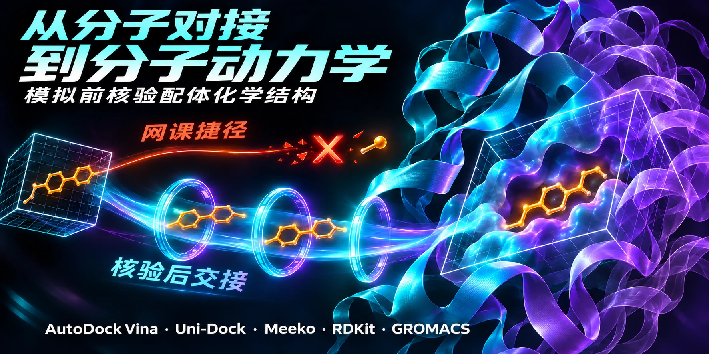

# 分子对接与 GROMACS 分子动力学

[English](README.md) · **简体中文**

面向可溶性蛋白–配体体系的可复现分子对接与分子动力学工作流。膜体系、共价配体、必需金属或辅因子、非标准残基需采用专用建模方案。公开 1IEP 示例采用已确定的 **+1** 配体微观状态。

[常见问题](docs/FAQ.zh-CN.md) · [版本矩阵](docs/QUICKSTART.zh-CN.md#version-matrix) · [验证范围](docs/QUICKSTART.zh-CN.md#validation-boundary)

**验证记录：** 2026-11-28，公开 1IEP 数据，Linux x86-64 CPU 路线。文档与可执行命令对应同一源码提交。

## 联系

- [问题反馈](https://github.com/LuciferBioLab/docking-gromacs-tutorial/issues/new/choose)
- [lucifer.qsq@gmail.com](mailto:lucifer.qsq@gmail.com)
- [3069326069@qq.com](mailto:3069326069@qq.com)

**核验 docking pose（对接位姿）交接。** 保留原始配体化学身份，通过 Meeko 元数据或 RDKit 显式原子映射回填对接坐标。[两套交接路线](docs/DOCKING.zh-CN.md#pose-handoff) · [Chem3D/PyMOL 对照](docs/TROUBLESHOOTING.zh-CN.md#chem3d-pymol-topology)。

## 从这里开始

1. **只做对接：** 使用 SHA-256 校验过的 1IEP 输入完成 01–05。[快速入门](docs/QUICKSTART.zh-CN.md#dock)。
2. **只做 MD：** 使用已核验的 docking pose（对接位姿）或已建系输入。[体系准备](docs/SYSTEM_SETUP.zh-CN.md#topology) · [快速入门](docs/QUICKSTART.zh-CN.md#quickstart-md)。
3. **只想出图：** 准备相互匹配的轨迹、topology（拓扑）和索引。[分析](docs/ANALYSIS.zh-CN.md#analysis)。

## 目录

- [快速入门](docs/QUICKSTART.zh-CN.md)
- [文件地图与运行核查表](docs/WORKFLOW.zh-CN.md)
- [01–02 环境与重对接](docs/ENVIRONMENT.zh-CN.md)
- [03–05 制备与对接](docs/DOCKING.zh-CN.md)
- [06–08 力场与建系](docs/SYSTEM_SETUP.zh-CN.md)
- [09–10 平衡与生产](docs/SIMULATION.zh-CN.md)
- [11–12 分析与复现记录](docs/ANALYSIS.zh-CN.md)
- [术语与命令参数](docs/GLOSSARY.zh-CN.md)
- [研究扩展与验证](docs/RESEARCH.zh-CN.md)
- [多阶段对接验证](docs/DOCKING_VALIDATION.zh-CN.md)
- [排错与教程纠错](docs/TROUBLESHOOTING.zh-CN.md)
- [参考文献与引用](docs/REFERENCES.zh-CN.md)

1. [环境](docs/ENVIRONMENT.zh-CN.md#setup)
2. [参考重对接](docs/ENVIRONMENT.zh-CN.md#benchmark)
3. [结构制备](docs/DOCKING.zh-CN.md#docking)
4. [批量对接](docs/DOCKING.zh-CN.md#batch-docking)
5. [位姿交接](docs/DOCKING.zh-CN.md#pose-handoff)
6. [力场](docs/SYSTEM_SETUP.zh-CN.md#topology)
7. [复合物组装](docs/SYSTEM_SETUP.zh-CN.md#complex-assembly)
8. [运行参数](docs/SYSTEM_SETUP.zh-CN.md#simulation)
9. [平衡](docs/SIMULATION.zh-CN.md#equilibration)
10. [生产模拟](docs/SIMULATION.zh-CN.md#production)
11. [分析](docs/ANALYSIS.zh-CN.md#analysis)
12. [复现记录](docs/ANALYSIS.zh-CN.md#reproducibility)

[许可](LICENSE) · [CITATION.cff](CITATION.cff) · [更新记录](CHANGELOG.md) · [贡献规则](CONTRIBUTING.md)

旧版章节跳转

- [acknowledgments](docs/REFERENCES.zh-CN.md#acknowledgments)

- [agent-workflow](docs/ANALYSIS.zh-CN.md#agent-workflow)

- [analysis](docs/ANALYSIS.zh-CN.md#analysis)

- [batch-docking](docs/DOCKING.zh-CN.md#batch-docking)

- [benchmark](docs/ENVIRONMENT.zh-CN.md#benchmark)

- [chem3d-pymol-topology](docs/TROUBLESHOOTING.zh-CN.md#chem3d-pymol-topology)

- [complex-assembly](docs/SYSTEM_SETUP.zh-CN.md#complex-assembly)

- [complex-systems](docs/TROUBLESHOOTING.zh-CN.md#complex-systems)

- [conformer-preparation](docs/DOCKING_VALIDATION.zh-CN.md#conformer-preparation)

- [disclaimer](docs/REFERENCES.zh-CN.md#disclaimer)

- [docking](docs/DOCKING.zh-CN.md#docking)

- [docking-errors](docs/TROUBLESHOOTING.zh-CN.md#docking-errors)

- [endpoint-energy](docs/ANALYSIS.zh-CN.md#endpoint-energy)

- [equilibration](docs/SIMULATION.zh-CN.md#equilibration)

- [figure-layout](docs/ANALYSIS.zh-CN.md#figure-layout)

- [interaction-review](docs/DOCKING_VALIDATION.zh-CN.md#interaction-review)

- [legacy-adt-handoff](docs/DOCKING.zh-CN.md#legacy-adt-handoff)

- [local-inputs](docs/DOCKING.zh-CN.md#local-inputs)

- [method-evidence](docs/REFERENCES.zh-CN.md#method-evidence)

- [pose-handoff](docs/DOCKING.zh-CN.md#pose-handoff)

- [pose-validation](docs/DOCKING_VALIDATION.zh-CN.md#pose-validation)

- [production](docs/SIMULATION.zh-CN.md#production)

- [publication-figures](docs/ANALYSIS.zh-CN.md#publication-figures)

- [pymol-image-export](docs/ANALYSIS.zh-CN.md#pymol-image-export)

- [receptor-repair](docs/DOCKING_VALIDATION.zh-CN.md#receptor-repair)

- [references](docs/REFERENCES.zh-CN.md#references)

- [reproducibility](docs/ANALYSIS.zh-CN.md#reproducibility)

- [server-errors](docs/TROUBLESHOOTING.zh-CN.md#server-errors)

- [server-handoff](docs/SIMULATION.zh-CN.md#server-handoff)

- [setup](docs/ENVIRONMENT.zh-CN.md#setup)

- [simulation](docs/SYSTEM_SETUP.zh-CN.md#simulation)

- [simulation-errors](docs/TROUBLESHOOTING.zh-CN.md#simulation-errors)

- [sources](docs/REFERENCES.zh-CN.md#sources)

- [tiled-search](docs/DOCKING_VALIDATION.zh-CN.md#tiled-search)

- [toolchain](docs/WORKFLOW.zh-CN.md#toolchain)

- [topology](docs/SYSTEM_SETUP.zh-CN.md#topology)

- [topology-errors](docs/TROUBLESHOOTING.zh-CN.md#topology-errors)

- [triage](docs/TROUBLESHOOTING.zh-CN.md#triage)

- [troubleshooting-contents](docs/TROUBLESHOOTING.zh-CN.md#troubleshooting-contents)

- [tutorial-error-flow](docs/TROUBLESHOOTING.zh-CN.md#tutorial-error-flow)

- [validation-references](docs/DOCKING_VALIDATION.zh-CN.md#validation-references)

- [validation-triage](docs/DOCKING_VALIDATION.zh-CN.md#validation-triage)

- [tutorial-error-flow](docs/TROUBLESHOOTING.zh-CN.md#tutorial-error-flow)

- [chem3d-pymol-topology](docs/TROUBLESHOOTING.zh-CN.md#chem3d-pymol-topology)

