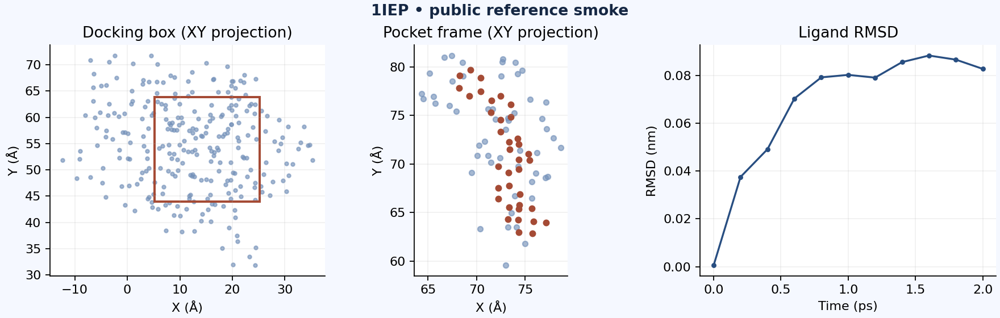

# Trajectory analysis and reproducibility

**English** · [简体中文](ANALYSIS.zh-CN.md)

[Repository home](../README.md#contents)

<a name="analysis"></a>

## 11. Trajectory processing and analysis

- **Input** Matching trajectory, TPR and groups
- **Outputs** analysis series and figure inputs
- **If a step fails** check imaging and selection if values jump

### Periodic boundary condition correction

**Environment:** `docking-gromacs`. **Expected files or evidence:** `md.tpr`, `whole.xtc`, `centered.xtc`. For planning, use the per-stage budget in the quickstart.

```bash
gmx trjconv -s md.tpr -f md.xtc -n index.ndx -o whole.xtc -pbc whole
gmx trjconv -s md.tpr -f whole.xtc -n index.ndx -o centered.xtc -pbc mol -center -ur compact
gmx check -f centered.xtc
```

For the first command, choose **System** as output. For the second, center on **Protein** and write **System**. Inspect early, middle, and late frames to verify the relative periodic images of the receptor, ligand, and any multichain assembly. Preserve physical displacement when analyzing dissociation.

**Official usage.** Consult the versioned `trjconv` reference and inspect the trajectory when combining `-pbc`, `-center`, or `-fit`. [GROMACS trjconv](https://manual.gromacs.org/2026.3/onlinehelp/gmx-trjconv.html)

### Structural and contact metrics

**Environment:** `docking-gromacs`. **Expected files or evidence:** `md.tpr`, `rmsd_protein.xvg`, `rmsd_ligand.xvg`, `rmsf.xvg`, `rg.xvg`, `sasa.xvg`, `mindist.xvg`, `contacts.xvg`. For planning, use the per-stage budget in the quickstart.

```bash
gmx rms -s md.tpr -f centered.xtc -n index.ndx -o rmsd_protein.xvg -tu ns
gmx rms -s md.tpr -f centered.xtc -n index.ndx -o rmsd_ligand.xvg -tu ns -nomw
gmx rmsf -s md.tpr -f centered.xtc -n index.ndx -res -o rmsf.xvg
gmx gyrate -s md.tpr -f centered.xtc -n index.ndx -sel 'group "Protein"' -o rg.xvg
gmx sasa -s md.tpr -f centered.xtc -n index.ndx  -surface 'group "Complex"' -output 'group "Protein"; group "Ligand"' -o sasa.xvg
gmx mindist -s md.tpr -f centered.xtc -n index.ndx -od mindist.xvg -on contacts.xvg -d 0.35
gmx hbond -s md.tpr -f centered.xtc -n index.ndx  -r 'group "Protein"' -t 'group "Ligand"' -num hbond.xvg
```

For an ACPYPE ligand, verify that GROMACS 2026.3 can read the elements as well as the index selections. The [1IEP reference failure and fix](TROUBLESHOOTING.md#atomic-number-analysis) includes verified output.

| Metric | Selection, reference, or interpretation |
| --- | --- |
| Protein RMSD | Choose `Backbone` for fit and calculation. |
| Ligand RMSD | Fit to `Backbone` and calculate on `Ligand_heavy`. This uses the production TPR coordinates as reference. Compare redocking to the crystal pose separately. |
| RMSF | Select `C_alpha` and preserve residue and chain identifiers. |
| Rg and SASA | Rg describes whole-protein compactness, while SASA measures protein and ligand exposure in the complex. |
| Minimum distance and contacts | Select `Protein_heavy` followed by `Ligand_heavy` and document the example cutoff, 0.35 nm. |
| Hydrogen bonds | The command uses the newer `gmx hbond` interface. Check local syntax with `gmx hbond -h` and report distance and angle definitions. |


Interpret ligand RMSD after protein alignment together with minimum distance, residue contacts, and representative conformations. These measurements help distinguish displacement, reorientation, and dissociation. Analyze independent replicates separately and report analysis windows and exclusions. [GROMACS manual](https://manual.gromacs.org/2026.3/) · [New hydrogen-bond tool](https://manual.gromacs.org/current/onlinehelp/gmx-hbond.html)

**Environment:** `docking-gromacs`. **Expected files or evidence:** `md.tpr`, `complex_movie.xtc`, `complex_movie.pdb`. For planning, use the per-stage budget in the quickstart.

```bash
grep -v '^[#@]' rmsd_ligand.xvg > rmsd_ligand_columns.txt
gmx trjconv -s md.tpr -f centered.xtc -n index.ndx -o complex_movie.xtc -dt 100
gmx trjconv -s md.tpr -f centered.xtc -n index.ndx -o complex_movie.pdb -dump 0
```

Select **Complex** for both exports. Verify the first trajectory time with `gmx check -f complex_movie.xtc` and replace `-dump 0` if the first time differs from 0 ps. The reference PDB and trajectory must use the same atom order.

Within the analysis window, select a representative frame using a stated criterion such as contact persistence, ligand displacement, or conformational clustering. Check available timestamps with `gmx check -f centered.xtc`, substitute the selected time for the illustrative 50,000 ps, and choose **Complex**. Report the criterion and actual frame time.

**Environment:** `docking-gromacs`. **Expected files or evidence:** `md.tpr`, `representative.pdb`. For planning, use the per-stage budget in the quickstart.

```bash
gmx trjconv -s md.tpr -f centered.xtc -n index.ndx -o representative.pdb -dump 50000
```

<a name="publication-figures"></a>

### Publication figures and panel assembly

| Stage | Tool and task | Archive |
| --- | --- | --- |
| Structural panels | Prefer open-source PyMOL for protein, ligand, pocket, and representative structures. | Input PDB, frame or docking MODEL, PyMOL commands and session, original PNG. |
| Quantitative panels | Calculate metrics with GROMACS or MDAnalysis, organize data with pandas, and plot with Matplotlib or seaborn. | Raw XVG, plotting CSV, commands, and PDF/SVG. |
| Panel assembly | Prefer Inkscape for vector layout. GIMP or Adobe Photoshop can assemble raster panels and align type and panel labels. | Original panels, editable figure, and journal export. |

<a name="pymol-image-export"></a>

#### A. Structures and pockets in open-source PyMOL

Use the Schrödinger-maintained `pymol-open-source` build. Its standard `png` export adds no software watermark by default. Record the version and installation source, and follow PyMOL's citation guidance. [Source](https://github.com/schrodinger/pymol-open-source) · [conda-forge](https://anaconda.org/conda-forge/pymol-open-source) · [Oxford Protein Informatics Group](https://www.blopig.com/blog/2023/10/tips-tricks-with-pymol/) · [Citation](https://pymol.org/support.html)

**Environment:** `pymol-oss`. **Expected files or evidence:** terminal output or the paths named below. For planning, use the per-stage budget in the quickstart.

```bash
conda create -n pymol-oss --override-channels -c conda-forge pymol-open-source
conda activate pymol-oss
pymol
```

At the PyMOL prompt, load `representative.pdb`. For a docking panel, load the verified complex corresponding to the selected `MODEL`. Replace `LIG` with the residue name in your structure and verify the ligand selection with `count_atoms`. [PyMOL selection syntax](https://pymolwiki.org/index.php/Selection_Algebra)

```text
load representative.pdb, complex
select ligand, complex and resn LIG
count_atoms ligand
select pocket, byres ((complex and polymer.protein) within 4.0 of ligand)
```

Export both the complete complex and a binding-site close-up. Report the structure source, docking model or trajectory time, chain and residue identifiers, frame-selection rule, and display cutoff. The illustrative 4.0 Å cutoff defines the displayed pocket. Calculate quantitative contacts from the reported trajectory, atom selections, and analysis cutoff. Follow the target journal's image-resolution and printable-size requirements. [PyMOL PNG export](https://pymolwiki.org/index.php/Png)

```text
hide everything, complex
show cartoon, complex and polymer.protein
color marine, complex and polymer.protein
show sticks, ligand and not hydro
color orange, ligand
bg_color white
set ray_opaque_background, on
zoom complex, 2
png complex_overview.png, width=2400, height=1800, dpi=300, ray=1

show sticks, pocket and not hydro
zoom ligand, 6
png pocket_closeup.png, width=2400, height=1800, dpi=300, ray=1
save pocket_view.pse
```

Suggested citation · The PyMOL Molecular Graphics System, Version X.Y, Schrödinger, LLC. Replace X.Y with the installed version. [PyMOL Citation Guidance](https://pymol.org/support.html)

#### B. Trajectory checks and quantitative plots in Python

Calculate the metrics first and archive the original XVG output. Use MDAnalysis for trajectory inspection and custom atom selections, pandas for replicate-level tables, and Matplotlib or seaborn for plots and vector export. The example plots ligand heavy-atom RMSD after alignment to the protein.<sup>[21](REFERENCES.md#ref-21),[22](REFERENCES.md#ref-22),[23](REFERENCES.md#ref-23),[24](REFERENCES.md#ref-24),[25](REFERENCES.md#ref-25)</sup> [MDAnalysis Universe](https://userguide.mdanalysis.org/stable/universe.html) · [pandas read_csv](https://pandas.pydata.org/docs/reference/api/pandas.read_csv.html) · [Matplotlib savefig](https://matplotlib.org/stable/api/_as_gen/matplotlib.pyplot.savefig.html) · [seaborn lineplot](https://seaborn.pydata.org/generated/seaborn.lineplot.html)

<details>
<summary>Show commands</summary>

Run from the corresponding replicate directory and use the `rmsd_ligand_columns.txt` produced in step 11. Add the actual input path for each independent replicate to `repeat_files`. Use consistent alignment, units, and time conventions. If reporting a summary or uncertainty interval, define the statistical unit, replicate count, and interval in the figure legend.

**Environment:** `md-analysis`. **Expected files or evidence:** terminal output or the paths named below. For planning, use the per-stage budget in the quickstart.

```bash
conda create -n md-analysis --override-channels -c conda-forge  mdanalysis pandas matplotlib 'seaborn>=0.12'
conda activate md-analysis
```

The optional trajectory check uses the matching `Complex` files exported in step 11.

**Environment:** `docking-gromacs`. **Expected files or evidence:** terminal output or the paths named below. For planning, use the per-stage budget in the quickstart.

```bash
python - <<'PY'
import MDAnalysis as mda

u = mda.Universe("complex_movie.pdb", "complex_movie.xtc")
print("Atoms:", u.atoms.n_atoms, "Frames:", len(u.trajectory))
PY
```

Save the plotted data and two vector formats. The axes are in ns and nm, as produced by the step 11 RMSD command.

**Environment:** `docking-gromacs`. **Expected files or evidence:** terminal output or the paths named below. For planning, use the per-stage budget in the quickstart.

```bash
python - <<'PY'
import matplotlib.pyplot as plt
import pandas as pd
import seaborn as sns

repeat_files = {
    "rep01": "rmsd_ligand_columns.txt",
}
curves = []
for replicate, path in repeat_files.items():
    trace = pd.read_csv(path, sep=r"\s+", header=None, names=["time_ns", "rmsd_nm"])
    curves.append(trace.assign(replicate=replicate))
rmsd = pd.concat(curves, ignore_index=True)
rmsd.to_csv("rmsd_plot_data.csv", index=False)

sns.set_theme(style="ticks", palette="colorblind")
fig, ax = plt.subplots(figsize=(4.5, 3), layout="constrained")
sns.lineplot(data=rmsd, x="time_ns", y="rmsd_nm", hue="replicate",
             estimator=None, errorbar=None, ax=ax)
ax.set(xlabel="Time (ns)", ylabel="Ligand heavy-atom RMSD (nm)")
fig.savefig("rmsd_ligand.pdf")
fig.savefig("rmsd_ligand.svg")
plt.close(fig)
PY
```

</details>

<a name="figure-layout"></a>

#### C. Panel assembly in Inkscape, GIMP, or Photoshop

1. Import the original structure PNGs and Python plot SVG/PDF. Use **Inkscape** for vector curves and text, and retain the editable SVG. [Inkscape](https://inkscape.org/) · [Upstream source](https://gitlab.com/inkscape/inkscape)
2. For raster layouts, use open-source **GIMP** or optional **Adobe Photoshop**. In Photoshop, use **File → Place Embedded** to place source panels as Smart Objects, keep panel labels on separate layers, and save the PSD. In GIMP, retain the editable XCF. [GIMP](https://www.gimp.org/) · [Adobe Photoshop](https://www.adobe.com/products/photoshop.html) · [Adobe Smart Objects](https://helpx.adobe.com/photoshop/desktop/create-manage-layers/smart-objects/create-embedded-smart-objects.html)
3. Match the journal's requirements for type, panel labels, legends, and export dimensions. Preserve the underlying data, structures, axis scales, originals, and cropping records. Update plots, units, or structural views in the source tool, then rebuild the figure. [Nature figure integrity](https://research-figure-guide.nature.com/figures/image-integrity/) · [PLOS figure guidelines](https://journals.plos.org/plosone/s/figures)

<a name="agent-workflow"></a>

#### D. Optional agent-assisted editing and panel assembly

Prefer an open-source toolchain. Generate the source panels from structures and data with open-source PyMOL and Python, then assemble them in Inkscape or GIMP. An agent can run reviewed commands, arrange existing panels, and document changes. [Agent Skills specification](https://agentskills.io/specification) · [OpenAI Skills documentation](https://developers.openai.com/plugins/concepts/skills)

| Task | Suggested tools and use |
| --- | --- |
| Academic copyediting | Use the community `nature-skills` package’s `nature-polishing` skill to harmonize scientific wording and tense. Supply the draft, glossary, and verified references. Request tracked changes and review numerical values, qualifiers, claim strength, and DOIs. [nature-polishing](https://github.com/Yuan1z0825/nature-skills/blob/main/skills/nature-polishing/README_EN.md) |
| Data-driven figures | Use `nature-figure` to plan panel layout and legends. Generate plots from archived CSV/XVG and molecular views from archived structures and PyMOL commands. Give the agent the panel IDs, placement, and source files for assembly. [nature-figure](https://github.com/Yuan1z0825/nature-skills/blob/main/skills/nature-figure/README_EN.md) |
| Verify final outputs | Use Superpowers' `verification-before-completion` skill to check panel completeness, numerical values, units, label collisions, and whether export files reopen. [Superpowers verification](https://github.com/obra/superpowers/blob/main/skills/verification-before-completion/SKILL.md) |
| Batch layout in an existing Photoshop installation | Adobe Photoshop is licensed software. The third-party MIT-licensed `drmedia/photoshop-mcp` bridge can place source panels, organize layers, and export files using a compatible Photoshop installation. Verify the process on a working copy. [Photoshop MCP](https://github.com/drmedia/photoshop-mcp) · [Adobe Photoshop](https://www.adobe.com/products/photoshop.html) |

`nature-skills` and Superpowers are community projects. Follow the target journal's policies on generative AI, copyediting, and disclosure. Base submitted figures on traceable data, structures, and rendering records. The authors are responsible for reviewing the final manuscript and figures. [Nature editorial policy on AI](https://www.nature.com/nature-portfolio/editorial-policies/ai) · [Nature figure integrity guide](https://research-figure-guide.nature.com/figures/image-integrity/)

<a name="endpoint-energy"></a>

### Optional MM/GBSA and MM/PBSA

<details>
<summary>Show commands</summary>

The example inputs are for a completed AMBER replicate. For CHARMM, use the corresponding upstream example to verify topology conversion, radii, and compatibility with the selected PB or GB model. Install `gmx_MMPBSA` in a separate environment and verify the installation using an upstream example. Check versions and verify TPR readability from the MD replicate directory.<sup>[26](REFERENCES.md#ref-26)</sup> [Installation](https://github.com/Valdes-Tresanco-MS/gmx_MMPBSA/blob/master/docs/installation.md) · [CHARMM examples](https://github.com/Valdes-Tresanco-MS/gmx_MMPBSA/blob/master/examples/README.md)

**Environment:** `mmpbsa`. **Expected files or evidence:** `md.tpr`, `energy_window.xtc`, `index_energy_review.ndx`. For planning, use the per-stage budget in the quickstart.

```bash
gmx --version
gmx_MMPBSA --help
gmx check -f centered.xtc
gmx trjconv -s md.tpr -f centered.xtc -n index.ndx  -b 80000 -e 100000 -dt 100 -o energy_window.xtc
gmx check -f energy_window.xtc
gmx make_ndx -f em.gro -n index.ndx -o index_energy_review.ndx
```

Select the analysis window and sampling interval for the study. The example uses 80–100 ns with a 100 ps stride. Select `System` during trajectory extraction to retain atom order. Record the actual `Protein` and `Ligand` group IDs in `index.ndx`, then exit with `q`. Verify that `md_processed.top` corresponds to `md.tpr`.

Save the following inputs as `energy_gbsa/gbsa.in` and `energy_pbsa/pbsa.in`. Select the method or methods you need and report the salt concentration, implicit-solvent model, dielectric settings, and radii. These examples omit conformational entropy. [Input namelists](https://github.com/Valdes-Tresanco-MS/gmx_MMPBSA/blob/master/docs/input_file.md) · [Command-line flags](https://github.com/Valdes-Tresanco-MS/gmx_MMPBSA/blob/master/docs/gmx_MMPBSA_command-line.md)

**Environment:** `Bash`. **Expected files or evidence:** terminal output or the paths named below. For planning, use the per-stage budget in the quickstart.

```bash
mkdir -p energy_gbsa energy_pbsa
```

```ini
&general
  startframe=1,
  interval=1,
/
&gb
  igb=5,
  saltcon=0.15,
/
```

```ini
&general
  startframe=1,
  interval=1,
/
&pb
  istrng=0.15,
/
```

In the same Bash session, enter the two group IDs you verified. Run the analyses you need, with outputs in their respective directories.

**Environment:** `Bash`. **Expected files or evidence:** terminal output or the paths named below. For planning, use the per-stage budget in the quickstart.

```bash
read -r -p 'Protein group number: ' protein_group
read -r -p 'Ligand group number: ' ligand_group
```

**Environment:** `mmpbsa`. **Expected files or evidence:** `FINAL_RESULTS_GBSA.dat`. For planning, use the per-stage budget in the quickstart.

```bash
(
  cd energy_gbsa &&
  gmx_MMPBSA -O -nogui -i gbsa.in -cs ../md.tpr -ct ../energy_window.xtc  -ci ../index.ndx -cg "$protein_group" "$ligand_group"  -cp ../md_processed.top -o FINAL_RESULTS_GBSA.dat
)
```

**Environment:** `mmpbsa`. **Expected files or evidence:** `FINAL_RESULTS_PBSA.dat`. For planning, use the per-stage budget in the quickstart.

```bash
(
  cd energy_pbsa &&
  gmx_MMPBSA -O -nogui -i pbsa.in -cs ../md.tpr -ct ../energy_window.xtc  -ci ../index.ndx -cg "$protein_group" "$ligand_group"  -cp ../md_processed.top -o FINAL_RESULTS_PBSA.dat
)
```

Check topology conversion, component assignments, and frame counts in the output logs. Report endpoint estimates and uncertainty across independent replicates. Interpret MM/GBSA and MM/PBSA estimates in the context of the model and sampling window. Establish experimental affinity independently.

</details>

[Back to contents](../README.md#contents)

<a name="reproducibility"></a>

## 12. Reproducibility records and troubleshooting

- **Input** Reviewed outputs
- **Outputs** methods record, file hashes, and provenance
- **If a step fails** regenerate incomplete or inconsistent archives


Find system-specific preparation, common errors, and the tutorial comparison in the separate guide. Start from the [error index](TROUBLESHOOTING.md#triage) to locate the first affected stage.

- [Complex receptors and membrane systems](TROUBLESHOOTING.md#complex-systems)
- [Docking and pose recovery](TROUBLESHOOTING.md#docking-errors) · [Topology and force fields](TROUBLESHOOTING.md#topology-errors)
- [Equilibration and trajectories](TROUBLESHOOTING.md#simulation-errors) · [GPU, server portability, and restart](TROUBLESHOOTING.md#server-errors)
- [Tutorial pitfalls](TROUBLESHOOTING.md#tutorial-error-flow) · [Workflow comparison](TROUBLESHOOTING.md#chem3d-pymol-topology)

Archive input structure provenance and SHA-256 hashes, environment locks, ligand microstates, receptor preparation, docking boxes and seeds, pose selections and atom maps, force-field and charge assignments, MDPs, processed topologies, TPR/CPT/EDR/XTC outputs, logs, analysis selections, and time windows. Retain `gmx --version` and the configuration for CUDA source builds.

**Environment:** `docking-gromacs`. **Expected files or evidence:** terminal output or the paths named below. For planning, use the per-stage budget in the quickstart.

```bash
conda list -n docktools --explicit > qc/docktools-explicit.txt
conda list -n ligandtools --explicit > qc/ligandtools-explicit.txt
conda list -n gmx-cpu --explicit > qc/gmx-cpu-explicit.txt
```

Export the additional environment used for GPU docking or CGenFF conversion. For CGenFF, retain the stream, penalties, converter commit, and force-field archive hash.

**Environment:** `Bash`. **Expected files or evidence:** terminal output or the paths named below. For planning, use the per-stage budget in the quickstart.

```bash
conda list -n dockgpu --explicit > qc/dockgpu-explicit.txt
conda list -n cgenff-tools --explicit > qc/cgenff-tools-explicit.txt
```

If you installed optional pip packages, also record their versions.

**Environment:** `docking-gromacs`. **Expected files or evidence:** terminal output or the paths named below. For planning, use the per-stage budget in the quickstart.

```bash
conda run -n docktools python -m pip freeze > qc/docktools-pip.txt
```

### Methods and figure provenance

For each final panel, record its system, replicate, source files, plotting tool version and settings, and cropping or layer edits. Include the MODEL or frame time for structures, and selections, reference, alignment, analysis window, and summary method for quantitative plots. Retain XVG/CSV, PDB, original renderings, and editable SVG, PSD, or XCF files. Share materials according to the journal's and data providers' requirements. [MD reproducibility checklist](https://doi.org/10.1038/s42003-023-04653-0) · [Nature figure integrity](https://research-figure-guide.nature.com/figures/image-integrity/)

[Back to contents](../README.md#contents)

## Public 1IEP example outputs



Figure 3. Left: XY projection of the Vina box (outline) and receptor Cα atoms. Middle: one complex frame with ligand heavy atoms (red) and protein heavy atoms within 4 Å (blue). Right: protein-aligned ligand RMSD during 2 ps of production. The projection is for geometry review and the short run is for software and file validation. [Rendering script](../scripts/render_example.py) · [Pocket annotations and frame fingerprints](RESEARCH.md#interaction-analysis)
