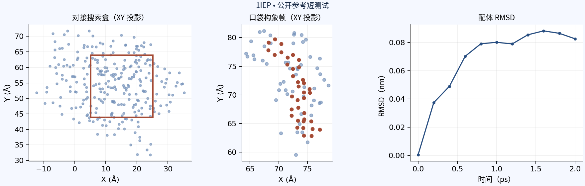

# 轨迹分析与复现记录

[English](ANALYSIS.md) · **简体中文**

中英文同步于 2026-11-29。[已验证的工作流提交](https://github.com/LuciferBioLab/docking-gromacs-tutorial/commit/d139618900e79f0dc186d3bb64fbe5be4cc25914)。

[仓库首页](../README.zh-CN.md#contents)

<a name="analysis"></a>

## 11. 轨迹处理与分析

- **输入** 匹配的轨迹、TPR 和分组
- **输出** 输出分析序列和图件输入
- **失败时的操作** 数值异常时核查周期映像与选择

### 核对已有轨迹文件

在单独的分析目录操作，确认 `PATH` 上是 GROMACS 2026.3。将相互配套的全体系轨迹和 TPR 复制或链接为本地的 `md.xtc` 与 `md.tpr`。手工流程使用该次运行的 `index.ndx`。若使用本地自动 1IEP 短测产物，以运行目录中的 `md/analysis_full.ndx` 为起始索引，其中已包含配体 RMSD 的基本组。其他指标所需组请核对或补建，保留原始输入文件。

```bash
gmx check -f md.xtc -s1 md.tpr
```

核对原始轨迹的帧数、原子数和首末时间。传入 `-s1 md.tpr` 时，`gmx check` 也会按 TPR 的键定义核查轨迹。确认轨迹、TPR、索引采用同一原子顺序。若数量或顺序不符，找回实际配套的输入。只有抽取过的溶质 XTC 时，按所需分析使用同子集、同顺序的匹配参考和索引，或用与轨迹配套的 PDB 做可视化。[GROMACS check](https://manual.gromacs.org/2026.3/onlinehelp/gmx-check.html)

索引缺失或组不齐全时，用 `gmx make_ndx -f md.tpr -o index.ndx`。保留 `System`、`Protein` 和 `Backbone`，按审核过的残基或原子编号选择目标配体实例，命名为 `Ligand`。将 `Protein` 和 `Ligand` 合并为 `Complex`。计算其余指标前，按 TPR 和实际选择补建 `C_alpha`、`Protein_heavy`、`Ligand_heavy`。[命名索引组示例](SIMULATION.zh-CN.md#equilibration)列出了蛋白在前的已知原子顺序所用表达式。核对蛋白和配体两组互不重叠，且指向正确的原子。[GROMACS make_ndx](https://manual.gromacs.org/2026.3/onlinehelp/gmx-make_ndx.html)

### 周期边界条件处理

**环境：** GROMACS 2026.3。**预期文件：** `whole.xtc` 和 `centered.xtc`。

```bash
gmx trjconv -s md.tpr -f md.xtc -n index.ndx -o whole.xtc -pbc whole
gmx trjconv -s md.tpr -f whole.xtc -n index.ndx -o centered.xtc -pbc mol -center -ur compact
gmx check -f centered.xtc
```

第一条 `trjconv` 的输出组选 **System**。第二条中心组选 **Protein**，输出组选 **System**。抽查最初、中间和最后几帧，确认 receptor（受体）、配体和多链装配的周期映像合理。对跨盒的多链装配按实际结构另行处理；分析解离时保留物理位移。

**官方用法** 同一次 `trjconv` 处理中，`-pbc`、`-center`、`-fit` 的组合应结合实测轨迹核对。查对应版本的选项和输出文件格式。 [GROMACS trjconv](https://manual.gromacs.org/2026.3/onlinehelp/gmx-trjconv.html)

### RMSD、RMSF、Rg、SASA 和口袋接触

**环境：** GROMACS 2026.3。**预期文件或核查依据：** `rmsd_protein.xvg`, `rmsd_ligand.xvg`, `rmsf.xvg`, `rg.xvg`, `sasa.xvg`, `mindist.xvg`, `contacts.xvg`。耗时和磁盘规划见快速入门的分阶段表。

```bash
gmx rms -s md.tpr -f centered.xtc -n index.ndx -o rmsd_protein.xvg -tu ns
gmx rms -s md.tpr -f centered.xtc -n index.ndx -o rmsd_ligand.xvg -tu ns -nomw
gmx rmsf -s md.tpr -f centered.xtc -n index.ndx -res -o rmsf.xvg
gmx gyrate -s md.tpr -f centered.xtc -n index.ndx -sel 'group "Protein"' -o rg.xvg
gmx sasa -s md.tpr -f centered.xtc -n index.ndx  -surface 'group "Complex"' -output 'group "Protein"; group "Ligand"' -o sasa.xvg
gmx mindist -s md.tpr -f centered.xtc -n index.ndx -od mindist.xvg -on contacts.xvg -d 0.35
gmx hbond -s md.tpr -f centered.xtc -n index.ndx  -r 'group "Protein"' -t 'group "Ligand"' -num hbond.xvg -hbr 0.35 -hba 30
```

对 ACPYPE 生成的配体，要核对 GROMACS 2026.3 能读取原子元素与索引选择。[1IEP 实测报错与修复](TROUBLESHOOTING.zh-CN.md#atomic-number-analysis)给出已验证产物。

| 指标 | 分组、参考或判读 |
| --- | --- |
| 蛋白 RMSD | 拟合与计算均选 `Backbone`。 |
| 配体 RMSD | 对 `Backbone` 拟合，对 `Ligand_heavy` 计算。这里用生产 TPR 的初始坐标为参考，范围与共晶重对接 RMSD 不同。 |
| RMSF | 选择 `C_alpha`，追踪残基及链编号。 |
| Rg、SASA | Rg 描述整个蛋白紧致程度；SASA 在复合物表面计算蛋白和配体各自暴露面积。 |
| 最短距离及接触 | 依次选择 `Protein_heavy`、`Ligand_heavy`，记录 0.35 nm 示例阈值。 |
| 氢键 | 本 GROMACS 2026.3 示例的供体–受体距离阈值为 0.35 nm，受体–供体–氢角度阈值为 30°。解读计数前核对元素指派。 |


结合蛋白对齐后的配体 RMSD、最短距离、关键残基接触与代表构象，判断候选姿态是否发生移动、翻转或解离。逐个分析独立重复，保留采样窗口与剔除依据。XVG 可用 Grace 查看，或转换为表格后绘图。 [GROMACS manual](https://manual.gromacs.org/2026.3/) · [New hydrogen-bond tool](https://manual.gromacs.org/2026.3/onlinehelp/gmx-hbond.html)

**环境：** GROMACS 2026.3。**预期文件或核查依据：** `complex_movie.xtc`, `complex_movie.pdb`。耗时和磁盘规划见快速入门的分阶段表。

```bash
gmx trjconv -s md.tpr -f centered.xtc -n index.ndx -o complex_movie.xtc -skip 10
gmx check -f complex_movie.xtc
read -r -p 'First time in complex_movie.xtc (ps): ' first_frame_ps
gmx trjconv -s md.tpr -f centered.xtc -n index.ndx -o complex_movie.pdb -dump "${first_frame_ps:?Enter the first frame time in ps}"
```

两次导出都选 **Complex**。影片默认每十个已保存帧保留一帧，按轨迹调整 `-skip`。输入影片首帧的实际时间（ps）以导出参考 PDB，并确认参考 PDB 与轨迹的原子顺序相同。

按所选时间窗的接触、位移或构象分组选择代表帧。下例用 实际时间（ps） 作为示例，先运行 `gmx check -f centered.xtc` 确认实际时间，替换后再导出，选 `Complex`。报告选帧依据和实际导出时间。

**环境：** GROMACS 2026.3。**预期文件或核查依据：** `representative.pdb`。耗时和磁盘规划见快速入门的分阶段表。

```bash
read -r -p 'Reviewed representative frame time (ps): ' frame_ps
gmx trjconv -s md.tpr -f centered.xtc -n index.ndx -o representative.pdb -dump "${frame_ps:?Enter a reviewed frame time in ps}"
```

<a name="publication-figures"></a>

### 论文出图与组图

| 阶段 | 工具与操作 | 归档 |
| --- | --- | --- |
| 结构图 | 优先用开源 PyMOL 展示蛋白、配体、口袋和代表构象。 | 输入 PDB、轨迹帧或对接 MODEL、PyMOL 命令与会话、原始 PNG。 |
| 定量图 | GROMACS 或 MDAnalysis 计算指标，pandas 整理数据，Matplotlib / seaborn 作图。 | 原始 XVG、绘图 CSV、绘图命令、PDF/SVG。 |
| 组图与排版 | 优先用 Inkscape 组矢量图；位图可选 GIMP 或 Adobe Photoshop，统一字体、面板编号和对齐。 | 原始面板、可编辑图版以及符合投稿要求的导出文件。 |

<a name="pymol-image-export"></a>

#### A. 开源 PyMOL 结构图与口袋图

优先安装 Schrödinger 维护的开源构建 `pymol-open-source`。该构建用标准 `png` 命令导出时默认无软件水印。记录实际版本和安装来源，并按 PyMOL 的官方建议引用。 [Source](https://github.com/schrodinger/pymol-open-source) · [conda-forge](https://anaconda.org/conda-forge/pymol-open-source) · [Oxford Protein Informatics Group](https://www.blopig.com/blog/2023/10/tips-tricks-with-pymol/) · [Citation](https://pymol.org/support.html)

**环境：** `pymol-oss`。**预期文件或核查依据：** 终端输出或下方命令指定的文件。耗时和磁盘规划见快速入门的分阶段表。

```bash
conda create -n pymol-oss --override-channels -c conda-forge pymol-open-source
conda activate pymol-oss
pymol
```

在 PyMOL 命令行读取上一步已选的 `representative.pdb`。画对接结果时，换成与所选 MODEL 对应、已核对绝对坐标的复合物结构。将 `LIG` 换成 PDB 中实际的配体残基名。先用 `count_atoms` 确认选中了目标配体。 [PyMOL selection syntax](https://pymolwiki.org/index.php/Selection_Algebra)

```text
load representative.pdb, complex
select ligand, complex and resn LIG
count_atoms ligand
select pocket, byres ((complex and polymer.protein) within 4.0 of ligand)
```

以下示例分别导出全局图和口袋近景。图注注明结构来源、对接 MODEL 或轨迹时间、链/残基编号、选帧依据，以及图中口袋残基的距离标准。这里 4.0 Å 用于显示附近残基。定量接触以所报告的轨迹选择、阈值及统计方法计算。打印尺寸和输出分辨率按拟投期刊核对。 [PyMOL PNG export](https://pymolwiki.org/index.php/Png)

```text
hide everything, complex
show cartoon, complex and polymer.protein
color marine, complex and polymer.protein
show sticks, ligand and not hydro
color orange, ligand
bg_color white
set ray_opaque_background, on
zoom complex, 2
png complex_overview.png, width=2400, height=1800, dpi=300, ray=1

show sticks, pocket and not hydro
zoom ligand, 6
png pocket_closeup.png, width=2400, height=1800, dpi=300, ray=1
save pocket_view.pse
```

建议引用格式 · The PyMOL Molecular Graphics System, Version X.Y, Schrödinger, LLC. 将 X.Y 换成实际版本。 [PyMOL Citation Guidance](https://pymol.org/support.html)

<a name="python-figures"></a>

#### B. Python 轨迹检查与定量绘图

GROMACS 先生成指标和原始 XVG。MDAnalysis 可核查结构与轨迹文件并做自定义选择。pandas 汇总带重复编号的数据，Matplotlib 和 seaborn 控制颜色、坐标单位和矢量输出。下面以蛋白拟合后的配体 heavy atom（重原子） RMSD 为例。<sup>[21](REFERENCES.zh-CN.md#ref-21),[22](REFERENCES.zh-CN.md#ref-22),[23](REFERENCES.zh-CN.md#ref-23),[24](REFERENCES.zh-CN.md#ref-24),[25](REFERENCES.zh-CN.md#ref-25)</sup> [MDAnalysis Universe](https://userguide.mdanalysis.org/stable/universe.html) · [pandas read_csv](https://pandas.pydata.org/docs/reference/api/pandas.read_csv.html) · [Matplotlib savefig](https://matplotlib.org/stable/api/_as_gen/matplotlib.pyplot.savefig.html) · [seaborn lineplot](https://seaborn.pydata.org/generated/seaborn.lineplot.html)

<details>
<summary>展开命令</summary>

使用步骤 11 产生的原始 XVG，或将归档的 `analysis/ligand-rmsd.xvg` 放入出图目录。将 `rmsd_source` 改成实际路径，再用 Bash 导出数据。示例输入为单条配体 RMSD 序列，时间单位 ns，距离单位 nm。先核对原始数据的单位，若有差异则修改轴标或换算数据。在 Python 的 `repeat_files` 中加入其他独立重复时，保持单位和拟合方法一致。

```bash
rmsd_source='rmsd_ligand.xvg'
test -s "$rmsd_source" &&
  awk 'NF == 2 && $1 !~ /^[#@&]/ {print $1, $2}' "$rmsd_source" > rmsd_ligand_columns.txt &&
  test -s rmsd_ligand_columns.txt
```

创建 `md-analysis` 用于出图和可选的轨迹文件检查。若已有该环境，直接激活即可。

```bash
conda create -n md-analysis --override-channels -c conda-forge  mdanalysis pandas matplotlib 'seaborn>=0.12'
conda activate md-analysis
```

可选的轨迹读取检查使用步骤 11 配套导出的 `Complex` 文件。

**环境：** `md-analysis`。**预期文件或核查依据：** 终端输出或下方命令指定的文件。耗时和磁盘规划见快速入门的分阶段表。

```bash
python - <<'PY'
import MDAnalysis as mda

u = mda.Universe("complex_movie.pdb", "complex_movie.xtc")
print("Atoms:", u.atoms.n_atoms, "Frames:", len(u.trajectory))
PY
```

用下面的命令保存绘图数据和两种矢量文件。两个坐标轴分别是 ns 和 nm，对应步骤 11 的 RMSD 命令。

**环境：** `md-analysis`。**预期文件或核查依据：** 终端输出或下方命令指定的文件。耗时和磁盘规划见快速入门的分阶段表。

```bash
python - <<'PY'
import matplotlib.pyplot as plt
import pandas as pd
import seaborn as sns

repeat_files = {
    "rep01": "rmsd_ligand_columns.txt",
}
curves = []
for replicate, path in repeat_files.items():
    trace = pd.read_csv(path, sep=r"\s+", header=None, names=["time_ns", "rmsd_nm"])
    curves.append(trace.assign(replicate=replicate))
rmsd = pd.concat(curves, ignore_index=True)
rmsd.to_csv("rmsd_plot_data.csv", index=False)

sns.set_theme(style="ticks", palette="colorblind")
fig, ax = plt.subplots(figsize=(4.5, 3), layout="constrained")
sns.lineplot(data=rmsd, x="time_ns", y="rmsd_nm", hue="replicate",
             estimator=None, errorbar=None, ax=ax)
ax.set(xlabel="Time (ns)", ylabel="Ligand heavy-atom RMSD (nm)")
fig.savefig("rmsd_ligand.pdf")
fig.savefig("rmsd_ligand.svg")
plt.close(fig)
PY
```

</details>

<a name="figure-layout"></a>

#### C. 用 Inkscape、GIMP 或 Photoshop 组图

1. 从 PyMOL 导入原始结构 PNG，从 Python 导入曲线 SVG/PDF。用 **Inkscape** 组图可保留矢量曲线和文本，建议保存可编辑的 SVG。 [Inkscape](https://inkscape.org/) · [Upstream source](https://gitlab.com/inkscape/inkscape)
2. 做位图组图时，可用开源 **GIMP** 或可选的 **Adobe Photoshop**。Photoshop 中可用 **File → Place Embedded** 把源面板置入为智能对象，将编号和注释放在独立图层，保存 PSD。GIMP 可保留可编辑的 XCF。 [GIMP](https://www.gimp.org/) · [Adobe Photoshop](https://www.adobe.com/products/photoshop.html) · [Adobe Smart Objects](https://helpx.adobe.com/photoshop/desktop/create-manage-layers/smart-objects/create-embedded-smart-objects.html)
3. 按期刊要求统一字体、面板编号、图例和输出尺寸。保持图版与数据、结构和坐标轴一致，保留原图及裁切记录。需要修改数据曲线、绘图单位或结构呈现时，在 GROMACS、Python 或 PyMOL 中更新源面板，再重新组图。 [Nature figure integrity](https://research-figure-guide.nature.com/figures/image-integrity/) · [PLOS figure guidelines](https://journals.plos.org/plosone/s/figures)

<a name="agent-workflow"></a>

#### D. 可选的 Agent 辅助润色与组图

计算和出图优先使用开源工具组合。用开源 PyMOL 和 Python 从真实结构与数据生成源面板，再用 Inkscape 或 GIMP 排版。Agent 可以运行已核对的命令、排版现有面板和整理修改记录。 [Agent Skills specification](https://agentskills.io/specification) · [OpenAI Skills documentation](https://developers.openai.com/plugins/concepts/skills)

| 要做的事 | 可选工具与操作 |
| --- | --- |
| 学术英语润色 | 社区项目 `nature-skills` 的 `nature-polishing` 可帮助统一术语和时态。提供现有稿件、术语表和已核实的引文，让 Agent 交付修改对照，作者复核数值、限定语、结论强度和 DOI。 [nature-polishing](https://github.com/Yuan1z0825/nature-skills/blob/main/skills/nature-polishing/README_EN.md) |
| 从数据出图与组图 | 用 `nature-figure` 协助拟定图版布局与图例。实际曲线仍由归档的 CSV/XVG 和 Matplotlib 生成，结构图由归档的 PDB 与 PyMOL 命令生成。把面板编号、位置及源文件交给 Agent，用 Inkscape 或 GIMP 排版。 [nature-figure](https://github.com/Yuan1z0825/nature-skills/blob/main/skills/nature-figure/README_EN.md) |
| 检查最终文件 | 可结合 Superpowers 的 `verification-before-completion`，检查面板是否齐全、数值与单位是否对应、标签有无遮挡、导出文件是否可打开。 [Superpowers verification](https://github.com/obra/superpowers/blob/main/skills/verification-before-completion/SKILL.md) |
| 已有 Photoshop 的批量排版 | Adobe Photoshop 是授权软件。`drmedia/photoshop-mcp` 是第三方 MIT 许可的 Photoshop UXP 桥接项目，可用于置入现有面板、整理图层和批量导出。需要安装兼容的 Photoshop，并在副本上核对操作。 [Photoshop MCP](https://github.com/drmedia/photoshop-mcp) · [Adobe Photoshop](https://www.adobe.com/products/photoshop.html) |

`nature-skills` 和 Superpowers 是社区项目。图件和文章应遵循目标期刊对生成式 AI、语言润色和披露的要求。涉及投稿的图版以可追溯的源数据、结构和渲染记录为准，作者负责审核最终文字与图件。 [Nature editorial policy on AI](https://www.nature.com/nature-portfolio/editorial-policies/ai) · [Nature figure integrity guide](https://research-figure-guide.nature.com/figures/image-integrity/)

<a name="endpoint-energy"></a>

### 可选分析：MM/GBSA 与 MM/PBSA

<details>
<summary>展开步骤</summary>

以下输入示例用于已经完成 AMBER 路线的独立重复。CHARMM 路线应先按上游 CHARMM 示例核对 topology（拓扑）转换、半径集和所选 PB/GB 模型的适配性。按上游安装指南在单独环境安装 `gmx_MMPBSA`，先跑对应的上游案例。回到自己的 MD 重复目录，核对工具版本及 GROMACS 能读取当前 TPR。<sup>[26](REFERENCES.zh-CN.md#ref-26)</sup> [Installation](https://github.com/Valdes-Tresanco-MS/gmx_MMPBSA/blob/master/docs/installation.md) · [CHARMM examples](https://github.com/Valdes-Tresanco-MS/gmx_MMPBSA/blob/master/examples/README.md)

**环境：** `mmpbsa`。**预期文件或核查依据：** `md.tpr`, `energy_window.xtc`, `index_energy_review.ndx`。耗时和磁盘规划见快速入门的分阶段表。

```bash
gmx --version
gmx_MMPBSA --help
gmx check -f centered.xtc
gmx trjconv -s md.tpr -f centered.xtc -n index.ndx  -b 80000 -e 100000 -dt 100 -o energy_window.xtc
gmx check -f energy_window.xtc
gmx make_ndx -f em.gro -n index.ndx -o index_energy_review.ndx
```

先按轨迹和研究问题选择实际时间窗。这里的 80–100 ns 与 100 ps 间隔仅为示例。截帧时选 `System` 以保留完整的原子顺序。查看与实际 `index.ndx` 对应的 `Protein` 和 `Ligand` 组号，输入 `q` 退出。用生成 `md.tpr` 时保存的 `md_processed.top`，确保其与生产 topology（拓扑）一致。

在 `energy_gbsa/gbsa.in` 和 `energy_pbsa/pbsa.in` 分别保存以下配置。选择所需的一种或两种方法，明确报告对应的盐浓度、隐式溶剂模型、介电和半径设置。下例不含构象熵。 [Input namelists](https://github.com/Valdes-Tresanco-MS/gmx_MMPBSA/blob/master/docs/input_file.md) · [Command-line flags](https://github.com/Valdes-Tresanco-MS/gmx_MMPBSA/blob/master/docs/gmx_MMPBSA_command-line.md)

**环境：** `Bash`。**预期文件或核查依据：** 终端输出或下方命令指定的文件。耗时和磁盘规划见快速入门的分阶段表。

```bash
mkdir -p energy_gbsa energy_pbsa
```

```ini
&general
  startframe=1,
  interval=1,
/
&gb
  igb=5,
  saltcon=0.15,
/
```

```ini
&general
  startframe=1,
  interval=1,
/
&pb
  istrng=0.15,
/
```

在当前 Bash 终端输入刚查到的两个组号。分别执行所需的分析，输出到各自目录。

**环境：** `Bash`。**预期文件或核查依据：** 终端输出或下方命令指定的文件。耗时和磁盘规划见快速入门的分阶段表。

```bash
read -r -p 'Protein group number: ' protein_group
read -r -p 'Ligand group number: ' ligand_group
```

**环境：** `mmpbsa`。**预期文件或核查依据：** `FINAL_RESULTS_GBSA.dat`。耗时和磁盘规划见快速入门的分阶段表。

```bash
(
  cd energy_gbsa &&
  gmx_MMPBSA -O -nogui -i gbsa.in -cs ../md.tpr -ct ../energy_window.xtc  -ci ../index.ndx -cg "$protein_group" "$ligand_group"  -cp ../md_processed.top -o FINAL_RESULTS_GBSA.dat
)
```

**环境：** `mmpbsa`。**预期文件或核查依据：** `FINAL_RESULTS_PBSA.dat`。耗时和磁盘规划见快速入门的分阶段表。

```bash
(
  cd energy_pbsa &&
  gmx_MMPBSA -O -nogui -i pbsa.in -cs ../md.tpr -ct ../energy_window.xtc  -ci ../index.ndx -cg "$protein_group" "$ligand_group"  -cp ../md_processed.top -o FINAL_RESULTS_PBSA.dat
)
```

检查日志中的 topology（拓扑）转换、组分和处理帧数是否正确。按独立重复报告结果和不确定性。MM/GBSA 与 MM/PBSA 都是依赖模型和采样窗口的端点估算，实验结合亲和力需要独立验证。

</details>

[返回目录](../README.zh-CN.md#contents)

<a name="reproducibility"></a>

## 12. 复现记录与排错入口

- **输入** 已审核产物
- **输出** 输出方法记录、校验和及溯源信息
- **失败时的操作** 归档不全或不一致时重新整理


复杂 receptor（受体）、常见报错及网课流程对照见独立排错页。需要先定位故障时，从[报错索引](TROUBLESHOOTING.zh-CN.md#triage)进入。

- [复杂 receptor（受体）与膜体系](TROUBLESHOOTING.zh-CN.md#complex-systems)
- [对接与 docking pose（对接位姿）恢复](TROUBLESHOOTING.zh-CN.md#docking-errors) · [topology（拓扑）与 force field（力场）](TROUBLESHOOTING.zh-CN.md#topology-errors)
- [平衡与轨迹](TROUBLESHOOTING.zh-CN.md#simulation-errors) · [GPU、服务器和续跑](TROUBLESHOOTING.zh-CN.md#server-errors)
- [网课错误流程图](TROUBLESHOOTING.zh-CN.md#tutorial-error-flow) · [Chem3D–ADT–PyMOL 对照](TROUBLESHOOTING.zh-CN.md#chem3d-pymol-topology)

复现时保存原始结构来源与 SHA-256、环境锁文件、receptor（受体）和配体状态、搜索盒、种子、所有对接结果、姿态选取和 atom mapping（原子映射）记录、force field（力场）与电荷模型、MDP、展开 topology（拓扑）、TPR/CPT/EDR/XTC、GROMACS 日志、分析分组和选取区间。在项目根目录记录软件环境，CUDA 源码构建另存 `gmx --version` 与编译配置。

**环境：** `docking-gromacs`。**预期文件或核查依据：** 终端输出或下方命令指定的文件。耗时和磁盘规划见快速入门的分阶段表。

```bash
conda list -n docktools --explicit > qc/docktools-explicit.txt
conda list -n ligandtools --explicit > qc/ligandtools-explicit.txt
conda list -n gmx-cpu --explicit > qc/gmx-cpu-explicit.txt
```

若运行了 GPU 对接或安装了 CGenFF 工具，可额外导出对应环境。CGenFF 路线同时保存 stream、罚分、转换器提交号和 force field（力场）包哈希。

**环境：** `Bash`。**预期文件或核查依据：** 终端输出或下方命令指定的文件。耗时和磁盘规划见快速入门的分阶段表。

```bash
conda list -n dockgpu --explicit > qc/dockgpu-explicit.txt
conda list -n cgenff-tools --explicit > qc/cgenff-tools-explicit.txt
```

如果安装了可选的 pip 包，另存 pip 版本列表。

**环境：** `docking-gromacs`。**预期文件或核查依据：** 终端输出或下方命令指定的文件。耗时和磁盘规划见快速入门的分阶段表。

```bash
conda run -n docktools python -m pip freeze > qc/docktools-pip.txt
```

### 方法与图件复现记录

每个最终图版记录面板编号、体系、重复编号、源文件、画图工具版本与参数、裁切或图层信息。对结构图记录模型号或实际帧时间，对定量图记录索引组、参考结构、对齐方式、分析时间窗和汇总方式。归档`XVG/CSV`、`PDB`、原始面板以及`SVG/PSD/XCF`等可编辑源文件，按期刊与数据来源要求提供材料。 [MD reproducibility checklist](https://doi.org/10.1038/s42003-023-04653-0) · [Nature figure integrity](https://research-figure-guide.nature.com/figures/image-integrity/)

[返回目录](../README.zh-CN.md#contents)

## 公开 1IEP 示例产物



图 3. 左：Vina 对接盒（外框）与 receptor（受体）Cα 原子的 XY 投影。中：单帧复合物中配体重原子（红色）与 4 Å 内的蛋白重原子（蓝色）。右：2 ps 生产段按蛋白叠合后的配体 RMSD。投影供几何核对，短运行用于验证软件和文件交接。[制图脚本](../scripts/render_example.py) · [口袋注释与逐帧指纹](RESEARCH.zh-CN.md#interaction-analysis)
