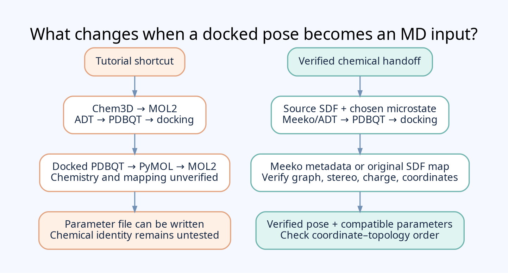
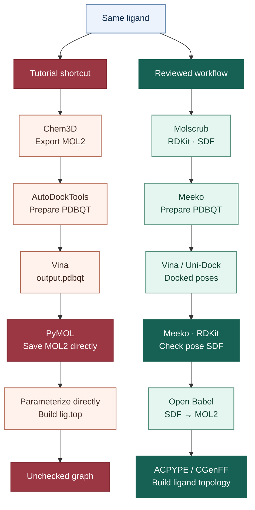

# Complex systems and troubleshooting

**English** · [简体中文](TROUBLESHOOTING.zh-CN.md)

Languages synchronized 2026-11-28. [Verified workflow commit](https://github.com/LuciferBioLab/docking-gromacs-tutorial/commit/d139618900e79f0dc186d3bb64fbe5be4cc25914).

[Repository home](../README.md#contents)

## First-error index

<a name="triage"></a>

| Error or symptom | Likely cause | First action |
| --- | --- | --- |
| `has no donors AND has no acceptors` with a valid ligand group | Element fields omitted in the ligand topology | [Check encoded atomic numbers](#atomic-number-analysis) |
| `ValueError: interrupted residues in PDB: {'A:438'}` | Pinned public example contains an out-of-order PDB record | Use the fixture-specific coordinate-preserving ordering step |
| `Explicit valence for atom # 16 N, 4, is greater than permitted` | Teaching MOL2–RDKit representation disagreed on valence | Recover the SDF via Open Babel and verify the chemical graph and +1 charge |
| Low ranked region RMSD, high top-1 RMSD | Near-native pose sampled but ranked lower | Report top-1 and best-sampled results independently |
| High fixed-frame RMSD for all ranks | Wrong box/frame, pose sampling, or incorrect atom correspondence | Check box, receptor frame, and symmetric graph mapping |
| High apparent MD ligand RMSD with unchanged contacts | Potential PBC image or coordinate ordering error | Reimage, fit the protein and verify topology order |
| Matching atom count with wrong atom order | Coordinate concatenation or reordering error | Check names and coordinate correspondence against the topology |
| SETTLE or LINCS error early | Potential severe overlap or constraint/starting-model problem | Inspect structure, minimization and preflight parameters |

[Main tutorial](../README.md#contents) · [References and software citation](REFERENCES.md#references)

This page uses generic systems and filenames. Identify the first failing stage and retain its inputs, log, and software versions. Error strings are search terms. Their wording can vary by release and backend.

<a name="troubleshooting-contents"></a>

## Contents

1. [Triage](#triage)
2. [Complex receptors and membrane systems](#complex-systems)
3. [Docking, template matching, and pose recovery](#docking-errors)
4. [Parameterization and topology](#topology-errors)
5. [Minimization, equilibration, and trajectories](#simulation-errors)
6. [Portability, GPU execution, and restart](#server-errors)
7. [Tutorial pitfalls](#tutorial-error-flow) · [Workflow comparison](#chem3d-pymol-topology)

<a name="triage"></a>

## 1. Triage

| Symptom or message | Start here |
| --- | --- |
| No matching residue template | [Check structure and chemistry](#complex-systems) |
| Missing poses or failed SDF export | [Check inputs, MODEL, and mapping](#docking-errors) |
| Directive order, missing parameters, or mismatched coordinates | [Inspect includes, parameters, and molecule order](#topology-errors) |
| Constraint failure or nonfinite forces or energies | [Locate the first failure and its inputs](#simulation-errors) |
| TPR compatibility, GPU memory, or checkpoint append failure | [Check versions, hardware, and companion files](#server-errors) |

Record the last completed step and its outputs. Resume from the last validated coordinates and checkpoint where appropriate. Changes to chemical identity, atom order, or topology require revalidation from the first affected stage. [GROMACS runtime errors](https://manual.gromacs.org/documentation/current/user-guide/run-time-errors.html) · [GROMACS restart and extension](https://manual.gromacs.org/documentation/current/user-guide/managing-simulations.html)

<a name="complex-systems"></a>

## 2. Complex receptors and membrane systems

| System feature | Minimum modeling checks |
| --- | --- |
| Multichain assembly, partner, or interface pocket | Verify the biological assembly, interface, occupancy, and interchain covalent links. Retain chains that form the pocket or stabilize its conformation. |
| Missing loops, alternate conformers, multiple models, or predicted structures | Use sequence and structural evidence to assess the pocket impact of missing segments. Record the selected chains, models, and edits. Examine local pLDDT and interdomain PAE where relevant. Compare justified receptor conformations and report recurrence of pockets and poses. |
| Nonstandard residues, modifications, metals, or cofactors | Check identity, protonation, oxidation or coordination state, covalent links, and total charge against the structural and experimental evidence. Validate atom types, masses, partial charges, bonded terms, and coordinate mapping for the chosen force field. |
| Membrane proteins and membrane assemblies | Verify assembly and membrane orientation, build a compatible explicit bilayer, and resolve lipid–protein overlaps. Check leaflet assignment and box orientation before minimization and staged equilibration. Verify semi-isotropic pressure coupling against the chosen membrane protocol. |
| Glycosylation or topology conversion | Preserve glycoform, anomeric configuration, and covalent connectivity. Verify 1–4 scaling, exclusions, atom ordering, masses, and charges. Compare energy terms for a representative subsystem using identical geometry and matched settings. |
| Covalent ligands or reactive sites | Use a dedicated modeling and docking protocol appropriate to the chemical state, with evidence for the covalent connection and reactive site. |

**When to pause.** Pause when essential pocket geometry, domain arrangement, chemical state, or topology conversion remains unresolved. Check compatibility across protein, lipid, glycans, water, ions, and ligand parameters. Explicit pair definitions can preserve validated heterogeneous 1–4 scaling. Changes to global `fudgeQQ` or `fudgeLJ` affect all pairs generated from defaults.<sup>[1](#ref-1),[2](#ref-2),[3](#ref-3)</sup> [AlphaFold DB confidence and PAE](https://alphafold.ebi.ac.uk/faq) · [Amber reference manuals](https://ambermd.org/Manuals.php) · [GROMACS topology file formats](https://manual.gromacs.org/documentation/current/reference-manual/topologies/topology-file-formats.html) · [Lipid21 paper](https://doi.org/10.1021/acs.jctc.1c01217) · [GLYCAM06 paper](https://doi.org/10.1002/jcc.20820) · [PACKMOL-Memgen paper](https://doi.org/10.1021/acs.jcim.9b00269)

**Equilibration checks for membrane systems.** Inspect temperature, volume, lateral bilayer area, thickness, leaflet behavior, and essential covalent links. Review geometry and periodic imaging when membrane folds or image jumps appear. Interpret area, thickness, and area per lipid against composition, temperature, and metric definition. Verify which position restraints are active before interpreting subsequent relaxation. [GROMACS MDP parameters](https://manual.gromacs.org/documentation/current/user-guide/mdp-options.html) · [Lipid21 methods](https://doi.org/10.1021/acs.jctc.1c01217)

<a name="docking-errors"></a>

## 3. Docking, template matching, and pose recovery

- **Receptor template mismatch.** Inspect the reported residue and neighboring atoms for missing heavy atoms, naming, chain, alternate conformer, termini, and hydrogen state. Determine whether cofactors or special chemistry require a dedicated preparation route.<sup>[4](#ref-4)</sup> [Meeko receptor preparation](https://meeko.readthedocs.io/en/develop/rec_cli_options.html) · [GROMACS pdb2gmx](https://manual.gromacs.org/documentation/current/onlinehelp/gmx-pdb2gmx.html)
- **Ligand preparation failed.** Check the source record, bond orders, stereochemistry, formal charge, and salt form. Generate a 3D conformer for the verified microstate when starting from 2D, and verify explicit hydrogens before invoking Meeko. [Meeko ligand input requirements](https://meeko.readthedocs.io/en/develop/lig_prep_basic.html) · [Molscrub CLI](https://molscrub.readthedocs.io/en/latest/cli.html)
- **Empty output or pose recovery failure.** Inspect the exit status, first error, and output directory. Match the run manifest, PDBQT `MODEL`, score, and SDF record. If mapping metadata is absent, recover with a verified original SDF template or prepare a new input and redock. Verify heavy-atom coordinates against the selected PDBQT `MODEL`. [Meeko export](https://meeko.readthedocs.io/en/develop/export_usage.html) · [Pose transfer](DOCKING.md#pose-handoff)
- **Reference-like pose sampled but poorly ranked.** Report top-ranked RMSD, best sampled RMSD, rank of the best-matching pose, and reference contacts. Verify the search box and chemical state, then compare seeds, conformers, and relevant receptor models. Document any ranking discrepancy.<sup>[5](#ref-5),[6](#ref-6)</sup> [Vina tutorial](https://autodock-vina.readthedocs.io/en/latest/docking_basic.html) · [DockRMSD](https://doi.org/10.1186/s13321-019-0362-7) · [Docking validation review](https://doi.org/10.1007/s10822-026-00849-8)

<a name="topology-errors"></a>

## 4. Parameterization and topology

| Symptom | Diagnosis and action |
| --- | --- |
| Charge mismatch, high CGenFF penalty, or incompatible stream | Verify chemistry and coordinates against the docked microstate. Check force-field family and version. Review high-penalty terms and validate any refinement. |
| `Invalid order for directive atomtypes` / Global parameter declaration out of order | Inspect include order. Declare global `[ atomtypes ]` before any `[ moleculetype ]`. The selected force field supplies the top-level `[ defaults ]`. |
| `No default ... types` / Missing bonded parameter | Trace the reported atoms and interaction term. Check atom types, connectivity, parameter version, and includes. Reprocess after resolving the missing term with a justified parameter assignment. |
| Coordinate and topology atom counts differ | Compare the GRO atom count with `[ molecules ]` counts, atoms per molecule, and coordinate order. For a fresh solvation, use the unsolvated complex and its matching topology. |
| Ligand displaced or position restraints out of range | Check Å/nm conversion, atom mapping, periodic imaging, and atom order. Position-restraint indices are local to their `[ moleculetype ]`. Use a reference structure with matching atom order. |

Rerun `grompp` for the failed stage with separate output paths. Save the preprocessed topology with `-pp` and the processed MDP with `-po`. After successful preprocessing, use these outputs to verify restraints, molecule counts, and production settings.<sup>[7](#ref-7)</sup> [GROMACS grompp](https://manual.gromacs.org/documentation/current/onlinehelp/gmx-grompp.html) · [Topology file formats](https://manual.gromacs.org/documentation/current/reference-manual/topologies/topology-file-formats.html) · [CGenFF documentation](https://docs.silcsbio.com/2026/cgenff/usage.html)

<a name="simulation-errors"></a>

## 5. Minimization, equilibration, and trajectories

**LINCS, SETTLE, or nonfinite values.** Locate the first failing step and affected atoms. Review minimization forces, steric overlaps, atom order, topology, and restraint references. A warning before the first output frame can require inspection of the previous stage's endpoint. Reprocess and revalidate from consistent inputs after correcting the cause. [GROMACS common errors](https://manual.gromacs.org/documentation/current/user-guide/run-time-errors.html) · [Constraint algorithms](https://manual.gromacs.org/documentation/current/reference-manual/algorithms/constraint-algorithms.html)

**Environment:** `Bash`. **Expected files or evidence:** terminal output or the paths named below. For planning, use the per-stage budget in the quickstart.

```bash
# Set LOG to the actual log for the failing stage.
LOG='npt.log'
grep -inE 'warning|lincs|settle|fatal error|non-finite|not finite|nan|maximum force' "$LOG"
```

**Equilibration drift or abrupt ligand RMSD changes.** Compare blockwise trends in temperature, density, volume, and pressure. Check periodic imaging and timestamps, then compare whole-protein and local pocket alignment together with contact persistence and minimum distance. Local metrics can help distinguish flexible-domain motion from a change in the ligand pose. Base any extension on recorded evidence.<sup>[8](#ref-8)</sup> [gmx trjconv](https://manual.gromacs.org/documentation/current/onlinehelp/gmx-trjconv.html) · [MD reproducibility checklist](https://doi.org/10.1038/s42003-023-04653-0)

<a name="server-errors"></a>

## 6. Portability, GPU execution, and restart

- **TPR unreadable on the target.** Compare GROMACS versions and checksums. Test the file on the target with `gmx dump -s md.tpr`. Use a compatible build or regenerate the TPR from archived MDP, topology, coordinates, index, and a compatible checkpoint, then verify the run settings. Retain the original and regenerated files. [gmx dump](https://manual.gromacs.org/documentation/current/onlinehelp/gmx-dump.html) · [gmx grompp](https://manual.gromacs.org/documentation/current/onlinehelp/gmx-grompp.html)
- **CUDA startup failure or insufficient device memory.** Check scheduler allocation, executable build, driver, and log. Isolate the issue with a small single-device job. Reduce the docking batch size where appropriate. Verify GROMACS parallelism and offload options for the installed build. [GROMACS performance](https://manual.gromacs.org/documentation/current/user-guide/mdrun-performance.html) · [Uni-Dock](https://github.com/dptech-corp/Uni-Dock)
- **Checkpoint append failed.** Check the run prefix, TPR/checkpoint correspondence, and the integrity of the existing outputs. Restore the matching files or restart in separate parts according to the documented procedure, and archive the parts. [Managing long simulations](https://manual.gromacs.org/documentation/current/user-guide/managing-simulations.html)
- **Ambiguous production status.** Record input readiness, production execution, and completion separately. A readable `md.tpr` supports checking compiled settings. Establish elapsed production from logs, checkpoints, and actual trajectory frames. [Production handoff](SIMULATION.md#server-handoff)

[Back to troubleshooting](#troubleshooting-contents)

## Tutorial pitfalls and workflow comparison

The examples below show common workflow errors and the checks that detect them.

<a name="tutorial-error-flow"></a>

### Tutorial error flowchart

Follow the common failure sequence in the diagram. The table explains the consequences and corrective checks. For docking scores and RMSD, consult the [analysis section](ANALYSIS.md#analysis).


| Common shortcut | Consequence | Fix |
| --- | --- | --- |
| Delete everything outside the protein | This can remove the co-crystal reference ligand, a coordination metal, or an essential cofactor. | Save the reference ligand first and document each component decision. Model essential metals and cofactors explicitly. |
| Copy 60 ADT intervals into Vina as `size_x = 60` | At 0.375 Å per interval, the intended length is 22.5 Å. Entering 60 greatly enlarges the search space. | Convert to Å and inspect coverage on the receptor and reference ligand. |
| Regenerate 3D geometry while converting a docked PDBQT to MOL2 | The reconstructed graph can be wrong and the ligand may move or change pose. | Recover the SDF graph with Meeko, then convert the format while retaining the pose coordinates. |
| Treat a working CUDA driver as GPU support in upstream `vina.exe` | Standard upstream Vina batch docking still runs on the CPU. | Choose Uni-Dock CUDA or an engine with a documented GPU backend and check both its log and device activity. |
| Include a GAFF2 ligand directly in a CHARMM36m topology | Nonbonded defaults, 1–4 rules, and parameter conventions can conflict. | Use the matched AMBER + GAFF2 or CHARMM + CGenFF combination. |
| Raise `-maxwarn` after warnings or interpret the lowest docking score as affinity | This can hide topology and parameter problems or overstate a screening result. | Review the expanded topology, warning messages, and redocking, and use independent experiments to assess affinity. |

<a name="chem3d-pymol-topology"></a>



*Figure 2. The risk is the unverified transfer of chemical identity and atom order.*

### Tutorial shortcut and reviewed workflow

Optimize the ligand in Chem3D, export `ligand.mol2`, and use AutoDockTools (ADT) to prepare `ligand.pdbqt`. After Vina writes `output.pdbqt`, the shortcut saves the selected pose as MOL2 in PyMOL and passes it to ACPYPE or a similar tool to generate `lig.top` or `lig.itp`. The Meeko route recovers the SDF, verifies chemistry and pose coordinates, and then converts to MOL2 for parameterization. Completed ADT jobs can use the [original SDF template](DOCKING.md#legacy-adt-handoff).



**The risk arises during docking-to-MD transfer.** Chem3D can generate conformers, and a chemically verified MOL2 can serve as input for parameterization. PDBQT records coordinates, atom types, and docking partial charges. Recovery of complete bond orders and formal charge requires the original chemical graph or equivalent mapping metadata. Preparation can merge nonpolar hydrogens. After saving MOL2 in PyMOL, compare bond orders, aromaticity, protonation, and net charge against the source ligand even when the heavy-atom coordinates agree. Successful parameterization still requires independent verification of ligand chemistry. Assign MD partial charges using the selected force-field protocol.<sup>[4](#ref-4),[9](#ref-9)</sup>

**Checked pose transfer.** Archive an SDF or MOL2 with the same microstate as the docking input. Retain `REMARK SMILES` and `REMARK SMILES IDX` during Meeko preparation. Recover the selected docking pose and verify bond orders, stereochemistry, net charge, and heavy-atom coordinates. If MOL2 is required, convert without altering the coordinates and use the selected AMBER or CHARMM parameterization route. For legacy ADT output, establish an unambiguous atom map to the original ligand. Redock a Meeko-prepared input if the mapping cannot be verified.<sup>[4](#ref-4)</sup>


References · [Vina: Exporting results to SDF](https://autodock-vina.readthedocs.io/en/latest/docking_basic.html#exporting-results-to-sdf) · [Meeko: Exporting docking results](https://meeko.readthedocs.io/en/develop/export_usage.html) · [PyMOL: Save](https://pymolwiki.org/index.php/Save) · [ACPYPE: Ligand parameterization](https://acpype.readthedocs.io/en/latest/)

Run the following commands from the step 05 work directory to export and convert a Meeko-prepared pose. Set the SDF record number to the value established during pose selection.

**Environment:** `docking-gromacs`. **Expected files or evidence:** `docked_poses.sdf`. For planning, use the per-stage budget in the quickstart.

```bash
mk_export.py selected_run.pdbqt -s docked_poses.sdf
obabel docked_poses.sdf -f 1 -l 1 -O lig_pose.sdf
obabel lig_pose.sdf -O lig_pose.mol2
```

Upstream references · [Vina box and pose export](https://autodock-vina.readthedocs.io/en/latest/docking_basic.html) · [GROMACS force fields](https://manual.gromacs.org/2026.3/user-guide/force-fields.html) · [grompp warnings and expanded topology](https://manual.gromacs.org/current/onlinehelp/gmx-grompp.html)

[Back to troubleshooting](#troubleshooting-contents)


<a name="references"></a>

## References

1. <a name="ref-1"></a> Dickson CJ, Walker RC, Gould IR. *Lipid21: Complex lipid membrane simulations with AMBER*. J Chem Theory Comput. 2022. [DOI](https://doi.org/10.1021/acs.jctc.1c01217)
2. <a name="ref-2"></a> Kirschner KN, Yongye AB, Tschampel SM, et al. *GLYCAM06: A generalizable biomolecular force field. Carbohydrates*. J Comput Chem. 2008. [DOI](https://doi.org/10.1002/jcc.20820)
3. <a name="ref-3"></a> Schott-Verdugo S, Gohlke H. *PACKMOL-Memgen: A simple-to-use, generalized workflow for membrane-protein–lipid-bilayer system building*. J Chem Inf Model. 2019. [DOI](https://doi.org/10.1021/acs.jcim.9b00269)
4. <a name="ref-4"></a> Santos-Martins D, He Y, Eberhardt J, et al. *Meeko: Molecule parametrization and software interoperability for docking and beyond*. J Chem Inf Model. 2025. [DOI](https://doi.org/10.1021/acs.jcim.5c02271)
5. <a name="ref-5"></a> Forli S, Huey R, Pique ME, et al. *Computational protein–ligand docking and virtual drug screening with the AutoDock suite*. Nat Protoc. 2016. [DOI](https://doi.org/10.1038/nprot.2016.051)
6. <a name="ref-6"></a> Kittelson KS, Martins ACF, Santos RP, et al. *Reproducibility, validation, and failure modes across classical and AI-driven molecular docking*. J Comput Aided Mol Des. 2026. [DOI](https://doi.org/10.1007/s10822-026-00849-8)
7. <a name="ref-7"></a> Abraham MJ, Murtola T, Schulz R, et al. *GROMACS: High performance molecular simulations through multi-level parallelism from laptops to supercomputers*. SoftwareX. 2015. [DOI](https://doi.org/10.1016/j.softx.2015.06.001)
8. <a name="ref-8"></a> *Reliability and reproducibility checklist for molecular dynamics simulations*. Commun Biol. 2023. [DOI](https://doi.org/10.1038/s42003-023-04653-0)
9. <a name="ref-9"></a> O'Boyle NM, Banck M, James CA, Morley C, Vandermeersch T, Hutchison GR. *Open Babel: An open chemical toolbox*. J Cheminform. 2011. [DOI](https://doi.org/10.1186/1758-2946-3-33)

<a name="atomic-number-analysis"></a>

## Modern hydrogen-bond analysis and ACPYPE atom types

**Observed with GROMACS 2026.3 on the public 1IEP fixture.** A valid ligand selection contained 69 atoms, yet GROMACS stopped with the following message before the atom-type fix.

```text
Selection 'resname UNL' has no donors AND has no acceptors! Nothing to be done.
```

Check that the selection matches the ligand. Inspect the atomic-number field in the ligand `[ atomtypes ]` section and the corresponding TPR. Some ACPYPE versions omit that optional column. The fixture script now validates the ACPYPE atom order and assigned elements, adds atomic numbers by atom type in a new ITP, and preserves the other parameters. Rebuild the TPR from the reviewed topology and the matching atom ordering before rerunning hydrogen-bond analysis. A ligand with genuinely absent donors or acceptors still needs chemistry-aware interpretation. [GROMACS topology format](https://manual.gromacs.org/2026.3/reference-manual/topologies/topology-file-formats.html) · [Hydrogen-bond method](https://doi.org/10.1021/acs.jcim.3c02087)

**Environment:** `docking-gromacs`. Run from the completed smoke directory. The output is a separate XVG containing ps versus bond count. The 1IEP smoke has 11 frames and completes this analysis within seconds.

**Environment:** `docking-gromacs`. **Expected files or evidence:** terminal output or the paths named below. For planning, use the per-stage budget in the quickstart.

```bash
gmx hbond -s md/md.tpr -f analysis/centered.xtc -n md/analysis_full.ndx -r 'group "Protein"' -t 'group "Ligand"' -num analysis/hbond.xvg
```

Option names are documented in [GROMACS 2026.3 hbond](https://manual.gromacs.org/2026.3/onlinehelp/gmx-hbond.html). The [measured series](../examples/expected/hbond.csv) contains counts of 3–5 per frame. Review donor chemistry and geometry before assigning individual hydrogen bonds.

<a name="mapping-negative-test"></a>

## Deliberate atom-order failure

Swapping the coordinate triples of the first two MOL2 atoms in a scratch copy, while preserving the ACPYPE topology and names, triggered the following stage 07 failure.

```text
ValueError: ACPYPE coordinate or atom-order mismatch at atom 1.
```

Recreate the matched ligand GRO and ITP from the same verified MOL2 and preserve the mapping. Stop at this check even when atom counts and names appear to match.
