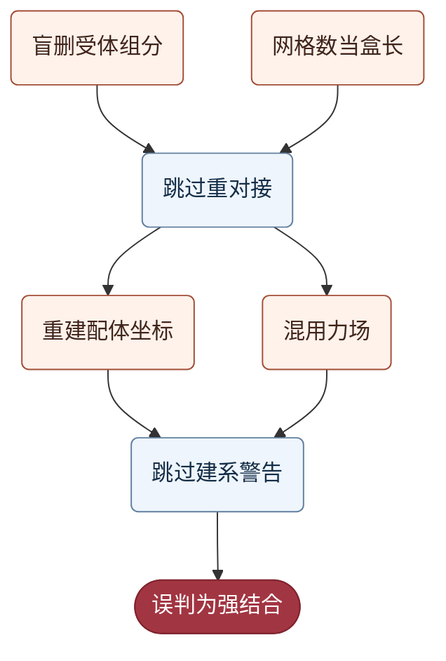
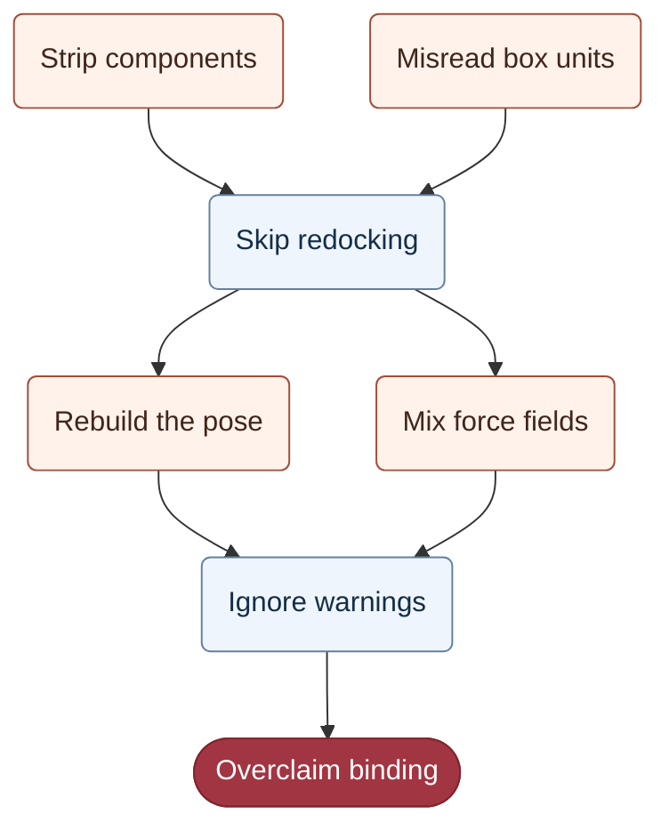
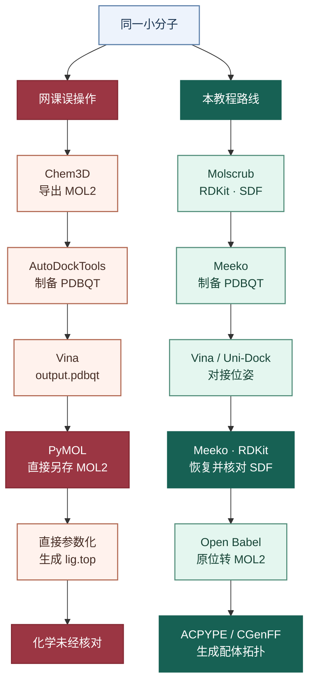
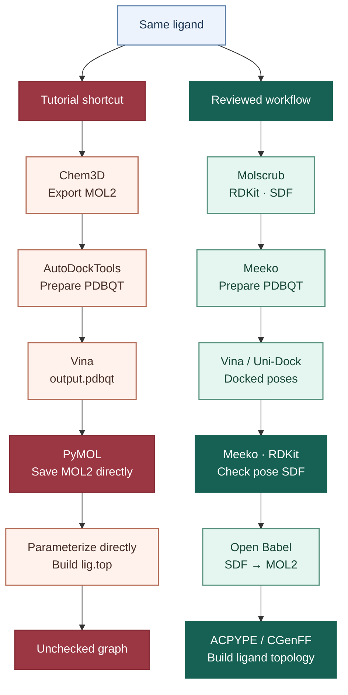

# 复杂体系与常见报错 / Complex systems and troubleshooting

[主教程目录 / Main tutorial](../README.md#contents) · [参考文献与软件引用 / References and software citation](../README.md#references)

本页使用通用体系和文件名。先定位第一个异常阶段，保留原始日志、输入文件和软件版本。表中的故障标记是搜索关键词，实际措辞随软件版本和后端而异。  
This page uses generic systems and filenames. Identify the first failing stage and retain its inputs, log, and software versions. Error strings are search terms. Their wording can vary by release and backend.

<a name="troubleshooting-contents"></a>

## 目录 / Contents

1. [快速定位 / Triage](#triage)
2. [复杂受体与膜体系 / Complex receptors and membrane systems](#complex-systems)
3. [对接、模板匹配与位姿恢复 / Docking, template matching, and pose recovery](#docking-errors)
4. [参数化与拓扑 / Parameterization and topology](#topology-errors)
5. [能量最小化、平衡与轨迹 / Minimization, equilibration, and trajectories](#simulation-errors)
6. [服务器读取、GPU 与续跑 / Portability, GPU execution, and restart](#server-errors)
7. [网课错误流程图 / Tutorial pitfalls](#tutorial-error-flow) · [Chem3D–ADT–PyMOL 对照 / Workflow comparison](#chem3d-pymol-topology)

<a name="triage"></a>

## 1. 快速定位 / Triage

| 症状或消息 / Symptom or message | 从这里开始 / Start here |
| --- | --- |
| Meeko 无匹配模板、`Residue ... not found`、非标准残基 / No matching residue template | [核查结构和化学模型 / Check structure and chemistry](#complex-systems) |
| 对接无输出、输出缺少位姿、SDF 无法导出 / Missing poses or failed SDF export | [核对任务清单、MODEL 和映射 / Check inputs, MODEL, and mapping](#docking-errors) |
| `Invalid order for directive atomtypes`、`No default ... types`、坐标和拓扑原子数不同 / Directive order, missing parameters, or mismatched coordinates | [核查 include、参数和分子顺序 / Inspect includes, parameters, and molecule order](#topology-errors) |
| `LINCS WARNING`、`water molecules can not be settled`、非有限力或能量 / Constraint failure or nonfinite forces or energies | [定位首次异常和上游输入 / Locate the first failure and its inputs](#simulation-errors) |
| `reading tpx file ... version ...`、CUDA 内存不足、checkpoint 无法追加 / TPR compatibility, GPU memory, or checkpoint append failure | [检查版本、设备和配套文件 / Check versions, hardware, and companion files](#server-errors) |

操作前记录上一阶段实际完成的步数与输出。已完成的环节可从最后一个经核验的坐标和检查点继续。修改化学状态、原子顺序或拓扑后，从受影响的第一阶段重新验收。  
Record the last completed step and its outputs. Resume from the last validated coordinates and checkpoint where appropriate. Changes to chemical identity, atom order, or topology require revalidation from the first affected stage. [GROMACS runtime errors](https://manual.gromacs.org/documentation/current/user-guide/run-time-errors.html) · [GROMACS restart and extension](https://manual.gromacs.org/documentation/current/user-guide/managing-simulations.html)

<a name="complex-systems"></a>

## 2. 复杂受体与膜体系 / Complex receptors and membrane systems

| 体系特征 / System feature | 最低建模核查 / Minimum modeling checks |
| --- | --- |
| 多链复合物、共晶伙伴或界面口袋 / Multichain assembly, partner, or interface pocket | 核实生物学组装、链间界面、占有率和链间共价连接。保留构成口袋或稳定构象的必要链。 / Verify the biological assembly, interface, occupancy, and interchain covalent links. Retain chains that form the pocket or stabilize its conformation. |
| 缺失环、替代构象、多模型或预测结构 / Missing loops, alternate conformers, multiple models, or predicted structures | 按序列、结构域和参考结构判断缺失部分是否影响口袋。记录保留链、模型和变更。预测结构在结合区域看 pLDDT，跨域口袋另核查 PAE。比较有依据的多个受体构象并报告口袋与位姿的复现情况。 / Use sequence and structural evidence to assess the pocket impact of missing segments. Record the selected chains, models, and edits. Examine local pLDDT and interdomain PAE where relevant. Compare justified receptor conformations and report recurrence of pockets and poses. |
| 非标准残基、翻译后修饰、金属或辅因子 / Nonstandard residues, modifications, metals, or cofactors | 对照源结构和实验背景确认化学身份、质子化、氧化态或配位、连接方式和总电荷。使用与所选力场和状态相容的参数，核查原子类型、质量、部分电荷、键合项及坐标映射。 / Check identity, protonation, oxidation or coordination state, covalent links, and total charge against the structural and experimental evidence. Validate atom types, masses, partial charges, bonded terms, and coordinate mapping for the chosen force field. |
| 膜蛋白与膜蛋白复合物 / Membrane proteins and membrane assemblies | 核实装配和膜朝向，按所用脂质力场构建匹配的显式膜，处理脂质–蛋白重叠。检查膜叶和盒方向后再最小化与分阶段平衡。按所选膜模型核对半各向同性压力耦合。 / Verify assembly and membrane orientation, build a compatible explicit bilayer, and resolve lipid–protein overlaps. Check leaflet assignment and box orientation before minimization and staged equilibration. Verify semi-isotropic pressure coupling against the chosen membrane protocol. |
| 糖基化或跨软件拓扑转换 / Glycosylation or topology conversion | 保留正确糖型、异头构型与共价连接。核对 1–4 缩放、排除项、原子序、质量、电荷。对代表性子体系使用相同几何并对齐两端能量设置，比较各能量项。 / Preserve glycoform, anomeric configuration, and covalent connectivity. Verify 1–4 scaling, exclusions, atom ordering, masses, and charges. Compare energy terms for a representative subsystem using identical geometry and matched settings. |
| 共价配体或反应中心 / Covalent ligands or reactive sites | 先为目标化学状态选择专门的建模和对接方案，核查连接及反应位点的证据。 / Use a dedicated modeling and docking protocol appropriate to the chemical state, with evidence for the covalent connection and reactive site. |

**什么时候暂停 / When to pause.** 口袋关键部分缺失、结构域相对构象无法判断、必要成分的化学状态未定，或力场转换无法验证时，先完成结构或参数审查。对于混合成分，逐项核实蛋白、脂质、糖、水、离子和配体参数间的兼容性。需要不同的 1–4 缩放时，可经验证地使用显式配对参数。仅改全局 `fudgeQQ` 或 `fudgeLJ` 会影响所有由默认规则生成的配对。  
Pause when essential pocket geometry, domain arrangement, chemical state, or topology conversion remains unresolved. Check compatibility across protein, lipid, glycans, water, ions, and ligand parameters. Explicit pair definitions can preserve validated heterogeneous 1–4 scaling. Changes to global `fudgeQQ` or `fudgeLJ` affect all pairs generated from defaults. [AlphaFold DB confidence and PAE](https://alphafold.ebi.ac.uk/faq) · [Amber reference manuals](https://ambermd.org/Manuals.php) · [GROMACS topology file formats](https://manual.gromacs.org/documentation/current/reference-manual/topologies/topology-file-formats.html) · [Lipid21 paper](https://doi.org/10.1021/acs.jctc.1c01217) · [GLYCAM06 paper](https://doi.org/10.1002/jcc.20820) · [PACKMOL-Memgen paper](https://doi.org/10.1021/acs.jcim.9b00269)

**膜体系的平衡验收 / Equilibration checks for membrane systems.** 检查温度、体积、侧向膜面积、膜厚、各膜叶行为以及关键共价连接。对膜褶皱或跨膜周期映像，检查几何与成像方式。面积、厚度和每脂质面积按组成、温度与计算定义分别解释。先确认是否还有有效位置限制，再判断放开限制后的行为。  
Inspect temperature, volume, lateral bilayer area, thickness, leaflet behavior, and essential covalent links. Review geometry and periodic imaging when membrane folds or image jumps appear. Interpret area, thickness, and area per lipid against composition, temperature, and metric definition. Verify which position restraints are active before interpreting subsequent relaxation. [GROMACS MDP parameters](https://manual.gromacs.org/documentation/current/user-guide/mdp-options.html) · [Lipid21 methods](https://doi.org/10.1021/acs.jctc.1c01217)

<a name="docking-errors"></a>

## 3. 对接、模板匹配与位姿恢复 / Docking, template matching, and pose recovery

- **受体模板匹配失败 / Receptor template mismatch.** 核对报错前后的残基、原子名、缺失重原子、链、altloc、端基和氢状态，先查明必要的配位、辅因子与非标准基团，再返回制备。  
  Inspect the reported residue and neighboring atoms for missing heavy atoms, naming, chain, alternate conformer, termini, and hydrogen state. Determine whether cofactors or special chemistry require a dedicated preparation route. [Meeko receptor preparation](https://meeko.readthedocs.io/en/develop/rec_cli_options.html) · [GROMACS pdb2gmx](https://manual.gromacs.org/documentation/current/onlinehelp/gmx-pdb2gmx.html)
- **配体制备失败 / Ligand preparation failed.** 按来源核对原始 SDF 的记录号、键级、立体化学、净电荷和盐形式。2D SDF 先按确认的微观状态生成 3D，Meeko 前确认显式氢。  
  Check the source record, bond orders, stereochemistry, formal charge, and salt form. Generate a 3D conformer for the verified microstate when starting from 2D, and verify explicit hydrogens before invoking Meeko. [Meeko ligand input requirements](https://meeko.readthedocs.io/en/develop/lig_prep_basic.html) · [Molscrub CLI](https://molscrub.readthedocs.io/en/latest/cli.html)
- **输出为空或恢复错误 / Empty output or pose recovery failure.** 先看退出码、第一条错误与输出目录，再对照任务清单、PDBQT `MODEL`、评分和 SDF 记录。映射丢失时用已验证原始 SDF 模板恢复，或重新制备并对接。原位重原子坐标须与选中的 PDBQT `MODEL` 对应。  
  Inspect the exit status, first error, and output directory. Match the run manifest, PDBQT `MODEL`, score, and SDF record. If mapping metadata is absent, recover with a verified original SDF template or prepare a new input and redock. Verify heavy-atom coordinates against the selected PDBQT `MODEL`. [Meeko export](https://meeko.readthedocs.io/en/develop/export_usage.html) · [位姿交接 / Pose transfer](../README.md#pose-handoff)
- **重对接采样到参考位姿但排名偏低 / Reference-like pose sampled but poorly ranked.** 同时报第一名 RMSD、候选中最佳 RMSD、该姿态的排名与关键接触。核查搜索盒和状态，并跨种子、构象及适用的受体模型复核。把排名偏差保留在记录里。  
  Report top-ranked RMSD, best sampled RMSD, rank of the best-matching pose, and reference contacts. Verify the search box and chemical state, then compare seeds, conformers, and relevant receptor models. Document any ranking discrepancy. [Vina tutorial](https://autodock-vina.readthedocs.io/en/latest/docking_basic.html) · [DockRMSD](https://doi.org/10.1186/s13321-019-0362-7) · [Docking validation review](https://doi.org/10.1007/s10822-026-00849-8)

<a name="topology-errors"></a>

## 4. 参数化与拓扑 / Parameterization and topology

| 症状 / Symptom | 检查与处理 / Diagnosis and action |
| --- | --- |
| 配体净电荷不符、CGenFF 罚分过高或 stream 版本不匹配 / Charge mismatch, high CGenFF penalty, or incompatible stream | 核对用于对接的同一化学状态、手性、净电荷和坐标，确认参数家族和版本。审核高罚分参数，按力场方法修正并重新验证。 / Verify chemistry and coordinates against the docked microstate. Check force-field family and version. Review high-penalty terms and validate any refinement. |
| `Invalid order for directive atomtypes` / Global parameter declaration out of order | 检查 include 顺序。全局 `[ atomtypes ]` 在任何 `[ moleculetype ]` 之前声明。顶层 `[ defaults ]` 由所选力场控制。 / Inspect include order. Declare global `[ atomtypes ]` before any `[ moleculetype ]`. The selected force field supplies the top-level `[ defaults ]`. |
| `No default ... types` / Missing bonded parameter | 找到报错的原子索引和交互项，核对原子类型、键合拓扑、参数版本及 include。补全有方法依据的参数后重新预处理。 / Trace the reported atoms and interaction term. Check atom types, connectivity, parameter version, and includes. Reprocess after resolving the missing term with a justified parameter assignment. |
| 坐标和拓扑原子数不同 / Coordinate and topology atom counts differ | 对照 GRO 第二行、`[ molecules ]`、每种分子的原子数及实际坐标顺序。重新溶剂化时从未加水的复合物及配套拓扑开始。 / Compare the GRO atom count with `[ molecules ]` counts, atoms per molecule, and coordinate order. For a fresh solvation, use the unsolvated complex and its matching topology. |
| 加水/离子后配体偏离口袋，或限制原子越界 / Ligand displaced or position restraints out of range | 对照 Å 与 nm、原子映射、复合物成像和原子顺序。位置限制编号在所属 `[ moleculetype ]` 内计数，参考文件与目标构象的原子顺序应一致。 / Check Å/nm conversion, atom mapping, periodic imaging, and atom order. Position-restraint indices are local to their `[ moleculetype ]`. Use a reference structure with matching atom order. |

在独立输出目录重新执行失败阶段的 `grompp`。用 `-pp` 保存展开拓扑，用 `-po` 保存实际处理的 MDP。预处理成功后，以这一轮生成的文件核对位置限制、分子数量和生产设置。  
Rerun `grompp` for the failed stage with separate output paths. Save the preprocessed topology with `-pp` and the processed MDP with `-po`. After successful preprocessing, use these outputs to verify restraints, molecule counts, and production settings. [GROMACS grompp](https://manual.gromacs.org/documentation/current/onlinehelp/gmx-grompp.html) · [Topology file formats](https://manual.gromacs.org/documentation/current/reference-manual/topologies/topology-file-formats.html) · [CGenFF documentation](https://docs.silcsbio.com/2026/cgenff/usage.html)

<a name="simulation-errors"></a>

## 5. 能量最小化、平衡与轨迹 / Minimization, equilibration, and trajectories

**LINCS、SETTLE 或非有限值 / LINCS, SETTLE, or nonfinite values.** 先定位异常起始的步数和相关原子，回看最小化最大力、局部重叠、原子顺序、拓扑与参考位置限制。有些警告在失败阶段的第一帧前出现，需检查上一阶段末态。修复原因后，从一致的输入重新预处理与验收。  
Locate the first failing step and affected atoms. Review minimization forces, steric overlaps, atom order, topology, and restraint references. A warning before the first output frame can require inspection of the previous stage's endpoint. Reprocess and revalidate from consistent inputs after correcting the cause. [GROMACS common errors](https://manual.gromacs.org/documentation/current/user-guide/run-time-errors.html) · [Constraint algorithms](https://manual.gromacs.org/documentation/current/reference-manual/algorithms/constraint-algorithms.html)

```bash
# Set LOG to the actual log for the failing stage.
LOG='npt.log'
grep -inE 'warning|lincs|settle|fatal error|non-finite|not finite|nan|maximum force' "$LOG"
```

**平衡漂移或配体 RMSD 突跳 / Equilibration drift or abrupt ligand RMSD changes.** 对比温度、密度、体积及压力的分块趋势。先确认周期性边界成像和帧时间，再比较全蛋白拟合与局部口袋拟合，并检查接触保留和最近距离。局部结果可帮助定位柔性域运动或实际位姿改变。依据实际记录评估是否需要延长。  
Compare blockwise trends in temperature, density, volume, and pressure. Check periodic imaging and timestamps, then compare whole-protein and local pocket alignment together with contact persistence and minimum distance. Local metrics can help distinguish flexible-domain motion from a change in the ligand pose. Base any extension on recorded evidence. [gmx trjconv](https://manual.gromacs.org/documentation/current/onlinehelp/gmx-trjconv.html) · [MD reproducibility checklist](https://doi.org/10.1038/s42003-023-04653-0)

<a name="server-errors"></a>

## 6. 服务器读取、GPU 与续跑 / Portability, GPU execution, and restart

- **TPR 在目标机读取失败 / TPR unreadable on the target.** 先比对 GROMACS 版本并核对文件校验值。用目标机 `gmx dump -s md.tpr` 只读测试。格式不兼容时优先使用兼容版本，或用归档 MDP、拓扑、坐标、索引及兼容 checkpoint 重新生成并核对运行设置。归档原 TPR 和重建版本。  
  Compare GROMACS versions and checksums. Test the file on the target with `gmx dump -s md.tpr`. Use a compatible build or regenerate the TPR from archived MDP, topology, coordinates, index, and a compatible checkpoint, then verify the run settings. Retain the original and regenerated files. [gmx dump](https://manual.gromacs.org/documentation/current/onlinehelp/gmx-dump.html) · [gmx grompp](https://manual.gromacs.org/documentation/current/onlinehelp/gmx-grompp.html)
- **CUDA 启动失败或显存不足 / CUDA startup failure or insufficient device memory.** 对照资源分配、实际程序构建、驱动和日志。用单任务、单设备的小规模作业隔离问题。对接批量不足可调小批次。GROMACS 并行和卸载选项按所用构建与版本核查。  
  Check scheduler allocation, executable build, driver, and log. Isolate the issue with a small single-device job. Reduce the docking batch size where appropriate. Verify GROMACS parallelism and offload options for the installed build. [GROMACS performance](https://manual.gromacs.org/documentation/current/user-guide/mdrun-performance.html) · [Uni-Dock](https://github.com/dptech-corp/Uni-Dock)
- **checkpoint 追加失败 / Checkpoint append failed.** 检查运行前缀、TPR/CPT 对应关系，以及原始输出是否仍完整。修复配套文件或按官方流程分段续跑并归档实际分段。  
  Check the run prefix, TPR/checkpoint correspondence, and the integrity of the existing outputs. Restore the matching files or restart in separate parts according to the documented procedure, and archive the parts. [Managing long simulations](https://manual.gromacs.org/documentation/current/user-guide/managing-simulations.html)
- **生产状态不清楚 / Ambiguous production status.** 将输入准备、生产运行和完成验收分开记录。`md.tpr` 可读时可核对编译参数，正式运行的起止步数以日志、checkpoint 和实际轨迹为据。  
  Record input readiness, production execution, and completion separately. A readable `md.tpr` supports checking compiled settings. Establish elapsed production from logs, checkpoints, and actual trajectory frames. [生产交接 / Production handoff](../README.md#server-handoff)

[返回排错目录 / Back to troubleshooting](#troubleshooting-contents)

## 网课常见误操作与流程对照 / Tutorial pitfalls and workflow comparison

下例用常见教学操作复现问题，供跟练时自查。  
The examples below show common workflow errors and the checks that detect them.

<a name="tutorial-error-flow"></a>

### 网课错误流程图 / Tutorial error flowchart

按箭头读一条常见的误操作路径。各步骤的后果、纠正方法，以及如何解读对接分数和 RMSD，见下表和轨迹分析章节。



<details>
<summary>English version</summary>

Follow the stages in order, then consult the table for each failure mode, its consequences, and the corrective check.



</details>

| 常见做法 / Common shortcut | 会发生什么 / Consequence | 正确操作 / Fix |
| --- | --- | --- |
| 删除所有非蛋白原子 / Delete everything outside the protein | 可能丢失界定口袋的共晶配体、维持配位的金属或必要辅因子。 / This can remove the co-crystal reference ligand, a coordination metal, or an essential cofactor. | 先另存参考配体，记录各异质成分的保留与去除理由。需要金属或辅因子的体系专项建模。 / Save the reference ligand first and document each component decision. Model essential metals and cofactors explicitly. |
| 把 ADT 盒子的 60 个间隔写成 Vina 的 `size_x = 60` / Copy 60 ADT intervals into Vina as `size_x = 60` | 若间隔为 0.375 Å，实际示例边长为 22.5 Å，输入 60 会显著扩大搜索空间。 / At 0.375 Å per interval, the intended length is 22.5 Å. Entering 60 greatly enlarges the search space. | 转成 Å，再叠加受体和参考配体验证覆盖。 / Convert to Å and inspect coverage on the receptor and reference ligand. |
| 把已对接的 PDBQT 转 MOL2 时重建 3D，再接 MD / Regenerate 3D geometry while converting a docked PDBQT to MOL2 | 恢复的化学图可能错误，配体有可能移出口袋或改变位姿。 / The reconstructed graph can be wrong and the ligand may move or change pose. | Meeko 恢复原始 SDF 化学图，Open Babel 仅做格式转换并保留原位重原子坐标。 / Recover the SDF graph with Meeko, then convert the format while retaining the pose coordinates. |
| CUDA 能识别显卡，就给官方 `vina.exe` 加 GPU 参数 / Treat a working CUDA driver as GPU support in upstream `vina.exe` | 官方 Vina 的普通批处理仍由 CPU 执行。 / Standard upstream Vina batch docking still runs on the CPU. | 选择 Uni-Dock CUDA 或上游明确提供 GPU 后端的程序，并通过日志和设备监控确认。 / Choose Uni-Dock CUDA or an engine with a documented GPU backend and check both its log and device activity. |
| 将 GAFF2 配体直接 include 到 CHARMM36m 蛋白拓扑 / Include a GAFF2 ligand directly in a CHARMM36m topology | 非键合默认项、1–4 规则及参数体系可能冲突。 / Nonbonded defaults, 1–4 rules, and parameter conventions can conflict. | 使用 AMBER + GAFF2 或 CHARMM + CGenFF 的匹配路线。 / Use the matched AMBER + GAFF2 or CHARMM + CGenFF combination. |
| 遇到 grompp warning 直接抬高 `-maxwarn`，或把最低对接分数当作亲和力 / Raise `-maxwarn` after warnings or interpret the lowest docking score as affinity | 可能放行错序拓扑、未知参数或误读筛选结果。 / This can hide topology and parameter problems or overstate a screening result. | 检查展开拓扑、警告原文和重对接结果，用独立实验评价亲和力。 / Review the expanded topology, warning messages, and redocking, and use independent experiments to assess affinity. |

<a name="chem3d-pymol-topology"></a>

### 网课错误方法与本教程路线 / Tutorial shortcut and reviewed workflow

先在 Chem3D 优化小分子并导出 `ligand.mol2`，再用 AutoDockTools（ADT）制备 `ligand.pdbqt`。Vina 对接后获得 `output.pdbqt`。图中左列在对接后把选定的 PDBQT 直接用 PyMOL 另存为 MOL2，交给 ACPYPE 等工具生成 `lig.top` 或 `lig.itp`。右列以新项目的 Meeko 路线为例，先恢复 SDF 并核对化学与位姿，再转 MOL2 和参数化。已经完成对接的 ADT 项目，见[路线 B 的原始 SDF 模板恢复](../README.md#legacy-adt-handoff)。



**风险出在对接到 MD 的交接。** Chem3D 可以用于构象准备，MOL2 也可以作为参数化输入。PDBQT 保存对接坐标、原子类型和部分电荷，缺少用于可靠还原完整键级和形式电荷的信息。非极性氢也常在制备时合并。PyMOL 另存为 MOL2 时，即使重原子位置看起来一致，也需要对照原始配体检查键级、芳香性、质子化状态和净电荷。参数化完成只说明工具处理了该输入，化学状态仍需单独核对。MD 的部分电荷应按所选力场方案生成。

**可靠的交接方法。** 保留与对接输入同一化学状态的原始 SDF 或 MOL2。用 Meeko 制备配体时保留 `REMARK SMILES` 和 `REMARK SMILES IDX`，从所选对接位姿恢复 SDF，再逐原子核对重原子坐标、键级、手性和净电荷。确需 MOL2 时只转换格式，保留已核对的位姿，最后用所选的 AMBER 或 CHARMM 路线参数化。旧版 ADT 的输出若缺少 Meeko 映射，可用原始结构做可靠的原子映射。无法确认映射时，用 Meeko 重新制备并对接。

<details>
<summary>Workflow comparison in English</summary>

The example begins with ligand optimization in Chem3D, MOL2 export, and PDBQT preparation in AutoDockTools (ADT). After Vina writes `output.pdbqt`, the shortcut saves the selected pose as MOL2 in PyMOL and proceeds directly to `lig.top` or `lig.itp`. The right column shows how the Meeko workflow verifies the chemistry before parameterization. Completed ADT jobs can use the [original SDF template](../README.md#legacy-adt-handoff).



Chem3D can generate conformers, and a chemically verified MOL2 can serve as input for parameterization. PDBQT records coordinates, atom types, and docking partial charges. Recovery of bond orders and formal charge requires the original chemical graph or equivalent mapping metadata. Preparation can merge nonpolar hydrogens. Compare bond orders, aromaticity, protonation, and net charge against the source ligand, and assign MD partial charges using the chosen force-field protocol.

Archive an SDF or MOL2 for the original ligand microstate. Recover the selected pose using the Meeko SMILES and atom-index mapping, then verify bond orders, stereochemistry, net charge, and heavy-atom coordinates. If MOL2 is required, convert the verified pose without altering its coordinates. For legacy ADT output, establish an unambiguous atom map to the original ligand. Redock a newly prepared Meeko input if the mapping cannot be verified.

</details>

依据 / References · [Vina: Exporting results to SDF](https://autodock-vina.readthedocs.io/en/latest/docking_basic.html#exporting-results-to-sdf) · [Meeko: Exporting docking results](https://meeko.readthedocs.io/en/develop/export_usage.html) · [PyMOL: Save](https://pymolwiki.org/index.php/Save) · [ACPYPE: Ligand parameterization](https://acpype.readthedocs.io/en/latest/)

例如，一个来自 Meeko 对接任务的 PDBQT 应先恢复为 SDF，再取经核对的记录转 MOL2。以下在步骤 05 的目录运行，`1` 是核对过的记录号示例。  
Run the following commands from the step 05 work directory to export and convert a Meeko-prepared pose. Set the SDF record number to the value established during pose selection.

```bash
mk_export.py selected_run.pdbqt -s docked_poses.sdf
obabel docked_poses.sdf -f 1 -l 1 -O lig_pose.sdf
obabel lig_pose.sdf -O lig_pose.mol2
```

上游依据 / Upstream references · [Vina box and pose export](https://autodock-vina.readthedocs.io/en/latest/docking_basic.html) · [GROMACS force fields](https://manual.gromacs.org/2026.3/user-guide/force-fields.html) · [grompp warnings and expanded topology](https://manual.gromacs.org/current/onlinehelp/gmx-grompp.html)

[返回排错目录 / Back to troubleshooting](#troubleshooting-contents)
