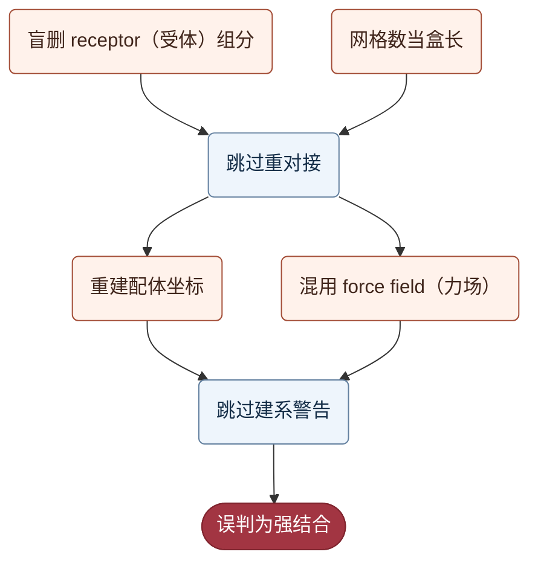
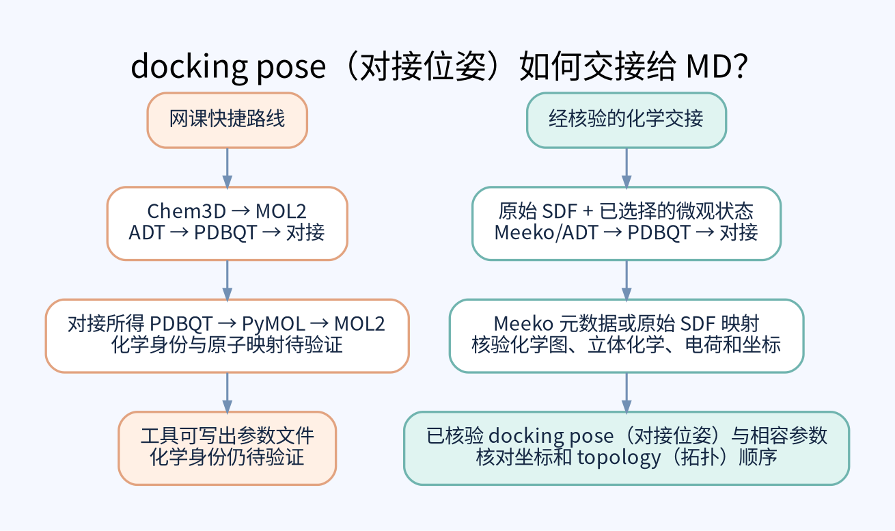
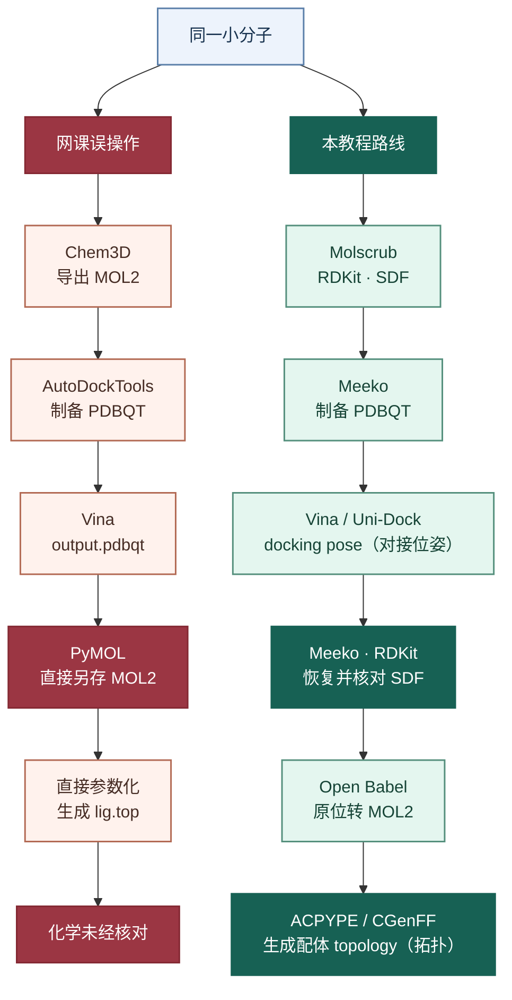

# 复杂体系与常见报错

[English](TROUBLESHOOTING.md) · **简体中文**

中英文同步于 2026-11-28。[已验证的工作流提交](https://github.com/LuciferBioLab/docking-gromacs-tutorial/commit/d139618900e79f0dc186d3bb64fbe5be4cc25914)。

[仓库首页](../README.zh-CN.md#contents)

## 首条报错索引

<a name="triage"></a>

| 报错或现象 | 可能原因 | 优先处理 |
| --- | --- | --- |
| 分组已选到配体，但报 `has no donors AND has no acceptors` | 配体 topology（拓扑）缺元素字段 | [核对原子序数](#atomic-number-analysis) |
| `ValueError: interrupted residues in PDB: {'A:438'}` | 固定公开示例有一条乱序 PDB 记录 | 用示例专用的坐标不变排序步骤 |
| `Explicit valence for atom # 16 N, 4, is greater than permitted` | 示例 MOL2 与 RDKit 的价态表示不一致 | 通过 Open Babel 转回 SDF，验证化学图与 +1 电荷 |
| 有低 RMSD 的低排名结果而首名 RMSD 高 | 采到了近天然 docking pose（对接位姿），但评分排名靠后 | 单列首名与最佳采样结果 |
| 所有 docking pose（对接位姿）固定坐标系 RMSD 高 | 盒、参考坐标、采样或原子映射问题 | 复查盒、receptor（受体）坐标系和对称图映射 |
| MD 配体 RMSD 高而接触不变 | 可能是 PBC 映像或坐标顺序不匹配 | 重建映像、按蛋白拟合并检查 topology（拓扑）顺序 |
| 原子数相同但顺序不同 | 坐标拼接或排序错误 | 按 topology（拓扑）核对原子名和坐标对应 |
| 早期 SETTLE 或 LINCS 报错 | 可能有严重冲突或约束、初始模型问题 | 核查结构、最小化和短试跑参数 |

[主教程目录](../README.zh-CN.md#contents) · [参考文献与软件引用](REFERENCES.zh-CN.md#references)

本页使用通用体系和文件名。先定位第一个异常阶段，保留原始日志、输入文件和软件版本。表中的故障标记是搜索关键词，实际措辞随软件版本和后端而异。

<a name="troubleshooting-contents"></a>

## 目录

1. [快速定位](#triage)
2. [复杂 receptor（受体）与膜体系](#complex-systems)
3. [对接、模板匹配与 docking pose（对接位姿）恢复](#docking-errors)
4. [参数化与 topology（拓扑）](#topology-errors)
5. [能量最小化、平衡与轨迹](#simulation-errors)
6. [服务器读取、GPU 与续跑](#server-errors)
7. [网课错误流程图](#tutorial-error-flow) · [Chem3D–ADT–PyMOL 对照](#chem3d-pymol-topology)

<a name="triage"></a>

## 1. 快速定位

| 症状或消息 | 从这里开始 |
| --- | --- |
| Meeko 无匹配模板、`Residue ... not found`、非标准残基 | [核查结构和化学模型](#complex-systems) |
| 对接无输出、输出缺少 docking pose（对接位姿）、SDF 无法导出 | [核对任务清单、MODEL 和映射](#docking-errors) |
| `Invalid order for directive atomtypes`、`No default ... types`、坐标和 topology（拓扑）原子数不同 | [核查 include、参数和分子顺序](#topology-errors) |
| `LINCS WARNING`、`water molecules can not be settled`、非有限力或能量 | [定位首次异常和上游输入](#simulation-errors) |
| `reading tpx file ... version ...`、CUDA 内存不足、checkpoint 无法追加 | [检查版本、设备和配套文件](#server-errors) |

操作前记录上一阶段实际完成的步数与输出。已完成的环节可从最后一个经核验的坐标和检查点继续。修改化学状态、原子顺序或 topology（拓扑）后，从受影响的第一阶段重新验收。 [GROMACS runtime errors](https://manual.gromacs.org/documentation/current/user-guide/run-time-errors.html) · [GROMACS restart and extension](https://manual.gromacs.org/documentation/current/user-guide/managing-simulations.html)

<a name="complex-systems"></a>

## 2. 复杂 receptor（受体）与膜体系

| 体系特征 | 最低建模核查 |
| --- | --- |
| 多链复合物、共晶伙伴或界面口袋 | 核实生物学组装、链间界面、占有率和链间共价连接。保留构成口袋或稳定构象的必要链。 |
| 缺失环、替代构象、多模型或预测结构 | 按序列、结构域和参考结构判断缺失部分是否影响口袋。记录保留链、模型和变更。预测结构在结合区域看 pLDDT，跨域口袋另核查 PAE。比较有依据的多个 receptor（受体）构象并报告口袋与 docking pose（对接位姿）的复现情况。 |
| 非标准残基、翻译后修饰、金属或辅因子 | 对照源结构和实验背景确认化学身份、质子化、氧化态或配位、连接方式和总电荷。使用与所选 force field（力场）和状态相容的参数，核查原子类型、质量、partial charge（部分电荷）、键合项及坐标映射。 |
| 膜蛋白与膜蛋白复合物 | 核实装配和膜朝向，按所用脂质 force field（力场）构建匹配的显式膜，处理脂质–蛋白重叠。检查膜叶和盒方向后再最小化与分阶段平衡。按所选膜模型核对半各向同性压力耦合。 |
| 糖基化或跨软件 topology（拓扑）转换 | 保留正确糖型、异头构型与共价连接。核对 1–4 缩放、排除项、原子序、质量、电荷。对代表性子体系使用相同几何并对齐两端能量设置，比较各能量项。 |
| 共价配体或反应中心 | 先为目标化学状态选择专门的建模和对接方案，核查连接及反应位点的证据。 |

**什么时候暂停** 口袋关键部分缺失、结构域相对构象无法判断、必要成分的化学状态未定，或 force field（力场）转换无法验证时，先完成结构或参数审查。对于混合成分，逐项核实蛋白、脂质、糖、水、离子和配体参数间的兼容性。需要不同的 1–4 缩放时，可经验证地使用显式配对参数。仅改全局 `fudgeQQ` 或 `fudgeLJ` 会影响所有由默认规则生成的配对。<sup>[1](#ref-1),[2](#ref-2),[3](#ref-3)</sup> [AlphaFold DB confidence and PAE](https://alphafold.ebi.ac.uk/faq) · [Amber reference manuals](https://ambermd.org/Manuals.php) · [GROMACS topology file formats](https://manual.gromacs.org/documentation/current/reference-manual/topologies/topology-file-formats.html) · [Lipid21 paper](https://doi.org/10.1021/acs.jctc.1c01217) · [GLYCAM06 paper](https://doi.org/10.1002/jcc.20820) · [PACKMOL-Memgen paper](https://doi.org/10.1021/acs.jcim.9b00269)

**膜体系的平衡验收** 检查温度、体积、侧向膜面积、膜厚、各膜叶行为以及关键共价连接。对膜褶皱或跨膜周期映像，检查几何与成像方式。面积、厚度和每脂质面积按组成、温度与计算定义分别解释。先确认是否还有有效位置限制，再判断放开限制后的行为。 [GROMACS MDP parameters](https://manual.gromacs.org/documentation/current/user-guide/mdp-options.html) · [Lipid21 methods](https://doi.org/10.1021/acs.jctc.1c01217)

<a name="docking-errors"></a>

## 3. 对接、模板匹配与 docking pose（对接位姿）恢复

- **receptor（受体）模板匹配失败** 核对报错前后的残基、原子名、缺失 heavy atom（重原子）、链、altloc、端基和氢状态，先查明必要的配位、辅因子与非标准基团，再返回制备。<sup>[4](#ref-4)</sup> [Meeko receptor preparation](https://meeko.readthedocs.io/en/develop/rec_cli_options.html) · [GROMACS pdb2gmx](https://manual.gromacs.org/documentation/current/onlinehelp/gmx-pdb2gmx.html)
- **配体制备失败** 按来源核对原始 SDF 的记录号、bond order（键级）、stereochemistry（立体化学）、净电荷和盐形式。2D SDF 先按确认的微观状态生成 3D，Meeko 前确认显式氢。 [Meeko ligand input requirements](https://meeko.readthedocs.io/en/develop/lig_prep_basic.html) · [Molscrub CLI](https://molscrub.readthedocs.io/en/latest/cli.html)
- **输出为空或恢复错误** 先看退出码、第一条错误与输出目录，再对照任务清单、PDBQT `MODEL`、评分和 SDF 记录。映射丢失时用已验证原始 SDF 模板恢复，或重新制备并对接。原位 heavy atom（重原子）坐标须与选中的 PDBQT `MODEL` 对应。 [Meeko export](https://meeko.readthedocs.io/en/develop/export_usage.html) · [docking pose（对接位姿）交接](DOCKING.zh-CN.md#pose-handoff)
- **重对接采样到参考 docking pose（对接位姿）但排名偏低** 同时报第一名 RMSD、候选中最佳 RMSD、该姿态的排名与关键接触。核查搜索盒和状态，并跨种子、构象及适用的 receptor（受体）模型复核。把排名偏差保留在记录里。<sup>[5](#ref-5),[6](#ref-6)</sup> [Vina tutorial](https://autodock-vina.readthedocs.io/en/latest/docking_basic.html) · [DockRMSD](https://doi.org/10.1186/s13321-019-0362-7) · [Docking validation review](https://doi.org/10.1007/s10822-026-00849-8)

<a name="topology-errors"></a>

## 4. 参数化与 topology（拓扑）

| 症状 | 检查与处理 |
| --- | --- |
| 配体净电荷不符、CGenFF 罚分过高或 stream 版本不匹配 | 核对用于对接的同一化学状态、手性、净电荷和坐标，确认参数家族和版本。审核高罚分参数，按 force field（力场）方法修正并重新验证。 |
| `Invalid order for directive atomtypes` / Global parameter declaration out of order | 检查 include 顺序。全局 `[ atomtypes ]` 在任何 `[ moleculetype ]` 之前声明。顶层 `[ defaults ]` 由所选 force field（力场）控制。 |
| `No default ... types` / Missing bonded parameter | 找到报错的原子索引和交互项，核对原子类型、键合 topology（拓扑）、参数版本及 include。补全有方法依据的参数后重新预处理。 |
| 坐标和 topology（拓扑）原子数不同 | 对照 GRO 第二行、`[ molecules ]`、每种分子的原子数及实际坐标顺序。重新溶剂化时从未加水的复合物及配套 topology（拓扑）开始。 |
| 加水/离子后配体偏离口袋，或限制原子越界 | 对照 Å 与 nm、atom mapping（原子映射）、复合物成像和原子顺序。位置限制编号在所属 `[ moleculetype ]` 内计数，参考文件与目标构象的原子顺序应一致。 |

在独立输出目录重新执行失败阶段的 `grompp`。用 `-pp` 保存展开 topology（拓扑），用 `-po` 保存实际处理的 MDP。预处理成功后，以这一轮生成的文件核对位置限制、分子数量和生产设置。<sup>[7](#ref-7)</sup> [GROMACS grompp](https://manual.gromacs.org/documentation/current/onlinehelp/gmx-grompp.html) · [Topology file formats](https://manual.gromacs.org/documentation/current/reference-manual/topologies/topology-file-formats.html) · [CGenFF documentation](https://docs.silcsbio.com/2026/cgenff/usage.html)

<a name="simulation-errors"></a>

## 5. 能量最小化、平衡与轨迹

**LINCS、SETTLE 或非有限值** 先定位异常起始的步数和相关原子，回看最小化最大力、局部重叠、原子顺序、topology（拓扑）与参考位置限制。有些警告在失败阶段的第一帧前出现，需检查上一阶段末态。修复原因后，从一致的输入重新预处理与验收。 [GROMACS common errors](https://manual.gromacs.org/documentation/current/user-guide/run-time-errors.html) · [Constraint algorithms](https://manual.gromacs.org/documentation/current/reference-manual/algorithms/constraint-algorithms.html)

**环境：** `Bash`。**预期文件或核查依据：** 终端输出或下方命令指定的文件。耗时和磁盘规划见快速入门的分阶段表。

```bash
# Set LOG to the actual log for the failing stage.
LOG='npt.log'
grep -inE 'warning|lincs|settle|fatal error|non-finite|not finite|nan|maximum force' "$LOG"
```

**平衡漂移或配体 RMSD 突跳** 对比温度、密度、体积及压力的分块趋势。先确认周期性边界成像和帧时间，再比较全蛋白拟合与局部口袋拟合，并检查接触保留和最近距离。局部结果可帮助定位柔性域运动或实际 docking pose（对接位姿）改变。依据实际记录评估是否需要延长。<sup>[8](#ref-8)</sup> [gmx trjconv](https://manual.gromacs.org/documentation/current/onlinehelp/gmx-trjconv.html) · [MD reproducibility checklist](https://doi.org/10.1038/s42003-023-04653-0)

<a name="server-errors"></a>

## 6. 服务器读取、GPU 与续跑

- **TPR 在目标机读取失败** 先比对 GROMACS 版本并核对文件校验值。用目标机 `gmx dump -s md.tpr` 只读测试。格式不兼容时优先使用兼容版本，或用归档 MDP、topology（拓扑）、坐标、索引及兼容 checkpoint 重新生成并核对运行设置。归档原 TPR 和重建版本。 [gmx dump](https://manual.gromacs.org/documentation/current/onlinehelp/gmx-dump.html) · [gmx grompp](https://manual.gromacs.org/documentation/current/onlinehelp/gmx-grompp.html)
- **CUDA 启动失败或显存不足** 对照资源分配、实际程序构建、驱动和日志。用单任务、单设备的小规模作业隔离问题。对接批量不足可调小批次。GROMACS 并行和卸载选项按所用构建与版本核查。 [GROMACS performance](https://manual.gromacs.org/documentation/current/user-guide/mdrun-performance.html) · [Uni-Dock](https://github.com/dptech-corp/Uni-Dock)
- **checkpoint 追加失败** 检查运行前缀、TPR/CPT 对应关系，以及原始输出是否仍完整。修复配套文件或按官方流程分段续跑并归档实际分段。 [Managing long simulations](https://manual.gromacs.org/documentation/current/user-guide/managing-simulations.html)
- **生产状态不清楚** 将输入准备、生产运行和完成验收分开记录。`md.tpr` 可读时可核对编译参数，正式运行的起止步数以日志、checkpoint 和实际轨迹为据。 [生产交接](SIMULATION.zh-CN.md#server-handoff)

[返回排错目录](#troubleshooting-contents)

## 网课常见误操作与流程对照

下例用常见教学操作复现问题，供跟练时自查。

<a name="tutorial-error-flow"></a>

### 网课错误流程图

按箭头阅读常见误操作。下表说明各项后果及纠正方法。对接分数与 RMSD 的判读见[主教程的分析章节](ANALYSIS.zh-CN.md#analysis)。



| 常见做法 | 会发生什么 | 正确操作 |
| --- | --- | --- |
| 删除所有非蛋白原子 | 可能丢失界定口袋的共晶配体、维持配位的金属或必要辅因子。 | 先另存参考配体，记录各异质成分的保留与去除理由。需要金属或辅因子的体系专项建模。 |
| 把 ADT 盒子的 60 个间隔写成 Vina 的 `size_x = 60` | 若间隔为 0.375 Å，实际示例边长为 22.5 Å，输入 60 会显著扩大搜索空间。 | 转成 Å，再叠加 receptor（受体）和参考配体验证覆盖。 |
| 把已对接的 PDBQT 转 MOL2 时重建 3D，再接 MD | 恢复的化学图可能错误，配体有可能移出口袋或改变 docking pose（对接位姿）。 | Meeko 恢复原始 SDF 化学图，Open Babel 仅做格式转换并保留原位 heavy atom（重原子）坐标。 |
| CUDA 能识别显卡，就给官方 `vina.exe` 加 GPU 参数 | 官方 Vina 的普通批处理仍由 CPU 执行。 | 选择 Uni-Dock CUDA 或上游明确提供 GPU 后端的程序，并通过日志和设备监控确认。 |
| 将 GAFF2 配体直接 include 到 CHARMM36m 蛋白 topology（拓扑） | 非键合默认项、1–4 规则及参数体系可能冲突。 | 使用 AMBER + GAFF2 或 CHARMM + CGenFF 的匹配路线。 |
| 遇到 grompp warning 直接抬高 `-maxwarn`，或把最低对接分数当作亲和力 | 可能放行错序 topology（拓扑）、未知参数或误读筛选结果。 | 检查展开 topology（拓扑）、警告原文和重对接结果，用独立实验评价亲和力。 |

<a name="chem3d-pymol-topology"></a>



*图 2. 风险来自未经核验的化学身份与原子顺序交接。*

### 网课错误方法与本教程路线

先在 Chem3D 优化小分子并导出 `ligand.mol2`，再用 AutoDockTools（ADT）制备 `ligand.pdbqt`。Vina 对接后获得 `output.pdbqt`。图中左列在对接后把选定的 PDBQT 直接用 PyMOL 另存为 MOL2，交给 ACPYPE 等工具生成 `lig.top` 或 `lig.itp`。右列以新项目的 Meeko 路线为例，先恢复 SDF 并核对化学与 docking pose（对接位姿），再转 MOL2 和参数化。已经完成对接的 ADT 项目可使用[原始 SDF 模板恢复](DOCKING.zh-CN.md#legacy-adt-handoff)。



**风险出在对接到 MD 的交接。** Chem3D 可以用于构象准备，经过化学核验的 MOL2 可以用于参数化。PDBQT 保存对接坐标、原子类型和 partial charge（部分电荷）。恢复完整 bond order（键级）和 formal charge（形式电荷）需要原始化学图或等效的映射信息。制备时也可能合并非极性氢。PyMOL 另存为 MOL2 后，即使 heavy atom（重原子）坐标一致，也需要对照原始配体检查 bond order（键级）、芳香性、protonation state（质子化状态）和净电荷。参数化工具成功处理输入后仍需完成化学核验。MD 的 partial charge（部分电荷）应按所选 force field（力场）方案生成。<sup>[4](#ref-4),[9](#ref-9)</sup>

**可靠的交接方法。** 保存与对接输入相同微观状态的 SDF 或 MOL2。用 Meeko 制备时保留 `REMARK SMILES` 和 `REMARK SMILES IDX`。恢复选定的 docking pose（对接位姿）后，核对 bond order（键级）、stereochemistry（立体化学）、净电荷及 heavy atom（重原子）坐标。如需 MOL2，在保持坐标的前提下转换，再按所选 AMBER 或 CHARMM 路线参数化。旧 ADT 输出应建立到原始配体的明确 atom mapping（原子映射）。无法核验时，用 Meeko 重新制备并对接。<sup>[4](#ref-4)</sup>


依据 · [Vina: Exporting results to SDF](https://autodock-vina.readthedocs.io/en/latest/docking_basic.html#exporting-results-to-sdf) · [Meeko: Exporting docking results](https://meeko.readthedocs.io/en/develop/export_usage.html) · [PyMOL: Save](https://pymolwiki.org/index.php/Save) · [ACPYPE: Ligand parameterization](https://acpype.readthedocs.io/en/latest/)

例如，一个来自 Meeko 对接任务的 PDBQT 应先恢复为 SDF，再取经核对的记录转 MOL2。以下在步骤 05 的目录运行，`1` 是核对过的记录号示例。

**环境：** `docking-gromacs`。**预期文件或核查依据：** `docked_poses.sdf`。耗时和磁盘规划见快速入门的分阶段表。

```bash
mk_export.py selected_run.pdbqt -s docked_poses.sdf
obabel docked_poses.sdf -f 1 -l 1 -O lig_pose.sdf
obabel lig_pose.sdf -O lig_pose.mol2
```

上游依据 · [Vina box and pose export](https://autodock-vina.readthedocs.io/en/latest/docking_basic.html) · [GROMACS force fields](https://manual.gromacs.org/2026.3/user-guide/force-fields.html) · [grompp warnings and expanded topology](https://manual.gromacs.org/current/onlinehelp/gmx-grompp.html)

[返回排错目录](#troubleshooting-contents)


<a name="references"></a>

## 参考文献

1. <a name="ref-1"></a> Dickson CJ, Walker RC, Gould IR. *Lipid21: Complex lipid membrane simulations with AMBER*. J Chem Theory Comput. 2022. [DOI](https://doi.org/10.1021/acs.jctc.1c01217)
2. <a name="ref-2"></a> Kirschner KN, Yongye AB, Tschampel SM, et al. *GLYCAM06: A generalizable biomolecular force field. Carbohydrates*. J Comput Chem. 2008. [DOI](https://doi.org/10.1002/jcc.20820)
3. <a name="ref-3"></a> Schott-Verdugo S, Gohlke H. *PACKMOL-Memgen: A simple-to-use, generalized workflow for membrane-protein–lipid-bilayer system building*. J Chem Inf Model. 2019. [DOI](https://doi.org/10.1021/acs.jcim.9b00269)
4. <a name="ref-4"></a> Santos-Martins D, He Y, Eberhardt J, et al. *Meeko: Molecule parametrization and software interoperability for docking and beyond*. J Chem Inf Model. 2025. [DOI](https://doi.org/10.1021/acs.jcim.5c02271)
5. <a name="ref-5"></a> Forli S, Huey R, Pique ME, et al. *Computational protein–ligand docking and virtual drug screening with the AutoDock suite*. Nat Protoc. 2016. [DOI](https://doi.org/10.1038/nprot.2016.051)
6. <a name="ref-6"></a> Kittelson KS, Martins ACF, Santos RP, et al. *Reproducibility, validation, and failure modes across classical and AI-driven molecular docking*. J Comput Aided Mol Des. 2026. [DOI](https://doi.org/10.1007/s10822-026-00849-8)
7. <a name="ref-7"></a> Abraham MJ, Murtola T, Schulz R, et al. *GROMACS: High performance molecular simulations through multi-level parallelism from laptops to supercomputers*. SoftwareX. 2015. [DOI](https://doi.org/10.1016/j.softx.2015.06.001)
8. <a name="ref-8"></a> *Reliability and reproducibility checklist for molecular dynamics simulations*. Commun Biol. 2023. [DOI](https://doi.org/10.1038/s42003-023-04653-0)
9. <a name="ref-9"></a> O'Boyle NM, Banck M, James CA, Morley C, Vandermeersch T, Hutchison GR. *Open Babel: An open chemical toolbox*. J Cheminform. 2011. [DOI](https://doi.org/10.1186/1758-2946-3-33)

<a name="atomic-number-analysis"></a>

## 新版氢键分析与 ACPYPE 原子类型

**使用公开 1IEP 示例在 GROMACS 2026.3 实际复现。** 配体分组成功选到 69 个原子，但修复原子类型前，GROMACS 报出以下错误。

```text
Selection 'resname UNL' has no donors AND has no acceptors! Nothing to be done.
```

先核对分组是否对应配体，再检查配体 `[ atomtypes ]` 和对应 TPR 中的原子序数。部分 ACPYPE 版本省略这列可选字段。公开示例的脚本核对 ACPYPE 原子顺序和元素后，在新 ITP 中按原子类型补写原子序数，其余参数原样保留。从已核查 topology（拓扑）和顺序匹配的坐标重建 TPR，再运行氢键分析。如果配体本身确实缺乏供体或受体，仍须结合其化学结构解释。[GROMACS topology 文件格式](https://manual.gromacs.org/2026.3/reference-manual/topologies/topology-file-formats.html) · [氢键方法论文](https://doi.org/10.1021/acs.jcim.3c02087)

**环境：** `docking-gromacs`。从已完成的短测试目录运行。输出独立 XVG，记录时间（ps）与计数。此示例有 11 帧，分析数秒内完成。

**环境：** `docking-gromacs`。**预期文件或核查依据：** 终端输出或下方命令指定的文件。耗时和磁盘规划见快速入门的分阶段表。

```bash
gmx hbond -s md/md.tpr -f analysis/centered.xtc -n md/analysis_full.ndx -r 'group "Protein"' -t 'group "Ligand"' -num analysis/hbond.xvg
```

参数见 [GROMACS 2026.3 hbond](https://manual.gromacs.org/2026.3/onlinehelp/gmx-hbond.html)。[实测序列](../examples/expected/hbond.csv)每帧为 3–5 条。仅在检查具体供受体化学性质与几何后做氢键归属。

<a name="mapping-negative-test"></a>

## 故意错配原子的实验

在临时副本中交换 MOL2 最前两个原子的三维坐标，并保留 ACPYPE topology（拓扑）和原子名，阶段 07 实际报出以下错误。

```text
ValueError: ACPYPE coordinate or atom-order mismatch at atom 1.
```

用同一份经核验的 MOL2 重新取得匹配的配体 GRO 与 ITP，并保存映射。即使原子数和名称表面一致，该错误仍须先解决。
