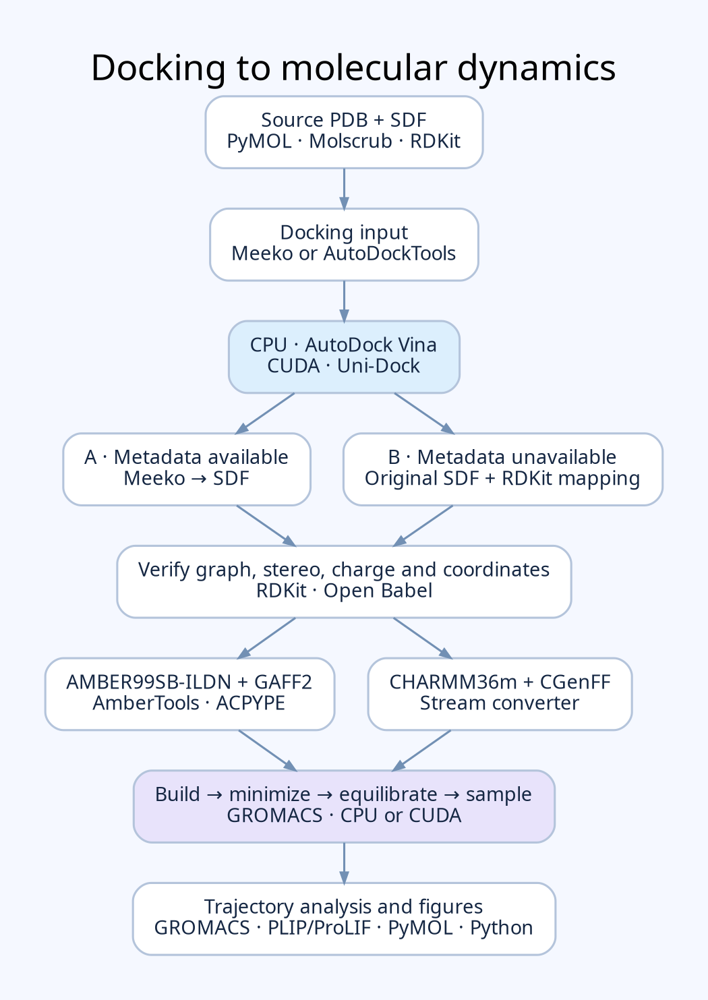
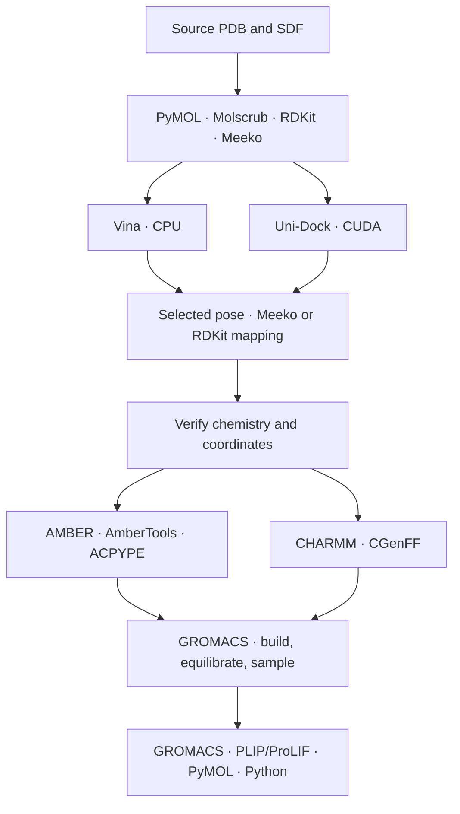

# Workflow and file map

**English** · [简体中文](WORKFLOW.zh-CN.md)

Languages synchronized 2026-11-28. [Verified workflow commit](https://github.com/LuciferBioLab/docking-gromacs-tutorial/commit/d139618900e79f0dc186d3bb64fbe5be4cc25914).

[Repository home](../README.md#contents)

## Workflow overview

The receptor structure and ligand microstate are prepared separately. Choose the docking engine, molecular dynamics force field, and compute backend independently. Use the co-crystal benchmark to verify the docking installation and protocol. [Reference redocking](ENVIRONMENT.md#benchmark)

*Figure 1. Docking engine, pose handoff, and MD force field are independent choices.*

[Diagnose the Chem3D and PyMOL conversion shortcut](TROUBLESHOOTING.md#chem3d-pymol-topology)

### Tools and file handoffs

| Step | Tools and roles | Files or checks |
| --- | --- | --- |
| [01–02 Setup and validation](ENVIRONMENT.md#setup) | Miniforge/Conda manages environments. Use Linux on servers and WSL2 or native Vina on Windows. NVIDIA drivers and CUDA support the GPU tools. | 1IEP co-crystal redocking, logs, and heavy-atom RMSD. |
| [03 Receptor preparation](DOCKING.md#docking) | Use RCSB PDB for source structures and open-source PyMOL to inspect chains, pockets, and the co-crystal ligand. Meeko prepares the docking receptor. AutoDockTools can assist with legacy inputs or GPF inspection. | Reviewed protein PDB, receptor PDBQT, box. |
| [03 Ligand preparation](DOCKING.md#docking) | PubChem or another documented source provides the SDF. Molscrub generates protonation states, tautomers, and 3D candidates. RDKit checks graph, stereochemistry, and net charge. Meeko writes mapped PDBQT. | Source and selected-state SDFs, ligand PDBQT. |
| [04 Docking and follow-up](DOCKING.md#docking) | AutoDock Vina uses CPU threads and Uni-Dock uses NVIDIA CUDA. Review poses and pocket contacts in a structure viewer. | Poses, logs, candidate IDs, box, and seeds. |
| [05 Pose recovery and QC](DOCKING.md#pose-handoff) | A exports SDF from Meeko mappings. B maps a legacy ADT pose onto the original SDF with RDKit. Both require chemistry and coordinate checks before Open Babel converts to MOL2. | Selected pose SDF, MOL2, atom mapping, and absolute coordinate check. |
| [06–07 Force fields and assembly](SYSTEM_SETUP.md#topology) | GROMACS `pdb2gmx` parameterizes the protein. For AMBER ligands, use AmberTools (`antechamber`, `sqm`, `parmchk2`, and `tleap`) and ACPYPE. The CHARMM ligand uses CGenFF and the Lemkul Lab converter. | AMBER99SB-ILDN + GAFF2/AM1-BCC or CHARMM36m + CGenFF, with matching coordinate and topology atom order. |
| [08–10 Setup and production](SYSTEM_SETUP.md#simulation) | GROMACS handles boxing, solvation, ions, EM, NVT, NPT, unrestrained tests, production, and restarts. | MDP, TPR, CPT, EDR, XTC, and logs. |
| [11–12 Analysis and figures](ANALYSIS.md#analysis) | GROMACS and MDAnalysis analyze trajectories. gmx_MMPBSA can estimate endpoint energies. Open-source PyMOL renders structures, pandas / Matplotlib / seaborn prepare plots, and Inkscape or optional GIMP / Photoshop assembles panels. | XVG, CSV, representative structures, structure PNGs, vector plots, and editable figures. |

## Printable run checklist

- [ ] Record source structure, ligand microstate, package lock and hashes.
- [ ] Save box geometry, backend, seed and docking output.
- [ ] Verify chemical graph, stereochemistry, charge and mapped heavy-atom coordinates.
- [ ] Match force-field family, water, ions and topology ordering.
- [ ] Save checkpoints, verify the production input and document equilibration.
- [ ] Validate trajectory and report analysis window, selections and replicates.

Run `make skeleton RUN=runs/study01` in the repository root to create a new directory structure. Use `make check STEP=05 RUN=runs/1iep-dock` to invoke the stage-specific check. [Batch schema](../examples/README.md) · [Slurm template](../config/tutorial.sbatch)
