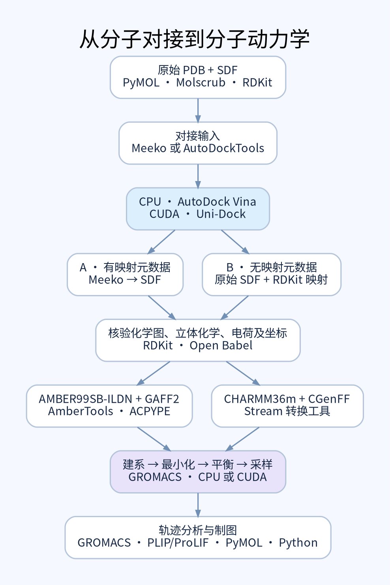
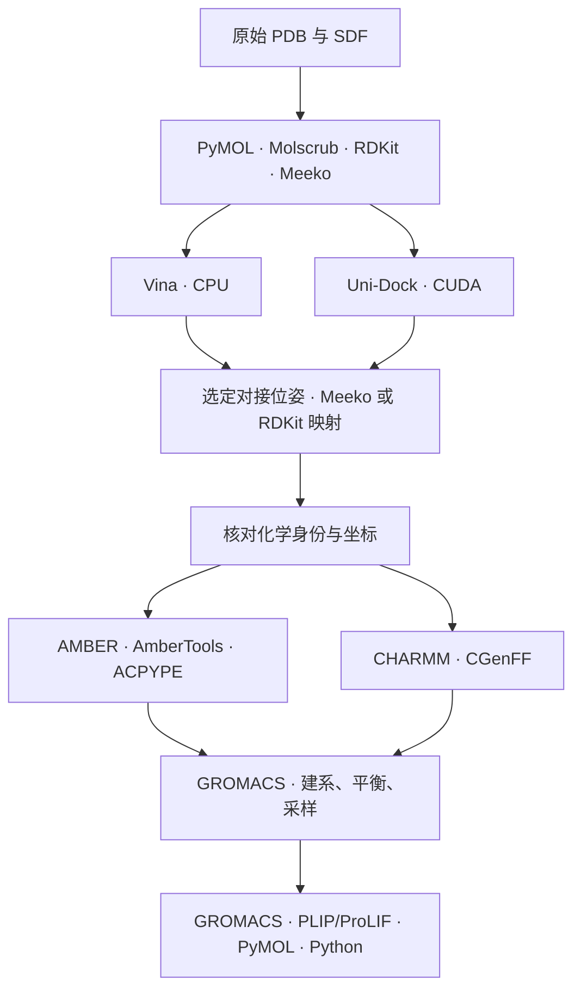

# 流程与文件地图

[English](WORKFLOW.md) · **简体中文**

中英文同步于 2026-11-28。[已验证的工作流提交](https://github.com/LuciferBioLab/docking-gromacs-tutorial/commit/d139618900e79f0dc186d3bb64fbe5be4cc25914)。

[仓库首页](../README.zh-CN.md#contents)

## 完整流程图

从两条输入开始。receptor（受体）按所选链和结构状态准备，配体按所选化学状态准备。对接引擎、MD force field（力场）和 GROMACS 设备可以独立选择。首次使用先做[共晶重对接验收](ENVIRONMENT.zh-CN.md#benchmark)。

*图 1. 对接引擎、docking pose（对接位姿）交接和 MD force field（力场）是独立决策。*

[查看两条路线的对比图](TROUBLESHOOTING.zh-CN.md#chem3d-pymol-topology)

### 工具与文件交接

| 步骤 | 工具与职责 | 关键文件或检查 |
| --- | --- | --- |
| [01–02 部署与验收](ENVIRONMENT.zh-CN.md#setup) | Miniforge/Conda 管理环境。Linux 为服务器方案，Windows 可用 WSL2 或原生 Vina。NVIDIA 驱动及 CUDA 支持 GPU 工具。 | 1IEP 共晶重对接、日志、heavy atom（重原子） RMSD。 |
| [03 receptor（受体）准备](DOCKING.zh-CN.md#docking) | RCSB PDB 提供源结构。开源 PyMOL 审查链、口袋和共晶配体。Meeko 制备对接 receptor（受体），AutoDockTools 可辅助处理旧项目或查看 GPF。 | 审核后的蛋白 PDB、receptor（受体） PDBQT、搜索盒。 |
| [03 配体准备](DOCKING.zh-CN.md#docking) | PubChem 等提供原始 SDF。Molscrub 生成质子化、互变异构和 3D 候选。RDKit 核对化学图、手性和净电荷，Meeko 输出带映射的 PDBQT。 | 原始 SDF、选定状态 SDF、配体 PDBQT。 |
| [04 对接与复筛](DOCKING.zh-CN.md#docking) | AutoDock Vina 用 CPU 多线程，Uni-Dock 用 NVIDIA CUDA。用结构查看器检查 docking pose（对接位姿）和口袋接触。 | docking pose（对接位姿）、日志、候选 ID、搜索盒和种子。 |
| [05 恢复与质检](DOCKING.zh-CN.md#pose-handoff) | A 用 Meeko 映射导出 SDF。B 用原始 SDF 和经审核的 atom mapping（原子映射），由 RDKit 恢复旧 ADT docking pose（对接位姿）。两条路线都通过化学与坐标检查，再用 Open Babel 转 MOL2。 | 入选 docking pose（对接位姿）的 SDF、MOL2、atom mapping（原子映射）及绝对坐标核对。 |
| [06–07 两套 force field（力场）与组装](SYSTEM_SETUP.zh-CN.md#topology) | 蛋白由 GROMACS `pdb2gmx` 参数化。AMBER 配体采用 AmberTools（`antechamber`、`sqm`、`parmchk2`、`tleap`）与 ACPYPE；CHARMM 配体采用 CGenFF 与 Lemkul Lab 转换器。 | AMBER99SB-ILDN + GAFF2/AM1-BCC 或 CHARMM36m + CGenFF，坐标和 topology（拓扑）原子顺序一致。 |
| [08–10 建系与生产](SYSTEM_SETUP.zh-CN.md#simulation) | GROMACS 完成建盒、加水加盐、EM、NVT、NPT、解除位置限制后试跑、生产和检查点续跑。 | MDP、TPR、CPT、EDR、XTC 与日志。 |
| [11–12 分析与出图](ANALYSIS.zh-CN.md#analysis) | GROMACS / MDAnalysis 处理轨迹，gmx_MMPBSA 可做端点能量估算。开源 PyMOL 出结构图，pandas / Matplotlib / seaborn 出曲线与统计图，Inkscape 或可选的 GIMP / Photoshop 组图。 | XVG、CSV、代表结构、结构图 PNG、矢量曲线图和可编辑图版。 |

## 可打印运行核查清单

- [ ] 记录结构来源、配体微观状态、环境锁文件与哈希。
- [ ] 保存盒几何、对接引擎、种子和输出。
- [ ] 核对化学图、立体化学、电荷与已映射的重原子坐标。
- [ ] 核对 force field（力场）家族、水、离子及 topology（拓扑）顺序。
- [ ] 保存检查点，校验生产输入并记录平衡。
- [ ] 核验轨迹，报告分析窗口、原子选择与重复。

在仓库根目录执行 `make skeleton RUN=runs/study01` 创建新的目录骨架；用 `make check STEP=05 RUN=runs/1iep-dock` 调用对应阶段核验。[批处理结构](../examples/README.md) · [Slurm 模板](../config/tutorial.sbatch)
